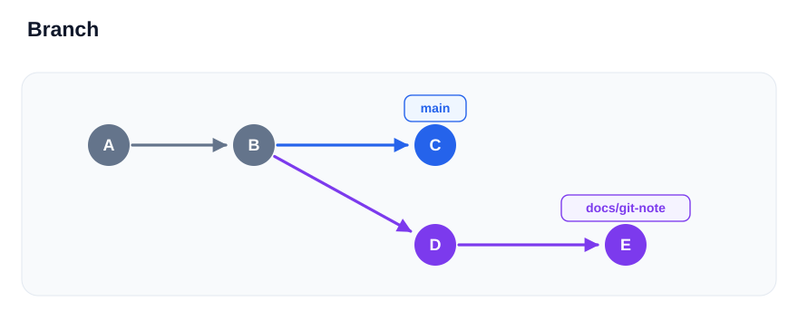

# Branch

특정 커밋을 가리키는 이름. 작업별 이력 분리.

## 브랜치 분기



- `B`에서 분기한 뒤 각 브랜치에 커밋을 추가한 예시
- `main`은 `C`, `docs/git-note`는 `E`를 참조
- 원은 커밋, 화살표는 과거에서 새 커밋으로 이어지는 흐름

## 브랜치 생성·전환

생성 기준은 현재 로컬 `main`. 미커밋 변경은 커밋 또는 stash로 정리.

```powershell
git switch main
git switch -c docs/git-note
```

- 현재 커밋에서 `docs/git-note` 시작
- 이 브랜치에서 커밋하면 `docs/git-note`의 위치만 이동
- `main`은 기존 커밋 유지
- 이름의 `/`는 구분용 문자. 실제 작업 폴더 생성 없음

| 명령 | 하는 일 |
| --- | --- |
| `git branch docs/git-note` | 브랜치 생성 |
| `git switch docs/git-note` | 기존 브랜치로 이동 |
| `git switch -c docs/git-note` | 생성하면서 이동 |

## 현재 브랜치 확인

```powershell
git branch
git log --oneline --decorate -3
```

- `*`가 붙은 이름: 현재 브랜치
- HEAD: 보통 현재 브랜치를 가리키는 참조
- `HEAD -> docs/git-note`: `docs/git-note`에서 작업 중

## 다른 브랜치로 이동

전환 전 파일 저장. 미커밋 변경은 커밋 또는 stash로 보관.

```powershell
git switch main
```

- 파일 내용도 해당 브랜치의 커밋에 맞게 변경
- 전환에 지장이 없는 미커밋 변경은 다른 브랜치로 따라갈 수 있음
- 전환 중 로컬 변경을 잃게 되는 경우 Git이 중단

## 끝난 브랜치 삭제

`main`에 병합을 마친 뒤 불필요한 로컬 브랜치 삭제.

```powershell
git switch main
git branch -d docs/git-note
```

- 현재 사용 중인 브랜치는 삭제 불가
- `-d`가 병합 여부 때문에 거부하면 남길 작업부터 확인
- 로컬 브랜치만 삭제. GitHub의 브랜치 삭제는 별도

참고: [Git branch](https://git-scm.com/docs/git-branch) · [Git switch](https://git-scm.com/docs/git-switch)

[목차로](../README.md)
