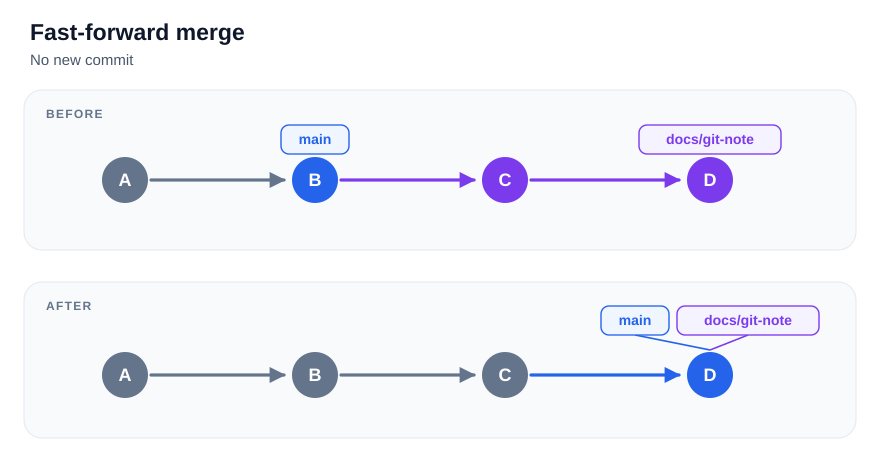

# Merge와 충돌

다른 브랜치의 작업 이력을 현재 브랜치에 병합.

## main에 작업 반영

전제: `docs/git-note`의 작업 커밋 완료, 미커밋 변경 없음.

```powershell
git switch main
git status
git merge docs/git-note
```

병합 결과는 `main`에 반영. `docs/git-note`의 커밋 위치는 유지.

| 병합 전 이력 | 기본 병합 결과 |
| --- | --- |
| `main`이 `docs/git-note`의 이전 커밋을 가리킴 | Fast-forward. `main`의 위치만 이동 |
| 두 브랜치가 갈라진 뒤 각각 커밋 추가 | 두 이력을 잇는 Merge 커밋 생성 |

- 양쪽에 커밋이 있어도 자동 병합 가능
- 같은 부분을 다르게 수정하는 등 자동 병합이 어려우면 충돌 발생

### Fast-forward



`main`을 `B`에서 `D`로 이동. 새 커밋 생성 없음

### Merge 커밋


- 두 이력을 잇는 `M` 생성. 부모 커밋은 `C`, `E`
- `main`은 `M`, `docs/git-note`는 `E`를 참조

## 충돌한 파일 수정

`main`에서 `docs/git-note` 병합 중 `topics/git-github/README.md`의 같은 줄 충돌.

```text
<<<<<<< HEAD
다음 공부: Git
=======
다음 공부: GitHub
>>>>>>> docs/git-note
```

- 위쪽: 현재 `main`의 내용
- 아래쪽: 합치려는 `docs/git-note`의 내용
- 필요한 내용 선택·수정
- `<<<<<<<`, `=======`, `>>>>>>>` 표시 제거 후 저장

모든 충돌 파일 수정·저장 → `git add`로 해결 표시 → `git commit`으로 병합 완료.

```powershell
git add topics/git-github/README.md
git commit -m "Git 학습 순서 충돌 정리"
git status
```

최종 파일이 기존 `main`과 같아져도 병합 커밋이 필요할 수 있음.

## 병합 취소

```powershell
git merge --abort
```

병합 시작 전 상태로 복구. 시작 전 미커밋 변경이 있으면 불완전한 복구 가능.

참고: [Git merge](https://git-scm.com/docs/git-merge)

[목차로](../README.md)
