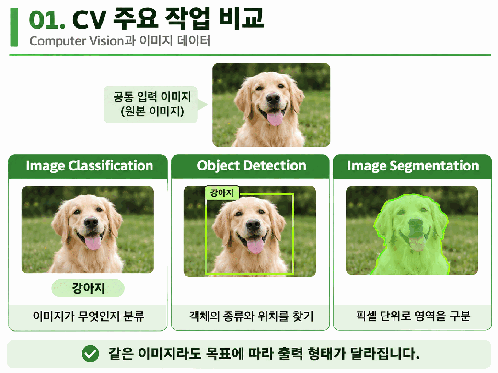
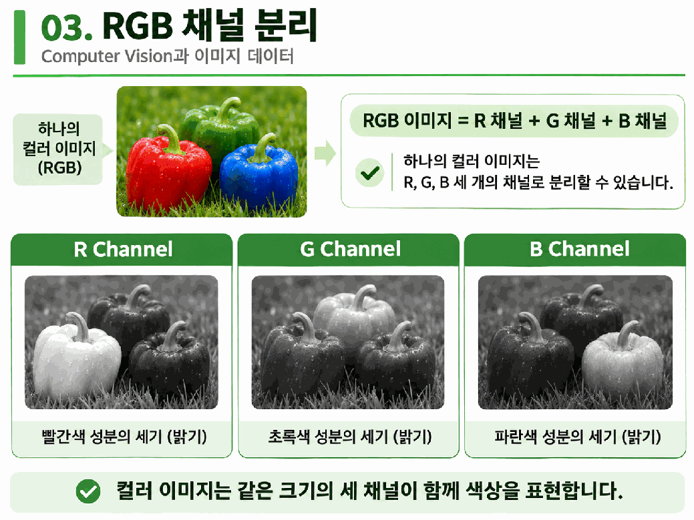
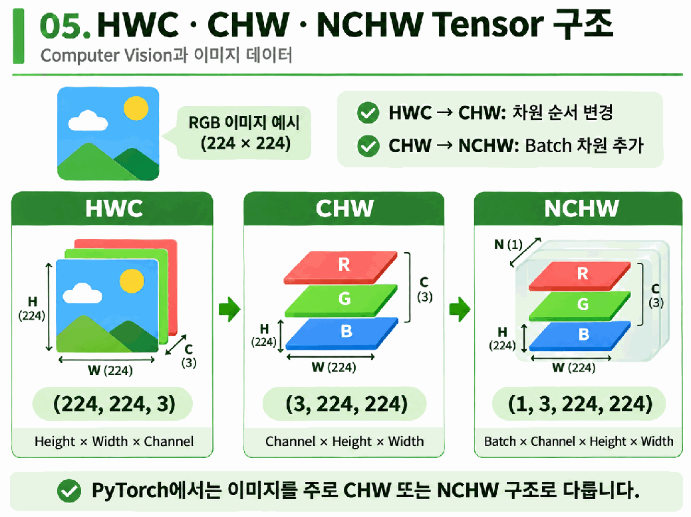
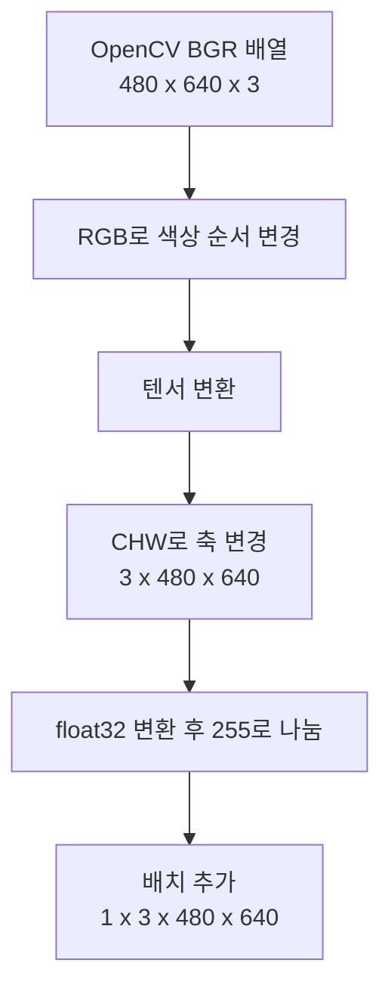

# Day 1. 컴퓨터 비전과 이미지 데이터

> 이미지는 픽셀의 색상과 밝기를 숫자로 저장한 데이터다. 이미지가 PyTorch 모델에 들어가기까지 채널, 자료형, 값 범위와 차원 순서가 어떻게 준비되는지 살펴본다.

## 1. 컴퓨터 비전의 작업

<strong>컴퓨터 비전(Computer Vision)</strong>은 이미지나 영상에서 시각 정보를 추출하고 분석하는 분야다. 같은 사진이라도 해결할 문제에 따라 필요한 출력이 다르다.

> 2쪽: 분류는 이미지의 종류를, 탐지는 물체의 종류와 위치를, 분할은 픽셀별 영역을 출력한다.

이미지 분류(Image Classification)는 사진이 강아지임을 알려주고, 객체 탐지(Object Detection)는 강아지의 위치를 경계 상자로 표시한다. 이미지 분할(Image Segmentation)은 강아지가 차지하는 픽셀 영역을 구분한다. 컴퓨터는 파일을 읽어 픽셀값을 배열로 표현한 뒤 필요한 계산을 수행한다.

## 2. 픽셀과 채널

<strong>픽셀(Pixel)</strong>은 이미지를 구성하는 공간 단위다. 너비(Width)는 가로 픽셀 수, 높이(Height)는 세로 픽셀 수다. 너비 4, 높이 3인 이미지에는 12개 픽셀이 있다.

<strong>채널(Channel)</strong>은 각 픽셀에서 같은 종류의 값을 모은 배열이다. RGB 이미지는 빨강(Red), 초록(Green), 파랑(Blue) 성분을 각각 한 채널로 저장한다. 8비트 RGB 이미지에서 빨강은 `(255, 0, 0)`, 노랑은 `(255, 255, 0)`이다.

> 8쪽: 같은 픽셀 위치라도 색상 성분에 따라 채널값이 다르다. 채널별 흑백 그림의 밝기는 그 성분의 크기를 나타낸다.

채널 하나를 흑백으로 표시하면 해당 성분이 강한 위치가 밝게 보인다. 예를 들어 빨간 픽셀은 R 채널에서 흰색이고 G와 B 채널에서는 검정이다. 이 흑백 표시는 원래 색이 아니라 채널 값의 크기를 보여준다.

<strong>그레이스케일(Grayscale)</strong>은 픽셀마다 밝기값 하나를 사용한다. 일반적인 8비트 표현에서 0은 검정, 255는 흰색이다. RGB의 세 성분에 가중치를 적용해 밝기를 계산하므로 R 값만 추출한 R 채널과 다르다.

$$
Y \approx 0.299R + 0.587G + 0.114B
$$

R, G, B는 해당 픽셀의 색상 성분이고 Y는 밝기값이다. 빨간색 `(255, 0, 0)`을 대입하면 `0.299×255=76.245`이므로 밝기는 약 76이다. 공간 크기는 유지되지만 색상 정보는 하나의 밝기 채널로 바뀐다.

## 3. 자료형과 값 범위

<strong>자료형(Data Type)</strong>은 숫자를 저장하고 계산하는 방식이다. 일반적인 8비트 이미지의 `uint8`은 0부터 255까지의 정수를 저장한다. `float32`는 소수와 음수를 표현할 수 있어 신경망 연산에 자주 사용된다.

| 변환 단계 | 자료형 | 픽셀값 예시 |
| --- | --- | --- |
| 원본 | uint8 | 0, 128, 255 |
| 실수로 변환 | float32 | 0.0, 128.0, 255.0 |
| 255로 나누기 | float32 | 0.0, 약 0.502, 1.0 |

**자료형 변환과 값의 범위 조정은 별개다.** 128을 실수로 바꿔도 128.0이지만, 255로 나누면 약 0.502가 된다. 모델마다 요구하는 정규화 방식이 다르므로 사전학습 모델의 입력 조건을 확인한다.

<strong>오버플로(Overflow)</strong>는 계산 결과가 자료형의 표현 범위를 넘는 현상이다. NumPy의 `uint8` 배열끼리 250과 10을 더하면 260이 256을 기준으로 순환해 4가 된다. 실수로 변환한 뒤 더하면 260.0을 표현할 수 있다.

## 4. 텐서와 배치

<strong>텐서(Tensor)</strong>는 다차원 숫자 데이터다. PyTorch는 텐서를 사용해 모델의 가중치와 입력을 계산하며, 자동 미분과 지원되는 GPU 연산을 활용한다. 텐서로 변환하는 것만으로 색상 순서나 값 범위가 자동으로 맞춰지는 것은 아니다.

H는 높이(Height), W는 너비(Width), C는 채널(Channel) 수다. <strong>배치(Batch)</strong>는 한 번에 처리하는 이미지 묶음이며, N은 그 이미지 수를 뜻한다.

> 21쪽: HWC에서 CHW로 바꿀 때 픽셀값은 그대로 두고 축의 순서를 바꾼다. NCHW에서는 앞에 이미지 수를 나타내는 축이 추가된다.

HWC는 높이, 너비, 채널 순서이고 CHW는 채널을 앞에 둔다. NCHW는 CHW 앞에 배치 축을 추가한다. `(8, 1, 64, 64)`는 높이와 너비가 64인 1채널 이미지 8장이다.

## 5. 라이브러리와 모델 입력

| 라이브러리 | 이미지 표현 | 확인할 점 |
| --- | --- | --- |
| Pillow | 이미지 객체 | 크기를 `(너비, 높이)`로 표시 |
| OpenCV | 일반적으로 NumPy 배열 | 컬러 이미지를 기본적으로 BGR 순서로 읽음 |
| PyTorch | 텐서 | 일반적인 CNN 배치 입력은 NCHW |

너비 640, 높이 480의 컬러 이미지는 Pillow에서 `(640, 480)`, OpenCV 배열에서 `(480, 640, 3)`으로 표시된다. RGB와 BGR은 채널 수가 같아도 순서가 다르다. 빨강은 RGB에서 `(255, 0, 0)`, BGR에서 `(0, 0, 255)`다.

HWC에서 CHW로 바꾸는 일과 BGR에서 RGB로 바꾸는 일은 다르다. TorchVision의 ToTensor는 일반적인 8비트 RGB PIL 이미지를 CHW의 실수 텐서와 0에서 1 사이의 값으로 바꾸지만 배치 축이나 모델별 크기 및 정규화까지 추가하지는 않는다.

모델 입력 전에는 **높이와 너비, 채널 수와 색상 순서, 텐서 형태, 자료형, 값 범위와 장치**를 확인한다. 채널 수가 다르면 오류가 날 수 있지만, RGB와 BGR은 형태가 같아 실행되어도 예측이 달라질 수 있다.

## 핵심 개념 비교표

| 구분 | 차이 |
| --- | --- |
| 픽셀과 채널 | 공간 위치의 단위와 같은 성분을 모은 배열 |
| R 채널과 그레이스케일 | R 성분 추출과 RGB 가중합으로 계산한 밝기 |
| 자료형과 값 범위 | 숫자의 저장 방식과 숫자의 크기 |
| CHW와 NCHW | 한 장의 구조와 배치 축을 추가한 구조 |
| 축 순서와 색상 순서 | H, W, C의 배치와 R, G, B 성분의 배치 |

## 최종 정리

- 분류, 탐지, 분할은 같은 이미지에서 서로 다른 결과를 얻는 작업이다.
- RGB는 세 색상 성분으로, 그레이스케일은 밝기값 하나로 픽셀을 표현한다.
- `uint8`에서 `float32`로 바꾸는 것과 255로 나누어 범위를 조정하는 것은 별개다.
- 텐서의 각 축을 읽으면 이미지 수, 채널 수, 높이와 너비를 구분할 수 있다.
- RGB와 BGR처럼 형태가 같아도 의미가 다른 입력은 모델 결과에 영향을 줄 수 있다.
- 모델이 요구하는 크기, 채널, 자료형, 값 범위와 장치를 함께 확인한다.
