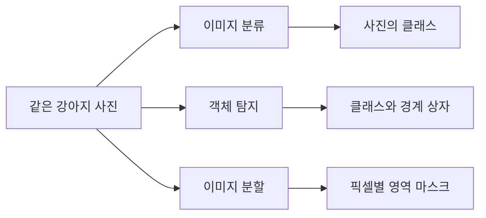
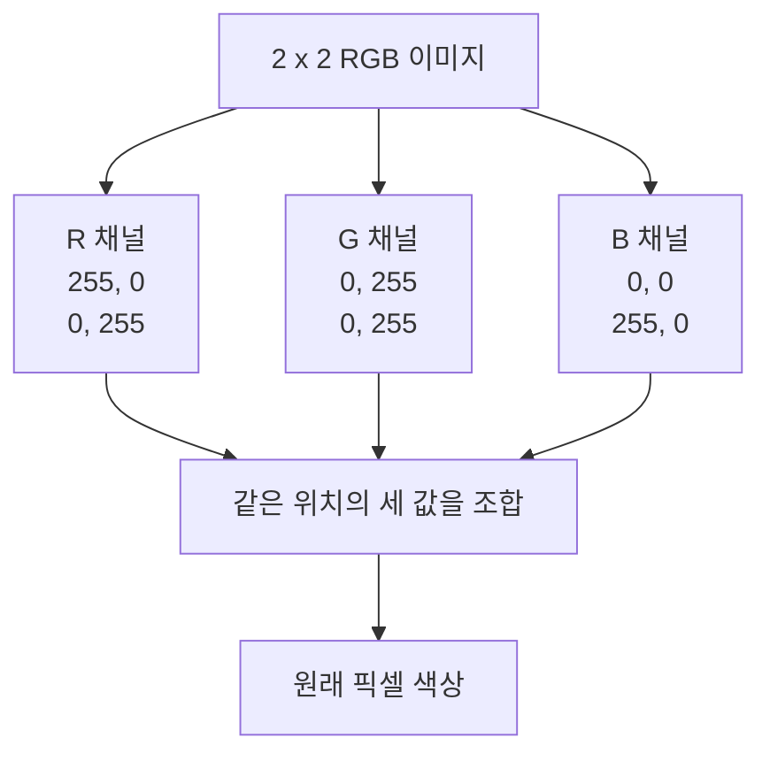
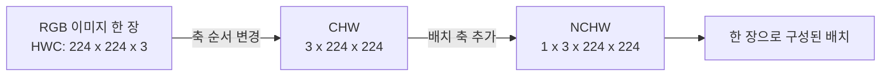
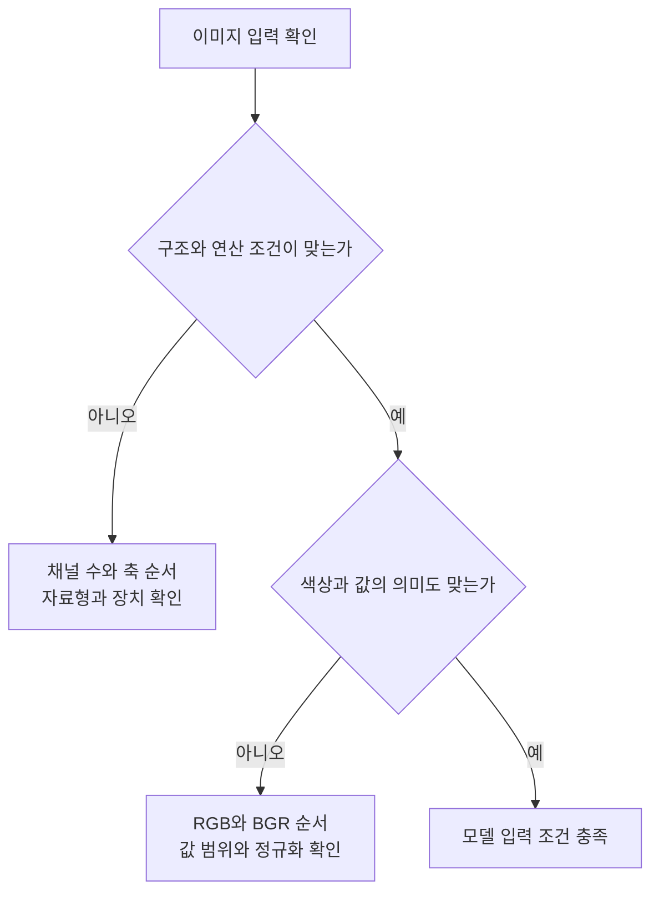
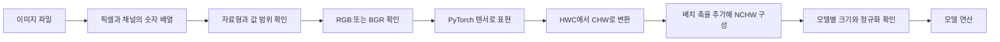

# Day 1. 컴퓨터 비전과 이미지 데이터

> 이미지는 위치별 색상과 밝기를 숫자로 저장한 데이터다. 픽셀과 채널부터 자료형, 텐서의 차원 구조, 모델 입력 조건까지 연결해 이해한다.

## 1. 컴퓨터 비전이 다루는 문제 (원본 1~3쪽)

<strong>컴퓨터 비전(Computer Vision, CV)</strong>은 이미지나 영상에서 필요한 시각 정보를 추출하고 분석하는 분야다. 사람은 강아지 사진을 하나의 장면으로 이해하지만, 컴퓨터는 먼저 이미지에 저장된 숫자를 읽고 계산해야 한다. 계산의 목적에 따라 최종 결과의 형태도 달라진다.

| 작업 | 해결하려는 문제 | 예측 결과 |
| --- | --- | --- |
| 이미지 분류(Image Classification) | 사진이 무엇을 나타내는가 | 강아지처럼 이미지의 클래스 |
| 객체 탐지(Object Detection) | 어떤 객체가 어디에 있는가 | 객체의 클래스와 위치를 감싸는 경계 상자(Bounding Box) |
| 이미지 분할(Image Segmentation) | 각 픽셀이 어떤 영역에 속하는가 | 픽셀별 영역을 나타내는 마스크(Mask) |

분류 결과만으로는 강아지가 사진의 어느 위치에 있는지 알 수 없다. 탐지는 위치까지 알려주지만 상자 안의 모든 픽셀이 강아지라는 뜻은 아니다. 분할은 픽셀 단위로 영역을 구분한다. **같은 입력 이미지를 사용해도 문제에 따라 필요한 출력이 다르다.**

이미지 파일을 읽는 것은 이 분석을 위한 첫 단계다. JPG나 PNG 파일에서 픽셀값을 읽고 배열로 표현한 뒤 필요한 전처리와 모델 연산을 수행한다. 파일이 존재한다는 사실과 모델이 요구하는 입력이 준비되었다는 사실은 구분해야 한다.

## 2. 픽셀과 색상 채널 (원본 3~11쪽)

### 2.1 픽셀, 높이, 너비

<strong>픽셀(Pixel)</strong>은 디지털 이미지를 구성하는 작은 공간 단위다. 픽셀이 가로와 세로로 배열되며 각 위치에는 색상이나 밝기를 나타내는 숫자가 저장된다. 이미지의 <strong>너비(Width, W)</strong>는 가로 픽셀 수, <strong>높이(Height, H)</strong>는 세로 픽셀 수다.

원본 4쪽의 작은 그레이스케일 이미지는 다음과 같다. 표의 행은 세로 위치를, 열은 가로 위치를 구분한다.

| 세로 위치 | 1열 | 2열 | 3열 | 4열 |
| --- | ---: | ---: | ---: | ---: |
| 1행 | 0 | 45 | 100 | 180 |
| 2행 | 15 | 80 | 150 | 230 |
| 3행 | 30 | 120 | 200 | 255 |

높이 3, 너비 4이므로 픽셀 수는 3×4=12개다. 일반적인 8비트 밝기 표현에서는 0이 검정, 255가 흰색이며 그 사이는 회색이다. 첫 행의 첫 픽셀은 검정이고 마지막 행의 마지막 픽셀은 흰색이다. **이미지 처리의 계산 대상은 이러한 위치별 숫자다.**

### 2.2 RGB와 채널의 의미

<strong>RGB 색상 모델(RGB Color Model)</strong>은 빨강(Red), 초록(Green), 파랑(Blue)의 세 성분을 조합한다. 일반적인 8비트 RGB 이미지에서는 픽셀 하나에 성분별 값 세 개가 있다.

| RGB 값 | 색상 | 값의 해석 |
| --- | --- | --- |
| (255, 0, 0) | 빨강 | R 성분만 최대 |
| (0, 255, 0) | 초록 | G 성분만 최대 |
| (0, 0, 255) | 파랑 | B 성분만 최대 |
| (255, 255, 0) | 노랑 | R과 G 성분이 최대 |
| (0, 0, 0) | 검정 | 세 성분이 모두 0 |
| (255, 255, 255) | 흰색 | 세 성분이 모두 최대 |

<strong>채널(Channel)</strong>은 모든 픽셀에서 같은 성분의 값만 모아 원래 공간 위치에 배열한 것이다. RGB 이미지에는 R, G, B 채널이 각각 하나씩 있다. 픽셀 수와 채널 수는 다른 개념이다. 2×2 RGB 이미지에는 공간상 픽셀 4개가 있고, 픽셀마다 값이 세 개이므로 총 12개 성분값이 있다.

원본 6~7쪽은 빨강, 초록, 파랑, 노랑으로 구성된 2×2 이미지를 채널별로 나누어 보여준다.

| 위치 | 원래 색상 | R 채널 | G 채널 | B 채널 |
| --- | --- | ---: | ---: | ---: |
| 왼쪽 위 | 빨강 | 255 | 0 | 0 |
| 오른쪽 위 | 초록 | 0 | 255 | 0 |
| 왼쪽 아래 | 파랑 | 0 | 0 | 255 |
| 오른쪽 아래 | 노랑 | 255 | 255 | 0 |

채널 하나를 흑백 이미지로 표시하면 그 성분이 강한 위치가 밝게 보인다. 빨간 픽셀은 R 채널에서 흰색, G와 B 채널에서는 검정으로 표시된다. 흰색으로 보인다는 것은 해당 채널 값이 크다는 뜻이며, 원래 픽셀이 흰색이었다는 의미는 아니다.

### 2.3 그레이스케일과 개별 채널의 차이

<strong>그레이스케일(Grayscale)</strong>은 픽셀의 밝기를 숫자 하나로 표현한다. RGB의 세 값으로 표현하던 색상 정보를 하나의 밝기로 바꾸므로 채널 수는 3개에서 1개가 된다. 높이와 너비는 그대로 유지된다.

대표적인 변환식은 다음과 같다.

$$
Y \approx 0.299R + 0.587G + 0.114B
$$

R, G, B는 해당 픽셀의 색상 성분이고 Y는 변환한 밝기값이다. 사람은 세 색상을 같은 밝기로 느끼지 않으므로 서로 다른 가중치를 사용한다. 이 식은 초록 성분에 가장 큰 비중을 둔다.

| 색상 | 대입한 계산 | 8비트 밝기값의 예 |
| --- | --- | ---: |
| 빨강 | 0.299×255 | 약 76 |
| 초록 | 0.587×255 | 약 150 |
| 파랑 | 0.114×255 | 약 29 |
| 노랑 | 0.299×255+0.587×255 | 약 226 |

빨강의 경우 0.299×255=76.245다. 이를 정수로 표현하면 약 76이 된다. **R 채널 추출은 R 값만 가져오고, 그레이스케일 변환은 세 성분을 함께 계산한다.** 두 결과를 모두 흑백으로 표시할 수 있지만 숫자가 만들어지는 원리는 다르다.

## 3. 자료형과 값의 범위 (원본 11~17쪽)

### 3.1 저장과 계산에 사용하는 자료형

<strong>자료형(Data Type)</strong>은 숫자를 어떤 방식으로 저장하고 계산할지 정한다. 이미지의 모양이 같아도 자료형이 다르면 표현할 수 있는 값과 연산 결과가 달라질 수 있다.

| 자료형 | 의미 | 이미지에서의 용도 |
| --- | --- | --- |
| uint8 | 부호 없는 8비트 정수, 0~255 | 일반적인 8비트 이미지 데이터 |
| float32 | 32비트 실수 | 소수와 음수가 필요한 이미지 연산과 신경망 계산 |

8비트는 256가지 값을 표현하므로 uint8은 0부터 255까지 저장한다. 숫자 하나에 1바이트를 사용한다. 반면 신경망은 픽셀에 가중치를 곱하고 손실의 변화량을 계산하므로 실수 자료형이 필요하다. float32는 0.5나 음수, 255보다 큰 값도 표현할 수 있다.

### 3.2 오버플로의 계산 예

<strong>오버플로(Overflow)</strong>는 계산 결과가 자료형이 표현할 수 있는 범위를 넘어서는 현상이다. 원본은 NumPy의 uint8 배열끼리 더하는 예를 사용한다.

| 단계 | uint8 배열 덧셈 | float32 변환 후 덧셈 |
| --- | --- | --- |
| 입력 | 250과 10 | 250.0과 10.0 |
| 수학적 합 | 260 | 260.0 |
| 표현 범위 처리 | 256을 기준으로 순환 | 260.0 표현 가능 |
| 결과 | 260-256=4 | 260.0 |

이 예에서 4는 실제 밝기 합을 나타내는 값이 아니다. 저장 범위를 넘었기 때문에 생긴 결과다. 밝기를 더하거나 픽셀 사이의 차이를 계산할 때 원래 영상이 uint8이라는 이유로 모든 연산을 그대로 수행하면 의도와 다른 값이 나올 수 있다. 이 동작은 원본의 NumPy 배열 연산 예에 해당한다.

### 3.3 실수 변환과 정규화

<strong>정규화(Normalization)</strong>는 여기서는 픽셀값의 수치 범위를 조정하는 작업을 뜻한다. 일반적인 8비트 값은 255로 나누면 0부터 1 사이가 된다.

$$
x_{\mathrm{scaled}}=\frac{x}{255}
$$

x는 원래 픽셀값이고, 결과는 범위를 조정한 픽셀값이다. 128을 대입하면 128÷255≈0.502다. 0은 0, 255는 1이 되며 중간값도 같은 비율로 바뀐다.

| 단계 | 자료형 | 값 | 바뀐 내용 |
| --- | --- | --- | --- |
| 원본 | uint8 | 0, 128, 255 | 8비트 정수 저장 |
| 실수로 변환 | float32 | 0.0, 128.0, 255.0 | 표현 자료형 |
| 255로 나눔 | float32 | 0.0, 약 0.502, 1.0 | 숫자의 범위 |

실수로 변환하는 것만으로 값이 0~1이 되지는 않는다. 범위를 조정해도 픽셀 사이의 상대적인 밝기 관계는 유지된다. 입력의 수치 크기를 관리하면 학습이 안정적으로 진행되는 데 도움이 될 수 있다. 다만 **모든 모델이 같은 정규화를 사용하는 것은 아니다.** 사전학습 모델(Pretrained Model)을 사용할 때는 그 모델의 입력 조건을 확인해야 한다.

## 4. 텐서와 이미지의 차원 (원본 17~22쪽)

### 4.1 텐서가 필요한 이유

<strong>텐서(Tensor)</strong>는 다차원 숫자 자료구조다. NumPy 배열로도 이미지 계산은 가능하지만 PyTorch 신경망은 PyTorch 텐서를 입력받아 가중치와 함께 연산한다. 텐서는 모델 학습에 필요한 <strong>자동 미분(Automatic Differentiation)</strong>과 지원되는 <strong>그래픽 처리 장치(Graphics Processing Unit, GPU)</strong>의 연산을 활용할 수 있다.

자동 미분은 손실에 대한 모델 가중치의 기울기를 계산하는 기능이다. 학습에서는 예측을 계산하고 정답과 비교한 뒤 이 기울기를 사용해 가중치를 갱신한다. 텐서 변환은 이미지를 이러한 연산 체계에 맞추는 과정이다. 텐서로 바뀌었다는 이유만으로 화질이 좋아지거나 모델 입력 조건이 모두 맞춰지는 것은 아니다.

### 4.2 HWC와 CHW

<strong>형태(Shape)</strong>는 각 차원의 크기를 나타낸다. H는 높이(Height), W는 너비(Width), C는 채널(Channel) 수다. 같은 RGB 이미지도 축을 어떤 순서로 배치하는지에 따라 형태가 다르게 표시된다.

| 구조 | 차원 순서 | 224×224 RGB 이미지 |
| --- | --- | --- |
| HWC | 높이, 너비, 채널 | (224, 224, 3) |
| CHW | 채널, 높이, 너비 | (3, 224, 224) |

HWC는 일반적인 컬러 이미지 NumPy 배열에서 자주 사용하고 CHW는 PyTorch의 합성곱 신경망(Convolutional Neural Network, CNN) 이미지 입력에서 주로 사용한다. CHW의 첫 숫자 3은 사진 세 장을 뜻하지 않는다. 한 사진 안의 채널이 세 개라는 의미다.

높이와 너비가 서로 다른 `(3, 128, 256)`은 3채널, 높이 128, 너비 256인 한 장의 이미지다. 정사각형 예제에서는 H와 W를 뒤집어도 숫자가 같으므로 각 축의 의미를 따로 기억해야 한다.

### 4.3 배치와 NCHW

<strong>배치(Batch)</strong>는 한 번에 처리할 여러 이미지를 묶은 것이다. NCHW는 CHW 앞에 배치 안의 이미지 수 N을 추가한다. 한 장만 처리할 때도 N=1인 배치로 표현할 수 있다.

| 형태 | 이미지 수 | 채널 수 | 높이와 너비 |
| --- | ---: | ---: | --- |
| (1, 3, 224, 224) | 1 | 3 | 224×224 |
| (8, 3, 224, 224) | 8 | 3 | 224×224 |
| (32, 3, 224, 224) | 32 | 3 | 224×224 |
| (8, 1, 64, 64) | 8 | 1 | 64×64 |

이 과정은 데이터를 어느 축에 놓을지 바꾸는 것이다. 축 순서를 바꾸는 것, 자료형을 바꾸는 것, 숫자를 255로 나누는 것은 서로 다른 작업이다. 하나의 변환이 무엇을 바꾸는지 구분해야 결과를 정확히 해석할 수 있다.

## 5. 라이브러리 사이의 변환과 모델 입력 (원본 22~28쪽)

### 5.1 크기 표시와 색상 순서

<strong>Pillow(PIL)</strong>는 이미지 읽기와 저장, 기본 변환에 사용하고, **OpenCV**는 이미지 처리와 색상 변환 등에 사용한다. **PyTorch**는 텐서 연산과 신경망 실행에 사용한다.

| 도구 | 데이터 표현 | 너비 640, 높이 480인 컬러 이미지 |
| --- | --- | --- |
| Pillow | 이미지 객체 | 크기(size): (640, 480) |
| OpenCV | 일반적으로 NumPy 배열 | 형태(shape): (480, 640, 3) |
| PyTorch | 텐서 | CNN용 CHW: (3, 480, 640) |

Pillow의 size는 너비부터, 배열의 shape는 높이부터 확인하는 경우가 많다. 같은 파일을 읽어도 숫자가 나타나는 순서는 다를 수 있다.

**BGR**은 파랑(Blue), 초록(Green), 빨강(Red)의 순서다. OpenCV의 일반적인 컬러 이미지 읽기는 BGR을 사용한다. Pillow에서 RGB로 변환한 이미지는 RGB다. 같은 빨간색도 RGB에서는 `(255, 0, 0)`, BGR에서는 `(0, 0, 255)`로 저장된다.

BGR 배열을 RGB로 해석하는 Matplotlib 같은 시각화 도구에 그대로 전달하면 빨강과 파랑이 뒤바뀌어 보일 수 있다. RGB를 기대하는 모델에도 같은 종류의 입력 의미 불일치가 생긴다. 채널 수가 모두 3이라 형태만 확인해서는 발견하기 어렵다.

### 5.2 변환 단계별로 바뀌는 것

원본 25~26쪽의 변환은 색상, 자료구조, 축 순서, 자료형, 값 범위, 배치를 차례로 맞춘다. 너비 640, 높이 480인 이미지를 기준으로 정리하면 다음과 같다.

| 단계 | 형태 | 자료형과 값 | 의미 |
| --- | --- | --- | --- |
| OpenCV로 읽기 | (480, 640, 3) | uint8, 0~255 | BGR 배열 |
| BGR을 RGB로 변경 | (480, 640, 3) | uint8, 0~255 | 색상 순서 조정 |
| 텐서 변환 | (480, 640, 3) | uint8, 0~255 | PyTorch 자료구조 |
| HWC를 CHW로 변경 | (3, 480, 640) | uint8, 0~255 | 축 순서 조정 |
| 실수 변환 후 255로 나눔 | (3, 480, 640) | float32, 0~1 | 수치 표현 조정 |
| 배치 축 추가 | (1, 3, 480, 640) | float32, 0~1 | 한 장의 배치 |

TorchVision의 ToTensor 변환은 일반적인 8비트 RGB PIL 이미지를 CHW 실수 텐서로 만들고 0~1로 조정하는 작업을 묶어 처리한다. 배치 축은 추가하지 않으며, 모델별 입력 크기 조정이나 평균과 표준편차 정규화까지 모두 자동으로 수행하는 것도 아니다.

### 5.3 실행 오류와 의미 오류

모델이 요구하는 채널 수와 입력 채널 수가 다르면 연산 오류가 발생할 수 있다. 자료형이나 계산 장치도 모델의 조건과 맞아야 한다. 한편 RGB와 BGR처럼 형태는 맞지만 내용의 의미가 다른 입력은 실행되어도 예측에 영향을 준다.

크기를 맞추는 것만으로는 충분하지 않다. 높이와 너비, 채널 수, 색상 순서, 배치 구성, 자료형, 값 범위를 하나의 입력 조건으로 확인해야 한다. 전처리를 수행했다는 사실보다 **전처리 결과가 해당 모델의 조건에 맞는지**가 판단 기준이다.

## 6. 핵심 개념 비교표 (원본 28~29쪽)

| 혼동하기 쉬운 개념 | 첫 번째 개념 | 두 번째 개념 |
| --- | --- | --- |
| 픽셀과 채널 | 픽셀은 이미지의 공간 위치 단위 | 채널은 같은 성분값을 모은 배열 |
| R 채널과 그레이스케일 | R 성분만 추출 | RGB의 가중합으로 밝기 계산 |
| 자료형 변환과 범위 조정 | 숫자를 저장하는 방식 변경 | 나눗셈 등으로 값의 크기 변경 |
| HWC와 CHW | 채널 축이 마지막 | 채널 축이 첫 번째 |
| CHW와 NCHW | 이미지 한 장의 구조 | 맨 앞에 이미지 수를 추가한 구조 |
| 축 순서와 색상 순서 | H, W, C의 배치를 변경 | R, G, B 성분의 순서를 변경 |

## 7. 전체 학습 흐름 (원본 28~29쪽)

## 8. 핵심 정리 (원본 28~29쪽)

- 이미지의 의미를 분석하려면 먼저 픽셀과 채널로 구성된 숫자 데이터를 읽어야 한다. 분류, 탐지, 분할은 그 숫자에서 얻으려는 출력이 서로 다르다.
- RGB의 개별 채널은 색상 성분의 강도를 나타낸다. 그레이스케일은 세 성분을 하나의 밝기값으로 계산한 결과다.
- uint8 저장값을 float32로 바꾸어도 숫자 크기는 유지된다. 0~1 변환에는 별도의 범위 조정이 필요하다.
- 텐서는 모델 연산을 위한 자료구조이며 형태, 자료형, 값 범위까지 자동으로 맞춰주는 것은 아니다.
- HWC와 CHW는 축 순서가 다르고, NCHW는 이미지 수를 나타내는 배치 축을 포함한다.
- RGB와 BGR의 차이는 형태만으로 드러나지 않는다. 실행 성공과 올바른 입력 준비는 별도로 확인해야 한다.
