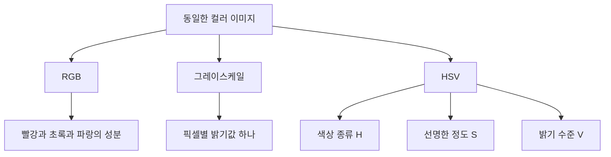
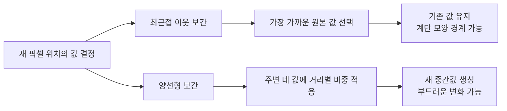
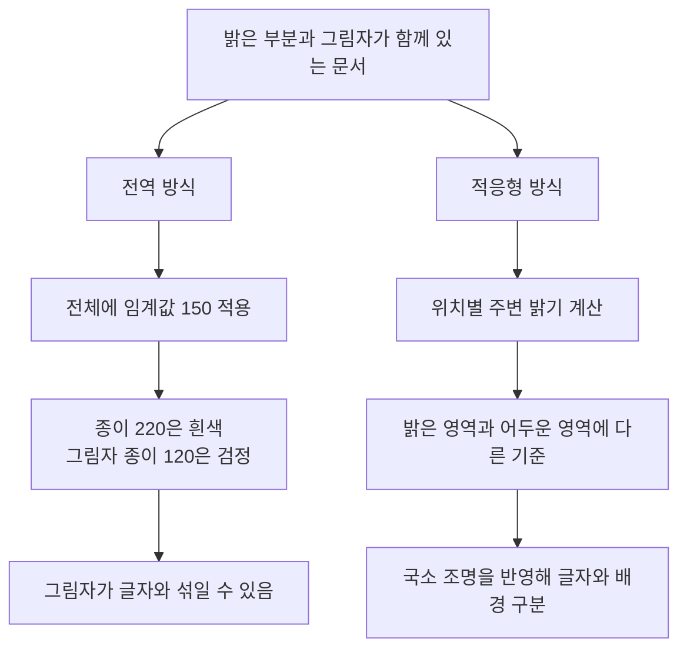
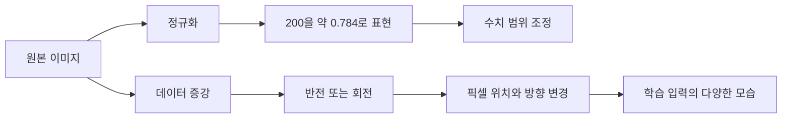
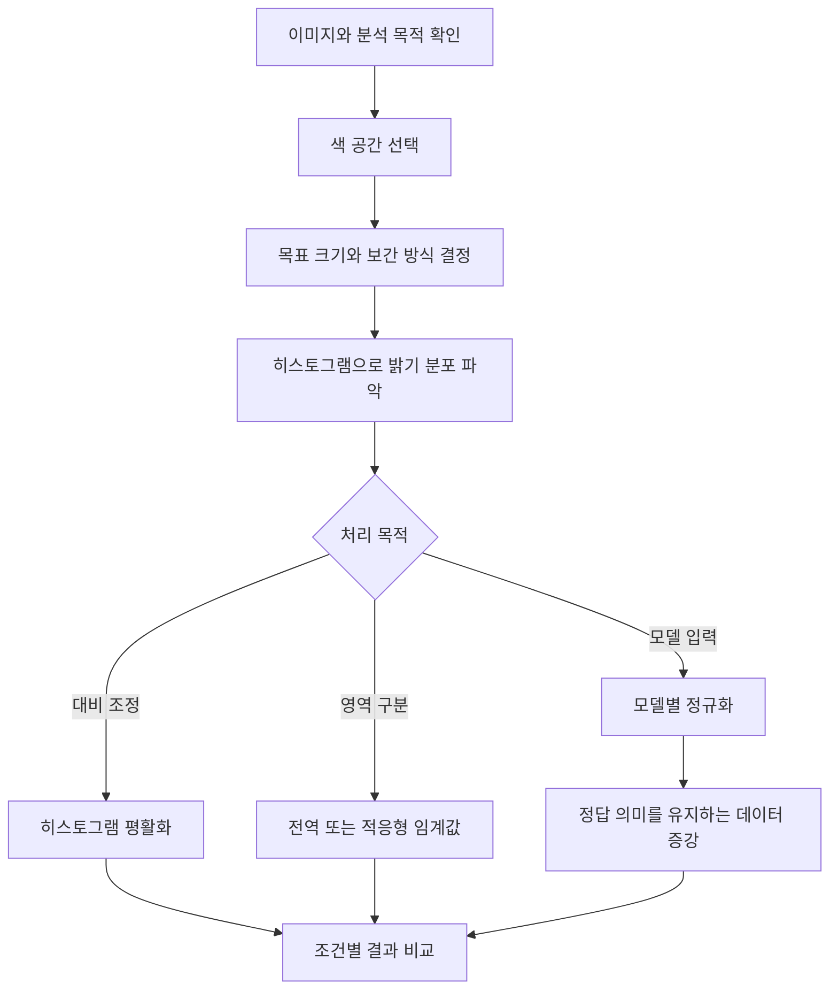

# Day 1. 이미지 전처리의 원리와 실습

> 이미지 전처리는 색상 표현, 크기, 밝기 분포, 수치 범위와 위치를 분석 목적에 맞게 바꾸는 과정이다. 각 변환이 어떤 정보를 변경하는지와 설정값에 따른 결과 차이를 정리한다.

## 1. 이미지 전처리의 목적 (원본 1~2쪽)

<strong>이미지 전처리(Image Preprocessing)</strong>는 이미지를 분석 목적이나 모델 입력 조건에 맞게 준비하는 작업이다. 같은 물체를 촬영해도 사진의 해상도, 조명, 밝기, 방향이 다를 수 있다. 파일을 읽어 숫자 배열로 만드는 것만으로 이러한 차이가 해결되지는 않는다.

512×512 사진과 1920×1080 사진은 픽셀 수가 다르다. 같은 흰 종이도 빛을 받는 곳은 밝고 그림자가 생긴 곳은 어둡다. 모델이 요구하는 입력 크기를 맞추거나 문서에서 글자를 구분하려면 처리 목적에 맞는 변환을 선택해야 한다.

| 전처리 | 바꾸는 대상 | 사용하는 이유 |
| --- | --- | --- |
| 색 공간 변환 | 색상을 숫자로 표현하는 방식 | 분석할 색상이나 밝기 정보 선택 |
| 크기 조정 | 가로와 세로의 픽셀 수 | 모델의 입력 크기에 맞춤 |
| 히스토그램 평활화 | 밝기값의 분포 | 밝고 어두운 부분의 대비 조정 |
| 임계값 처리 | 기준에 따른 픽셀 구분 | 글자와 배경 같은 영역 구분 |
| 정규화 | 픽셀값의 수치 범위 | 모델 연산에 사용할 값 준비 |
| 데이터 증강 | 방향이나 위치 등 이미지의 모습 | 학습 입력의 다양성 확보 |

이 표의 방법을 모든 이미지에 순서대로 적용하는 것은 아니다. 특정 색을 찾는 작업과 문서의 글씨를 분리하는 작업은 필요한 전처리가 다르다. **전처리는 무엇을 바꿀지와 어떤 정보를 유지할지를 함께 결정하는 과정이다.**

## 2. 색 공간과 채널의 의미 (원본 2~5쪽)

### 2.1 RGB, 그레이스케일, HSV

<strong>색 공간(Color Space)</strong>은 색상을 숫자로 표현하는 방식이다. RGB는 빨강(Red), 초록(Green), 파랑(Blue) 성분을 조합한다. <strong>그레이스케일(Grayscale)</strong>은 밝기를 하나의 값으로 표현한다. **HSV**는 색상(Hue), 채도(Saturation), 밝기 수준(Value)을 구분한다.

| HSV 성분 | 뜻 | 같은 빨강 계열에서의 의미 |
| --- | --- | --- |
| H | 색상의 종류 | 빨강인지 파랑인지 구분 |
| S | 색상이 선명한 정도 | 선명한 빨강인지 탁한 빨강인지 구분 |
| V | 밝게 표현되는 정도 | 밝은 빨강인지 어두운 빨강인지 구분 |

사진에서 빨간 물체를 찾을 때 RGB는 세 성분의 조합을 봐야 한다. HSV는 색상 종류를 H로 분리하므로 원하는 색상 계열을 기준으로 영역을 구분하는 데 활용할 수 있다. 색상과 밝기에 서로 다른 의미를 부여한 표현이다.

### 2.2 숫자 범위와 해석

OpenCV의 일반적인 8비트 HSV 표현은 H에 0~179, S와 V에 0~255를 사용한다. 순수한 빨강은 RGB에서 `(255, 0, 0)`, 이 HSV 표현에서는 `(0, 255, 255)`가 된다. HSV의 첫 값 0은 빨강 성분이 없다는 뜻이 아니라 빨강 계열을 나타내는 색상 값이다.

**같은 개수의 숫자라도 표현 방식에 따라 의미가 달라진다.** RGB와 HSV가 모두 3채널이라는 사실만으로 서로 바꾸어 사용할 수 없다. 변환한 뒤 각 축에 무엇이 저장되는지 확인해야 한다.

그레이스케일과 V 채널도 다르다. 그레이스케일은 RGB의 가중합을 사용하지만 V는 RGB 중 최댓값을 사용한다. 빨강 `(255, 0, 0)`의 그레이스케일이 약 76이어도 V는 255다. 두 값이 모두 밝기와 관련 있다고 해서 동일한 계산 결과를 기대해서는 안 된다.

## 3. 크기 조정과 보간 (원본 5~8쪽)

### 3.1 크기와 종횡비

<strong>크기 조정(Resize)</strong>은 이미지의 가로와 세로 픽셀 수를 바꾸는 작업이다. 모델이 224×224 이미지를 입력받도록 설계되었다면 원본을 그 크기로 맞출 수 있다. 축소는 기존 정보를 더 적은 픽셀로 표현하고, 확대는 새 위치의 값을 정해야 하는 작업이다.

<strong>종횡비(Aspect Ratio)</strong>는 너비와 높이의 비율이다. 픽셀 수뿐 아니라 비율이 바뀌면 물체의 형태도 달라진다.

| 너비×높이 | 종횡비 | 원래 512×512 이미지와의 차이 |
| --- | --- | --- |
| 512×512 | 1:1 | 원본 |
| 224×224 | 1:1 | 크기는 줄지만 가로와 세로 비율 유지 |
| 320×160 | 2:1 | 가로가 상대적으로 길어져 형태 왜곡 |

512×512의 사람 사진을 320×160으로 바꾸면 사람이 가로로 늘어난 것처럼 보일 수 있다. 입력 크기 조건을 맞췄어도 형태가 왜곡되었는지는 따로 확인해야 한다.

### 3.2 보간으로 새 픽셀값 결정

<strong>보간(Interpolation)</strong>은 원래 픽셀을 이용해 변경된 위치의 값을 계산하는 방법이다. 단순히 가로와 세로의 개수만 늘리는 것으로는 새 픽셀에 저장할 숫자가 정해지지 않는다.

<strong>최근접 이웃 보간(Nearest Neighbor Interpolation)</strong>은 가장 가까운 원본 픽셀값을 그대로 사용한다. 새로운 중간값을 만들지 않아 확대하면 경계가 계단처럼 보일 수 있다. 픽셀값 0이 배경, 1이 사람인 영역 마스크(Mask)처럼 기존 구분값을 유지해야 할 때 활용할 수 있다.

<strong>양선형 보간(Bilinear Interpolation)</strong>은 새 위치를 둘러싼 네 픽셀의 값과 거리를 이용한다. 가까운 위치의 값이 더 큰 비중을 갖도록 계산하므로 값의 변화가 부드럽게 나타날 수 있다.

원본 6쪽의 네 픽셀을 표로 나타내면 다음과 같다.

| 위치 | 왼쪽 | 오른쪽 |
| --- | ---: | ---: |
| 위 | 0 | 80 |
| 아래 | 160 | 240 |

정확한 중앙은 네 점과의 거리가 같아 각 값을 같은 비중으로 반영한다.

$$
(0+80+160+240)\div4=480\div4=120
$$

120은 원본 네 값 중 하나를 고른 것이 아니라 주변을 조합해 만든 값이다. 중앙이 아닌 위치라면 네 값의 비중이 달라진다. 마스크의 클래스 번호처럼 중간값이 의미 없는 데이터에는 이런 변화가 적절하지 않을 수 있다.

## 4. 히스토그램과 대비 조정 (원본 8~11쪽)

### 4.1 밝기 분포 읽기

<strong>히스토그램(Histogram)</strong>은 픽셀값마다 해당 값을 가진 픽셀이 몇 개인지 나타내는 그래프다. 가로축은 밝기값, 세로축은 픽셀 개수다. 8비트 그레이스케일에서는 밝기 축이 0~255다.

원본 예제의 픽셀값은 첫 행이 50, 50, 100이고 둘째 행이 100, 100, 200인 2×3 배열이다.

| 밝기값 | 픽셀 개수 | 전체 6개에서의 비중 |
| --- | ---: | --- |
| 50 | 2 | 2/6 |
| 100 | 3 | 3/6 |
| 200 | 1 | 1/6 |

낮은 값에 픽셀이 많으면 어두운 픽셀이 많은 이미지이고, 값이 좁은 범위에 몰리면 밝고 어두운 부분의 차이가 작을 수 있다. 다만 히스토그램에는 픽셀의 공간 위치가 없다. 특정 밝기가 얼마나 있는지는 알 수 있어도 어느 위치에 모여 있는지는 알 수 없다.

### 4.2 누적 분포와 평활화

<strong>대비(Contrast)</strong>는 이미지에서 밝은 부분과 어두운 부분의 차이다. <strong>히스토그램 평활화(Histogram Equalization)</strong>는 밝기 분포를 이용해 픽셀값을 새 값으로 대응시켜 대비를 조정한다. 값이 주로 90~150에 집중된 이미지를 더 넓은 범위로 표현하는 상황이 한 예다.

이때 <strong>누적 분포(Cumulative Distribution)</strong>를 사용한다. 어두운 값부터 픽셀 수를 차례로 더하고 전체 픽셀 수에 대한 비율을 구한다. 위 예제에서는 50 이하가 2/6, 100 이하가 5/6, 200 이하가 6/6이다. 원본의 다른 예처럼 100픽셀 중 70개가 120 이하라면 120까지의 누적 비율은 70%다.

평활화는 이 비율을 이용해 새 밝기값을 정한다. 같은 원래 값을 가진 픽셀은 같은 새 값으로 바뀌므로 모든 밝기 구간에 픽셀이 정확히 같은 수로 배치되는 것은 아니다. **평활화의 목적은 분포를 이용한 대비 조정이며, 결과가 완벽한 균등 분포라는 뜻은 아니다.**

실습에서는 원본과 평활화 이미지에 각각의 히스토그램을 함께 놓고 비교한다. 평균은 전체적인 밝기 수준을, 표준편차(Standard Deviation)는 값이 퍼진 정도를 읽는 참고 지표다. 수치와 실제 이미지의 대비를 함께 확인해야 변화를 해석할 수 있다.

## 5. 임계값으로 글자와 배경 구분 (원본 11~14쪽)

### 5.1 전역 임계값 처리

<strong>임계값 처리(Thresholding)</strong>는 특정 기준값을 이용해 픽셀을 구분하는 방법이다. 픽셀을 검정 또는 흰색으로 만드는 <strong>이진화(Binarization)</strong>는 그 활용 방식이다. <strong>전역 임계값 처리(Global Thresholding)</strong>는 이미지 전체에 같은 임계값을 적용한다.

원본의 THRESH_BINARY 방식에서 임계값 T가 150이면 픽셀값이 T보다 클 때 255, T보다 작거나 같을 때 0으로 바뀐다.

| 원본 행 | 원본 값 | 임계값 150 적용 결과 |
| --- | --- | --- |
| 1행 | 80, 170, 210 | 0, 255, 255 |
| 2행 | 120, 145, 230 | 0, 0, 255 |

예를 들어 170은 150보다 크므로 흰색이 되고, 145는 작으므로 검정이 된다. 기준을 190으로 높이면 170도 검정이 된다. **같은 입력에서도 임계값이 달라지면 분류되는 영역이 달라진다.**

### 5.2 그림자가 있을 때의 문제

흰 종이의 밝기가 조명 아래에서는 220, 그림자 아래에서는 120이라고 가정한다. 전역 임계값 150을 적용하면 밝은 종이는 흰색이지만 그림자가 진 종이는 검정이 된다. 실제로는 같은 배경인데 밝기만 달라 글자와 같은 영역으로 분류되는 것이다.

이 문제는 전역 방식이 위치마다 다른 조명을 고려하지 않기 때문에 생긴다. 기준값 하나를 바꾸는 것만으로 밝은 곳과 어두운 곳을 모두 적절히 처리하기 어려울 수 있다.

### 5.3 적응형 임계값 처리와 설정

<strong>적응형 임계값 처리(Adaptive Thresholding)</strong>는 각 픽셀 주변의 밝기를 바탕으로 해당 위치의 임계값을 정한다. 밝은 영역에서는 높은 기준, 어두운 영역에서는 낮은 기준을 사용할 수 있어 조명이 불균일한 문서에서 글자와 배경을 구분하는 데 활용한다.

원본의 <strong>적응형 가우시안 임계값 처리(Adaptive Gaussian Thresholding)</strong>는 가까운 픽셀에 더 큰 가중치를 주어 주변 밝기를 계산한다. 계산한 가중 평균에서 상수 C를 빼 최종 임계값을 정한다.

| 설정 | 의미 | 원본 예시 |
| --- | --- | --- |
| block_size | 참고할 주변 영역의 한 변 크기 | 31이면 31×31 영역 |
| C | 주변 가중 평균에서 빼는 값 | 10이면 계산값에서 10을 뺌 |

block_size는 중심 픽셀 주변을 정하므로 3 이상의 홀수를 사용한다. 31과 51은 계산에 참고하는 영역이 다른 설정이다. 어느 값이 더 나은지는 문서의 글자와 그림자에 따라 결과를 비교해야 한다.

[추가 설명] 가중 평균이 200인 영역과 100인 영역에서 C=10이면 임계값은 각각 190과 90이 된다. 이는 계산 원리를 보여주기 위한 예시이며 원본 실습 이미지의 실제 측정값이 아니다. 이진화 규칙이 동일하다면 C를 크게 해 임계값을 낮출수록 흰색으로 분류될 조건을 충족하기 쉬워진다.

## 6. 정규화와 데이터 증강 (원본 14~17쪽)

### 6.1 수치 범위 조정

<strong>정규화(Normalization)</strong>는 모델 입력에 사용하는 수치 범위를 조정한다. 원본은 uint8 픽셀을 실수로 바꾸고 255로 나누어 0~1로 만드는 방법을 설명한다. 200÷255≈0.784이므로 200이라는 밝기가 약 0.784로 표현된다.

물체의 위치나 형태가 바뀌는 작업은 아니다. 모델 계산에 쓰는 숫자의 크기를 조정하는 것이며 학습 안정성에 도움이 될 수 있다. 모델마다 요구하는 방식이 다르므로 0~1 변환을 했다는 이유만으로 전처리가 끝났다고 판단하지 않는다.

### 6.2 반전과 회전

<strong>데이터 증강(Data Augmentation)</strong>은 기존 이미지에 변환을 적용해 다양한 학습 입력을 만드는 방법이다. 같은 강아지도 왼쪽이나 오른쪽을 보거나 사진이 기울어질 수 있다. 이런 변화를 학습 데이터에 반영하는 데 <strong>반전(Flip)</strong>과 <strong>회전(Rotation)</strong>을 사용할 수 있다.

| 반전 설정 flip_code | 변화 |
| --- | --- |
| 1 | 좌우 반전 |
| 0 | 상하 반전 |
| -1 | 좌우와 상하를 모두 반전 |

회전은 지정한 각도만큼 이미지를 돌린다. 원본 실습은 30도와 45도를 비교한다. 출력 크기를 유지하면 일부 내용이 밖으로 잘리거나 비어 있는 영역이 생길 수 있다. 빈 영역은 지정한 색상으로 채울 수 있다.

증강 후에도 정답의 의미가 유지되어야 한다. 손글씨 숫자는 방향을 바꾸면 의미가 달라질 수 있다. 이미지의 모습이 다양해졌다는 사실만으로 모든 변환이 적절한 것은 아니다.

## 7. 실습 설정과 결과 해석 (원본 17~21쪽)

원본은 컬러 표본 이미지와 그림자가 있는 문서 이미지를 사용한다. 아래 이름은 원본 실습 파일을 식별하기 위한 것이며 이 저장소의 이미지 링크가 아니다.

| 대상 또는 설정 | 원본 값과 변경값 | 해석할 결과 |
| --- | --- | --- |
| color_sample.png | 512×512, 3채널, uint8 | 색 공간, 크기, 분포, 증강 비교 |
| shadow_document.png | 그림자가 있는 문서 | 전역과 적응형 이진화 비교 |
| 픽셀 위치 (y, x) | (120, 220) → (240, 330) | 같은 위치에서 RGB, 밝기, HSV의 의미 비교 |
| 목표 크기 | 224×224와 320×160 | 형태와 종횡비 변화 |
| 확대할 영역 | 32×32 | 같은 원본 영역으로 보간법 비교 |
| 확대 배율 | 8 → 4 | 경계와 중간 밝기값 비교 |
| 전역 임계값 global_t | 150 → 190 | 검정과 흰색 영역 변화 |
| 주변 크기 block_size | 31 → 51 | 국소 밝기를 참고하는 범위 변화 |
| 반전 flip_code | 1 → 0 | 좌우와 상하 반전의 차이 |
| 회전 angle | 30 → 45 | 잘림과 빈 영역 변화 |

보간법 실습의 <strong>평균 절댓값 차이(Mean Absolute Difference)</strong>는 대응하는 픽셀값 차이의 크기를 평균 낸 값이다. 두 결과가 얼마나 다른지 나타내며 그 수치만으로 어느 보간법이 더 적절한지 판단하는 지표는 아니다. 이진화에서는 설정 전후 달라진 픽셀 개수도 확인한다.

크기와 채널이 유지되어도 데이터가 같다는 의미는 아니다. 반전과 회전의 출력은 원본처럼 `(512, 512, 3)`일 수 있지만 픽셀 위치가 달라진다. 여러 설정을 동시에 바꾸면 원인을 구분하기 어려우므로 원본은 한 번에 하나씩 변경해 비교하도록 구성되어 있다.

## 8. 핵심 개념 비교표 (원본 21~22쪽)

| 개념 쌍 | 차이 | 선택 기준 |
| --- | --- | --- |
| 그레이스케일과 HSV의 V | RGB 가중합과 성분 최댓값 | 필요한 밝기 표현의 의미 |
| Resize와 보간 | 크기를 바꾸는 작업과 새 값을 정하는 방법 | 목표 크기와 데이터 성격 |
| 최근접과 양선형 | 원래 값 선택과 네 값의 거리별 조합 | 구분값 유지 또는 부드러운 표현 |
| 히스토그램과 평활화 | 분포 관찰과 분포 기반 값 변환 | 분석 또는 대비 조정 |
| 전역과 적응형 임계값 | 전체 기준 하나와 위치별 주변 기준 | 조명의 균일성 |
| 정규화와 증강 | 수치 범위와 이미지 모습의 변경 | 입력 조건 또는 학습 다양성 |

## 9. 전체 학습 흐름 (원본 21~23쪽)

## 10. 핵심 정리 (원본 21~23쪽)

- 색 공간은 색을 해석하는 기준이다. 같은 세 채널이라도 RGB와 HSV의 숫자는 의미가 다르다.
- 크기 조정에서는 픽셀 수, 보간 방식, 종횡비를 함께 고려해야 한다. 모양이 맞아도 형태나 구분값이 달라질 수 있다.
- 히스토그램은 밝기 분포를 보여주고 평활화는 누적 분포를 이용해 값을 바꾼다. 어느 위치가 밝은지는 히스토그램만으로 알 수 없다.
- 전역 이진화는 전체에 같은 기준을 적용한다. 적응형 이진화는 주변 조명을 반영해 위치별 기준을 계산한다.
- 정규화는 숫자의 표현 범위를 바꾸고, 증강은 학습에 사용할 이미지의 다양한 모습을 만든다.
- 전처리의 적절성은 실제 결과와 분석 목적을 기준으로 판단한다. 설정값을 바꾸면 어떤 정보가 달라지는지 함께 확인해야 한다.
