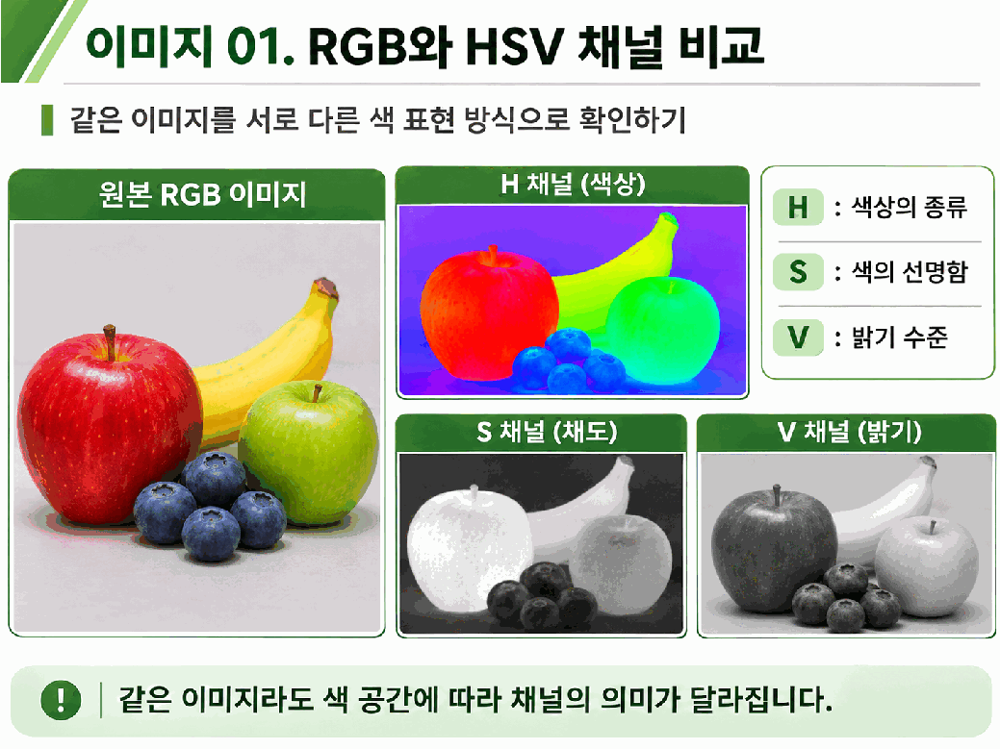
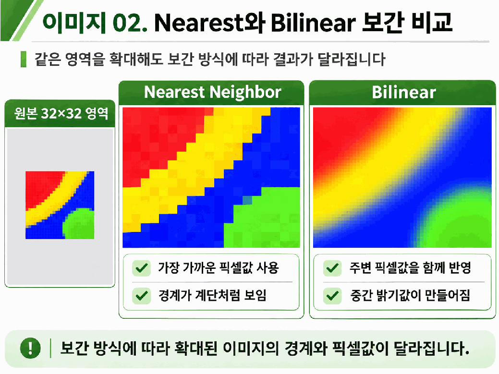
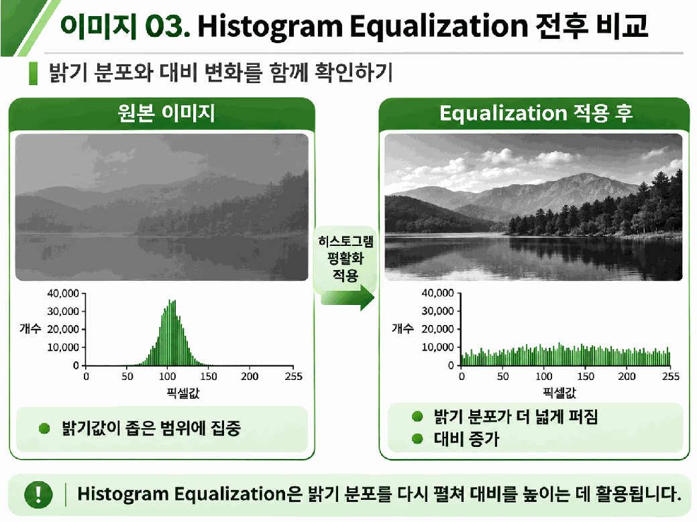
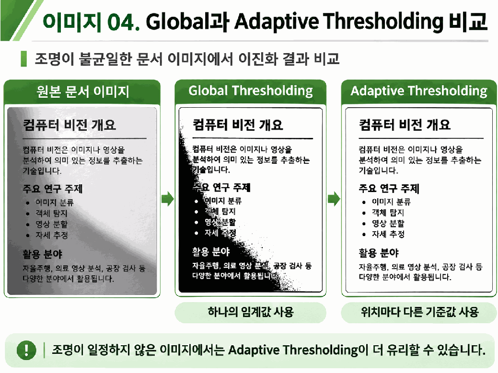
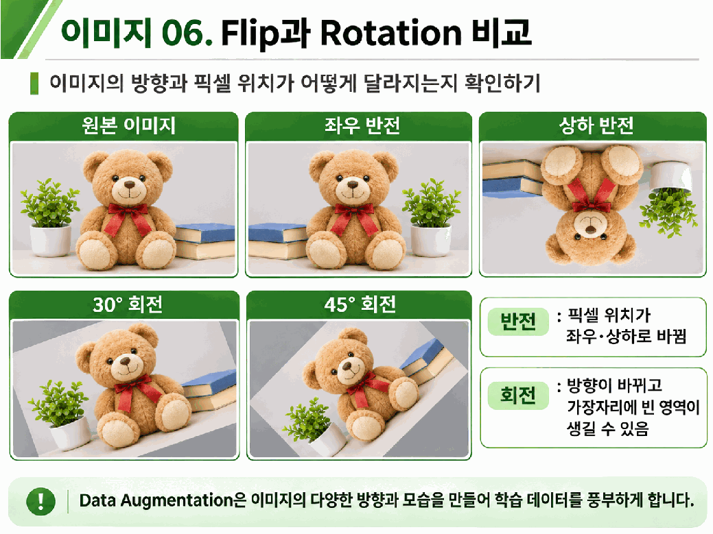

# Day 1. 이미지 전처리의 원리와 실습

> 이미지 전처리는 색상 표현, 크기, 밝기와 픽셀값을 분석 목적이나 모델의 입력 조건에 맞게 바꾸는 과정이다.

## 1. 전처리와 색 공간

<strong>이미지 전처리(Image Preprocessing)</strong>는 이미지의 데이터를 사용 목적에 맞게 준비하는 작업이다.
사진마다 크기나 조명이 다르므로 모델 입력 크기를 맞추거나 글자와 배경을 구분할 때 필요하다.

<strong>색 공간(Color Space)</strong>은 색상을 숫자로 표현하는 방식이다.
RGB는 빨강(Red), 초록(Green), 파랑(Blue)의 성분을 사용하고, 그레이스케일(Grayscale)은 밝기값 하나로 표현한다.
HSV는 색상 종류(Hue), 채도(Saturation), 밝기 수준(Value)을 구분하므로 특정 색상 영역을 찾는 데 활용할 수 있다.

| 표현 | 픽셀 정보 | 빨간색 픽셀의 예 |
| --- | --- | --- |
| RGB | 빨강, 초록, 파랑 성분 | `(255, 0, 0)` |
| 그레이스케일 | RGB를 가중합한 밝기 | 약 76 |
| HSV | 색상 종류, 선명한 정도, 밝기 수준 | OpenCV의 8비트 표현에서 `(0, 255, 255)` |

OpenCV의 일반적인 8비트 HSV에서 H는 0부터 179, S와 V는 0부터 255다.
HSV의 V는 RGB 성분의 최댓값이고 그레이스케일은 가중합이므로 같은 밝기값이 아닐 수 있다.

> 4쪽: H는 색상 종류, S는 선명한 정도, V는 밝기 수준을 나타낸다. 채널을 바꾸면 같은 위치의 값이 뜻하는 정보도 바뀐다.

## 2. 크기 조정과 보간

<strong>크기 조정(Resize)</strong>은 가로와 세로의 픽셀 수를 바꾸어 모델의 입력 크기 등에 맞추는 작업이다.
가로와 세로의 비율인 <strong>종횡비(Aspect Ratio)</strong>도 확인해야 한다.
512×512를 224×224로 바꾸면 1:1 비율이 유지되지만 320×160으로 바꾸면 2:1이 되어 물체가 늘어나 보일 수 있다.

<strong>보간(Interpolation)</strong>은 크기를 바꿀 때 기존 픽셀을 이용해 새 위치의 값을 정하는 방법이다.

| 방식 | 새 값을 정하는 방법 | 특징 |
| --- | --- | --- |
| 최근접 이웃 보간(Nearest Neighbor) | 가장 가까운 원본 픽셀값 선택 | 기존 구분값을 유지해 영역 마스크에 활용 |
| 양선형 보간(Bilinear Interpolation) | 주변 네 픽셀의 값과 거리 반영 | 중간값을 만들어 변화가 부드러워질 수 있음 |

양선형 보간에서 네 픽셀값이 0, 80, 160, 240이고 새 위치가 정확한 중앙이라면 같은 비중으로 계산한다.

$$
(0+80+160+240)\div4=120
$$

중앙에서 멀어지면 각 값의 비중이 달라진다.
마스크의 0과 1처럼 중간값에 의미가 없는 데이터는 기존 값을 선택하는 최근접 이웃 방식이 적합하다.

> 7쪽: 최근접 이웃은 원본값을 선택해 계단 모양 경계를 남기고, 양선형 보간은 주변값을 섞어 중간값을 만든다.

## 3. 히스토그램과 대비

<strong>히스토그램(Histogram)</strong>은 각 밝기값을 가진 픽셀의 개수를 보여준다.
밝기가 좁은 범위에 몰렸는지 확인할 수 있지만 픽셀의 위치는 알 수 없다.

<strong>히스토그램 평활화(Histogram Equalization)</strong>는 밝기의 누적 분포를 이용해 픽셀값을 새로 정하고 밝은 부분과 어두운 부분의 <strong>대비(Contrast)</strong>를 조정한다.
예를 들어 100개 픽셀 중 70개의 값이 120 이하면 120까지의 누적 비율은 70%다.
같은 원래 값은 같은 새 값으로 바뀌므로 결과가 모든 밝기 구간에 완전히 균등하게 분포하지는 않는다.

> 11쪽: 밝기가 좁은 범위에 모인 원본과 비교하면 평활화 후 밝기 범위가 넓어지고 대비가 커진다. 그래프는 밝기별 픽셀 수이며 픽셀의 위치는 담지 않는다.

## 4. 임계값 처리

<strong>임계값 처리(Thresholding)</strong>는 기준값으로 픽셀을 구분하는 방법이다.
밝기에 따라 검정 또는 흰색으로 바꾸는 <strong>이진화(Binarization)</strong>는 문서 이미지에서 글자와 배경을 나누는 데 활용된다.

전역 임계값(Global Threshold)을 150으로 정하고 150보다 큰 값만 흰색으로 바꾼다고 가정한다.
밝은 종이 220은 흰색이지만 그림자가 드리운 종이 120은 검정이 되어 글자와 섞일 수 있다.

> 14쪽: 하나의 전역 기준은 그림자 영역의 배경을 글자와 함께 검정으로 만들 수 있다. 적응형 처리는 주변 밝기에 따라 기준을 바꾼다.

<strong>적응형 임계값 처리(Adaptive Thresholding)</strong>는 위치별 주변 밝기를 이용해 임계값을 정한다.
가우시안 방식은 가까운 픽셀에 더 큰 가중치를 주고, 계산한 주변 밝기에서 상수 C를 뺀다.

| 설정 | 예시 | 의미 |
| --- | --- | --- |
| 주변 크기 `block_size` | 31 또는 51 | 픽셀 주변에서 참고할 영역의 한 변. 3 이상의 홀수 사용 |
| 상수 `C` | 10 | 주변 가중 평균에서 빼는 값 |
| 전역 임계값 | 150 또는 190 | 전체 이미지에 적용할 기준 |

## 5. 정규화와 데이터 증강

<strong>정규화(Normalization)</strong>는 모델에 입력할 픽셀값의 범위를 조정한다.
8비트 값 200을 255로 나누면 약 0.784가 된다.
이 과정에서 픽셀의 위치는 바뀌지 않으며, 사전학습 모델마다 요구하는 정규화 방식은 다를 수 있다.

<strong>데이터 증강(Data Augmentation)</strong>은 기존 이미지에 변환을 적용해 다양한 학습 입력을 만든다.
좌우 반전(Flip)은 픽셀 위치를 뒤집고 회전(Rotation)은 이미지를 일정한 각도로 돌린다.
회전 후 원래 크기를 유지하면 이미지 일부가 잘리거나 빈 영역이 생길 수 있다.

좌우 반전 설정 1과 상하 반전 설정 0을 사용할 수 있으며, 30도나 45도 회전처럼 회전 각도를 정할 수도 있다.
변형 후에도 정답의 의미가 유지되어야 하므로 방향에 따라 의미가 달라지는 손글씨 숫자 등은 변환을 신중히 선택한다.

> 17쪽: 반전은 위치를 뒤집고 회전은 방향을 바꾼다. 원래 크기를 유지하는 회전에서는 모서리가 잘리거나 빈 영역이 생길 수 있다.

## 6. 실습에서 비교할 조건

| 실습 | 비교할 조건 | 확인할 결과 |
| --- | --- | --- |
| 색 공간 | 픽셀 위치 `(120, 220)` → `(240, 330)` | RGB, 그레이스케일, HSV 값의 의미 |
| 크기와 비율 | 512×512 → 224×224 또는 320×160 | Shape와 물체 형태 |
| 보간 | 32×32 영역을 8배 또는 4배 확대 | 픽셀 경계와 평균 절댓값 차이 |
| 히스토그램 | 평활화 전후 | 밝기 분포와 대비 |
| 임계값 | 전역 150 → 190, 주변 크기 31 → 51 | 글자와 배경으로 나뉜 픽셀 |
| 증강 | 좌우 또는 상하 반전, 30도 또는 45도 회전 | 픽셀 위치, 잘린 부분과 빈 영역 |

한 번에 한 설정만 바꾸면 결과가 달라진 원인을 구분하기 쉽다.
반전과 회전 후에도 Shape가 `(512, 512, 3)`으로 같을 수 있지만 픽셀의 위치는 달라진다.

## 핵심 개념 비교표

| 구분 | 핵심 차이 |
| --- | --- |
| Resize와 보간 | 이미지 크기를 바꾸는 작업과 새 픽셀값을 정하는 방법 |
| 히스토그램과 평활화 | 밝기 분포를 확인하는 그래프와 분포를 이용한 값 변환 |
| 전역과 적응형 임계값 | 전체에 같은 기준 적용과 주변 밝기에 따른 위치별 기준 |
| 정규화와 증강 | 숫자의 범위 조정과 이미지 모습의 변형 |

## 최종 정리

- 색 공간이 바뀌면 같은 픽셀도 다른 의미의 채널값으로 표현된다.
- 크기 조정에서는 목표 크기뿐 아니라 보간 방식과 종횡비를 확인한다.
- 히스토그램은 밝기 분포를 나타내며 평활화는 그 분포로 대비를 조정한다.
- 전역 임계값은 하나의 기준을, 적응형 임계값은 주변에 따른 기준을 사용한다.
- 정규화는 모델에 맞는 수치 범위를 준비하고 증강은 학습 입력을 다양하게 만든다.
- 증강 설정은 정답의 의미와 유지해야 할 이미지 정보를 고려해 선택한다.
