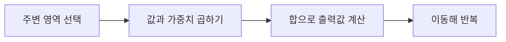
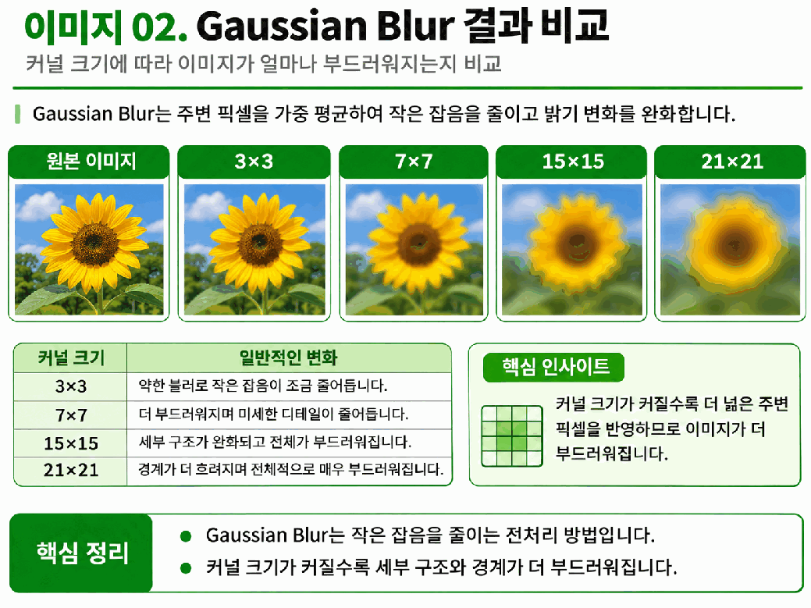
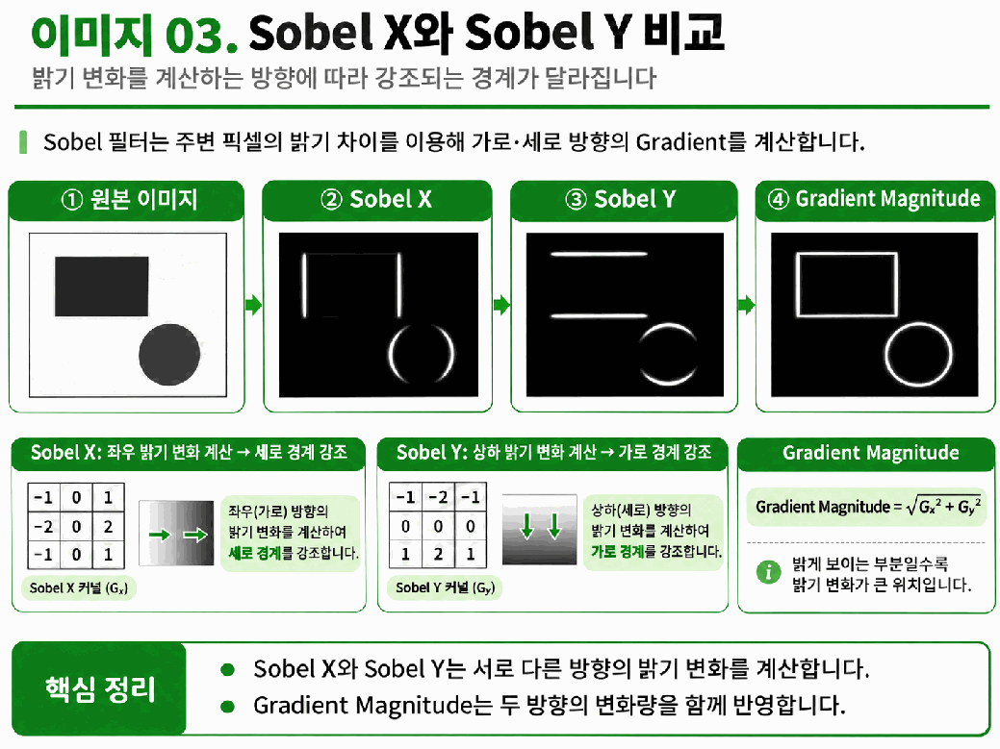
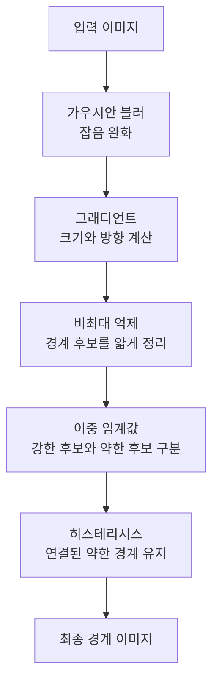
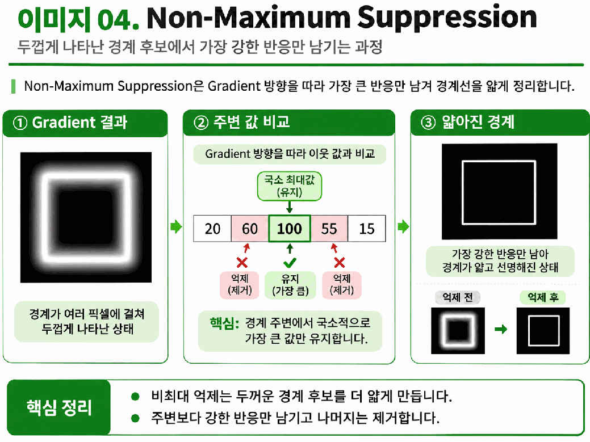
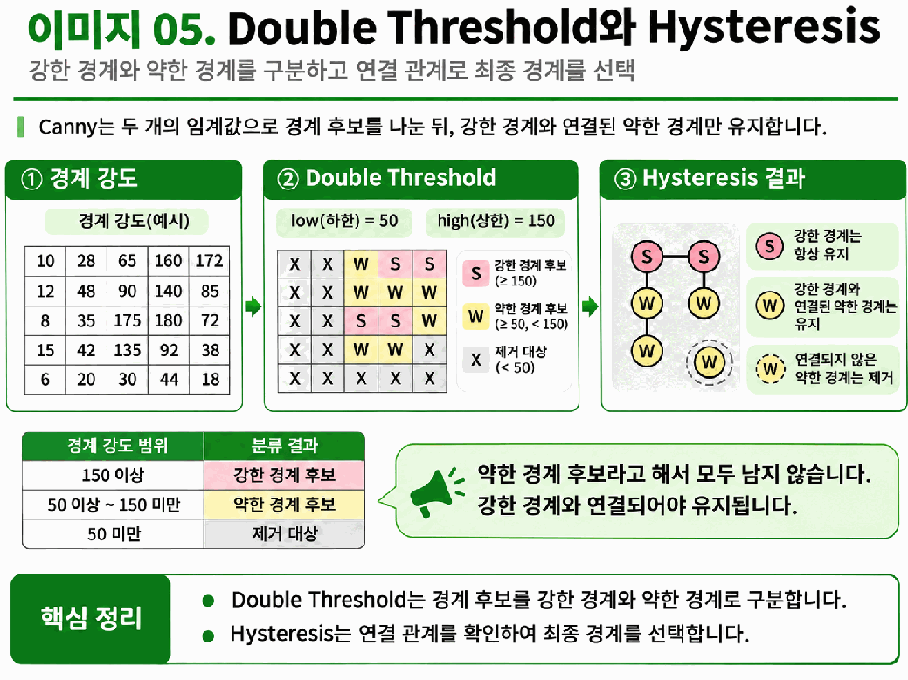
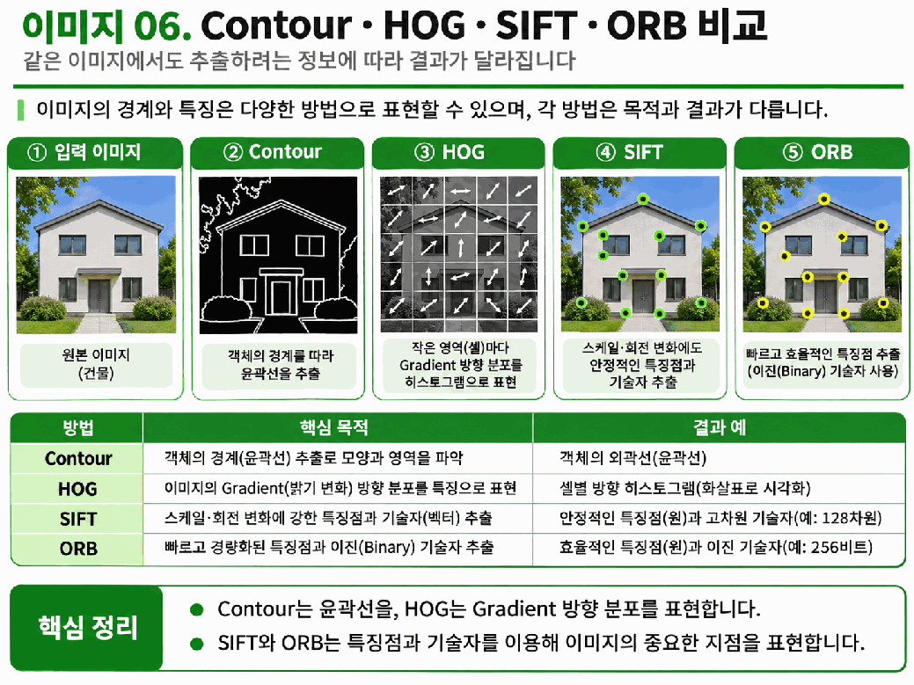

# Day 1. 이미지 필터링과 에지 검출

> 주변 픽셀을 함께 계산하면 잡음을 완화하거나 밝기가 달라지는 경계를 찾을 수 있다. 필터링에서 경계 검출과 특징 표현까지의 흐름을 정리한다.

## 1. 필터링과 커널

<strong>이미지 필터링(Image Filtering)</strong>은 한 픽셀과 주변 픽셀을 함께 사용해 새 값을 계산하는 처리다. 주변 값이 비슷한 영역과 밝기가 급격히 바뀌는 경계를 구분하거나 작은 잡음(Noise)을 줄일 때 사용한다.

<strong>커널(Kernel)</strong>은 계산에 사용할 작은 가중치 배열이다. 3×3 커널이 한 위치를 덮으면 각 픽셀값과 같은 위치의 가중치를 곱해 더하고, 다음 위치로 이동해 같은 계산을 반복한다.

커널 크기는 참고할 주변 영역의 범위다. 크기가 같더라도 가중치에 따라 평균을 내어 부드럽게 만들거나, 밝기 차이를 강조할 수 있다.

## 2. 가우시안 블러

<strong>가우시안 블러(Gaussian Blur)</strong>는 가까운 주변 픽셀에 더 큰 비중을 주는 가중 평균으로 이미지를 부드럽게 만든다. 작은 잡음이 경계로 잘못 검출되는 것을 줄일 수 있지만, 강하게 적용하면 실제 경계도 흐려질 수 있다.

3×3 가우시안 커널의 예는 중심 4, 상하좌우 2, 대각선 1로 구성된다. 주변 값에 각 가중치를 곱해 더한 뒤 가중치의 합인 16으로 나누면 새 밝기값이 된다.

| 가중치 위치 | 값 | 의미 |
| --- | ---: | --- |
| 중심 | 4 | 가장 큰 비중 |
| 상하좌우 | 2 | 중간 비중 |
| 대각선 | 1 | 상대적으로 작은 비중 |

<strong>시그마(Sigma, σ)</strong>는 가중치가 중심에서 주변으로 얼마나 넓게 퍼지는지 조절한다. OpenCV에서 σ=0은 커널 크기를 기준으로 자동 계산한다는 뜻이다. 자동 계산 조건에서 커널을 15×15에서 21×21로 키우면 일반적으로 더 넓은 주변을 반영한다.

> 7쪽: 커널이 커질수록 더 넓은 주변을 반영해 세부 무늬와 실제 경계도 흐려질 수 있다. 잡음 완화와 세부 정보 보존을 함께 살핀다.

## 3. 그래디언트와 소벨

<strong>에지(Edge)</strong>는 주변 픽셀 사이에서 밝기가 크게 변하는 경계다. <strong>그래디언트(Gradient)</strong>는 밝기가 어느 방향으로 얼마나 변하는지 나타낸다. `10, 10, 10, 200, 200, 200`에서는 각 영역 내부보다 10에서 200으로 넘어가는 위치의 변화가 크다.

<strong>소벨(Sobel)</strong>은 커널로 가로와 세로 방향의 밝기 변화를 계산한다. 방향 이름은 **밝기를 비교하는 방향**이며, 그로 인해 강조되는 경계가 뻗은 방향과는 다를 수 있다.

> 10쪽: 소벨 X는 좌우 밝기 차이로 세로 경계에, 소벨 Y는 상하 밝기 차이로 가로 경계에 반응한다. 두 변화량을 결합하면 방향별 경계를 함께 볼 수 있다.

변화량의 부호는 밝아지는 방향과 어두워지는 방향을 구분한다. 음수라도 변화가 약하다는 뜻은 아니다. 두 방향의 크기를 함께 보려면 <strong>그래디언트 크기(Gradient Magnitude)</strong>를 계산한다.

$$
M=\sqrt{G_x^2+G_y^2}
$$

Gx는 가로, Gy는 세로 변화량이며 M은 두 방향을 결합한 크기다. Gx=3, Gy=4이면 `√(3²+4²)=√25=5`다. M이 클수록 밝기 변화가 크지만, 소벨 결과는 아직 최종 경계 선택 결과가 아니다.

## 4. 캐니 에지 검출

<strong>캐니 에지 검출(Canny Edge Detection)</strong>은 밝기 변화에서 최종 경계 픽셀을 선택한다. 잡음이나 여러 픽셀에 걸친 두꺼운 반응을 정리하고 경계의 연결 상태를 확인한다.

<strong>비최대 억제(Non-Maximum Suppression)</strong>는 그래디언트 방향의 주변 값과 비교해 국소적으로 가장 강한 반응을 남긴다. `20 → 60 → 100 → 55 → 15`에서 100은 인접한 60과 55보다 커서 유지되고, 주변의 약한 반응은 억제된다.

> 15쪽: 그래디언트 방향의 이웃과 비교해 국소적으로 강한 위치를 남긴다. 이 단계는 후보를 얇게 만들며 최종 유지 여부는 강도와 연결 관계로 결정한다.

<strong>이중 임계값(Double Threshold)</strong>은 경계 강도를 강한 후보와 약한 후보로 나눈다. 예를 들어 Low=50, High=150이면 150 이상은 강한 후보, 50 이상 150 미만은 약한 후보, 50 미만은 제거 대상이다. 이 기준은 원본 픽셀의 밝기가 아니라 경계 강도에 적용된다.

<strong>히스테리시스(Hysteresis)</strong>는 강한 경계와 연결된 약한 경계를 유지한다. `160 → 90 → 80`에서 90과 80은 약해도 160에 이어져 있어 남을 수 있지만, 강한 경계와 연결되지 않은 90은 제거된다.

High를 150으로 고정하고 Low를 50에서 30으로 낮추면 약한 후보가 늘어날 수 있다. 후보가 늘어도 연결되지 않은 약한 경계까지 모두 최종 결과에 남는 것은 아니다.

> 17쪽: 강한 경계에 이어진 약한 후보는 유지하고, 연결되지 않은 약한 후보는 제거한다. 같은 강도의 약한 후보라도 연결 상태에 따라 결과가 다르다.

## 5. 윤곽과 특징점

<strong>윤곽선(Contour)</strong>은 경계를 이루는 점들을 연결한 표현으로, 물체의 면적이나 둘레를 분석하는 데 사용할 수 있다. 방향성 그래디언트 히스토그램(Histogram of Oriented Gradients, HOG)은 작은 영역의 그래디언트 방향 분포를 특징 벡터로 요약한다.

<strong>특징점(Keypoint)</strong>은 다른 이미지에서도 대응시킬 수 있는 특징적인 위치이고, <strong>특징 기술자(Descriptor)</strong>는 그 주변 패턴을 나타낸다. 크기 불변 특징 변환(Scale-Invariant Feature Transform, SIFT)과 방향을 고려한 FAST와 회전 BRIEF(Oriented FAST and Rotated BRIEF, ORB)는 특징점과 기술자를 이용해 서로 다른 사진에서 같은 건물의 대응 부분을 찾는 이미지 매칭 등에 사용한다.

> 20쪽: 윤곽은 경계선을, HOG는 국소 방향 분포를, SIFT와 ORB는 특징점과 주변 기술자를 표현한다. 서로 다른 분석 목적에 쓰이는 결과다.

## 6. 실습의 설정과 결과

| 비교 | 설정 | 관찰할 내용 |
| --- | --- | --- |
| 가우시안 블러 | 커널 15×15 → 21×21 | 부드러움과 세부 경계 변화 |
| 소벨 | X, Y, 두 방향을 결합한 크기 | 강조되는 방향과 변화량 |
| 캐니 | 블러 적용 여부와 Low, High 변경 | 검출된 경계 픽셀과 연결 상태 |
| 원본과 결과 | 원본, 블러, 소벨, 캐니 비교 | 각 결과가 표현하는 정보의 차이 |

## 핵심 개념 비교표

| 방법 | 계산 또는 결과 | 주요 역할 |
| --- | --- | --- |
| 가우시안 블러 | 주변의 가중 평균 | 잡음과 급격한 변화 완화 |
| 소벨 | 방향별 밝기 변화 | 경계 후보를 위한 변화 정보 계산 |
| 캐니 | 강도와 연결 관계에 따른 선택 | 최종 경계 픽셀 검출 |
| 윤곽선 | 연결된 경계점 | 물체의 형태 표현 |
| HOG | 영역별 방향 분포 | 형태를 특징 벡터로 표현 |
| SIFT와 ORB | 특징점과 기술자 | 이미지 사이의 대응점 비교 |

## 최종 정리

- 필터링은 커널의 가중치와 주변 픽셀을 계산해 새로운 값을 만든다.
- 가우시안 블러는 잡음을 완화하지만 실제 경계도 흐리게 할 수 있다.
- 소벨 X는 좌우 밝기 변화를 계산하고 세로 경계에 반응한다.
- 그래디언트의 부호는 변화 방향을, 크기는 변화의 강도를 나타낸다.
- 캐니는 경계 후보를 얇게 정리하고 임계값과 연결 관계로 최종 경계를 선택한다.
- 윤곽선, HOG, SIFT와 ORB는 경계와 특징을 서로 다른 형태로 표현한다.
