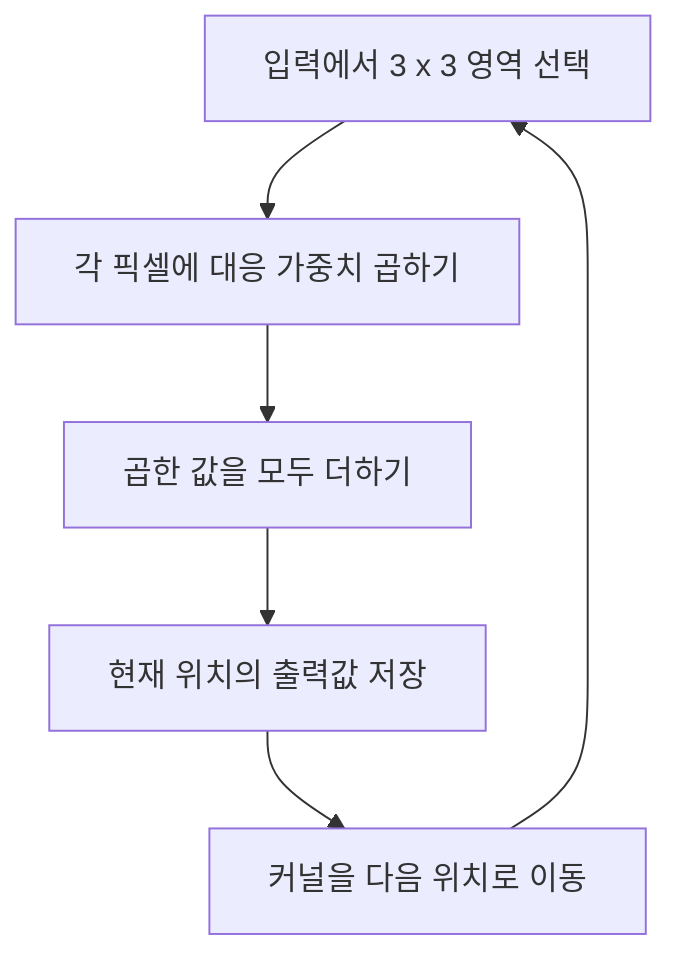
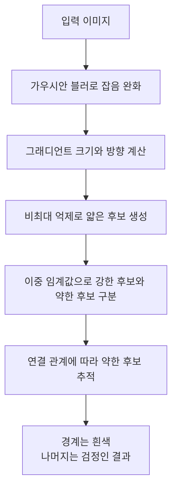
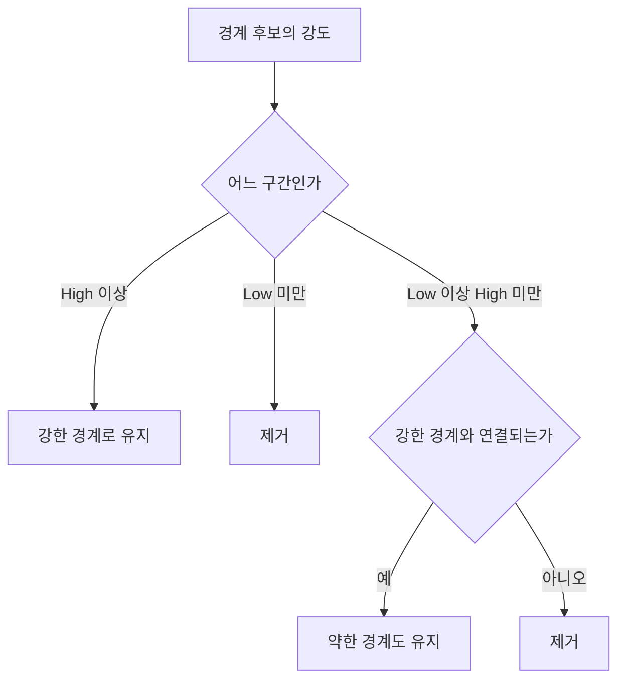
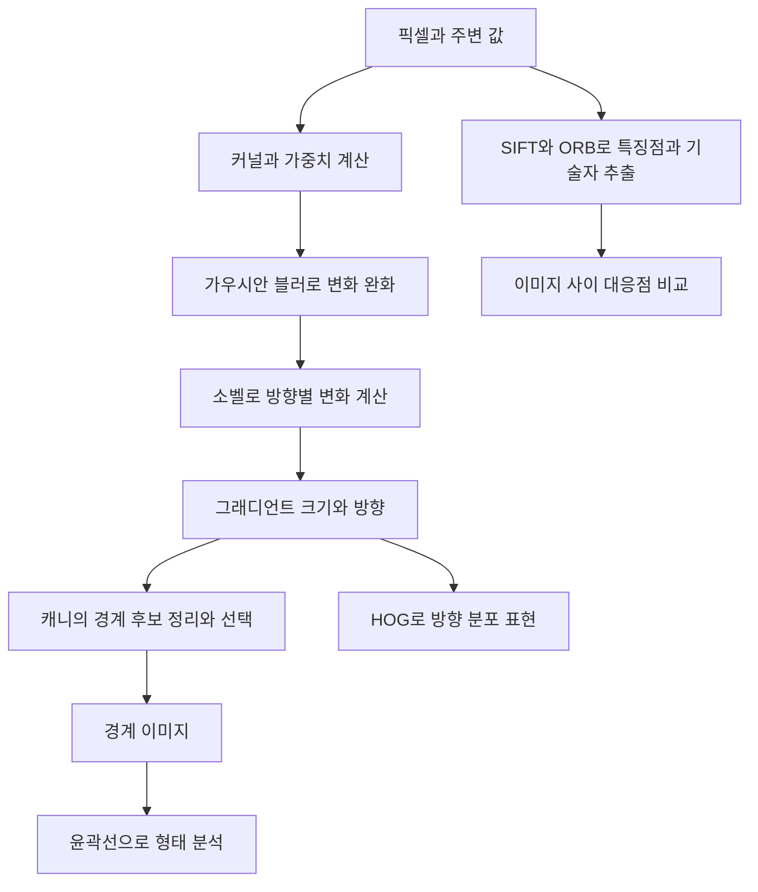

# Day 1. 이미지 필터링과 에지 검출

> 이미지의 주변 픽셀을 함께 계산하면 잡음을 줄이거나 밝기가 바뀌는 경계를 찾을 수 있다. 커널 계산부터 소벨, 캐니, 윤곽과 특징점 표현까지 각 단계가 만드는 정보의 차이를 정리한다.

## 1. 주변 픽셀을 사용하는 이유 (원본 1~2쪽)

**이미지 필터링(Image Filtering)**은 특정 픽셀과 주변 픽셀의 값을 이용해 새 값을 계산하는 처리다. 픽셀 하나의 밝기만으로는 물체 내부인지, 경계인지, 작은 잡음인지 판단하기 어렵다. 주변과 비슷한 값인지, 갑자기 달라지는지를 함께 살펴야 한다.

예를 들어 흰 배경의 검은 사각형은 두 영역 내부에서 밝기가 거의 일정하다. 경계에서는 검정에서 흰색으로 밝기가 크게 변한다. 반면 작은 **잡음(Noise)**도 급격한 밝기 변화를 만들 수 있다. 따라서 밝기 변화를 계산하기 전에 잡음을 완화하고, 계산 결과에서 최종 경계를 선택하는 단계가 필요하다.

| 처리 | 주된 역할 | 출력의 의미 |
| --- | --- | --- |
| 가우시안 블러(Gaussian Blur) | 주변을 반영해 급격한 변화 완화 | 부드러워진 밝기 이미지 |
| 소벨 그래디언트(Sobel Gradient) | 방향별 밝기 변화 계산 | 변화의 크기와 방향 정보 |
| 캐니 에지 검출(Canny Edge Detection) | 경계에 해당하는 픽셀 선택 | 최종 경계 이미지 |

이 방법들은 독립적으로도 사용할 수 있다. 위 흐름은 서로 연결했을 때의 역할을 보여준다. 실제 실습에서는 가우시안 블러 결과를 캐니 입력으로 전달하고, 캐니가 내부의 변화 계산과 경계 선택을 수행한다. 소벨 출력 이미지를 반드시 따로 만들어 캐니에 넣는 과정으로 해석하지 않는다.

## 2. 커널로 새 값을 계산하는 원리 (원본 2~4쪽)

### 2.1 주변 영역과 가중치

**커널(Kernel)** 또는 **필터(Filter)**는 주변 영역을 계산하는 작은 가중치 배열이다. 원본의 3×3 입력 영역은 다음과 같다.

| 위치 | 왼쪽 | 가운데 | 오른쪽 |
| --- | ---: | ---: | ---: |
| 위 | 10 | 20 | 30 |
| 가운데 | 20 | 40 | 60 |
| 아래 | 30 | 50 | 70 |

가운데 픽셀은 40이지만 필터링은 주변 8개 값도 함께 사용한다. 같은 위치의 픽셀값과 커널 가중치를 곱한 뒤 합산해 새 출력값을 만든다. 그다음 커널을 옆 위치로 옮겨 같은 계산을 반복한다.

커널 크기는 한 번에 참고하는 공간의 범위다. 3×3은 가까운 영역, 5×5와 7×7은 더 넓은 영역을 사용한다. 하지만 **같은 크기의 커널이라도 가중치가 다르면 계산 목적이 달라진다.** 주변을 평균 내는 커널은 부드럽게 만들고 좌우 차이를 계산하는 커널은 경계를 강조할 수 있다.

### 2.2 가우시안 가중 평균

**가우시안 블러(Gaussian Blur)**는 중심에 가까울수록 큰 비중을 두는 가중 평균으로 이미지를 부드럽게 만든다. 주변을 모두 똑같이 반영하는 단순 평균과 가중치 배치가 다르다.

원본 5쪽의 3×3 가우시안 가중치는 다음과 같다.

| 위치 | 왼쪽 | 가운데 | 오른쪽 |
| --- | ---: | ---: | ---: |
| 위 | 1 | 2 | 1 |
| 가운데 | 2 | 4 | 2 |
| 아래 | 1 | 2 | 1 |

중심은 4, 상하좌우는 2, 대각선은 1이다. 가중치의 합이 16이므로 대응하는 곱의 합을 16으로 나누어 새 밝기값을 구한다. 이렇게 계산하면 주변 값이 함께 반영되어 작은 밝기 변화가 완화된다.

[추가 설명] 원본의 입력 영역과 가우시안 가중치를 연결해 계산하면 다음과 같다.

| 입력 행 | 가중치를 적용한 계산 | 합 |
| --- | --- | ---: |
| 위 | 10×1+20×2+30×1 | 80 |
| 가운데 | 20×2+40×4+60×2 | 320 |
| 아래 | 30×1+50×2+70×1 | 200 |
| 전체 | (80+320+200)÷16 | 37.5 |

이 예의 새 값 37.5는 중심값 40과 주변의 밝기를 반영한 결과다. 원본에 각각 제시된 입력과 커널을 결합한 설명용 계산이며 실제 저장 자료형에 따른 반올림까지 보여주는 예는 아니다.

### 2.3 커널 크기와 시그마

**시그마(Sigma, σ)**는 가우시안 가중치가 중심에서 주변으로 얼마나 퍼지는지 조절한다. 시그마가 커지면 더 넓게 퍼진 주변의 영향을 반영한다. 원본의 OpenCV 설정에서 σ=0은 커널 크기로부터 자동 계산한다는 뜻이다. 블러를 적용하지 않는다는 뜻이 아니다.

| 설정 | 의미와 일반적인 변화 |
| --- | --- |
| 커널 3×3 | 가까운 주변만 참고 |
| 커널 7×7 | 더 넓은 영역의 밝기 변화 완화 |
| 커널 15×15 | 작은 구조와 경계가 더 부드러워질 수 있음 |
| 커널 21×21 | 더 넓은 영역을 반영 |
| σ=0 | 커널 크기를 고려해 시그마 자동 계산 |
| σ를 1, 2 등으로 지정 | 가중치의 퍼짐 정도를 직접 설정 |

일반적인 설정에서는 양의 홀수 크기 커널을 사용한다. 시그마를 자동 계산하는 조건에서 커널을 크게 하면 보통 더 부드러워진다. 이 설명을 커널 크기만으로 모든 블러 강도가 결정된다는 뜻으로 확대해서는 안 된다. 가중치의 분포도 결과에 영향을 준다.

블러는 잡음을 줄이지만 세부 정보와 실제 경계도 완화할 수 있다. 따라서 가장 매끈한 이미지가 항상 경계 검출에 가장 좋은 입력이라는 보장은 없다. 잡음 감소와 세부 구조 유지 사이의 결과를 살펴야 한다.

## 3. 그래디언트와 소벨 (원본 7~12쪽)

### 3.1 밝기와 밝기 변화의 차이

**에지(Edge)**는 주변 픽셀 사이에서 밝기가 크게 변하는 위치다. **그래디언트(Gradient)**는 어느 방향으로 얼마나 빠르게 밝기가 변하는지 나타낸다. 이미지의 밝기가 높다는 사실과 변화량이 크다는 사실은 다르다.

원본의 가로 방향 픽셀은 `10, 10, 10, 200, 200, 200`이다. 10이 반복되는 구간과 200이 반복되는 구간은 밝기는 다르지만 각각 내부 변화는 작다. 10에서 200으로 넘어가는 경계에서 큰 변화가 발생한다.

**Gx**는 가로 방향 이동에 따른 변화량, **Gy**는 세로 방향 이동에 따른 변화량이다. 소벨은 이 두 방향을 서로 다른 커널로 계산한다.

### 3.2 소벨 X와 소벨 Y

소벨 X는 왼쪽에 음수, 오른쪽에 양수 가중치를 둔다. 소벨 Y는 위쪽에 음수, 아래쪽에 양수 가중치를 둔다.

| 행 | 소벨 X의 가중치 | 소벨 Y의 가중치 |
| --- | --- | --- |
| 첫째 행 | -1, 0, 1 | -1, -2, -1 |
| 둘째 행 | -2, 0, 2 | 0, 0, 0 |
| 셋째 행 | -1, 0, 1 | 1, 2, 1 |

좌우가 비슷하면 X 커널의 양수와 음수 기여가 상쇄된다. 오른쪽이 왼쪽보다 밝으면 양수 방향의 반응이 커진다. Y 커널도 위아래를 같은 원리로 비교한다.

| 방법 | 계산하는 변화 방향 | 강하게 반응하는 경계 예 |
| --- | --- | --- |
| 소벨 X | 왼쪽과 오른쪽 | 세로로 뻗은 경계 |
| 소벨 Y | 위쪽과 아래쪽 | 가로로 뻗은 경계 |

**X와 Y는 경계선이 뻗은 방향이 아니라 밝기를 비교하는 방향이다.** 왼쪽이 검고 오른쪽이 흰 영상에는 세로 경계가 생기지만, 이 경계를 가로질러 이동할 때 밝기가 바뀌므로 X가 강하게 반응한다.

### 3.3 부호와 그래디언트 크기

원본 커널에서 어두운 곳에서 밝은 곳으로 변하면 양수, 반대로 변하면 음수 반응이 나올 수 있다. 음수라는 이유로 경계가 약하다고 판단하지 않는다. 부호는 변화 방향을 구분한다.

**그래디언트 크기(Gradient Magnitude)**는 두 방향의 변화를 하나의 크기로 결합한다. 대각선 경계처럼 가로와 세로 변화가 동시에 있는 경우에도 전체 변화의 강도를 표현할 수 있다.

$$
M=\sqrt{G_x^2+G_y^2}
$$

M은 전체 변화의 크기, Gx와 Gy는 가로와 세로 변화량이다. 각각을 제곱해 합한 뒤 제곱근을 구한다. 부호보다 크기를 나타내는 계산이다.

| 계산 단계 | 원본의 Gx=3, Gy=4 대입 |
| --- | --- |
| 제곱 | 3²=9, 4²=16 |
| 합산 | 9+16=25 |
| 제곱근 | √25=5 |

결과 5는 원본 픽셀의 밝기가 아니라 두 방향을 결합한 변화량이다. 크기가 클수록 주변에서 밝기가 크게 달라진다는 뜻이다. 시각화에서 밝은 부분은 강한 변화 위치를 나타내지만, 소벨 출력은 아직 최종 경계선의 선택 결과가 아니다.

## 4. 캐니의 경계 선택 과정 (원본 12~18쪽)

### 4.1 단계가 필요한 이유

밝기가 바뀌는 모든 위치를 경계로 남기면 잡음과 두꺼운 반응까지 포함된다. **캐니 에지 검출(Canny Edge Detection)**은 변화 정보를 계산한 뒤 경계 후보를 얇게 만들고, 강도와 연결 관계를 이용해 최종 픽셀을 선택한다.

원본의 실습은 블러를 별도로 적용한 이미지를 입력으로 사용한다. 최종 결과는 일반적으로 경계 픽셀 255, 나머지 0인 이진 이미지다. 이 값은 원본의 밝기를 유지한 값이 아니라 경계 선택 여부다.

### 4.2 비최대 억제

**비최대 억제(Non-Maximum Suppression)**는 그래디언트 방향을 따라 주변과 비교해 국소적으로 강한 반응을 남긴다. 하나의 경계가 여러 픽셀 두께로 반응했을 때 이를 얇게 정리하는 데 필요하다.

원본 14쪽의 그래디언트 크기는 `20 → 60 → 100 → 55 → 15`다. 가운데 100은 인접한 60과 55보다 크므로 유지된다. 상대적으로 작은 주변 반응은 억제된다. 전체 이미지에서 가장 큰 값 하나만 고르는 과정이 아니라 **각 위치에서 변화 방향을 기준으로 주변을 비교하는 과정**이다.

### 4.3 이중 임계값

**이중 임계값(Double Threshold)**은 낮은 임계값(Low Threshold)과 높은 임계값(High Threshold)을 사용해 경계 후보를 나눈다. 원본 픽셀의 밝기가 아니라 그래디언트 기반 경계 강도에 적용한다.

| 원본의 예시: Low=50, High=150 | 구분 | 다음 처리 |
| --- | --- | --- |
| 강도 150 이상 | 강한 후보 | 경계로 유지 |
| 강도 50 이상 150 미만 | 약한 후보 | 연결 관계를 확인 |
| 강도 50 미만 | 제거 대상 | 경계에서 제외 |

강도 기준 하나만 쓰면 약한 실제 경계를 놓치거나 잡음을 너무 많이 남길 수 있다. 두 기준은 확실한 경계와 추가 판단이 필요한 후보를 구분한다.

### 4.4 히스테리시스를 이용한 경계 추적

**히스테리시스 경계 추적(Edge Tracking by Hysteresis)**은 강한 경계와 연결된 약한 경계를 유지하는 과정이다. 같은 물체의 경계도 모든 구간의 밝기 차이가 같지는 않으므로 약한 반응을 전부 버리면 선이 끊어질 수 있다.

원본의 `160 → 90 → 80`에서는 160이 강한 후보이고, 90과 80은 약한 후보다. 낮은 값들이 강한 경계와 이어져 있으면 함께 남을 수 있다. 반면 다른 위치에 고립된 90은 강한 경계와 연결되지 않으면 제거된다.

같은 90이라도 연결 관계에 따라 결과가 다르다. **이중 임계값은 후보를 분류하고 히스테리시스는 연결성을 반영한다.**

### 4.5 임계값 변화 해석

| 변경 조건 | 후보 단계에서의 일반적인 영향 |
| --- | --- |
| High 고정, Low 감소 | 이전에 제거된 약한 변화가 후보가 될 수 있음 |
| High 고정, Low 증가 | 약한 후보가 줄어들 수 있음 |
| High 감소 | 강한 후보가 늘어날 수 있음 |
| High 증가 | 강한 후보가 줄어들 수 있음 |

High=150을 유지하고 Low를 50에서 30으로 낮추면 더 약한 반응도 후보로 들어올 수 있다. 하지만 모두 최종 경계가 되는 것은 아니다. 히스테리시스의 연결 조건도 충족해야 한다. 최종 결과에서는 경계 픽셀 수와 선의 연결 상태를 함께 확인한다.

## 5. 윤곽, 방향 분포, 특징점 (원본 18~20쪽)

### 5.1 윤곽선과 HOG

**윤곽선(Contour)**은 경계를 이루는 점들을 연결한 표현이다. 캐니가 동그라미 경계 픽셀을 찾는다면 윤곽선은 그 점을 따라 형태를 구성한다. 이진화 이미지나 경계 검출 결과에서 찾을 수 있으며 면적, 둘레, 물체를 둘러싼 사각형 같은 형태 분석에 활용한다.

**방향성 그래디언트 히스토그램(Histogram of Oriented Gradients, HOG)**은 작은 영역에서 밝기 변화 방향이 어떻게 분포하는지 모아 특징으로 표현한다. 사람의 머리, 어깨, 몸통, 다리에는 여러 방향의 경계가 있다. HOG는 이런 방향 분포를 숫자로 요약해 분류 모델과 함께 사람 탐지 등에 사용한다.

캐니의 결과는 경계 픽셀의 선택이고, HOG의 결과는 방향 분포를 요약한 **특징 벡터(Feature Vector)**다. 같은 이미지에서 출발해도 이후 분석에 사용하는 정보의 형태가 다르다.

### 5.2 SIFT와 ORB

**특징점(Keypoint)**은 이미지에서 다른 이미지와 대응시킬 때 사용할 특징적인 위치다. **특징 기술자(Descriptor)**는 그 위치 주변의 패턴을 숫자로 나타낸 것이다. 위치만 찾는 것과 그 위치가 어떤 모습인지 표현하는 것은 구분해야 한다.

**크기 불변 특징 변환(Scale-Invariant Feature Transform, SIFT)**은 특징점을 검출하고 주변 패턴을 기술한다. 원본은 크기나 회전이 다른 이미지 사이의 대응점을 찾는 데 활용할 수 있다고 설명한다.

**방향을 고려한 FAST와 회전 BRIEF(Oriented FAST and Rotated BRIEF, ORB)**는 FAST 기반 특징점 검출과 BRIEF 계열의 이진 특징 기술자를 결합한다. 이진 표현을 이용해 특징점을 효율적으로 비교하는 방법이다. 두 방법 모두 영상 정합, 이미지 매칭, 위치 추정에 활용할 수 있다.

서로 다른 위치에서 찍은 같은 건물 사진을 연결하는 상황에서는 전체 경계만 얻는 것으로 부족하다. 반복해 찾을 수 있는 지점을 검출하고 그 주변을 비교해야 하므로 특징점과 기술자가 필요하다.

## 6. 실습 설정과 관찰 기준 (원본 20~23쪽)

실습은 같은 이미지를 그레이스케일로 준비한 뒤 조건을 바꾸어 결과를 비교한다. 입력 크기와 형태(Shape), 자료형(Data Type)을 먼저 확인해 처리 조건을 파악한다.

| 비교 대상 | 원본의 설정과 변경 | 결과에서 읽을 내용 |
| --- | --- | --- |
| 가우시안 커널 | 3×3, 7×7, 15×15, 21×21 | 부드러움, 작은 구조, 실제 경계의 변화 |
| 커널 변경 실험 | 15×15 → 21×21 | 다른 조건을 유지했을 때 주변 범위의 영향 |
| 소벨 방향 | X, Y, 두 방향을 결합한 크기 | 강조되는 경계 방향과 반응 크기 |
| 캐니 입력 | 가우시안 전처리 조건 비교 | 잡음 완화가 경계 선택에 미치는 영향 |
| 캐니 임계값 | Low와 High 조건 비교 | 선택된 픽셀과 선의 연결 상태 |
| Low만 변경 | High=150, Low 50 → 30 | 약한 후보가 늘어나는 영향 |

원본, 블러, 소벨, 캐니 이미지는 같은 것을 보여주는 결과가 아니다. 원본은 밝기와 색상을, 블러는 부드럽게 만든 밝기를, 소벨은 밝기 변화를, 캐니는 선택된 경계 픽셀을 보여준다. 각 출력의 수치가 무엇을 뜻하는지 먼저 구분해야 비교가 가능하다.

## 7. 핵심 개념 비교표 (원본 20~25쪽)

| 개념 | 계산하거나 추출하는 것 | 결과 해석 |
| --- | --- | --- |
| 가우시안 블러 | 주변의 가중 평균 | 잡음과 급격한 변화 완화 |
| 소벨 | 방향별 밝기 차이 | 부호는 방향, 크기는 변화 강도 |
| 캐니 | 강도와 연결 관계에 따른 선택 | 경계 여부 |
| 비최대 억제 | 방향에 따른 국소 최대 반응 | 두꺼운 후보를 얇게 정리 |
| 이중 임계값 | 강한 후보와 약한 후보의 구분 | 추가 연결 판단 대상 결정 |
| 히스테리시스 | 강한 경계와 약한 경계의 연결 | 연속된 경계 유지 |
| 윤곽선 | 경계점의 연결 | 형태와 좌표 |
| HOG | 국소 영역의 방향 분포 | 특징 벡터 |
| SIFT와 ORB | 특징점과 주변 패턴 | 이미지 사이 대응점 비교 |

## 8. 전체 학습 흐름 (원본 24~25쪽)

## 9. 핵심 정리 (원본 24~25쪽)

- 커널 크기는 참고 범위를, 가중치는 어떤 계산을 할지 정한다. 같은 3×3 커널도 평균과 차이를 서로 다르게 계산할 수 있다.
- 가우시안 블러는 잡음 감소와 함께 실제 경계도 완화할 수 있다. 커널 크기와 시그마를 함께 해석해야 한다.
- 소벨 X는 좌우 밝기를 비교하므로 세로 경계에 반응한다. 방향 이름과 경계가 뻗은 방향을 혼동하지 않는다.
- 그래디언트의 부호는 변화 방향이고 크기는 전체 변화 강도다. 원본 픽셀의 밝기와는 다른 정보다.
- 캐니는 비최대 억제로 후보를 얇게 만든 뒤 임계값과 연결 관계를 이용해 최종 경계를 남긴다.
- 윤곽선, HOG, SIFT와 ORB는 경계의 연결, 방향 분포, 대응 가능한 위치를 각각 다른 형태로 표현한다.
