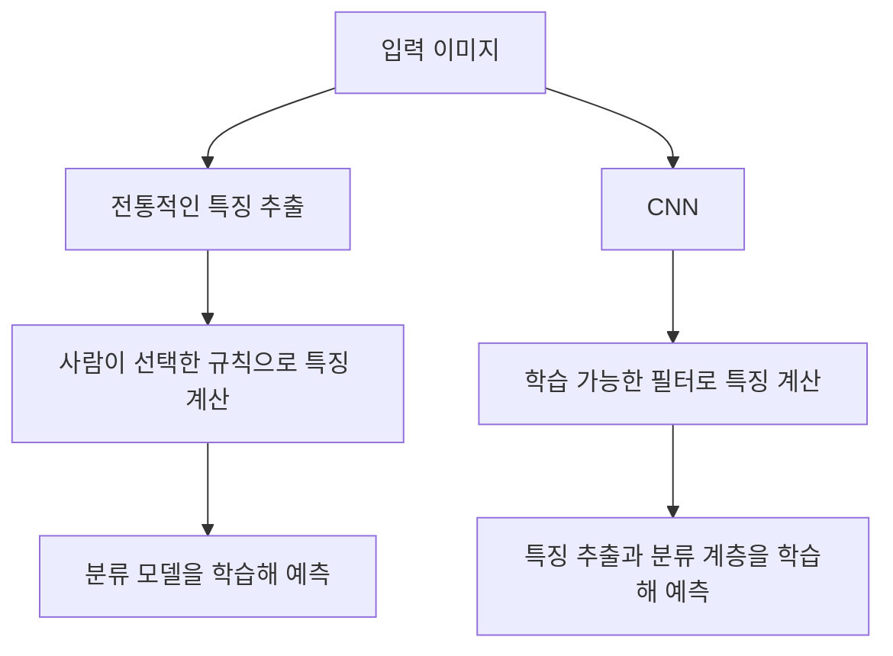
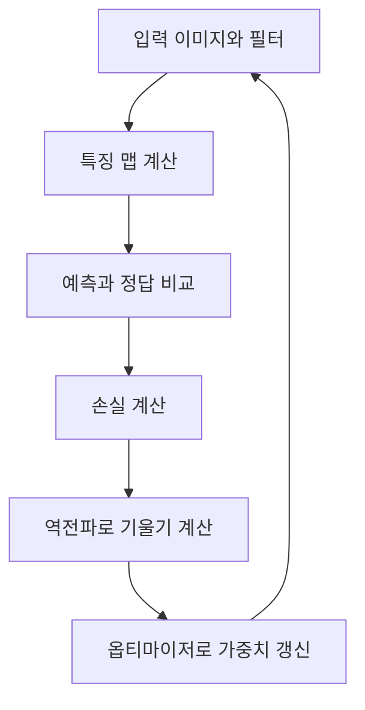
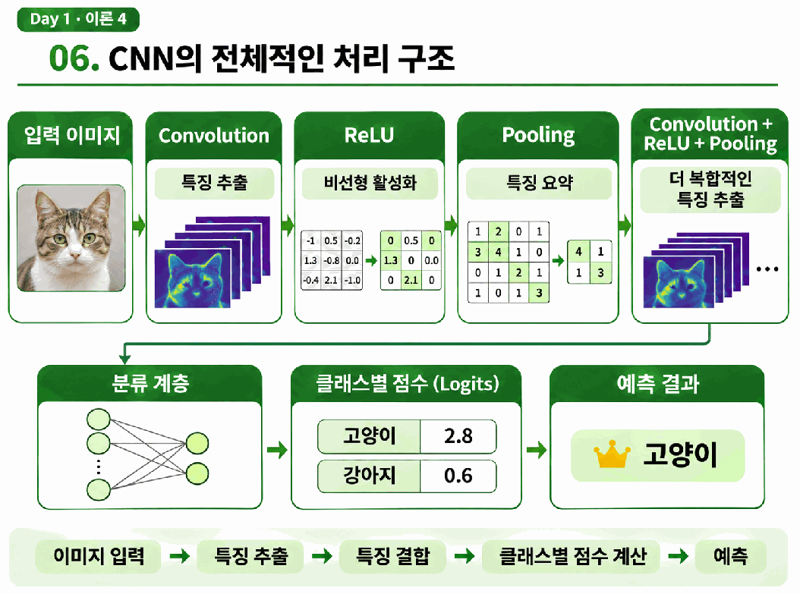
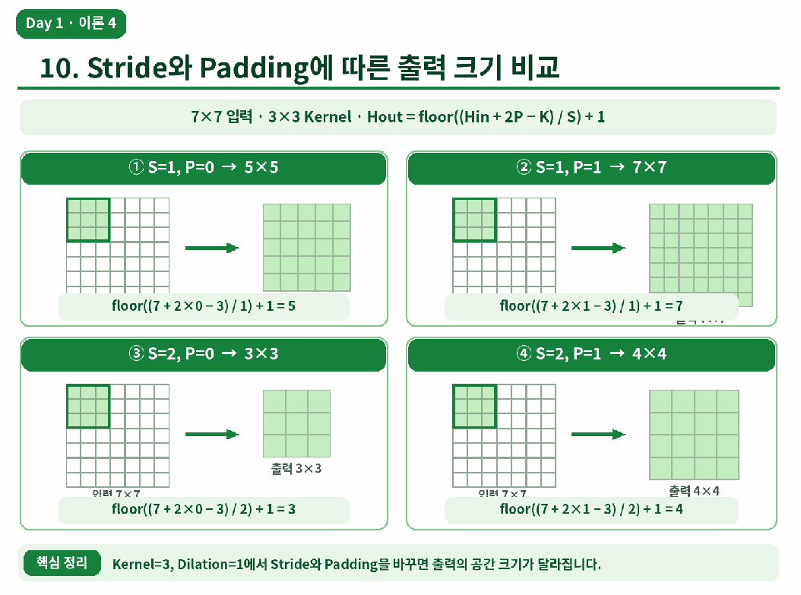
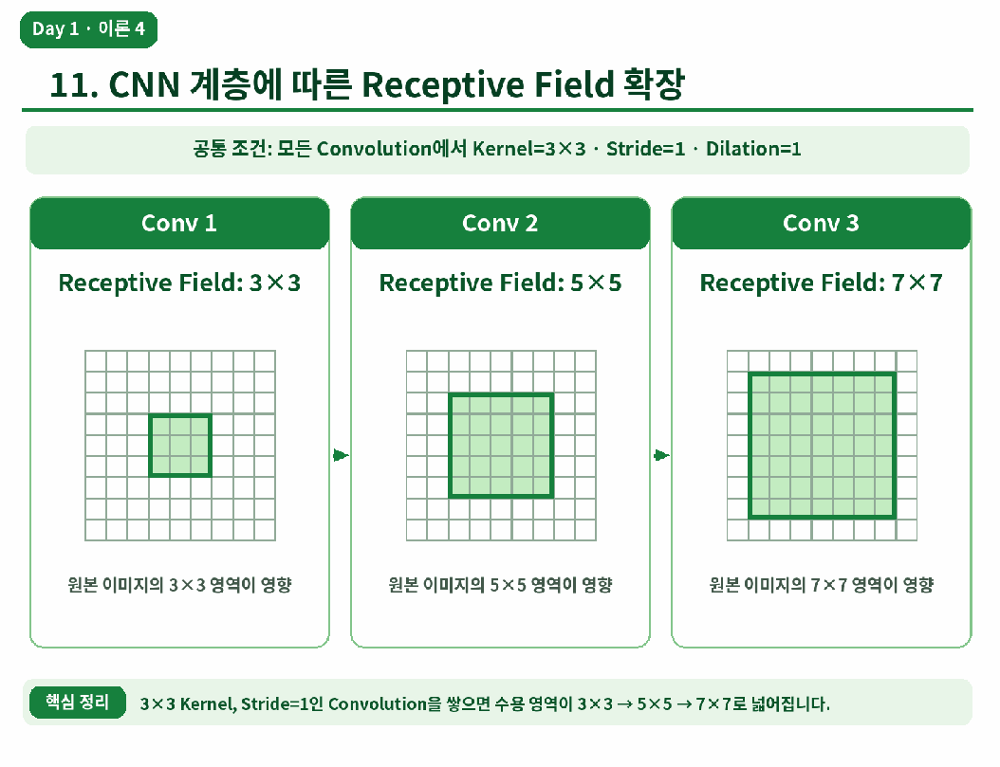

# Day 1. CNN의 등장과 학습 기반 특징 추출

> CNN은 이미지의 주변 공간을 활용하면서 특징을 추출하는 필터의 가중치를 학습한다. 고정 필터와의 차이, CNN의 처리 흐름, 출력 크기와 수용 영역을 정리한다.

## 1. 특징 추출과 CNN의 등장 (원본 1-6쪽)

전통적인 컴퓨터 비전에서는 사람이 소벨(Sobel), HOG, SIFT, ORB 같은 방법을 선택해 이미지 특징을 추출한다. 이 특징을 분류 모델에 전달하면 해당 모델은 학습 데이터로부터 분류 기준을 배울 수 있다.

문제에 맞는 특징을 사람이 결정해야 하므로 조명, 배경, 크기와 촬영 시점이 바뀌면 추출 조건을 다시 조정해야 할 수 있다. <strong>합성곱 신경망(Convolutional Neural Network, CNN)</strong>은 예측에 도움이 되는 필터의 가중치를 학습 데이터로부터 조정한다.

1998년의 LeNet-5는 합성곱과 공간 크기 축소를 사용해 손글씨 숫자를 분류한 초기 CNN이다. 2012년의 AlexNet은 더 깊은 CNN을 대규모 이미지에 적용했고 ReLU, GPU 학습, 드롭아웃과 데이터 증강을 활용했다. CNN이 등장한 뒤에도 문서 경계 검출처럼 목적이 분명한 작업에는 전통적인 방법을 사용할 수 있다.

## 2. 필터의 학습과 특징 맵 (원본 6-13쪽)

<strong>고정 필터(Fixed Filter)</strong>인 소벨은 좌우 밝기 차이를 계산하도록 정해진 가중치를 사용한다. CNN도 커널을 이동하며 입력과 가중치를 계산하지만, 필터 값은 손실을 줄이는 방향으로 갱신되는 학습 가능한 파라미터(Parameter)다.

원본의 경사 하강법(Gradient Descent) 예시는 현재 가중치 0.20, 학습률 0.1, 기울기 -0.40을 사용한다.

$$
\text{새 가중치}=\text{기존 가중치}-\text{학습률} \times \text{기울기}
$$

`0.20 - 0.1×(-0.40) = 0.24`이므로 가중치가 0.20에서 0.24로 바뀐다. 학습률은 기울기를 갱신에 얼마나 반영할지 정한다. 실제 학습에서는 필터의 여러 값과 다른 계층의 파라미터가 함께 바뀐다.

<strong>특징 맵(Feature Map)</strong>은 필터를 여러 위치에 적용한 결과를 공간적으로 모은 배열이다. 필터에 따라 경계나 질감 등에 반응할 수 있으며 값은 일반적으로 실수다. 경계 검출 결과인 에지 맵(Edge Map)과 달리 CNN 특징 맵은 학습한 필터가 반응한 여러 종류의 패턴을 표현할 수 있다.

RGB 입력에 3×3 필터 하나를 적용하면 세 입력 채널 전체를 사용하므로 가중치는 `3×3×3=27`개다. 각 채널의 결과를 합하고 편향(Bias)을 더해 출력 맵 하나를 만든다. 필터가 16개면 출력 특징 맵도 16개다.

## 3. CNN의 기본 처리 (원본 13-20쪽)

<strong>합성곱(Convolution)</strong>은 필터로 주변 특징을 계산한다. <strong>렐루(Rectified Linear Unit, ReLU)</strong>는 음수를 0으로 바꾸고 양수는 유지해 비선형성을 더한다. <strong>풀링(Pooling)</strong>은 주변 특징을 요약하며 공간 크기를 줄일 수 있다.

원본 18쪽의 그림은 특징 계산, 활성화, 풀링을 거쳐 분류하는 흐름을 보여준다.

최대 풀링(Max Pooling)은 영역의 최댓값을, 평균 풀링(Average Pooling)은 평균을 사용한다. 원본의 2×2 최대 풀링에서 영역 값이 `1, 3, 4, 6`이면 결과는 6이다. 일반적인 최대 풀링에는 별도로 학습할 필터 가중치가 없다.

특징 맵은 평탄화(Flatten)나 전역 평균 풀링(Global Average Pooling)으로 변환해 분류 계층에 전달할 수 있다. 분류 계층의 클래스별 점수를 <strong>로짓(Logits)</strong>이라고 하며, 필요한 경우 소프트맥스(Softmax)로 클래스별 확률을 구한다. 원본의 고양이 점수 2.8과 강아지 점수 0.6에서는 고양이를 예측한다.

## 4. 지역 연결과 가중치 공유 (원본 20-26쪽)

<strong>지역 연결(Local Connectivity)</strong>은 출력 위치 하나가 입력의 가까운 공간 영역을 참고하는 구조다. <strong>가중치 공유(Weight Sharing)</strong>는 같은 필터를 여러 위치에 재사용하는 방식이다. 두 원리 덕분에 가까운 픽셀의 관계를 활용하면서 위치마다 별도의 필터를 학습할 필요를 줄인다.

원본의 32×32 출력에 3×3 필터 하나와 편향 하나를 사용하는 예에서는 위치마다 별도 가중치를 두면 `1,024×(9+1)=10,240`개가 필요하다. 같은 필터를 공유하면 가중치 9개와 편향 1개로 총 10개다.

입력 채널 3개, 3×3 필터 16개에 편향을 사용하면 파라미터는 `(3×3×3+1)×16=448`개다. 입력 이미지의 높이와 너비가 바뀌면 출력 크기와 연산량은 달라질 수 있지만, 같은 필터의 파라미터 수는 유지된다.

## 5. 출력 크기와 수용 영역 (원본 26-33쪽)

<strong>스트라이드(Stride)</strong>는 필터가 이동하는 간격이다. <strong>패딩(Padding)</strong>은 입력 주변에 값을 추가해 가장자리 처리와 출력 크기를 조정한다. 출력 공간 크기는 입력 크기, 커널 크기, 스트라이드와 패딩에 따라 달라진다.

원본은 정사각형 커널과 딜레이션(Dilation)=1인 일반적인 합성곱에서 출력 높이를 다음과 같이 계산한다.

$$
H_{out}=\left\lfloor\frac{H_{in}+2P-K}{S}\right\rfloor+1
$$

Hin은 입력 높이, Hout은 출력 높이, P는 한쪽 패딩, K는 커널 크기, S는 스트라이드다. 내림 기호는 계산값을 넘지 않는 최대 정수를 뜻한다. 예를 들어 입력 7, K=3, P=1, S=2이면 `⌊(7+2-3)/2⌋+1=4`다.

원본 31쪽은 같은 7×7 입력에서 스트라이드와 패딩에 따라 5×5, 7×7, 3×3, 4×4 출력이 만들어지는 예를 비교한다. 출력 채널 수는 공간 크기와 별도로 필터 수에 의해 결정된다.

<strong>수용 영역(Receptive Field)</strong>은 출력 위치 하나에 영향을 줄 수 있는 원본 입력의 범위다. 원본의 3×3 커널, 스트라이드 1 조건에서는 합성곱을 세 번 연결하면서 원본 기준 수용 영역이 3×3, 5×5, 7×7로 넓어진다.

## 6. 계층적 특징과 해석 (원본 34-36쪽)

<strong>계층적 특징 추출(Hierarchical Feature Extraction)</strong>은 앞 계층의 특징을 다음 계층에서 다시 조합하는 방식이다. 초기 계층은 경계나 색상 변화에, 깊은 계층은 여러 특징이 결합된 질감이나 객체 부분에 반응할 수 있다.

특징 맵을 시각화하면 강하게 반응하는 위치를 볼 수 있다. 다만 한 맵이 여러 패턴에 반응할 수 있고, 밝게 보이는 위치가 최종 예측에서 가장 중요한 근거라고 단정할 수는 없다.

## 핵심 개념 비교표 (원본 36-39쪽)

| 구분 | 핵심 차이 |
| --- | --- |
| 고정 필터와 CNN 필터 | 사람이 정한 가중치와 학습으로 갱신하는 가중치 |
| 합성곱과 풀링 | 필터로 특징 계산과 주변 특징의 요약 |
| 지역 연결과 가중치 공유 | 참고할 주변 범위와 같은 필터의 위치별 재사용 |
| 출력 크기와 파라미터 수 | 계산되는 공간 위치 수와 학습할 값의 수 |
| 커널 크기와 수용 영역 | 한 계층의 참고 범위와 원본 기준의 영향 범위 |

## 최종 정리 (원본 37-39쪽)

- CNN은 예측 손실을 줄이도록 특징 추출 필터의 가중치를 학습한다.
- 특징 맵은 필터가 각 위치에서 계산한 결과이며, 여러 필터가 서로 다른 표현을 만든다.
- 합성곱은 특징을 계산하고 ReLU는 비선형성을 더하며 풀링은 주변을 요약한다.
- 지역 연결은 주변 공간을 사용하고 가중치 공유는 같은 필터를 여러 위치에 적용한다.
- 스트라이드와 패딩은 출력 크기를 바꾸며 필터 수는 출력 채널 수를 결정한다.
- 여러 계층을 거치면 수용 영역이 넓어지고 특징이 조합된다.
- 특징 맵의 밝은 위치만으로 모델의 최종 판단 근거를 확정할 수는 없다.
