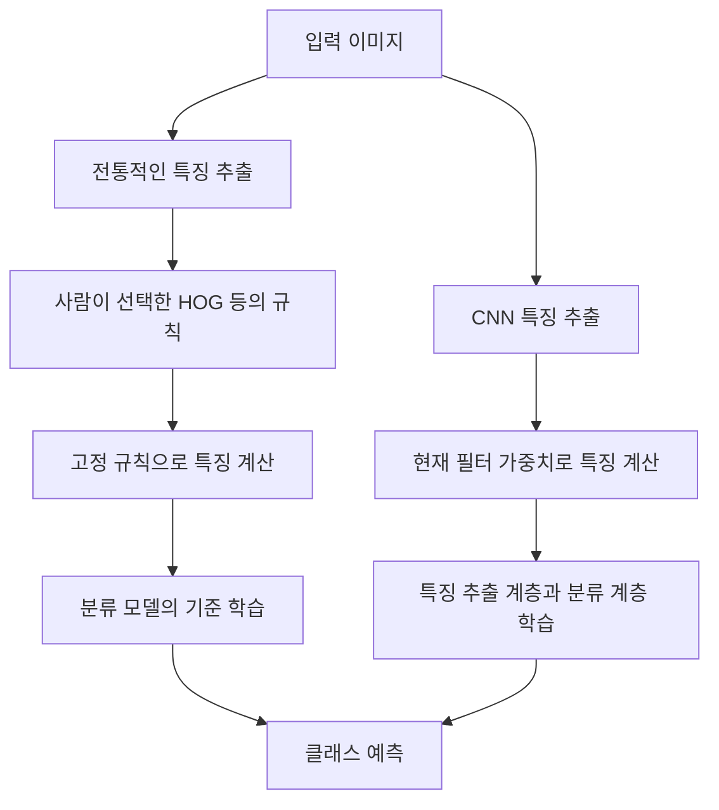
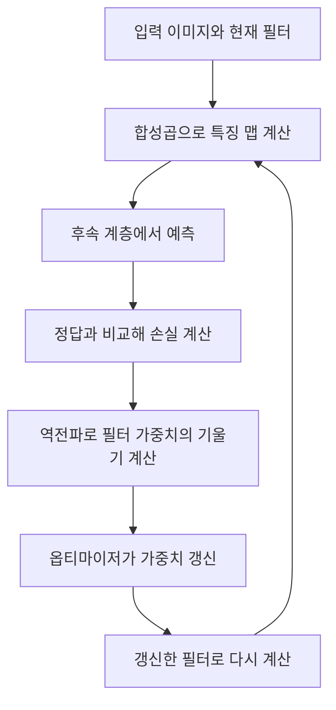
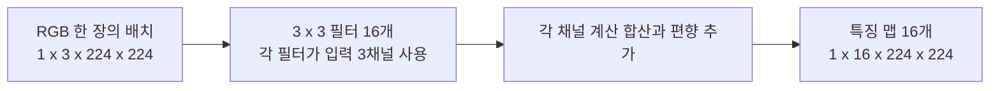
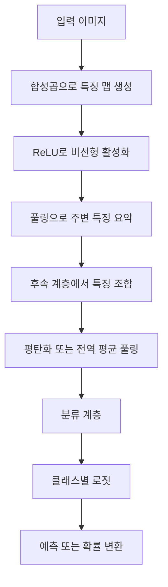
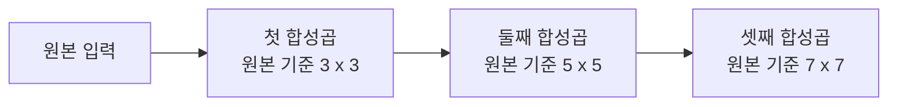
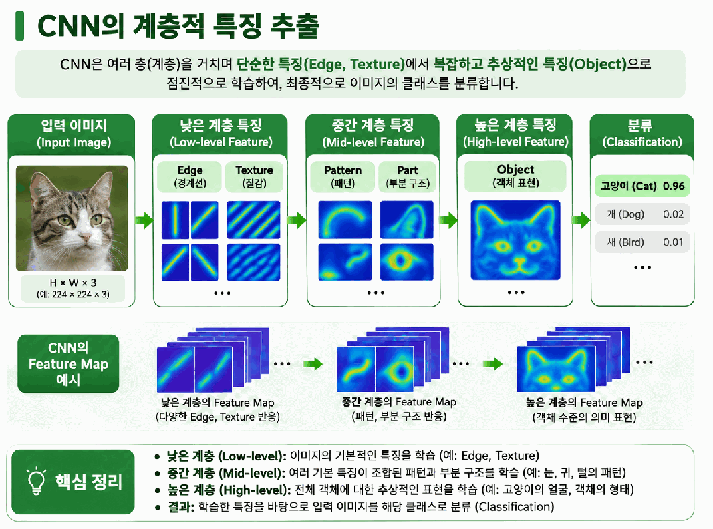
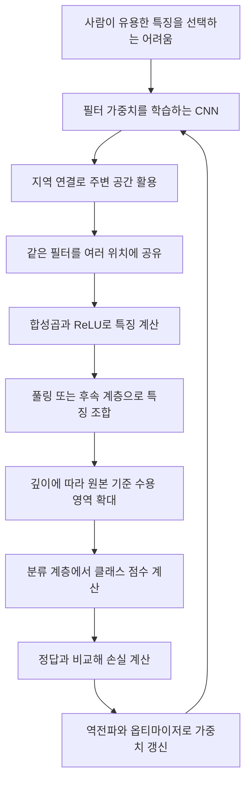

# Day 1. CNN의 등장과 학습 기반 특징 추출

> CNN은 이미지의 가까운 공간 관계를 활용하면서 특징을 추출하는 필터 자체를 학습한다. 고정 특징과의 차이, 가중치 학습, 합성곱의 출력 구조와 여러 계층에서 특징이 조합되는 과정을 정리한다.

## 1. 사람이 정한 특징에서 학습하는 특징으로 (원본 1~6쪽)

### 1.1 전통적인 특징 추출의 구조와 한계

**특징(Feature)**은 이미지의 분류나 비교에 활용할 수 있도록 원본 픽셀에서 얻은 정보다. 전통적인 컴퓨터 비전(Computer Vision)은 사람이 문제에 도움이 되는 계산 방법을 선택한다. 소벨(Sobel)은 경계의 밝기 변화, HOG는 작은 영역의 방향 분포, SIFT와 ORB는 특징점과 주변 패턴을 추출한다.

이처럼 사람이 규칙을 설계하거나 선택한 표현을 **수작업 설계 특징(Handcrafted Feature)**이라고 한다. 추출한 **특징 벡터(Feature Vector)**를 서포트 벡터 머신(Support Vector Machine, SVM) 같은 분류 모델에 입력해 클래스를 예측할 수 있다.

특징 계산 규칙이 고정되어 있어도 뒤의 분류 모델은 학습할 수 있다. 예를 들어 HOG 계산은 정해진 방식으로 수행하고 SVM은 학습 데이터에서 분류 기준을 배운다. **특징 추출 규칙의 학습과 분류 기준의 학습은 별개다.**

문제는 어떤 특징이 유용한지 사람이 미리 판단해야 한다는 점이다. 낮의 자동차에서 잘 작동한 경계 추출 설정이 야간이나 비 오는 날에도 그대로 적절할지는 알 수 없다. 조명, 배경, 잡음, 크기와 촬영 시점이 바뀌면 조건을 다시 조정해야 할 수 있다. 고양이 귀의 경계만 추출해도 귀가 가려진 사진이나 비슷한 경계를 가진 다른 물체를 구분하기는 어렵다.

### 1.2 CNN이 학습하는 대상

**합성곱 신경망(Convolutional Neural Network, CNN)**은 이미지의 공간 구조를 활용하고 필터의 가중치를 데이터로부터 학습하는 신경망이다. 사람이 어떤 경계나 질감이 유용한지 모두 정하는 대신, 모델이 학습 목표에 맞는 특징 표현을 만들도록 한다.

전통적인 방법도 문서 경계나 물체 윤곽 측정에 활용할 수 있다. CNN이 등장했다는 이유만으로 고정 이미지 처리가 모두 사라진 것은 아니다. 핵심 차이는 **특징을 계산하는 필터 가중치가 학습 대상인지**에 있다.

### 1.3 LeNet-5와 AlexNet

| 모델 | 발표 시기 | 주요 작업과 특징 | 이해할 점 |
| --- | --- | --- | --- |
| LeNet-5 | 1998년 | 손글씨 숫자 등 문서 이미지, 합성곱과 서브샘플링(Subsampling) | 필터를 학습하고 공간 크기를 줄여 분류한 초기 대표 사례 |
| AlexNet | 2012년 | 대규모 자연 이미지, 더 깊은 CNN, ReLU, GPU 학습 | 큰 데이터와 계산 자원에서 CNN의 효과를 보여준 사례 |

서브샘플링은 특징 표현의 공간 크기를 줄이는 처리다. AlexNet은 드롭아웃(Dropout)과 데이터 증강(Data Augmentation)을 사용해 과대적합을 완화했다. 원본은 세부 계층 암기보다 CNN이 필터를 학습한다는 흐름을 강조한다. AlexNet이 CNN을 처음 발명한 것은 아니다.

[추가 설명] 과대적합(Overfitting)은 훈련 데이터에는 잘 맞지만 새 데이터에서 성능이 떨어지는 상태다. 여기서 드롭아웃과 증강은 학습 결과가 특정 훈련 사례에 지나치게 의존하는 문제를 완화하기 위한 방법으로 이해한다.

## 2. 고정 필터와 학습 가능한 필터 (원본 6~13쪽)

### 2.1 필터 가중치의 차이

**고정 필터(Fixed Filter)**는 미리 정한 가중치를 적용한다. 소벨 X의 가중치는 좌우 밝기 차이를 계산하도록 정해져 있다. 이미지를 여러 장 처리해도 별도 수정 없이 값이 자동으로 학습되지는 않는다.

CNN도 작은 **커널(Kernel)**을 이동시키며 입력과 대응 가중치를 곱하고 합산한다. 하지만 그 숫자는 **학습 가능한 파라미터(Learnable Parameter)**다. 모델이 현재 숫자로 예측하고, 정답과의 오차에 따라 숫자를 바꾼다.

| 항목 | 고정 필터 | CNN의 필터 |
| --- | --- | --- |
| 가중치 결정 | 설계자가 정한 규칙 | 학습 과정에서 갱신 |
| 연산 | 현재 가중치와 입력 계산 | 현재 가중치와 입력 계산 |
| 목표 | 설계된 평균이나 밝기 차이 등 | 예측 목표에 유용한 표현 |
| 예 | 가우시안, 소벨 | CNN 합성곱 계층 |

연산에 작은 배열을 쓴다는 공통점과 가중치가 학습되는지의 차이를 구분해야 한다. 필터를 여러 위치에 적용하는 것 자체가 학습은 아니다. 학습은 정답과 손실을 이용해 파라미터를 갱신하는 과정이다.

### 2.2 손실에서 필터 갱신까지

**순전파(Forward Propagation)**는 입력에서 예측을 계산하는 과정이다. **손실(Loss)**은 예측과 정답의 차이를 수치로 나타낸다. **역전파(Backpropagation)**는 그 손실이 각 가중치에 따라 어떻게 변하는지 계산한다. **옵티마이저(Optimizer)**는 계산한 기울기를 사용해 가중치를 갱신한다.

원본은 **경사 하강법(Gradient Descent)**으로 가중치 하나를 바꾸는 예를 사용한다. **학습률(Learning Rate)**은 계산한 기울기를 얼마나 반영할지 정하는 값이다.

$$
w_{\mathrm{new}}=w_{\mathrm{old}}-\eta g
$$

w는 가중치, η는 학습률, g는 해당 가중치에 대한 손실의 기울기다. 기존 가중치 0.20, 기울기 -0.40, 학습률 0.1이면 다음과 같다.

| 단계 | 계산 |
| --- | --- |
| 기울기에 학습률 적용 | 0.1×(-0.40)=-0.04 |
| 기존 값에서 빼기 | 0.20-(-0.04)=0.24 |
| 새 가중치 | 0.24 |

기울기가 음수이므로 이 갱신에서는 가중치가 증가한다. 같은 기울기라면 학습률이 커질수록 한 번의 갱신 폭도 커진다. 실제 CNN에서는 필터 내부의 여러 가중치와 다른 계층의 파라미터가 함께 학습된다. 같은 필터가 여러 공간 위치에서 쓰이므로 각 위치의 계산 영향도 해당 필터의 기울기에 반영된다.

### 2.3 특징 맵의 의미

**특징 맵(Feature Map)**은 필터를 여러 위치에 적용한 결과를 공간적으로 배열한 것이다. 세로 경계와 비슷한 패턴에 반응하는 필터는 해당 위치에서 큰 값을 만들 수 있다. 다른 필터는 수평 경계나 질감에 반응할 수 있다.

특징 맵은 반드시 0과 255인 이미지가 아니다. 일반적으로 실수값이며 연산과 활성화 함수에 따라 범위가 달라진다. 사람이 보기 좋게 표시하려고 값을 변환할 수도 있다. 따라서 시각화의 밝기를 원본 픽셀 밝기와 동일하게 해석하지 않는다.

**에지 맵(Edge Map)**은 경계 검출 목적에 따른 변화나 선택 결과다. CNN 특징 맵은 학습한 필터가 반응한 값이므로 경계 이외의 패턴도 표현할 수 있다.

### 2.4 RGB 입력과 출력 채널

RGB 입력의 채널은 세 개다. 일반적인 3×3 합성곱에서 출력 맵 하나를 만드는 필터는 각 입력 채널의 3×3 영역을 모두 사용한다. 필요한 가중치는 3×3×3=27개이며, 채널별 계산을 합산하고 **편향(Bias)**을 더해 출력값 하나를 만든다.

필터가 16개면 각 필터가 세 입력 채널을 함께 처리해 출력 맵 16개를 만든다. 출력 채널 16을 RGB 색상 성분 16개로 해석하지 않는다. 학습된 특징 표현이 16개라는 뜻이다.

이 도식은 스트라이드 1, 패딩 1로 높이와 너비를 유지하는 원본 조건이다. 필터 개수는 출력 채널을 결정하고 공간 크기는 커널 크기, 스트라이드, 패딩으로 결정된다.

## 3. 합성곱, 활성화, 풀링과 분류 (원본 13~20쪽)

### 3.1 합성곱과 ReLU

**합성곱(Convolution)**은 작은 필터로 여러 위치의 주변 값을 계산해 특징 맵을 만든다. 한 계층의 출력이 다음 계층의 입력이 되므로 후속 계층은 원본 픽셀 대신 앞서 계산한 특징을 조합할 수 있다.

**활성화 함수(Activation Function)**는 신경망에 비선형성을 더한다. **정류 선형 함수(Rectified Linear Unit, ReLU)**는 음수를 0으로 바꾸고 양수는 유지한다.

$$
\operatorname{ReLU}(x)=\max(0,x)
$$

x는 합성곱 등의 결과로 들어온 값이다. 0과 비교해 큰 값을 선택하므로 -3은 0, -1은 0, 0은 0, 2는 2, 5는 5가 된다. 원본의 특징 맵에 적용하면 다음과 같다.

| 행 | 합성곱 출력 | ReLU 출력 |
| --- | --- | --- |
| 첫째 행 | -2, 3, 1 | 0, 3, 1 |
| 둘째 행 | 4, -1, 0 | 4, 0, 0 |
| 셋째 행 | -3, 2, 5 | 0, 2, 5 |

선형적인 계산만 여러 번 이어서는 표현할 수 있는 관계에 한계가 있다. ReLU 같은 비선형 함수를 함께 사용하면 여러 계층에서 복잡한 특징 관계를 표현할 수 있다. 출력 숫자가 어떻게 바뀌는지뿐 아니라 왜 합성곱 뒤에 이런 함수를 두는지도 연결해 이해해야 한다.

### 3.2 최대 풀링과 평균 풀링

**풀링(Pooling)**은 특징 맵의 주변 영역을 하나의 값으로 요약하는 연산이다. **최대 풀링(Max Pooling)**은 가장 큰 값, **평균 풀링(Average Pooling)**은 영역의 평균을 사용한다. 일반적인 최대 풀링에는 새로 학습하는 필터 가중치가 없다.

원본은 다음 4×4 특징 맵에 2×2 최대 풀링을 두 칸 간격으로 적용한다.

| 행 | 1열 | 2열 | 3열 | 4열 |
| --- | ---: | ---: | ---: | ---: |
| 1행 | 1 | 3 | 2 | 0 |
| 2행 | 4 | 6 | 1 | 2 |
| 3행 | 5 | 0 | 3 | 1 |
| 4행 | 2 | 1 | 7 | 4 |

| 처리 영역 | 네 값 | 최대값 |
| --- | --- | ---: |
| 왼쪽 위 | 1, 3, 4, 6 | 6 |
| 오른쪽 위 | 2, 0, 1, 2 | 2 |
| 왼쪽 아래 | 5, 0, 2, 1 | 5 |
| 오른쪽 아래 | 3, 1, 7, 4 | 7 |

결과는 첫 행이 6, 2이고 둘째 행이 5, 7인 2×2 맵이다. 공간 크기가 4×4에서 2×2로 줄고 영역별 가장 강한 활성화가 남는다. 모든 원래 값을 보존하는 작업은 아니다.

[추가 설명] 같은 왼쪽 위 영역에 평균 풀링을 적용하면 (1+3+4+6)÷4=3.5다. 최대 풀링의 6은 가장 큰 반응을, 평균 풀링의 3.5는 영역의 평균 반응을 나타낸다.

### 3.3 특징에서 클래스 점수로

여러 계층을 거친 특징 맵은 **평탄화(Flatten)**로 한 줄로 펼치거나 **전역 평균 풀링(Global Average Pooling)** 등으로 요약해 분류 계층에 전달할 수 있다. 분류 계층은 그 특징을 조합해 **로짓(Logits)**이라는 클래스별 점수를 만든다.

원본에서 고양이 로짓은 2.8, 강아지는 0.6이다. 점수가 높은 고양이를 예측한다. 이 숫자는 합이 1인 확률이 아니다. 필요한 경우 **소프트맥스(Softmax)**를 사용해 클래스별 확률로 변환할 수 있다.

원본 18쪽 그림은 입력 이미지에서 특징 맵을 만들고 ReLU와 풀링을 거쳐 분류하는 흐름을 보여준다. 합성곱은 특징 계산, ReLU는 비선형성 추가, 풀링은 요약을 맡는다. 실제 모델에서는 이 연산의 조합이 달라질 수 있으며 모든 합성곱 바로 뒤에 반드시 풀링이 오는 것은 아니다.

## 4. 지역 연결과 가중치 공유 (원본 20~26쪽)

### 4.1 주변 공간을 사용하는 구조

**완전연결계층(Fully Connected Layer)**의 출력 뉴런은 이전 계층의 모든 입력값을 이용한다. 224×224 RGB 이미지만 해도 224×224×3=150,528개 값이 있다. 작은 경계를 찾기 위해 매번 모든 픽셀을 같은 방식으로 연결할 필요는 없다.

**지역 연결(Local Connectivity)**은 출력 위치 하나를 계산할 때 제한된 주변 공간을 참고한다. 3×3 필터는 3×3 공간의 값을 사용한다. 일반적인 합성곱에서는 공간 범위가 작아도 그 위치의 입력 채널 전체를 함께 계산한다.

지역 연결은 가까운 픽셀 사이의 관계를 활용한다. 그러나 주변만 연결한다고 해서 위치마다 같은 가중치를 사용하는 것까지 자동으로 정해지지는 않는다. 이 점을 설명하는 개념이 가중치 공유다.

### 4.2 같은 필터를 재사용하는 효과

**가중치 공유(Weight Sharing)**는 이미지의 여러 위치에 같은 필터를 반복 적용하는 구조다. 왼쪽 위에 쓰는 3×3 필터와 오른쪽 아래에 쓰는 필터의 숫자가 같다. 각 위치의 입력은 달라도 계산 규칙은 공유한다.

이에 따라 비슷한 패턴이 어디에 있든 같은 필터로 반응을 계산할 수 있고, 위치마다 별도 파라미터를 학습할 필요도 줄어든다. 원본은 32×32인 1채널 입력, 3×3 필터, 출력 1채널, 스트라이드 1, 패딩 1을 비교한다. 출력 위치 수는 1,024개다.

| 구조 | 계산 | 파라미터 수 |
| --- | --- | ---: |
| 위치마다 별도 가중치를 둔 지역 연결 | 1,024×(9개 가중치+1개 편향) | 10,240 |
| 필터를 공유하는 합성곱 | 9개 가중치+1개 편향 | 10 |

첫 구조는 모든 입력을 연결한 완전연결계층이 아니라, 가중치만 공유하지 않는 가상의 지역 연결 구조다. 이 비교는 같은 작은 주변 영역을 보더라도 공유 여부에 따라 필요한 파라미터 수가 달라진다는 점을 보여준다.

### 4.3 여러 입력과 출력 채널의 파라미터

편향을 포함하는 원본의 일반적인 합성곱 계층은 다음과 같이 계산한다.

$$
\text{파라미터 수}=(C_{\mathrm{in}}K_hK_w+1)C_{\mathrm{out}}
$$

입력 채널 수가 Cin, 필터 높이와 너비가 Kh와 Kw, 출력 채널 수가 Cout다. 입력 채널 전체를 보는 필터 하나에 필요한 가중치 수를 먼저 구하고 편향 하나를 더한다. 이를 출력 맵 개수만큼 갖는다.

입력 채널 3, 필터 3×3, 출력 채널 16이면 다음과 같다.

| 계산 단계 | 결과 |
| --- | --- |
| 출력 맵 하나의 가중치 | 3×3×3=27 |
| 편향 포함 | 27+1=28 |
| 출력 16개 | 28×16=448 |
| 가중치 텐서의 형태 | (16, 3, 3, 3) |

가중치 텐서의 순서는 출력 채널, 입력 채널, 필터 높이, 필터 너비다. 입력 이미지의 높이와 너비는 이 파라미터 계산에 들어가지 않는다. 필터를 재사용하기 때문이다. **입력 크기가 바뀌면 출력 공간과 연산량은 달라질 수 있지만 같은 필터의 파라미터 수는 유지된다.** 파라미터 수와 연산량을 같은 개념으로 취급하지 않는다.

## 5. 출력 크기를 정하는 설정 (원본 26~31쪽)

### 5.1 스트라이드와 패딩

**스트라이드(Stride)**는 커널이 움직이는 간격이다. 1이면 한 칸씩, 2이면 두 칸씩 이동한다. 간격이 커지면 일반적으로 계산할 출력 위치가 줄어든다.

**패딩(Padding)**은 입력의 위아래와 양옆에 값을 추가하는 방법이다. 원본의 일반적인 설정은 0으로 채운다. 패딩 1은 각 방향으로 한 줄을 더한다는 의미이며 가장자리의 계산 범위와 출력 크기를 조절한다.

### 5.2 출력 크기 공식과 계산

원본은 정사각형 커널을 쓰고 커널 내부 간격을 늘리지 않는 딜레이션(Dilation)=1 조건을 가정한다. 출력 높이는 다음과 같다.

$$
H_{\mathrm{out}}=\left\lfloor\frac{H_{\mathrm{in}}+2P-K}{S}\right\rfloor+1
$$

| 기호 | 뜻 |
| --- | --- |
| Hin | 입력 높이 |
| Hout | 출력 높이 |
| P | 한쪽에 추가하는 패딩 크기 |
| K | 커널의 한 변 크기 |
| S | 스트라이드 |
| 내림 기호 ⌊ ⌋ | 계산값을 넘지 않는 최대 정수 |

패딩은 위와 아래에 각각 들어가므로 높이에 2P를 더한다. 커널 전체가 들어갈 수 있는 이동 범위를 구하고 S 간격으로 가능한 위치 수를 계산한다. 시작 위치도 한 개이므로 마지막에 1을 더한다. 출력 너비도 같은 방식이다.

| 입력 높이 7, 커널 3 | 대입 과정 | 출력 높이 |
| --- | --- | ---: |
| S=1, P=0 | ⌊(7-3)/1⌋+1 | 5 |
| S=1, P=1 | ⌊(7+2-3)/1⌋+1 | 7 |
| S=2, P=0 | ⌊(7-3)/2⌋+1 | 3 |
| S=2, P=1 | ⌊(7+2-3)/2⌋+1 | 4 |

원본 31쪽 그림은 같은 7×7 입력에서 이동 간격과 주변 공간만 바꾸어 5×5, 7×7, 3×3, 4×4가 되는 이유를 보여준다. 이 계산은 공간 크기에 관한 것이다. 출력 채널은 필터 수로 별도로 결정된다. 입력이 `(1, 3, 7, 7)`, 출력 채널이 16이고 S=2, P=1이면 출력은 `(1, 16, 4, 4)`다.

## 6. 수용 영역과 계층적 특징 추출 (원본 31~36쪽)

### 6.1 수용 영역이 넓어지는 원리

**수용 영역(Receptive Field)**은 특정 출력 위치에 영향을 줄 수 있는 원본 입력의 공간 영역이다. 첫 계층은 원본의 3×3을 볼 수 있지만 둘째 계층은 앞서 계산된 여러 출력 위치를 함께 본다. 그 위치들이 원본의 서로 겹치는 영역에서 왔으므로 원본 기준의 참고 범위가 더 넓어진다.

모든 합성곱의 커널이 3×3, 스트라이드 1, 딜레이션 1인 원본 예제에서는 다음과 같다.

필터 하나의 공간 크기가 계속 3×3이어도 깊은 계층의 출력은 원본에서 더 넓은 범위의 영향을 받을 수 있다. 풀링이나 다른 스트라이드가 포함되면 범위가 달라지므로 모든 모델에 3, 5, 7 규칙을 그대로 적용하지 않는다.

원본 33쪽의 색칠된 영역은 각 출력 하나가 원본에서 영향을 받을 수 있는 이론적 범위를 보여준다. 작은 범위는 밝기 변화의 일부를, 더 넓은 범위는 여러 경계의 조합이나 자동차 바퀴 같은 부분 구조를 표현하는 데 필요한 정보를 담을 수 있다.

### 6.2 단순한 특징을 조합한 표현

**계층적 특징 추출(Hierarchical Feature Extraction)**은 여러 계층에서 이전 특징을 조합해 표현하는 방식이다. 고양이 사진에는 색상 변화, 털의 질감, 눈과 귀의 경계, 머리와 몸통의 형태, 부분 사이의 관계가 함께 있다. 한 번의 국소 계산만으로 이러한 관계를 모두 표현하기는 어렵다.

| 계층의 경향 | 나타날 수 있는 반응 |
| --- | --- |
| 초기 계층 | 경계, 방향, 색상 변화 |
| 중간 계층 | 질감, 모서리, 반복되는 패턴 |
| 깊은 계층 | 여러 특징의 조합, 객체 부분과 관련된 표현 |

이는 관찰할 수 있는 일반적인 경향이다. 특정 깊이의 모든 필터가 하나의 정해진 의미만 학습한다는 뜻은 아니다. 다음 계층이 여러 입력 특징 맵을 다시 조합하면서 원본 픽셀보다 복합적인 표현을 형성한다.

원본 35쪽 그림은 경계와 질감에서 복합적인 표현으로 이어지는 흐름을 보여주는 설명용 그림이다. 그림 속 밝은 반응과 클래스 점수는 계층별 역할을 이해하는 자료로 읽어야 한다.

### 6.3 특징 맵 해석의 한계

특징 맵을 시각화하면 어떤 위치에서 반응이 강한지 관찰할 수 있다. 그러나 맵 하나로 모델이 어떤 개념을 배웠는지 확정할 수는 없다. 하나의 채널이 여러 패턴에 반응할 수 있고 계층이나 채널마다 값의 범위도 다르다.

밝은 위치가 최종 분류에서 가장 중요한 위치라는 보장도 없다. 후속 계층이 여러 맵을 어떻게 조합했는지까지 관계가 이어지기 때문이다. **특징 맵은 내부 표현을 관찰하는 자료이며 그 자체가 완전한 예측 근거 설명은 아니다.**

## 7. 핵심 개념 비교표 (원본 36~39쪽)

| 구분 | 역할 | 혼동하지 않을 점 |
| --- | --- | --- |
| 고정 필터와 학습 필터 | 정해진 계산과 데이터 기반 가중치 갱신 | 커널을 쓴다는 사실만으로 학습하는 것은 아님 |
| 에지 맵과 CNN 특징 맵 | 경계 정보와 학습한 표현 | 특징 맵이 항상 경계 또는 이진 이미지인 것은 아님 |
| 합성곱과 풀링 | 학습 가능한 특징 계산과 정해진 요약 | 일반적인 풀링에는 필터 학습이 없음 |
| ReLU와 소프트맥스 | 중간 표현의 비선형 변환과 클래스 확률 변환 | 적용 목적이 다름 |
| 입력 채널과 출력 채널 | 입력 성분 수와 출력 특징 맵 수 | RGB 성분과 학습된 특징 채널은 의미가 다름 |
| 지역 연결과 가중치 공유 | 참고할 주변 범위와 위치별 필터 재사용 | 연결 범위를 줄이는 것과 같은 숫자를 쓰는 것은 별개 |
| 출력 크기와 파라미터 수 | 계산되는 공간 위치 수와 학습할 숫자 수 | 큰 입력이 같은 필터의 파라미터를 늘리지는 않음 |
| 커널 크기와 수용 영역 | 한 계층의 공간 범위와 원본 기준 영향 범위 | 깊은 계층에서 두 크기가 같지 않을 수 있음 |

## 8. 전체 학습 흐름 (원본 37~39쪽)

## 9. 핵심 정리 (원본 37~39쪽)

- CNN은 특징을 추출하는 계산 규칙의 숫자까지 학습한다. 고정 특징 뒤에 분류기만 학습하는 구조와 학습 대상이 다르다.
- 학습은 현재 필터로 예측하고 손실의 기울기를 구해 가중치를 바꾸는 반복이다. 필터를 여러 위치에 적용하는 연산 자체와 구분한다.
- 일반적인 RGB 합성곱은 입력 세 채널을 함께 계산한다. 필터 수는 출력 특징 채널 수를 결정한다.
- 합성곱은 특징 계산, ReLU는 비선형성 추가, 풀링은 주변 요약을 맡는다. 이후 분류 계층이 로짓을 만들고 필요하면 확률로 변환한다.
- 지역 연결은 참고 범위를 제한하고 가중치 공유는 같은 필터를 재사용한다. 두 구조는 각각 공간 관계 활용과 파라미터 효율에 관여한다.
- 스트라이드와 패딩은 출력 공간 크기를 정한다. 필터 파라미터 수와 출력 위치 수는 다른 기준으로 계산한다.
- 계층이 깊어지면 앞의 특징을 조합하고 더 넓은 원본 영역을 반영할 수 있다. 특징 맵의 시각화만으로 최종 판단 근거를 단정하지 않는다.
