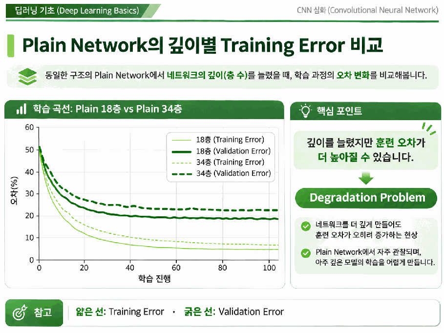
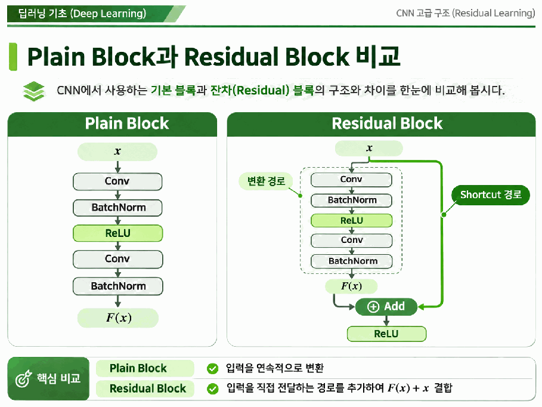

# Day 2. 깊은 CNN의 문제와 잔차 학습

> CNN을 깊게 만들면 복잡한 특징을 표현할 수 있지만 학습이 어려워질 수 있다. 잔차 연결은 입력을 직접 전달하는 경로를 추가해 깊은 모델의 최적화를 돕는다.

## 1. 깊이와 학습의 어려움 (1-5쪽)

합성곱 신경망(Convolutional Neural Network, CNN)은 앞 계층에서 만든 특징을 다음 계층에서 조합한다.
예를 들어 초기에는 경계나 색상 변화, 깊은 계층에서는 질감과 객체의 부분처럼 복합적인 특징을 표현할 수 있다.
계층을 거치면서 출력에 영향을 주는 입력 영역도 넓어진다.

순전파에서는 입력이 여러 계층을 거쳐 예측으로 바뀐다.
역전파에서는 손실의 기울기가 반대 방향으로 전달되므로, 깊어질수록 앞 계층의 가중치를 갱신하기까지 더 많은 계산을 거친다.

**기울기 소실(Vanishing Gradient)** 은 역전파 중 기울기가 작아져 앞 계층의 학습이 어려워지는 현상이다.
연쇄법칙에 따라 작은 미분값이 반복해서 곱해질 때 발생할 수 있다.

| 전달 단계 | 계산 | 기울기 |
| --- | --- | --- |
| 시작 | 1 | 1 |
| 2단계 | 1 × 0.5² | 0.25 |
| 4단계 | 1 × 0.5⁴ | 0.0625 |
| 8단계 | 1 × 0.5⁸ | 약 0.0039 |

매 계층에서 0.5가 곱해지는 설명용 예다.
실제 기울기는 가중치와 활성화 함수, 정규화 등 여러 조건에 따라 달라진다.

## 2. 성능 저하와 과적합 (6-8쪽)

**성능 저하 문제(Degradation Problem)** 는 모델을 깊게 만들었는데 최적화가 어려워져 더 얕은 모델보다 훈련 오차가 높아지는 현상이다.
기울기 소실은 학습을 어렵게 하는 한 요인이지만, 성능 저하의 모든 원인을 뜻하지는 않는다.

> 7쪽: 깊은 일반 네트워크에서 훈련 오차가 더 높게 나타나는 상황을 보여 준다. 곡선은 깊이에 따른 학습 문제를 설명하는 예시다.

과적합(Overfitting)은 훈련 데이터에는 잘 맞지만 새로운 데이터로 일반화하지 못하는 문제다.
성능 저하 문제는 훈련 데이터에서부터 깊은 모델의 최적화가 어려운 경우에 초점을 둔다.

일반 CNN과 잔차 CNN은 모두 깊은 특징 표현을 만들 수 있다.
차이는 잔차 블록이 원하는 변환을 입력에 더할 변화량으로 표현하고, 입력을 전달하는 별도 경로를 갖는 데 있다.
깊이만으로 실제 정확도가 결정되는 것은 아니다.

## 3. 초기화와 배치 정규화 (8-11쪽)

가중치 초기화(Weight Initialization)는 학습을 시작할 때 가중치의 크기를 정한다.
자비에 초기화(Xavier Initialization)는 입력과 출력 연결 수를 고려하고, 허 초기화(He Initialization)는 음수를 0으로 바꾸는 렐루(Rectified Linear Unit, ReLU)의 특성을 고려한다.

배치 정규화(Batch Normalization)는 학습 중 미니배치의 통계로 중간 값을 정규화하고, 학습 가능한 크기와 이동값을 적용한다.
CNN에서는 보통 채널별 통계를 사용하며, 추론에서는 학습 중 누적한 통계를 사용한다.
두 방법은 학습을 안정화하지만 깊이에 따른 최적화 문제가 항상 사라지는 것은 아니다.

## 4. 잔차 연결의 원리 (11-16쪽)

잔차 학습(Residual Learning)은 블록이 입력을 바탕으로 필요한 변화량을 계산하게 한다.
입력을 $x$, 블록의 변환 결과를 $F(x)$라 하면 더하기 직전의 결과는 다음과 같다.

$$
H(x)=x+F(x)
$$

$x=3$, $F(x)=0.5$이면 결과는 3.5다.
입력을 유지하는 것이 적절할 때 $F(x)=0$이면 합산 결과는 $x$다.
실제 기본 블록에서는 **더한 뒤 ReLU를 적용할 수 있으므로** 블록의 최종 출력과 합산 결과를 구분한다.

> 14쪽: 변환 경로는 새로운 특징을 계산하고, 지름길 연결은 입력을 더하기 지점까지 전달한다.

지름길 연결(Shortcut Connection) 또는 건너뛰기 연결(Skip Connection)은 중간 연산을 건너뛰는 경로다.
입력을 그대로 전달하는 항등 매핑(Identity Mapping)은 기존 특징을 재사용하고 역전파에서 기울기가 덧셈을 통해 전달될 경로를 제공한다.
이 경로가 있어도 변환 경로는 함께 학습된다.

## 핵심 개념 비교표

| 구분 | 핵심 역할 |
| --- | --- |
| 기울기 소실 | 역전파 기울기가 작아져 앞 계층 학습이 어려움 |
| 성능 저하 문제 | 깊은 모델이 훈련 데이터에서도 최적화되기 어려움 |
| 과적합 | 훈련과 새로운 데이터 사이의 일반화 차이 |
| 초기화와 배치 정규화 | 학습 전 가중치 크기 설정과 학습 중 활성화값 조절 |
| 일반 블록과 잔차 블록 | 순차 변환과 입력을 더하는 별도 경로 |

## 핵심 정리

- 깊은 CNN은 여러 계층의 특징을 조합하지만 최적화도 어려워질 수 있다.
- 작은 미분값이 반복해서 곱해지면 앞 계층의 기울기가 작아질 수 있다.
- 성능 저하 문제는 깊은 모델의 높은 훈련 오차를 살펴본다.
- 초기화와 배치 정규화는 값의 규모와 학습을 안정화하는 데 도움을 준다.
- 잔차 연결은 입력과 학습한 변화량을 더하고 기울기 전달 경로를 제공한다.
- 실제 블록에서는 합산 뒤의 활성화 함수까지 고려해 출력을 해석한다.
