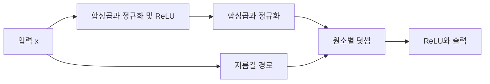
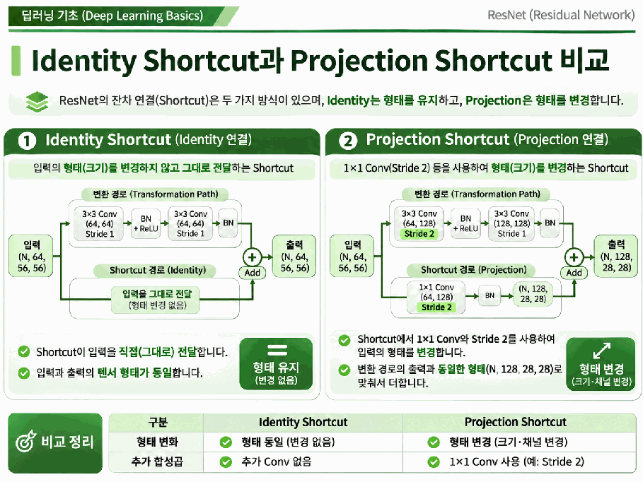
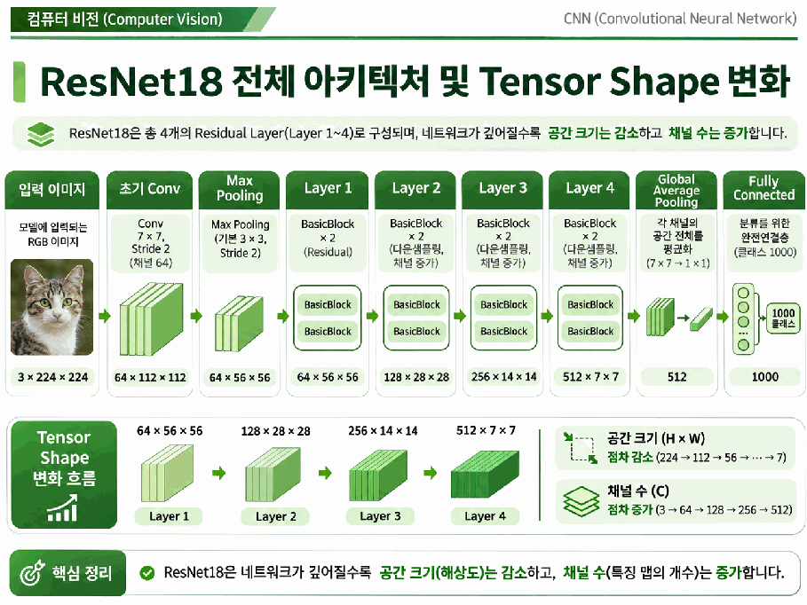

# Day 2. ResNet과 현대적인 CNN 아키텍처

> ResNet은 잔차 블록을 반복하며 특징을 추출한다. 입력 형태가 달라질 때의 지름길 연결과 이후 CNN의 발전 방향을 살펴본다.

## 1. 기본 잔차 블록과 형태

기본 블록(BasicBlock)은 두 개의 3×3 합성곱(Convolution)을 중심으로 구성된다.  
변환 경로는 첫 합성곱과 배치 정규화, ReLU를 거친 뒤 두 번째 합성곱과 배치 정규화를 수행한다.  
여기에 지름길 경로의 값을 더한 다음 ReLU를 적용한다.

입력이 `(N, 64, 56, 56)`이고 변환 경로가 채널 수와 공간 크기를 유지하면 두 경로의 값을 같은 위치끼리 더할 수 있다.  
N은 배치 크기이고 나머지는 채널, 높이, 너비다.

## 2. 항등 연결과 투영 연결

**항등 지름길(Identity Shortcut)** 은 입력과 변환 결과의 형태가 같을 때 입력을 그대로 전달한다.  
채널 수나 공간 크기가 달라지는 경우에는 **투영 지름길(Projection Shortcut)** 로 입력을 변환해 두 경로의 형태를 맞춘다.

예를 들어 `(N, 64, 56, 56)`에서 `(N, 128, 28, 28)`로 바뀌면 입력을 그대로 더할 수 없다.  
1×1 합성곱으로 출력 채널을 128개로 만들고 스트라이드 2를 적용하면 공간 크기를 28×28로 줄일 수 있다.  
실습에서 다루는 TorchVision ResNet18의 해당 지름길은 1×1 합성곱과 배치 정규화를 사용한다.

> 두 경로의 결과는 덧셈 전에 같은 형태여야 한다. 투영 연결은 필요할 때 채널과 공간 크기를 조정한다.

## 3. ResNet18의 전체 구조

ResNet18은 초기 합성곱과 최대 풀링 뒤에 네 단계의 잔차 블록을 사용한다.  
단계가 진행되면서 공간 크기를 줄이고 채널 수를 늘려 특징 표현을 바꾼다.  
각 단계에는 기본 블록 두 개가 있다.

> 224×224 이미지가 초기 처리와 네 단계를 거쳐 512개 채널의 7×7 특징 맵이 된다.

| 처리 단계 | 출력 형태 |
| --- | --- |
| RGB 입력 | `(N, 3, 224, 224)` |
| 초기 합성곱과 풀링 | `(N, 64, 56, 56)` |
| 단계 1 | `(N, 64, 56, 56)` |
| 단계 2 | `(N, 128, 28, 28)` |
| 단계 3 | `(N, 256, 14, 14)` |
| 단계 4 | `(N, 512, 7, 7)` |
| 전역 평균 풀링 | `(N, 512, 1, 1)` |
| 펼치기와 분류층 | `(N, 512)` → `(N, 1000)` |

전역 평균 풀링(Global Average Pooling)은 각 채널의 7×7 값을 평균해 채널마다 값 하나를 만든다.  
백본(Backbone)은 이미지의 특징을 추출하고 분류 헤드(Classification Head)는 그 특징으로 클래스별 점수를 계산한다.  
1000개 출력은 이 모델 설정의 클래스 수다.

## 4. 더 깊은 ResNet과 효율적인 CNN

병목 블록(Bottleneck Block)은 1×1, 3×3, 1×1 합성곱을 사용한다.  
1×1 합성곱으로 채널 차원을 조정한 뒤 공간 특징을 계산하고 다시 채널을 확장하여 깊은 모델의 연산을 관리한다.  
ResNet18의 기본 블록과 구성이 다르다.

효율적인 CNN은 정확도뿐 아니라 연산량과 모델 규모도 고려한다.

| 모델 | 주요 설계 |
| --- | --- |
| EfficientNet | 복합 스케일링으로 깊이, 너비, 입력 해상도를 함께 조절 |
| MobileNet | 깊이별 분리 합성곱으로 공간 계산과 채널 결합을 분리 |
| ConvNeXt | CNN 구조를 유지하며 현대적인 학습 및 설계 방식을 반영 |

깊이별 분리 합성곱(Depthwise Separable Convolution)은 각 채널에 공간 필터를 적용하는 깊이별 합성곱과 1×1 합성곱으로 채널을 섞는 점별 합성곱으로 구성된다.  
모델의 효율은 설정과 사용하는 장치에도 영향을 받는다.

## 5. 모델 구조를 확인할 때

모델의 각 단계에서 입력과 출력의 채널 수, 공간 크기, 블록 반복 횟수를 순서대로 확인한다.  
특히 새로운 단계의 첫 블록에서는 공간 크기나 채널 수가 바뀔 수 있으므로 변환 경로와 지름길 경로가 같은 형태로 끝나는지 살펴본다.

분류층의 출력은 클래스마다 하나의 점수다.  
이미지 한 장을 512개 특징값으로 요약하는 과정과, 그 특징값을 1000개 클래스 점수로 변환하는 과정은 서로 다르다.

## 핵심 개념 비교표

| 구분 | 차이 |
| --- | --- |
| 항등과 투영 지름길 | 그대로 전달과 형태를 맞추기 위한 변환 |
| 기본 블록과 병목 블록 | 두 3×3 합성곱과 1×1, 3×3, 1×1 구성 |
| 백본과 분류 헤드 | 특징 추출과 클래스 점수 계산 |
| 깊이별과 점별 합성곱 | 채널별 공간 계산과 채널 간 정보 결합 |

## 핵심 정리

- 기본 잔차 블록은 변환 결과와 지름길 경로를 더한 뒤 ReLU를 적용한다.
- 두 경로의 채널과 공간 크기가 같아야 원소별로 더할 수 있다.
- 형태가 달라질 때 투영 지름길은 1×1 합성곱 등으로 크기를 맞춘다.
- ResNet18은 단계별로 공간 크기를 줄이고 채널 수를 늘린다.
- 전역 평균 풀링은 채널별 공간 값을 하나로 요약한다.
- EfficientNet, MobileNet, ConvNeXt는 규모 조절과 효율 개선에 서로 다른 설계를 사용한다.

---

다음 학습: [Day 2. Vision Transformer의 구조](07-Vision-Transformer의-구조.md)
