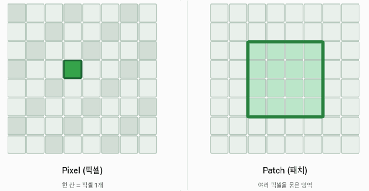
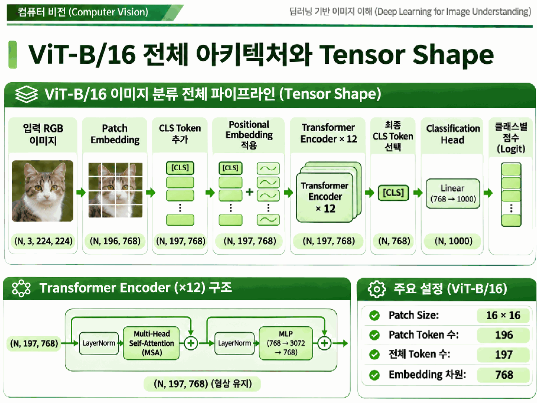

# Day 2. Vision Transformer의 구조

> 비전 트랜스포머는 이미지를 작은 패치로 나누어 토큰 시퀀스로 만들고, 어텐션을 이용해 패치 사이의 정보를 결합한다.

## 1. 이미지에서 패치 토큰으로 (1-11쪽)

비전 트랜스포머(Vision Transformer, ViT)는 이미지를 패치(Patch)라는 작은 영역으로 나누어 트랜스포머의 입력으로 사용한다. CNN은 작은 영역의 특징을 합성곱으로 계산하는 반면, ViT는 패치를 토큰(Token)으로 표현해 패치 간 관계를 계산한다.

> 5쪽: 픽셀은 한 위치의 값이고 패치는 여러 픽셀이 모인 이미지 영역이다.

224×224 RGB 이미지를 겹치지 않는 16×16 패치로 나누면 한 변에 `224 ÷ 16 = 14`개씩, 전체 `14×14 = 196`개가 생긴다. 패치 하나는 `3×16×16 = 768`개의 픽셀값을 포함한다.

패치 임베딩(Patch Embedding)은 각 패치를 펼친 뒤 학습 가능한 선형 투영(Linear Projection)으로 모델이 사용할 벡터로 바꾼다. 입력과 출력 차원이 모두 768이어도 학습된 가중치로 값을 새로 계산한다. 같은 처리는 커널 크기와 스트라이드가 모두 16인 합성곱으로도 구현할 수 있다.

패치가 커지면 토큰 수가 줄지만 각 토큰이 담는 영역은 넓어진다. 이미지 크기가 같을 때 패치가 작아지면 토큰 수와 토큰 간 관계를 계산하는 부담이 커진다.

예를 들어 같은 224×224 이미지를 32×32 패치로 나누면 한 변에 7개씩 총 49개의 패치가 생긴다. 16×16 설정의 196개와 비교하면 한 패치가 더 큰 영역을 담지만 토큰 간 조합은 줄어든다. [추가 설명]

## 2. 위치 정보와 분류 토큰 (12-15쪽)

위치 임베딩(Positional Embedding)은 패치의 공간적 순서에 관한 정보를 각 토큰 표현에 더한다. 셀프 어텐션 계산 자체는 입력 토큰의 원래 위치를 자동으로 알려주지 않으므로, 위치 정보를 통해 모델이 배치를 활용할 수 있게 한다.

분류 토큰(Classification Token, CLS Token)은 이미지 분류를 위해 패치 토큰 앞에 추가하는 학습 가능한 토큰이다. 196개 패치에 CLS 토큰 하나를 더하면 시퀀스 길이는 197이 된다. 인코더를 통과하며 CLS 표현도 다른 토큰의 정보를 반영하고, 최종 CLS 표현을 분류 헤드에 전달한다.

## 3. Transformer 인코더와 분류 (15-21쪽)

ViT-B/16은 임베딩 차원 768, 인코더 블록 12개, 어텐션 헤드 12개를 사용한다. 블록은 층 정규화(Layer Normalization), 다중 헤드 셀프 어텐션(Multi-Head Self-Attention), 다층 퍼셉트론(Multilayer Perceptron, MLP), 잔차 연결로 구성된다.

셀프 어텐션은 토큰 사이의 정보를 결합하고 MLP는 각 토큰의 표현을 변환한다. 두 변환에 각각 잔차 연결이 있어 이전 표현을 결과에 더한다. 인코더의 토큰 개수와 임베딩 차원은 이 블록을 통과해도 유지된다.

> 21쪽: 패치 임베딩에서 CLS 추가, 인코더 12개, CLS 선택과 분류까지 형태가 바뀌는 과정을 보여 준다.

| 단계 | 텐서 형태 |
| --- | --- |
| 이미지 | `(N, 3, 224, 224)` |
| 패치 임베딩 | `(N, 196, 768)` |
| CLS와 위치 정보 추가 | `(N, 197, 768)` |
| 인코더 출력 | `(N, 197, 768)` |
| CLS 표현과 분류 점수 | `(N, 768)` → `(N, 1000)` |

마지막 1000은 예시 모델의 분류 클래스 수다. 로짓(Logit)은 클래스별 점수이며 필요한 경우 소프트맥스로 확률을 구할 수 있다.

## 4. CNN과 ViT의 설계 차이 (22-25쪽)

귀납적 편향(Inductive Bias)은 모델 구조에 미리 반영한 데이터에 대한 가정이다. CNN은 지역 연결과 같은 필터의 가중치 공유를 통해 인접한 픽셀의 관계를 활용한다. ViT도 패치 분할에는 공간 구조가 반영되지만, 패치 간 관계는 주로 셀프 어텐션으로 학습하므로 CNN보다 지역성에 대한 구조적 가정이 적다.

토큰이 3개면 쿼리와 키의 조합은 9개이고 10개면 100개다. 전체 셀프 어텐션에서 토큰 쌍의 수는 시퀀스 길이의 제곱에 따라 증가하므로 패치 수를 정할 때 계산 비용도 고려한다.

## 핵심 개념 비교표

| 구분 | CNN | ViT |
| --- | --- | --- |
| 입력 처리 | 인접 영역에 필터 적용 | 패치를 토큰으로 변환 |
| 정보 결합 | 계층을 거쳐 지역 특징 조합 | 셀프 어텐션으로 토큰 관계 계산 |
| 위치 정보 | 공간 구조가 합성곱에 반영 | 패치 위치 임베딩을 추가 |
| 분류 | 추출 특징을 분류 헤드에 전달 | 최종 CLS 표현을 분류 헤드에 전달 |

## 핵심 정리

- ViT는 이미지를 패치 토큰으로 변환한다.
- 224×224 이미지와 16×16 패치는 196개 토큰을 만든다.
- CLS 토큰을 추가하면 예제의 시퀀스 길이는 197이다.
- 위치 임베딩은 패치의 위치를 모델에 전달한다.
- 인코더는 어텐션과 MLP를 잔차 연결과 함께 사용한다.
- 토큰 수가 늘면 전체 셀프 어텐션의 토큰 쌍 계산량이 빠르게 늘어난다.
