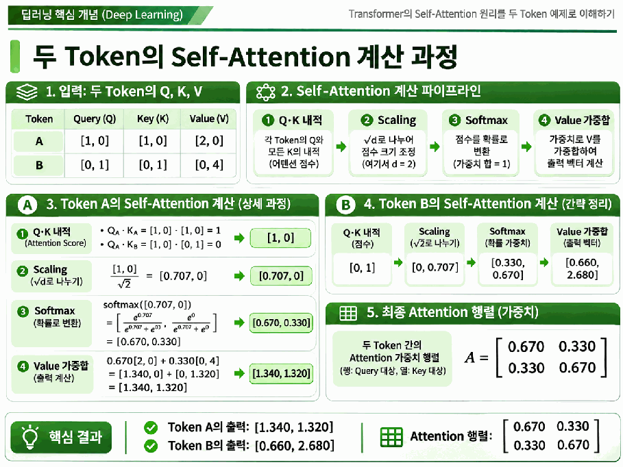
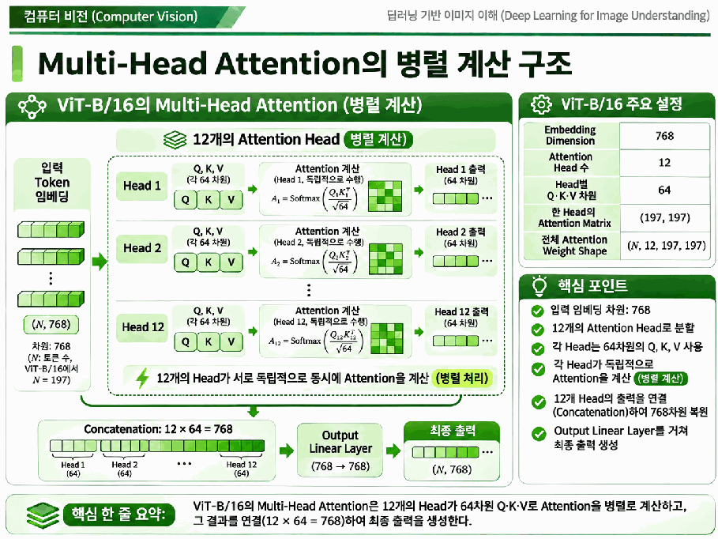
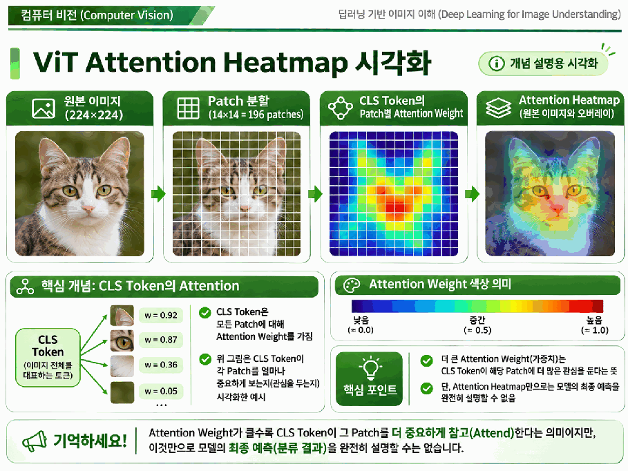

# Day 2. Self-Attention의 계산 원리

> 셀프 어텐션은 토큰마다 다른 토큰과의 관련도를 계산하고, 그 가중치로 정보를 결합해 새로운 표현을 만든다.

## 1. 쿼리, 키, 값 (1-6쪽)

셀프 어텐션(Self-Attention)은 같은 입력 시퀀스의 토큰들이 서로의 정보를 반영하는 연산이다. 각 입력 토큰은 서로 다른 학습 가중치로 변환되어 쿼리(Query, Q), 키(Key, K), 값(Value, V)을 각각 만든다.

| 표현 | 역할 |
| --- | --- |
| 쿼리 | 현재 토큰이 다른 토큰과의 관련도를 계산하는 기준 |
| 키 | 각 토큰이 쿼리와 비교될 때 사용하는 표현 |
| 값 | 계산된 가중치를 곱해 실제로 결합하는 정보 |

각 토큰은 세 표현을 모두 만든다. 관련도 계산에는 Q와 K를 사용하고, 새로운 표현은 계산된 가중치를 V에 적용해 만든다.

## 2. 점수와 가중치 계산 (6-10쪽)

내적(Dot Product)은 두 벡터의 같은 위치 원소를 곱해 더한다. Q가 `[1, 2]`, K가 `[3, 4]`라면 `1×3 + 2×4 = 11`이다. 점수는 학습된 표현에서의 관련도를 뜻하며 사람의 의미적 유사도와 항상 일치하지 않는다.

각 쿼리를 모든 키와 비교하면 어텐션 점수(Attention Score) 행렬이 나온다. 행은 현재 쿼리, 열은 참고 대상 키다. 자기 자신의 키도 비교할 수 있으며 토큰 197개의 점수 행렬은 197×197이다.

스케일링(Scaling)은 점수를 키 차원 $d_k$의 제곱근으로 나누어 내적값의 크기를 조절한다. 점수가 지나치게 커져 소프트맥스가 한쪽에 과도하게 집중되는 현상을 완화한다. 예를 들어 $d_k=2$이고 점수가 1이면 `1 ÷ √2 ≈ 0.707`이다.

소프트맥스(Softmax)는 점수를 가중치로 바꾸며 각 쿼리 행의 합이 1이 되게 한다. 점수 `[2, 1, 0]`의 가중치는 약 `[0.665, 0.245, 0.090]`이다. 이후 해당 비율로 각 V를 곱해 더한다.

$$
\operatorname{Attention}(Q,K,V)=\operatorname{softmax}\left(\frac{QK^T}{\sqrt{d_k}}\right)V
$$

$QK^T$는 쿼리와 키의 점수이고 $d_k$는 키 벡터의 차원이다. 소프트맥스 결과는 값 V를 결합하는 가중치다.

## 3. 두 토큰으로 계산하기 (10-15쪽)

| 토큰 | Q | K | V |
| --- | --- | --- | --- |
| A | `[1, 0]` | `[1, 0]` | `[2, 0]` |
| B | `[0, 1]` | `[0, 1]` | `[0, 4]` |

A의 Q와 두 K를 내적하면 `[1, 0]`이다. 차원 2의 제곱근으로 나누면 `[0.707, 0]`이고, 소프트맥스를 적용하면 약 `[0.670, 0.330]`이 된다. 이 가중치로 값을 결합하면 `0.670×[2, 0] + 0.330×[0, 4] = [1.340, 1.320]`이다.

같은 방법으로 B의 가중치는 `[0.330, 0.670]`, 출력은 `[0.660, 2.680]`이다. 같은 두 V를 사용해도 쿼리가 다르면 가중치와 출력이 달라진다.

> 15쪽: 내적, 스케일링, 소프트맥스, 값의 가중합을 차례로 연결한다. 가중치 행렬의 각 행은 하나의 쿼리에 대응한다.

두 토큰의 결과를 행렬로 보면 다음과 같다. 각 행의 합은 1이며, 대각선은 토큰이 자기 자신의 값에 적용하는 가중치다.

| 쿼리와 키 | A | B |
| --- | ---: | ---: |
| A | 0.670 | 0.330 |
| B | 0.330 | 0.670 |

## 4. 다중 헤드와 형태 (15-19쪽)

다중 헤드 어텐션(Multi-Head Attention)은 서로 다른 학습 가중치를 가진 여러 어텐션을 병렬로 계산한다. 각 헤드의 결과를 연결(Concatenation)하고 선형 변환해 출력한다. 헤드가 서로 다른 관계를 학습할 수 있지만 특정 헤드가 항상 고정된 의미를 담당하지는 않는다.

> 18쪽: ViT-B/16은 768차원을 12개 헤드에 나누어 헤드마다 64차원을 사용하고, 결과를 다시 768차원으로 연결한다.

배치 크기가 N이고 토큰이 197개일 때 전체 헤드의 가중치 형태는 `(N, 12, 197, 197)`이다. 마지막 두 축은 각각 쿼리와 키의 개수다.

## 5. 어텐션 히트맵 해석 (19-22쪽)

어텐션 히트맵(Attention Heatmap)은 가중치 행렬의 값을 색으로 표시한다. 행과 열이 무엇을 나타내는지, 어떤 쿼리가 소수의 키에 집중하는지 먼저 확인한다.

ViT에서 CLS 쿼리의 이미지 패치 196개에 대한 가중치를 선택하면 14×14로 배치해 이미지 위에 표시할 수 있다. 어떤 인코더 계층과 헤드의 값인지 함께 살펴야 한다.

> 21쪽: 색상은 패치에 적용된 가중치의 공간 분포를 보여 준다. 그림은 개념 설명용이며 연계 실습의 실제 사전학습 모델 결과가 아니다.

**가중치가 높다고 해당 영역이 최종 예측에 가장 큰 영향을 주었다고 단정할 수 없다.** 결과에는 V의 내용, 다른 헤드, 잔차 연결과 이후 변환도 영향을 준다. 연계 실습에서는 간단한 토큰 예제의 행렬을 계산해 히트맵으로 표현한다.

## 핵심 개념 비교표

| 구분 | 의미 |
| --- | --- |
| 점수와 가중치 | Q와 K의 비교값과 소프트맥스 이후 결합 비율 |
| 키와 값 | 관련도를 비교하는 표현과 가중합에 사용하는 표현 |
| 단일 헤드와 다중 헤드 | 한 표현 공간의 계산과 여러 계산 결과의 결합 |
| 히트맵과 최종 예측 근거 | 토큰 간 가중치 분포와 모델 전체의 판단 영향 |

## 핵심 정리

- 각 토큰은 학습된 변환으로 Q, K, V를 만든다.
- Q와 K의 내적은 토큰 간 관련도 점수를 계산한다.
- 점수는 키 차원의 제곱근으로 나눈 뒤 행별 소프트맥스를 적용한다.
- 가중치를 V에 곱해 더하면 쿼리별 새 표현을 얻는다.
- 다중 헤드는 여러 관계를 병렬로 계산하고 출력을 연결한다.
- 히트맵은 가중치 분포를 보여 주며 최종 예측의 완전한 설명은 아니다.
