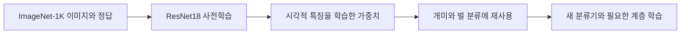
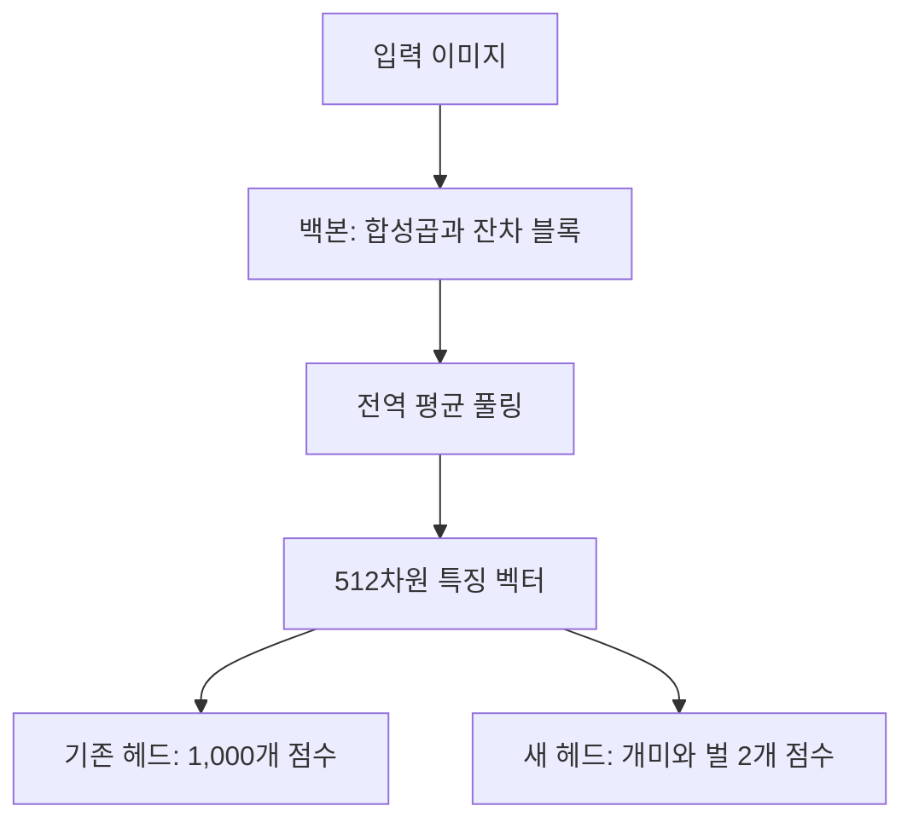
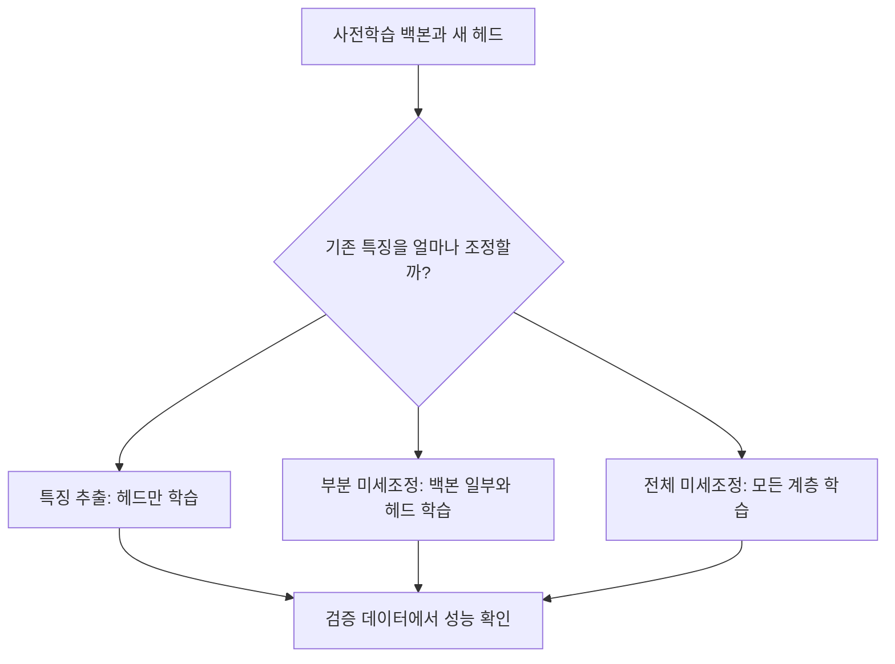
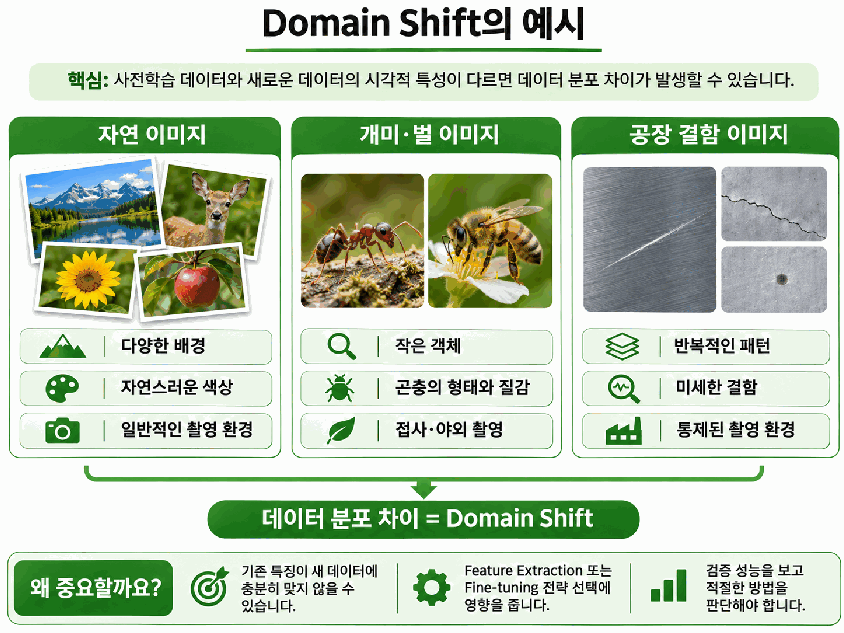

# Day 3. 사전학습과 전이학습

> 이미 학습한 시각적 특징을 새로운 문제에 재사용한다. 특징을 추출하는 부분과 분류하는 부분을 나누고, 데이터에 맞춰 학습 범위를 선택한다.

## 1. 이미 학습한 가중치를 사용하는 이유

**사전학습(Pre-training)** 은 대규모 데이터에서 모델의 가중치(Weight)를 미리 학습하는 과정이다.  
가중치는 입력에서 어떤 특징을 추출하고 결과를 계산할지 결정하는 값이다.  
ImageNet-1K로 학습한 ResNet18은 1,000개 범주를 구분하면서 선, 질감, 형태처럼 다른 이미지에도 활용할 수 있는 특징을 익힌다.

처음부터 학습(Training from Scratch)하면 초기화된 가중치에서 이러한 특징을 새롭게 배워야 한다.  
개미와 벌 사진이 각각 수십 장뿐이라면 다양한 방향과 배경을 충분히 경험하기 어렵고, 반복 학습에도 연산 비용이 든다.  
훈련 사진에만 맞춰져 새로운 사진에서 성능이 떨어지는 일반화(Generalization) 문제도 발생할 수 있다.

**전이학습(Transfer Learning)** 은 기존에 학습한 가중치를 새로운 작업에 활용하는 방법이다.  
새 작업의 클래스가 사전학습 때와 달라도 기존 특징 추출 능력은 재사용할 수 있다.  
ResNet18의 구조만 가져오고 모든 가중치를 새로 초기화했다면, 학습된 지식을 가져온 것이 아니므로 처음부터 학습하는 방식에 해당한다.

사전학습은 재사용할 가중치를 만드는 과정이고, 전이학습은 그 가중치를 가져다 쓰는 과정이다.  
기존 특징이 새 데이터에도 유용하다면 모든 특징을 처음부터 다시 학습할 부담을 줄일 수 있다.

## 2. 특징 추출부와 분류부 나누기

백본(Backbone)은 이미지에서 유용한 특징을 추출하는 부분이다.  
ResNet18에서는 합성곱(Convolution)과 잔차 블록(Residual Block)을 거쳐 특징을 계산하고, 전역 평균 풀링(Global Average Pooling)으로 공간 정보를 요약한다.  
이렇게 얻은 512차원 특징 벡터(Feature Vector)는 이미지 한 장을 512개의 숫자로 표현한 것이다.

분류 헤드(Classification Head)는 특징 벡터를 받아 클래스별 점수를 계산하는 부분이다.  
ResNet18의 마지막 완전연결 계층(Fully Connected Layer)은 `fc`라는 이름으로 구분한다.  
출력 점수인 로짓(Logit)에 소프트맥스(Softmax)를 적용하면 클래스별 상대적 점수를 확률 형태로 표현할 수 있다.

### 새 작업에서는 헤드를 교체한다

개미와 벌만 구분한다면 기존 1,000개 출력 대신 2개의 출력이 필요하다.  
입력 특징의 차원 512는 유지하고, 헤드의 출력 차원만 1,000에서 2로 바꾼다.  
새 헤드는 아직 개미와 벌의 분류 기준을 모르므로 정답 레이블(Label)이 있는 데이터로 학습해야 한다.

| 구성 | 기존 이미지 분류 | 개미와 벌 분류 |
| --- | --- | --- |
| 백본의 시작 가중치 | 사전학습된 값 | 기존 사전학습 값 재사용 |
| 특징 벡터 | 512차원 | 512차원 |
| 헤드의 입력과 출력 | 512 → 1,000 | 512 → 2 |
| 헤드의 시작 상태 | 기존 클래스에 맞게 학습됨 | 새로 초기화됨 |

**구조와 가중치의 초기 상태는 구분해야 한다.**  
사전학습 가중치는 계층의 구조와 형태(Shape)가 대응될 때 불러올 수 있다.  
출력 크기를 바꾼 새 헤드에는 기존 헤드의 가중치를 그대로 적용할 수 없으므로, 새 초기값에서 학습을 시작한다.

## 3. 기존 특징을 고정할지 조정할지 선택하기

특징 추출(Feature Extraction) 전략은 사전학습 백본을 고정하고 그 출력을 활용한다.  
여기서는 백본을 동결(Freeze)하고 새로운 헤드만 학습하는 방식을 말한다.  
백본은 계속 이미지를 처리하지만, 백본 가중치에 대한 기울기 계산과 업데이트는 하지 않으므로 일반적으로 학습 연산 부담이 작다.

미세조정(Fine-tuning)은 사전학습 가중치도 새 데이터에 맞게 추가 학습한다.  
부분 미세조정(Partial Fine-tuning)은 백본 앞부분을 고정하고 뒤쪽 일부와 헤드를 학습한다.  
전체 미세조정(Full Fine-tuning)은 백본 전체와 새 헤드를 학습 대상으로 삼는다.

### 동결과 실제 업데이트는 별도로 확인한다

`requires_grad`는 파라미터(Parameter)에 대한 자동 미분 여부를 설정한다.  
`False`는 해당 가중치의 기울기 계산을 비활성화하고, `True`는 기울기를 계산할 수 있게 한다.  
실제 업데이트를 하려면 학습 대상 파라미터가 최적화 알고리즘(Optimizer)의 관리 대상에도 들어 있어야 한다.

동결 범위는 어떤 특징을 유지할지 결정하고, 최적화 설정은 어떤 가중치를 실제로 변경할지 결정한다.  
학습 가능 상태로만 바꾸고 업데이트 대상에서 빠뜨리면 의도한 계층을 조정할 수 없다.

## 4. 데이터 분포가 달라질 때

도메인 이동(Domain Shift)은 사전학습 데이터와 새 데이터의 분포가 달라지는 현상이다.  
분포의 차이는 형태, 질감, 밝기, 촬영 조건처럼 이미지의 통계적 특성이 달라지는 것을 뜻한다.  
클래스 이름이나 개수가 달라졌다는 사실만으로 판단하지 않는다.

자연 사진으로 학습한 모델에 개미와 벌의 자연 사진을 입력한다면 기존 특징이 유용할 수 있다.  
반면 공장 제품의 미세한 결함이나 X-ray처럼 표현 방식이 다른 이미지에서는 기존 특징이 충분하지 않을 수 있다.  
이때는 일부 계층의 미세조정이나 해당 도메인에 적합한 사전학습 모델을 검토한다.

| 새 데이터의 조건 | 우선 검토할 방향 | 판단 이유 |
| --- | --- | --- |
| 기존 데이터와 비슷하고 양이 적음 | 특징 추출 | 기존 특징을 활용하며 학습할 가중치를 줄임 |
| 기존 데이터와 다르고 양이 적음 | 부분 미세조정 또는 도메인에 맞는 모델 | 특징 조정의 필요성과 데이터 부족을 함께 고려 |
| 기존 데이터와 크게 다르고 양이 충분함 | 전체 미세조정 검토 | 더 넓은 범위의 특징을 새 작업에 맞게 학습 가능 |

**데이터가 다르다고 전체 미세조정이 항상 유리한 것은 아니다.**  
공장 결함 이미지가 100장뿐이라면 많은 가중치를 안정적으로 조정하기 어려울 수 있다.  
훈련 데이터에 지나치게 맞추는 과적합(Overfitting)뿐 아니라, 학습률이나 학습량이 부적절해 패턴을 충분히 배우지 못하는 과소적합(Underfitting)도 살펴야 한다.

> 촬영 환경과 질감이 달라지면 같은 백본이 추출한 특징의 유용성도 달라질 수 있다.

## 5. 전이학습 적용 순서

1. 새로운 분류 작업과 클래스 수를 정한다.
2. 적합한 사전학습 모델을 선택하고 대응되는 백본 가중치를 불러온다.
3. 새 클래스 수에 맞는 헤드를 구성한다.
4. 데이터 특성과 양을 바탕으로 백본의 학습 범위를 정한다.
5. 모델이 요구하는 이미지 크기와 정규화 설정으로 입력을 준비한다.
6. 선택한 계층을 학습하고, 학습에 사용하지 않은 검증 데이터로 성능을 확인한다.

## 핵심 개념 비교표

| 개념 | 핵심 역할 | 구분할 점 |
| --- | --- | --- |
| 사전학습 / 전이학습 | 가중치 준비 / 새 작업에 재사용 | 모델 구조만 복사하는 것은 가중치 재사용이 아님 |
| 백본 / 분류 헤드 | 시각적 특징 계산 / 클래스 점수 계산 | 새 클래스에 맞춰 헤드를 바꾸어도 특징 차원은 유지 가능 |
| 특징 추출 / 미세조정 | 기존 특징 고정 / 기존 특징 조정 | 백본의 가중치 변경 여부가 다름 |
| 동결 설정 / 최적화 설정 | 기울기 계산 제어 / 실제 업데이트 대상 관리 | 학습하려면 두 설정이 함께 맞아야 함 |
| 클래스 변경 / 도메인 이동 | 출력 범주 변경 / 입력 분포 변경 | 클래스 수만으로 데이터 차이를 판단할 수 없음 |

## 핵심 정리

- 전이학습은 사전학습된 가중치에 담긴 특징 추출 능력을 새로운 문제에 재사용한다.
- 백본은 특징을 계산하고, 새 분류 헤드는 그 특징으로 새로운 클래스의 점수를 학습한다.
- 특징 추출은 백본을 고정하고, 미세조정은 백본의 일부 또는 전체를 조정한다.
- 기울기 계산 설정과 최적화 알고리즘의 업데이트 대상은 함께 확인해야 한다.
- 도메인 이동과 데이터의 양을 함께 고려해 학습 범위를 선택한다.
- 더 많은 계층을 학습하는 것보다 검증 데이터에서 실제로 개선되는지가 중요하다.

---

다음 학습: [전이학습의 학습 전략](10-전이학습의-학습-전략.md) | [학습 목차](README.md)
