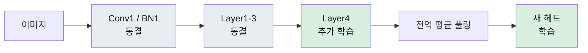
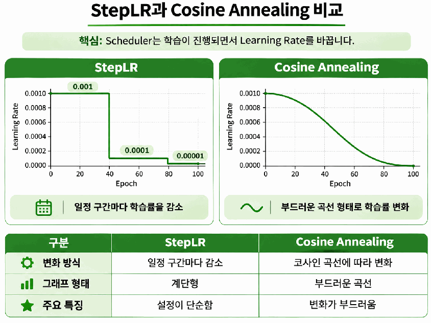
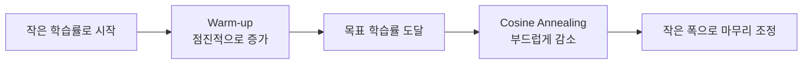
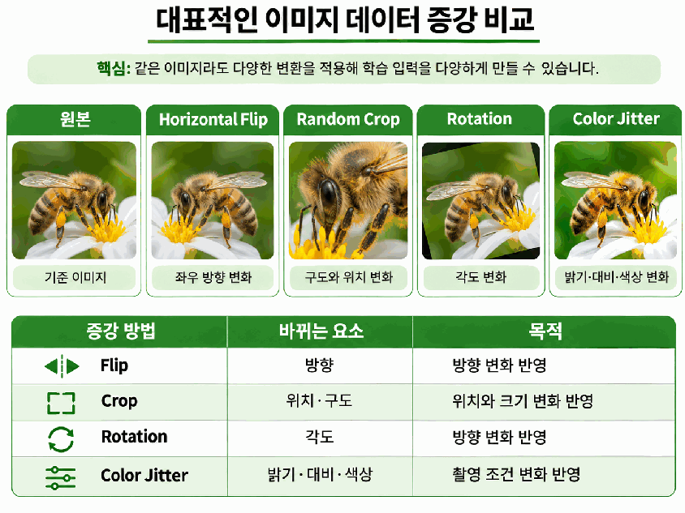
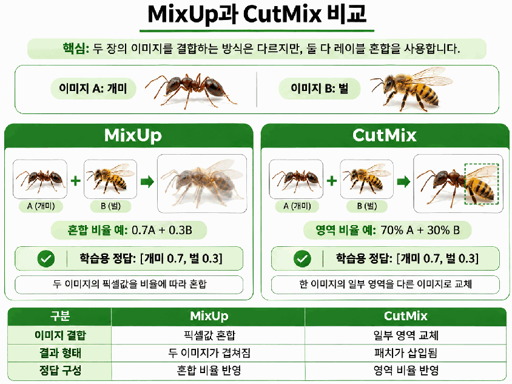
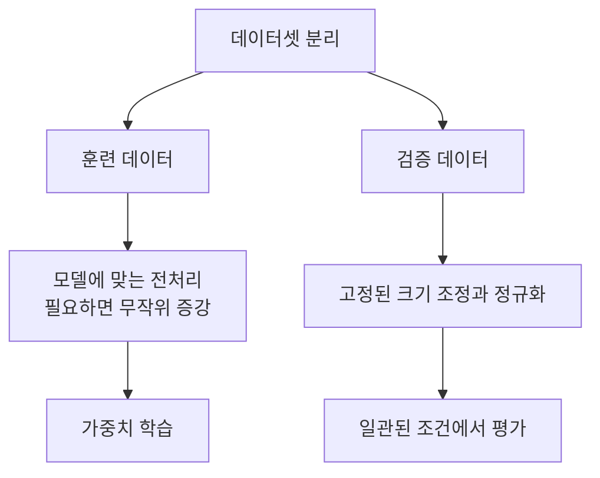

# Day 3. 전이학습의 학습 전략

> 학습할 계층, 가중치의 변경 크기, 입력 데이터의 변화를 각각 조절한다. 성능 차이의 원인을 파악하려면 비교할 조건을 통제해야 한다.

## 1. 학습할 가중치의 범위

동결(Freeze)은 기존 가중치를 업데이트하지 않도록 설정하는 것이고, 동결 해제(Unfreeze)는 다시 학습 대상으로 설정하는 것이다.  
특징 추출(Feature Extraction)에서는 백본(Backbone) 전체를 고정하고 새 분류 헤드(Classification Head)만 학습한다.  
전체 동결이라는 표현은 백본에 대한 것이며, 새로운 헤드까지 학습을 멈춘다는 뜻은 아니다.

부분 미세조정(Partial Fine-tuning)은 백본의 일부와 헤드를 함께 학습한다.  
ResNet18에서는 앞쪽 계층을 고정하고 마지막 잔차 계층인 `layer4`를 조정하는 방식이 가능하다.  
앞부분의 비교적 일반적인 특징을 유지하면서 뒤쪽의 복잡한 특징 조합을 새 작업에 맞추는 것이다.

전체 미세조정(Full Fine-tuning)은 백본 전체와 헤드를 학습한다.  
조정할 수 있는 특징의 범위가 넓어지지만, 데이터가 적을 때 기존 특징이 불필요하게 바뀌거나 과적합(Overfitting)이 생길 수 있다.  
학습할 가중치가 많다는 이유만으로 성능이 좋아지는 것은 아니다.

`requires_grad`는 파라미터(Parameter)의 기울기 계산 여부를 제어한다.  
`True`인 파라미터의 원소 수를 합하면 학습 가능한 파라미터 수를 확인할 수 있다.  
실제로 업데이트하려면 해당 파라미터를 최적화 알고리즘(Optimizer)의 관리 대상에도 포함해야 한다.

기존 모델을 동결한 뒤 새 헤드를 만들면 새 헤드는 기본적으로 학습 가능한 상태다.  
반대로 헤드까지 구성한 뒤 모두 동결했다면 헤드의 학습 설정도 다시 확인해야 한다.

## 2. BatchNorm 통계는 별도로 관리한다

배치 정규화(Batch Normalization, BatchNorm)는 평균과 분산을 활용해 중간값을 정규화하여 학습을 안정화하는 계층이다.  
여기에는 역전파로 학습하는 값과 순전파 중 갱신하는 통계가 함께 있다.  
**가중치를 동결해도 이동 통계까지 자동으로 고정되지는 않는다.**

| 값 | 역할 | 바뀌는 과정 |
| --- | --- | --- |
| 학습 파라미터 γ, β | 정규화된 값의 크기와 위치 조절 | 기울기와 최적화 알고리즘으로 업데이트 |
| 이동 평균과 이동 분산(Running Mean / Variance) | 입력 분포의 통계 저장 | 학습 모드의 순전파에서 갱신 |

`requires_grad=False`는 파라미터의 기울기 계산을 비활성화한다.  
BatchNorm에 `eval()`을 적용하면 이동 통계 갱신을 중단하지만 γ와 β의 학습 여부는 별도 설정에 따른다.  
모델 전체에 `train()`을 다시 적용하면 BatchNorm도 학습 모드로 돌아가므로, 통계 고정이 필요하면 다시 설정해야 한다.

소규모 데이터와 작은 배치에서는 이동 통계가 제한된 입력의 영향을 받을 수 있다.  
개미와 벌 비교 실험에서는 두 전략 모두 BatchNorm 통계를 고정해, 백본의 학습 범위 차이를 살펴본다.

## 3. 학습률로 변경 크기 조절하기

학습률(Learning Rate)은 계산된 기울기를 가중치 변경에 얼마나 반영할지 결정한다.  
기본 경사 하강법(Gradient Descent)의 업데이트는 다음과 같다.

$$
w_{new}=w_{old}-\eta\frac{\partial L}{\partial w}
$$

$w_{old}$와 $w_{new}$는 변경 전후 가중치, $\eta$는 학습률, $\partial L/\partial w$는 가중치에 대한 손실의 기울기다.  
손실을 줄이기 위해 기울기의 반대 방향으로 이동하며, 같은 기울기에서도 학습률이 크면 변경 폭이 커진다.

> [추가 설명] 가중치가 1.0이고 기울기가 0.2일 때 학습률이 0.1이면 `1.0 - 0.1 × 0.2 = 0.98`이다. 학습률을 0.01로 줄이면 0.998이 되어 더 조금 바뀐다. 이 계산은 기본 경사 하강법의 예시이며 AdamW의 전체 업데이트 식은 아니다.

사전학습 백본은 이미 유용한 특징을 갖지만 새 헤드는 분류 기준을 처음 배운다.  
계층별 학습률을 사용하면 백본에는 작은 변경을, 새 헤드에는 상대적으로 큰 변경을 적용할 수 있다.  
최적화 알고리즘의 파라미터 그룹마다 학습률을 지정하는 방식이다.

| 학습 대상 | 학습률 예시 | 의도 |
| --- | ---: | --- |
| ResNet18 `layer4` | 0.0001 | 기존 특징을 작은 폭으로 조정 |
| 새 분류 헤드 | 0.001 | 새 분류 기준을 상대적으로 크게 변경 |

위 값은 헤드의 학습률을 10배 크게 둔 예시이며 보편적인 최적값은 아니다.  
동결 범위 자체를 비교하는 실험에서는 학습률 차이의 영향을 줄이기 위해 동일한 학습률을 사용한다.

## 4. 학습 진행에 따라 학습률 바꾸기

학습률 스케줄러(Learning Rate Scheduler)는 진행 단계나 정해진 규칙에 따라 학습률을 바꾼다.  
최적화 알고리즘이 가중치를 업데이트한다면 스케줄러는 그때 적용할 학습률을 조절한다.  
계단형 감소(StepLR)는 일정 주기마다 줄이고, 코사인 어닐링(Cosine Annealing)은 코사인 곡선을 따라 부드럽게 조절한다.

| 학습 구간(Epoch) | StepLR 예시 | 설정 해석 |
| --- | ---: | --- |
| 1-5 | 0.001 | 초기 학습률 |
| 6-10 | 0.0001 | 5회 학습 뒤 0.1배 |
| 11-15 | 0.00001 | 다시 0.1배 |

에포크(Epoch)는 훈련 데이터 전체를 한 번 학습하는 단위다.  
StepLR은 감소 주기와 비율을, 코사인 어닐링은 변화 주기와 최소 학습률을 주요 설정으로 사용한다.

> StepLR은 구간마다 계단식으로, 코사인 어닐링은 곡선 형태로 변화한다. 그래프는 변화 형태를 설명하며 위 표와 동일한 감소 주기를 사용한 실험 결과는 아니다.

워밍업(Warm-up)은 초기의 작은 학습률을 목표값까지 점진적으로 높이는 전략이다.  
학습 시작부터 큰 폭으로 가중치를 바꾸지 않도록 하며, 이후 감소 스케줄과 결합할 수 있다.

## 5. 데이터 증강과 정답의 관계

데이터 증강(Data Augmentation)은 기존 이미지를 변환해 다양한 입력 조건을 학습하게 하는 방법이다.  
적은 사진에서도 방향, 구도, 조명이 다른 모습을 경험하게 하지만, 변환 뒤에도 정답의 의미가 적절해야 한다.  
개미 사진을 잘랐는데 개미가 완전히 사라졌다면 원래 정답을 그대로 사용하는 것이 부적절할 수 있다.

| 증강 | 변경 내용 | 주의할 점 |
| --- | --- | --- |
| 뒤집기(Flip) | 좌우 또는 상하 방향 | 방향에 따라 정답이 달라지는 작업인지 확인 |
| 자르기(Crop) | 일부 영역과 구도 | 분류 대상이 사라지지 않도록 설정 |
| 무작위 크기 조정 자르기(Random Resized Crop) | 무작위 영역 선택 후 지정 크기로 조정 | 객체의 위치와 크기가 함께 달라짐 |
| 회전(Rotation) | 이미지 각도 | 실제 입력과 정답 의미를 고려해 범위 선택 |
| 색 변형(Color Jitter) | 밝기, 대비, 채도, 색조 | 색 변화가 정답을 훼손하지 않는지 확인 |

> 같은 벌 사진에서도 방향, 구도와 색 표현이 달라진다. 증강의 범위는 정답 의미가 유지되도록 정한다.

믹스업(MixUp)은 두 이미지의 픽셀을 비율에 따라 섞고 정답도 같은 비율로 섞는다.  
개미 70%, 벌 30%를 섞었다면 정답도 두 클래스의 비중을 반영한다.  
컷믹스(CutMix)는 이미지의 일부 영역을 다른 이미지로 교체하고, 정답에 교체 면적의 비율을 반영한다.

CutMix는 모델이 특정 부분에만 의존하지 않도록 도울 수 있지만, 중요한 객체가 사라지면 혼합 정답과 이미지의 내용이 어긋날 수 있다.  
두 방법 모두 입력뿐 아니라 정답의 구성도 바뀐다는 점이 일반적인 뒤집기나 회전과 다르다.

> MixUp은 두 이미지가 겹친 형태이고 CutMix는 다른 이미지의 영역이 삽입된 형태다. 두 방식 모두 정답 비율도 바꾼다.

## 6. 훈련과 검증의 전처리

기본 전처리(Preprocessing)는 크기 조정이나 정규화로 모델이 기대하는 입력을 만든다.  
증강은 입력의 다양성을 높이는 것이 목적이며, 두 역할을 구분해야 한다.  
무작위 증강은 주로 훈련에 적용하고 검증은 고정된 조건으로 비교한다.

검증 때마다 무작위 변환을 적용하면 평가 입력이 바뀌어 성능 비교가 어려워진다.  
다만 고정 전처리만으로 조명과 회전 등 모든 환경 변화를 평가하는 것은 아니다.  
필요하면 해당 변화를 포함한 별도 데이터로 강건성 평가(Robustness Evaluation)를 수행한다.

## 7. 동결 범위 비교 실험

개미와 벌 실험에서는 헤드만 학습하는 조건과 `layer4`까지 학습하는 조건을 비교한다.  
모델, 사전학습 가중치, 데이터 분할, 헤드의 구조와 초기값, AdamW, 학습률, 에포크, 전처리를 동일하게 유지한다.  
두 조건 모두 BatchNorm 이동 통계를 고정하고, 무작위 증강은 학습에 적용하지 않아 동결 범위의 영향을 구분한다.

난수 시드(Random Seed)는 초기화와 데이터 섞기 같은 무작위 요소를 관리한다.  
같은 시드를 써도 장치의 연산이나 실행 방식에 따라 완전히 같은 결과가 보장되지는 않는다.  
동일 학습률과 에포크의 비교는 통제 실험이며, 각 전략을 개별 최적화한 최고 성능 비교는 아니다.

| 관찰 항목 | 해석 |
| --- | --- |
| 학습 가능한 파라미터 수 | 실제로 조정하는 가중치의 범위 |
| 훈련 손실(Training Loss) | 훈련 데이터의 패턴을 학습하는 정도 |
| 검증 손실(Validation Loss) | 학습에 쓰지 않은 데이터에서의 오차 |
| 검증 정확도(Validation Accuracy) | 검증 이미지 중 올바르게 분류한 비율 |

훈련 손실이 충분히 줄지 않으면 학습률이나 학습량 부족에 따른 과소적합(Underfitting)을 검토한다.  
훈련 손실은 줄지만 검증 손실이 커지면 과적합 가능성을 살핀다.  
작은 데이터에서 짧게 학습한 한 번의 결과만으로 특정 전략이 항상 우수하다고 결론내릴 수 없다.

## 핵심 개념 비교표

| 구분 | 차이 |
| --- | --- |
| 동결 / 부분 미세조정 / 전체 미세조정 | 백본의 변경 범위가 없음 / 일부 / 전체 |
| 파라미터 동결 / BatchNorm 통계 고정 | 기울기 계산 제어 / 순전파 통계 갱신 제어 |
| 계층별 학습률 / 스케줄러 | 계층에 따른 차이 / 학습 시점에 따른 차이 |
| MixUp / CutMix | 픽셀을 섞음 / 영역을 교체함 |
| 증강 / 고정 전처리 | 입력 다양성 확보 / 일관된 입력 조건 확보 |

## 핵심 정리

- 동결 범위를 넓히면 기존 특징을 유지하고, 해제하면 새 작업에 맞게 조정할 수 있다.
- 학습할 파라미터는 기울기 계산과 최적화 알고리즘의 관리 대상에 모두 포함해야 한다.
- BatchNorm의 이동 통계는 가중치와 별도로 고정 여부를 결정한다.
- 계층별 학습률은 학습 출발점의 차이를, 스케줄러는 학습 진행 단계를 반영한다.
- 데이터 증강은 정답의 의미를 유지하며, 혼합 증강은 정답 비율도 함께 바꾼다.
- 전략 비교에서는 다른 조건을 통제하고 훈련 손실과 검증 결과를 함께 해석한다.

---

다음 학습: [자기지도학습과 DINOv3](11-자기지도학습과-DINOv3.md) | [학습 목차](README.md)
