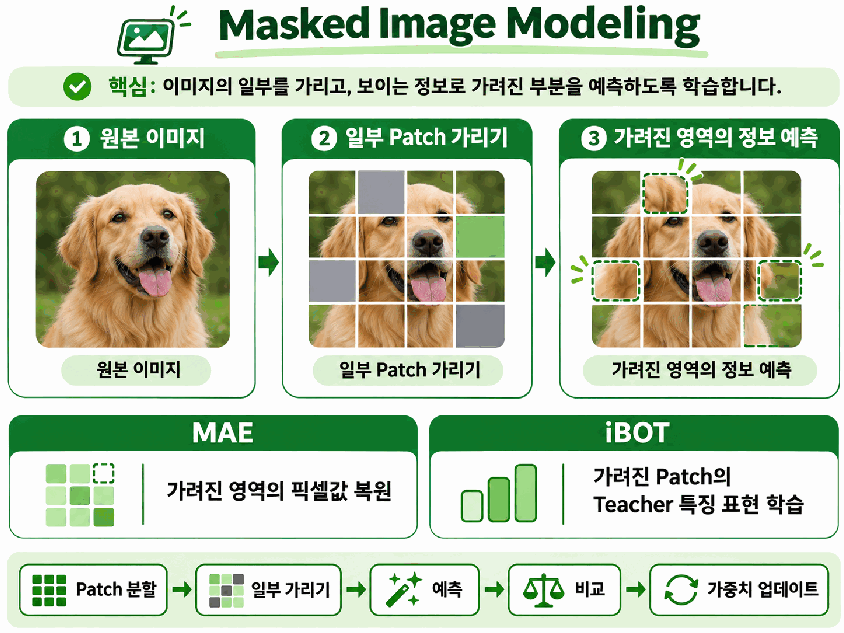
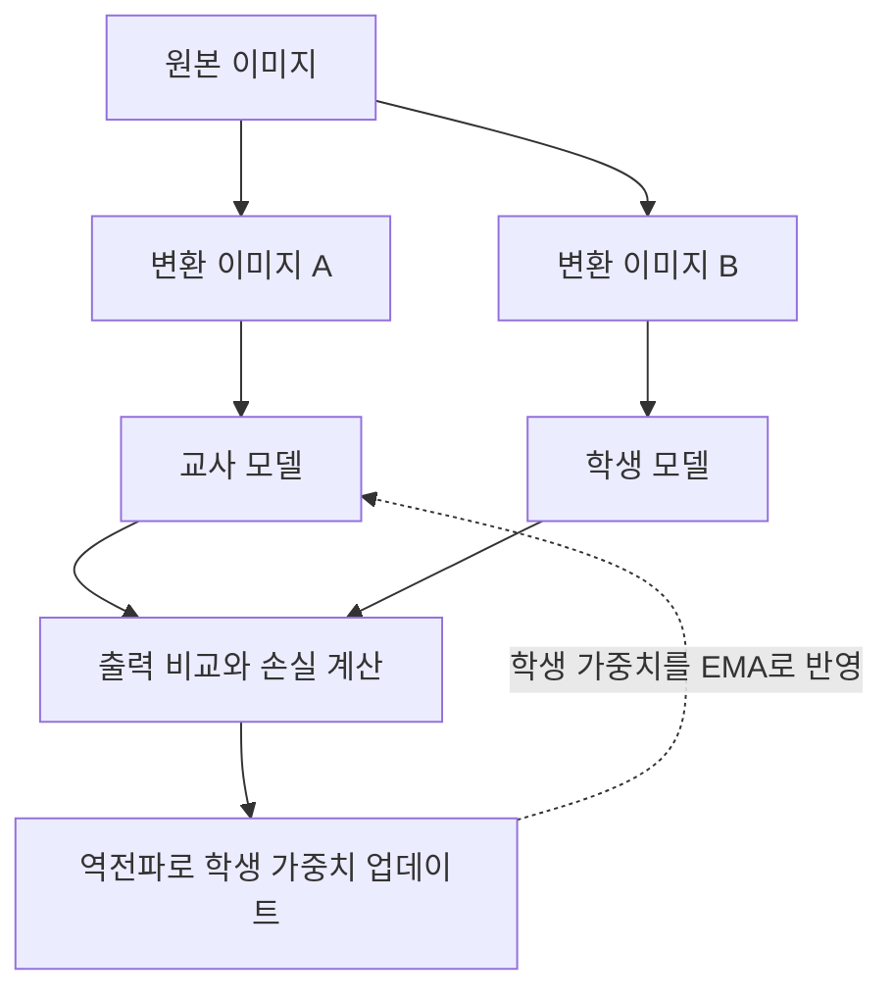
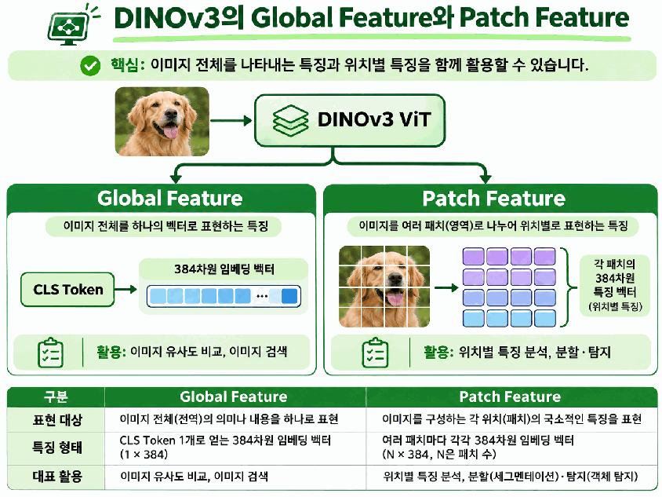
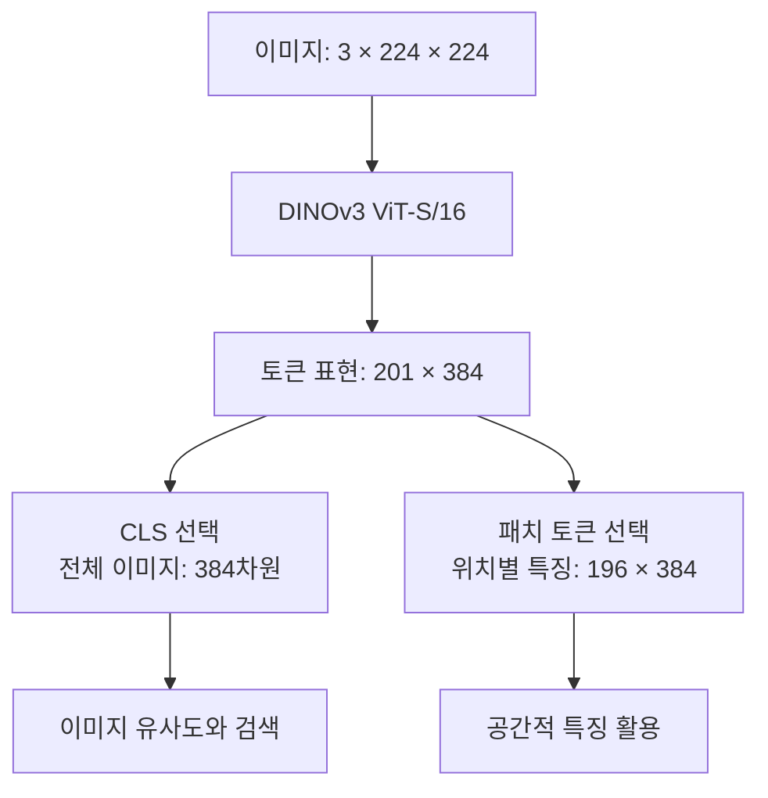
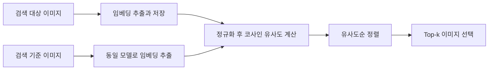

# Day 3. 자기지도학습과 DINOv3

> 데이터 자체에서 학습 목표를 만들면 클래스 정답이 없는 이미지에서도 특징을 학습할 수 있다. DINOv3의 특징 벡터를 이용해 이미지의 유사도를 비교하고 검색한다.

## 1. 정답 레이블 없이 학습 목표 만들기

지도학습(Supervised Learning)은 이미지와 정답 레이블(Label)을 함께 사용한다.  
개와 고양이 사진에 각각 정답을 붙이고 모델의 예측과 비교하는 방식이다.  
하지만 수집한 모든 이미지에 사람이 정답을 붙이려면 비용이 들고, 정답이 없는 데이터도 많다.

**자기지도학습(Self-Supervised Learning)** 은 데이터 자체에서 목표 신호를 구성하는 학습 방법이다.  
한 사진에서 서로 다르게 자르거나 색을 바꾼 두 이미지는 모습이 달라도 같은 원본에서 나왔다는 관계를 활용할 수 있다.  
강아지라는 이름을 알려주지 않아도 그 관계를 학습 목표로 삼을 수 있다.

자기지도학습에도 손실 함수(Loss Function)와 학습 기준이 있다.  
지도학습과의 차이는 학습 목표의 유무가 아니라 목표 신호를 어디에서 얻는가에 있다.

대규모 데이터에서 학습해 여러 후속 작업에 활용하는 모델을 파운데이션 모델(Foundation Model)이라고 한다.  
시각 분야의 비전 파운데이션 모델(Vision Foundation Model)은 이미지 검색, 분류, 탐지와 분할 등에 필요한 특징을 제공한다.  
DINOv3도 이러한 모델이며, 모든 작업의 최종 정답을 바로 출력한다는 뜻은 아니다.

## 2. 자기지도학습의 세 가지 접근

### 2.1 대조학습: 표현 사이의 관계 학습

대조학습(Contrastive Learning)은 관련된 표현을 가깝게, 구분할 표현을 다르게 학습한다.  
SimCLR에서는 같은 사진에 서로 다른 변환을 적용한 두 입력을 양성 쌍(Positive Pair)으로 사용하고, 다른 원본에서 온 입력을 음성 쌍(Negative Pair)으로 사용할 수 있다.  
여기서 가까움은 픽셀의 일치가 아니라 모델이 추출한 특징 벡터의 유사성을 말한다.

모든 자기지도학습이 음성 쌍을 직접 만드는 것은 아니다.  
DINO 계열은 교사와 학생의 출력 관계를 중심으로 학습하므로, SimCLR의 쌍 구성 방식을 그대로 적용한다고 이해하면 안 된다.

### 2.2 마스킹: 보이지 않는 정보 예측

마스킹 이미지 모델링(Masked Image Modeling)은 이미지의 일부 패치(Patch)를 가리고, 보이는 정보로 가려진 부분을 예측한다.  
강아지 얼굴 일부가 가려지면 주변 영역과 전체 구조를 활용해야 하므로, 이미지 내부 관계를 배울 수 있다.  
무엇을 예측하느냐에 따라 학습 방법이 달라진다.

| 방법 | 예측하는 목표 |
| --- | --- |
| 마스크 오토인코더(Masked Autoencoder, MAE) | 가려진 영역의 픽셀값 |
| iBOT | 가려진 패치 위치에 대응하는 교사 모델의 특징 표현 |

따라서 마스킹을 항상 원래 픽셀을 복원하는 작업으로만 볼 수는 없다.  
원본 이미지나 교사가 제공하는 목표와 예측을 비교해 모델을 학습한다.

> 보이는 패치를 활용해 가려진 영역을 예측한다. MAE는 픽셀, iBOT은 교사의 특징 표현을 목표로 한다.

### 2.3 자기증류: 모델의 출력을 목표로 사용

지식 증류(Knowledge Distillation)는 교사 모델(Teacher)의 정보를 학생 모델(Student)에 전달하는 방법이다.  
자기증류(Self-Distillation)는 모델 자체에서 구성한 교사의 출력을 학습 신호로 활용하는 접근이다.  
반드시 별도로 완성된 큰 교사 모델이나 사람이 만든 클래스 정답이 필요한 것은 아니다.

세 접근은 서로 배타적인 분류가 아니다.  
실제 모델에서는 이미지 전체의 관계를 학습하는 목표와 가려진 패치의 정보를 예측하는 목표를 함께 사용할 수 있다.

## 3. DINO의 교사와 학생

DINO는 레이블 없는 자기증류(Self-Distillation with No Labels)에서 유래한 이름이다.  
같은 원본의 서로 다른 변환 이미지를 교사와 학생이 처리하고, 학생은 교사 출력과 일관된 표현을 만들도록 학습한다.  
이 출력은 강아지나 고양이 같은 실제 클래스의 확률이 아니라 자기지도학습을 위해 구성한 출력 분포다.

학생은 손실로부터 역전파(Backpropagation)를 수행하고 최적화 알고리즘(Optimizer)으로 가중치를 업데이트한다.  
교사는 손실에서 직접 기울기를 받아 업데이트하지 않고, 학생 가중치를 지수이동평균(Exponential Moving Average, EMA)으로 반영한다.  
이전 교사 값을 상당 부분 유지하기 때문에 학생보다 변화가 완만한 학습 목표를 제공한다.

> [추가 설명] 교사 가중치가 2.0, 갱신된 학생 가중치가 3.0일 때 이전 교사를 90% 유지하면 `0.9 × 2.0 + 0.1 × 3.0 = 2.1`이다. 학생 값 3.0으로 즉시 바꾸는 대신 일부만 따라간다. 비율은 원리를 설명하기 위한 예시다.

위 흐름은 원리를 단순화한 것이다.  
실제 DINO는 여러 크기의 잘라낸 이미지를 사용하는 멀티크롭(Multi-crop)과 교사 및 학생 출력 분포 비교를 포함한다.

## 4. DINOv3의 전체 특징과 위치별 특징

DINO는 교사-학생 자기증류로 특징을 학습하고, DINOv2는 대규모 데이터와 DINO 및 iBOT 목표를 결합해 범용성을 강화했다.  
DINOv3는 규모 확장과 공간적 특징 품질 개선을 다루며, 비전 트랜스포머(Vision Transformer, ViT)와 ConvNeXt 기반 모델 계열을 제공한다.  
여기서는 ViT 기반 특징 활용을 중심으로 본다.

| 학습 요소 | 역할 |
| --- | --- |
| DINO 기반 목표 | 교사와 학생의 이미지 수준 출력을 비교해 전체 특징 학습 |
| iBOT 기반 목표 | 가려진 위치의 교사 표현을 예측해 패치 수준 특징 학습 |
| 그램 앵커링(Gram Anchoring) | 이미지 내부의 공간적 특징 관계를 유지해 위치별 특징 품질을 보완 |

전역 특징(Global Feature)은 이미지 전체를 하나의 벡터로 요약한 표현이다.  
ViT의 분류 토큰(CLS Token)에서 얻은 특징을 전체 이미지 유사도 비교와 검색에 활용할 수 있다.  
패치 특징(Patch Feature)은 각 위치에 대응하는 벡터이므로, 어디에 어떤 특징이 있는지 필요한 탐지와 분할에 유용하다.

> 전체 이미지를 요약하는 CLS 특징과 각 위치의 패치 특징은 활용 목적이 다르다.

## 5. 이미지가 숫자 벡터로 바뀌는 과정

이미지 임베딩(Image Embedding)은 추출한 특징을 숫자 벡터로 표현한 것이다.  
`[0.12, -0.35, 0.48, ...]`처럼 나타내지만 각 숫자가 반드시 귀 길이나 털 색처럼 하나의 속성을 뜻하지는 않는다.  
여러 값의 조합이 이미지의 특징을 표현한다.

DINOv3 ViT-S/16에서 S는 작은 모델 크기(Small), 16은 패치의 가로와 세로 크기를 뜻한다.  
각 토큰(Token)은 384차원으로 표현된다.  
224×224 입력을 사용한 형태(Shape)는 다음과 같이 계산한다.

| 계산 단계 | 결과 | 의미 |
| --- | --- | --- |
| 한 방향 패치 수 | 224 ÷ 16 = 14 | 가로와 세로 각각 14개 |
| 전체 패치 수 | 14 × 14 = 196 | 위치별 패치 토큰 |
| 보조 토큰 추가 | 196 + 1 + 4 = 201 | CLS 1개와 레지스터 토큰 4개 포함 |
| 전체 토큰 표현 | `(201, 384)` | 토큰 201개마다 384개의 특징값 |

레지스터 토큰(Register Token)은 특징 처리에 활용하는 학습된 보조 토큰이다.  
입력 이미지 패치와 일대일 대응하는 위치별 특징으로 다루지 않는다.

배치(Batch) 크기가 B이면 전체 표현은 `(B, 201, 384)`로 나타낼 수 있다.  
입력 해상도에 따라 패치 수가 달라지고, 라이브러리의 출력 옵션에 따라 반환 형태도 달라진다.  
검색에 사용할 CLS 벡터와 전체 토큰 배열을 구분해야 한다.

## 6. 코사인 유사도와 이미지 검색

코사인 유사도(Cosine Similarity)는 두 벡터의 방향이 얼마나 비슷한지 측정한다.  
크기보다는 방향을 비교하며, 1은 같은 방향, 0은 직각, -1은 반대 방향을 뜻한다.

$$
\operatorname{sim}(a,b)=\frac{\sum_i a_i b_i}{\|a\|\|b\|}
$$

$a$와 $b$는 비교할 임베딩이고, 분자는 같은 위치의 값을 곱해 더한 내적(Dot Product)이다.  
분모의 $\|a\|$와 $\|b\|$는 각 벡터의 크기로, 벡터 크기의 영향을 나누어 제거한다.

> [추가 설명] `a = [1, 0]`, `b = [1, 1]`이면 내적은 1, 두 크기는 1과 √2이므로 유사도는 `1 ÷ √2 ≈ 0.707`이다. `b = [2, 2]`로 크기만 늘려도 방향이 같아 유사도는 유지된다.

검색 대상 이미지들의 임베딩을 미리 저장하고 검색 기준 이미지(Query Image)도 같은 모델로 변환한다.  
벡터를 정규화한 뒤 유사도를 비교하고, 높은 순서대로 상위 k개(Top-k)를 고른다.  
새로운 분류 헤드 없이 사전학습 모델의 특징만으로 검색할 수 있다.

실습에서는 CLS의 384차원 벡터를 사용해 이미지 간 유사도 행렬을 만들고 히트맵(Heatmap)으로 나타낸다.  
히트맵의 각 칸은 두 이미지의 유사도이며, 검색 기준 이미지를 바꾸면 비교하는 행과 검색 결과가 달라진다.  
유사도가 높다는 것은 모델의 특징이 비슷하다는 뜻이지, 반드시 같은 클래스나 동일 객체라는 뜻은 아니다.

## 핵심 개념 비교표

| 구분 | 차이 |
| --- | --- |
| 지도학습 / 자기지도학습 | 외부 정답 사용 / 데이터에서 목표 구성 |
| 대조학습 / 마스킹 / 자기증류 | 표현 간 관계 / 가려진 정보 / 교사 출력을 학습 |
| DINO 학생 / 교사 | 역전파로 갱신 / 학생 가중치를 EMA로 반영 |
| 전역 특징 / 패치 특징 | 이미지 전체 요약 / 위치별 정보 표현 |
| ResNet18 분류 실습 / DINOv3 검색 실습 | 새 가중치 학습 / 기존 임베딩의 유사도 비교 |

DINOv3도 필요하면 미세조정(Fine-tuning)할 수 있다.  
검색 실습에서 추가 학습을 하지 않는다는 것이 모델 자체의 학습 가능성을 제한하는 것은 아니다.

## 핵심 정리

- 자기지도학습은 클래스 정답 대신 데이터 내부의 관계에서 학습 목표를 만든다.
- 대조학습, 마스킹과 자기증류는 서로 다른 학습 신호를 제공하며 함께 사용할 수 있다.
- DINO의 학생은 역전파로 학습하고 교사는 학생 가중치의 지수이동평균으로 갱신된다.
- DINOv3는 이미지 전체 특징과 공간적 위치별 특징을 모두 다룬다.
- ViT-S/16의 CLS 임베딩은 384차원이며 패치 수는 입력 크기에 따라 달라진다.
- 코사인 유사도는 임베딩 방향의 유사성이고 클래스 일치 확률이 아니다.
- 사전학습 임베딩을 저장하고 비교하면 새 분류 헤드 없이 유사 이미지 검색이 가능하다.

---

다음 학습: [CLIP과 비전 언어 모델](12-CLIP과-비전-언어-모델.md) | [학습 목차](README.md)
