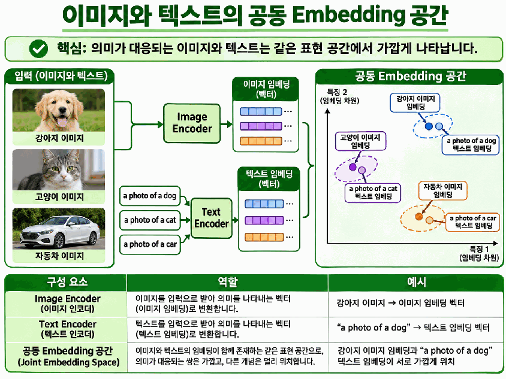
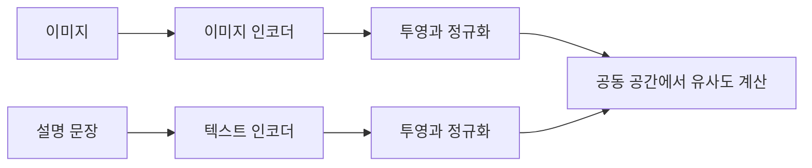
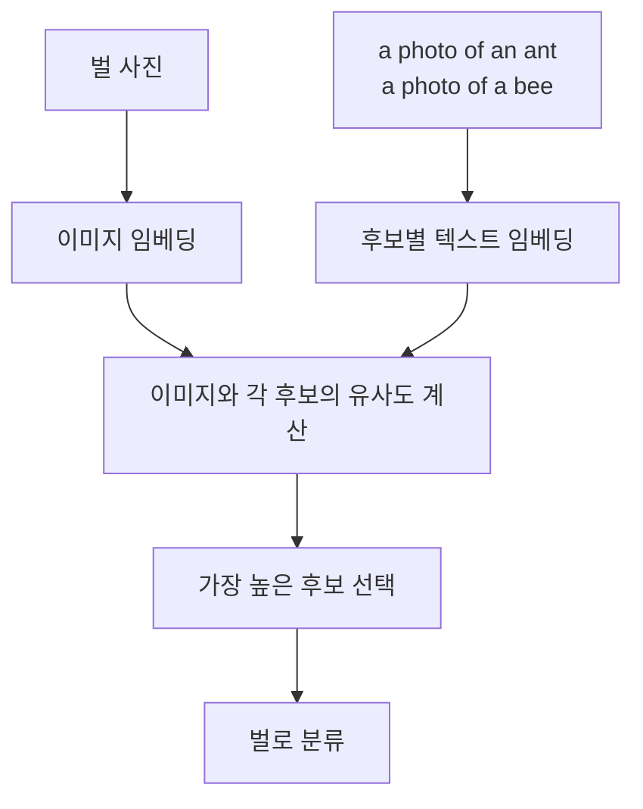
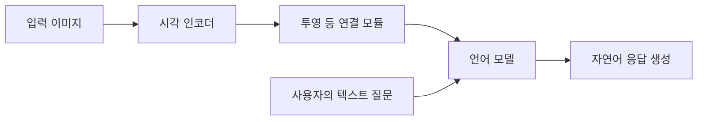
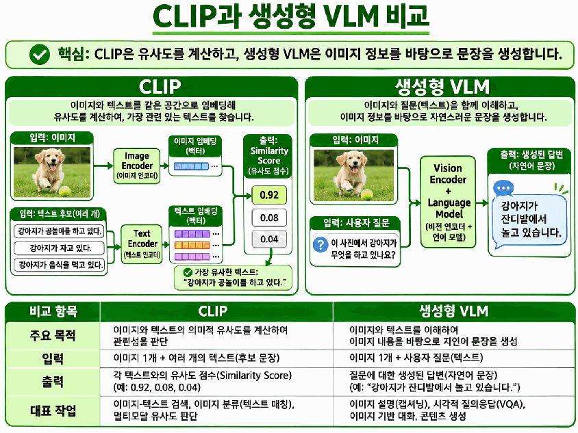

# Day 3. CLIP과 비전 언어 모델

> 이미지와 문장을 같은 의미 공간에서 비교하면 텍스트로 이미지를 찾거나 새로운 후보 클래스를 분류할 수 있다. 유사도를 계산하는 모델과 문장을 생성하는 모델의 역할을 구분한다.

## 1. 이미지와 텍스트를 비교할 수 있는 조건

사진은 픽셀로, 문장은 문자와 토큰으로 표현되므로 입력값 자체를 직접 비교할 수 없다.  
이미지 인코더(Image Encoder)와 텍스트 인코더(Text Encoder)는 각각의 입력을 특징 벡터인 임베딩(Embedding)으로 바꾼다.  
하지만 **두 벡터의 차원을 맞추는 것만으로 의미 있는 비교가 가능해지지는 않는다.**

공동 임베딩 공간(Joint Embedding Space)은 서로 다른 데이터 유형을 의미에 따라 비교하도록 학습한 표현 공간이다.  
강아지 사진과 강아지를 설명한 문장이 유사한 표현을 갖도록 학습하는 과정을 이미지-텍스트 정렬(Image-Text Alignment)이라고 한다.  
서로 관계없이 학습된 이미지 벡터와 문장 벡터를 같은 길이라는 이유로 비교해서는 안 된다.

모달리티(Modality)는 이미지, 텍스트, 오디오처럼 데이터가 표현되는 유형이다.  
여러 유형을 함께 처리하거나 학습하는 것을 멀티모달 학습(Multimodal Learning)이라고 한다.  
이미지와 문장을 연결하는 CLIP은 이러한 접근의 한 예다.

> 표현 공간에서 같은 의미의 이미지와 문장이 가까워지도록 학습한다. 그림의 배치는 실제 임베딩 좌표가 아닌 개념도다.

## 2. CLIP의 두 인코더

CLIP(Contrastive Language-Image Pre-training)은 이미지와 자연어 설명의 관계를 대조학습으로 학습하는 모델이다.  
이중 인코더(Dual Encoder) 구조로 두 입력을 각각 처리한 뒤 임베딩을 비교한다.  
이미지 인코더에는 ResNet이나 비전 트랜스포머(Vision Transformer, ViT), 텍스트 인코더에는 트랜스포머(Transformer) 기반 구조를 사용할 수 있다.

### 이미지 처리

실습 모델인 CLIP ViT-B/32에서 B는 기본 크기(Base), 32는 패치(Patch)의 가로와 세로 크기다.  
224×224 이미지는 `224 ÷ 32 = 7`이므로 가로와 세로 각각 7개, 전체 49개 패치로 나뉜다.  
패치 정보를 트랜스포머에서 처리하고 이미지 전체 특징을 추출한다.

투영(Projection)은 추출한 특징을 비교에 사용할 벡터 공간으로 변환하는 과정이다.  
이미지 인코더의 중간 특징과 최종 비교용 이미지 임베딩은 구분해야 한다.

### 텍스트 처리

토크나이저(Tokenizer)는 문장을 모델이 처리할 토큰 식별자(Token ID)로 바꾼다.  
토큰 임베딩과 트랜스포머를 거쳐 문장 특징을 얻고, 투영으로 최종 텍스트 임베딩을 만든다.  
같은 대상을 가리켜도 문장이 달라지면 텍스트 임베딩이 달라질 수 있다.

| 입력 | 주요 변환 흐름 | 최종 결과 |
| --- | --- | --- |
| 이미지 | 전처리 → 패치 임베딩 → 트랜스포머 → 전체 특징 → 투영 | 이미지 임베딩 |
| 텍스트 | 토큰 ID → 토큰 임베딩 → 트랜스포머 → 문장 특징 → 투영 | 텍스트 임베딩 |

두 임베딩에는 일반적으로 L2 정규화(L2 Normalization)를 적용해 벡터 크기를 1로 맞춘다.  
그 뒤 코사인 유사도(Cosine Similarity)로 방향의 유사성을 비교한다.  
CLIP은 유사도에 학습된 스케일을 적용해 로짓(Logit)을 계산할 수 있다.

## 3. 올바른 이미지와 문장을 연결하는 학습

대조학습(Contrastive Learning)은 관련된 표현은 유사하게, 구분할 표현은 다르게 만드는 학습이다.  
CLIP은 연결된 이미지-텍스트 쌍을 양성 쌍(Positive Pair), 배치에서 연결되지 않은 조합을 음성 쌍(Negative Pair)으로 사용한다.  
배치(Batch)에 있는 모든 이미지와 텍스트를 비교해 유사도 행렬을 만든다.

| 이미지 / 텍스트 | 강아지 설명 | 고양이 설명 | 자동차 설명 |
| --- | ---: | ---: | ---: |
| 강아지 사진 | 0.90 | 0.22 | 0.14 |
| 고양이 사진 | 0.19 | 0.88 | 0.17 |
| 자동차 사진 | 0.12 | 0.16 | 0.93 |

위 수치는 학습 원리를 보여 주는 가상 예시다.  
행과 열의 순서가 짝에 맞춰져 있으므로 대각선이 실제 연결된 쌍이고, 다른 칸은 배치 내 비교 대상이다.  
한 이미지를 기준으로 올바른 문장을 찾는 방향과 한 문장을 기준으로 올바른 이미지를 찾는 방향을 모두 학습한다.

두 방향에 소프트맥스(Softmax) 기반 대조 손실(Contrastive Loss)을 적용한다.  
정답 쌍의 점수가 다른 후보보다 상대적으로 높아지도록 손실을 줄이며 두 인코더의 가중치를 업데이트한다.  
DINOv3가 이미지 자체에서 목표를 구성하는 것과 달리, CLIP은 이미지에 연결된 자연어 설명을 학습 신호로 사용한다.

## 4. 새 헤드 없이 제로샷 분류하기

제로샷 분류(Zero-shot Classification)는 새 작업의 클래스별 정답 데이터로 추가 학습하지 않고 분류하는 방식이다.  
CLIP은 이미 사전학습되어 있으며, 제로샷이 모델을 전혀 학습하지 않았다는 뜻은 아니다.  
새 분류 헤드를 학습하는 대신 클래스 후보를 문장으로 표현한다.

가상 예시에서 개미 문장과의 유사도가 0.21이고 벌 문장과의 유사도가 0.34라면 벌을 선택한다.  
나비나 딱정벌레를 후보에 추가할 때는 해당 설명 문장을 추가할 수 있다.  
다만 후보가 늘어도 모든 클래스에서 정확도가 보장되는 것은 아니다.

### 프롬프트가 결과에 미치는 영향

프롬프트(Prompt)는 모델에 제공하는 텍스트 표현이다.  
같은 클래스라도 단어만 제시하거나 촬영 상황을 문장으로 표현하면 임베딩이 달라진다.  
모델과 이미지를 고정하고 문장만 바꿔야 프롬프트의 영향을 비교할 수 있다.

| 조건 | 개미 후보 | 벌 후보 |
| --- | --- | --- |
| 클래스 이름 | ant | bee |
| 사진 설명 | a photo of an ant | a photo of a bee |
| 근접 촬영 설명 | a close-up photo of an ant | a close-up photo of a bee |

후보마다 가능한 한 같은 문장 구조를 적용하고 유사도와 최종 예측 변화를 확인한다.  
더 긴 설명이나 특정 문장 형식이 항상 더 좋은 결과를 만든다고 가정하지 않는다.

### 유사도는 정답 확률이 아니다

유사도 0.8은 벡터 방향이 비슷하다는 뜻이지 정답 확률 80%가 아니다.  
스케일이 적용된 로짓에 소프트맥스를 취하면 주어진 후보 사이의 상대적 점수를 얻는다.  
그 결과도 실제 정답 확률로 정확히 보정되어 있다고 단정할 수 없다.

> [추가 설명] 후보의 로짓이 `[1, 2]`라면 두 번째 후보의 소프트맥스 값은 약 0.731이다. 로짓 2인 후보를 하나 더 넣어 `[1, 2, 2]`로 만들면 기존 두 번째 후보 값은 약 0.422가 된다. 기존 점수는 같아도 비교 후보가 바뀌어 정규화 결과가 달라진다.

| 값 | 의미 |
| --- | --- |
| 코사인 유사도 | 두 임베딩의 방향 유사성 |
| 로짓 | 유사도에 학습된 스케일을 적용한 점수 |
| 소프트맥스 결과 | 현재 후보 집합 안에서 정규화한 상대적 점수 |

## 5. SigLIP은 쌍별 손실을 사용한다

SigLIP(Sigmoid Loss for Language-Image Pre-training)도 이미지와 텍스트를 임베딩으로 변환해 의미 관계를 학습한다.  
CLIP과의 주요 차이는 손실 구성 방식이다.  
쌍별 시그모이드 손실(Pairwise Sigmoid Loss)로 각 이미지-텍스트 조합이 양성인지 음성인지 구분하도록 학습한다.

시그모이드(Sigmoid)는 점수를 0과 1 사이의 값으로 변환하는 함수다.  
SigLIP은 쌍별 점수에 기반한 손실을 사용하므로, CLIP처럼 배치 전체 후보에 대한 소프트맥스 정규화가 손실의 필수 단계는 아니다.  
차이는 주로 학습 손실에 있으며, 두 모델 모두 검색이나 제로샷 분류에 활용할 수 있다.

## 6. 유사도 비교에서 문장 생성으로

비전 언어 모델(Vision-Language Model, VLM)은 이미지와 텍스트를 함께 학습하거나 처리하는 모델이다.  
CLIP도 넓은 의미에서는 VLM이지만 기본 이중 인코더만으로 새로운 설명 문장을 자유롭게 생성하지는 않는다.  
준비한 문장 중 관련 있는 것을 선택하는 것과 새로운 답변을 작성하는 것은 다른 작업이다.

생성형 VLM은 시각 인코더(Vision Encoder)가 추출한 특징을 연결 모듈로 변환해 언어 모델(Language Model)에 전달하는 구조를 사용할 수 있다.  
언어 모델은 이미지 정보와 사용자의 요청을 함께 활용해 다음 토큰을 예측하며 문장을 생성한다.  
모델마다 연결 방식과 내부 구조는 다르므로 아래 흐름은 대표적인 구성의 개념도다.

이 구조는 이미지 설명(Image Captioning), 시각적 질의응답(Visual Question Answering), 시각적 추론(Visual Reasoning)에 활용할 수 있다.  
사진과 후보 문장의 관련성만 필요한 검색에서는 임베딩 비교가 중심이고, 이미지에 대한 자유로운 답변이 필요하면 언어 생성 기능이 필요하다.

> 후보 문장과의 유사도를 비교하는 출력과 새로운 응답을 생성하는 출력을 구분한다. 그림 속 점수는 실제 평가 결과가 아닌 설명용 예시다.

## 핵심 개념 비교표

| 구분 | 학습 또는 처리의 중심 | 대표 출력 |
| --- | --- | --- |
| DINOv3 | 이미지 자체에서 범용 시각 특징 학습 | 이미지 임베딩 |
| CLIP | 양방향 소프트맥스 대조 손실로 이미지와 문장 연결 | 임베딩과 유사도 |
| SigLIP | 시그모이드 손실로 이미지-텍스트 쌍별 관계 학습 | 임베딩과 유사도 |
| 생성형 VLM | 시각 정보와 텍스트 요청을 이용한 언어 생성 | 새로운 자연어 응답 |

## 핵심 정리

- 이미지와 문장은 의미가 정렬된 공동 임베딩 공간에서 비교해야 한다.
- CLIP은 두 인코더와 투영을 사용해 각 입력을 비교 가능한 벡터로 만든다.
- CLIP의 학습은 이미지에서 문장으로, 문장에서 이미지로 올바른 쌍을 찾는 두 방향을 사용한다.
- 제로샷 분류는 사전학습된 모델로 후보 문장을 비교하며 새 헤드를 학습하지 않는다.
- 프롬프트와 후보 구성은 결과를 바꾸고, 유사도나 소프트맥스 점수는 보정된 정답 확률과 다르다.
- SigLIP은 배치 내 소프트맥스 비교 대신 쌍별 시그모이드 손실을 사용한다.
- CLIP은 관련성을 비교하고, 생성형 VLM은 이미지 정보를 이용해 새로운 문장을 생성한다.

---

다음 학습: [사전학습부터 비전 언어 모델까지](13-사전학습부터-비전-언어-모델까지.md) | [학습 목차](README.md)
