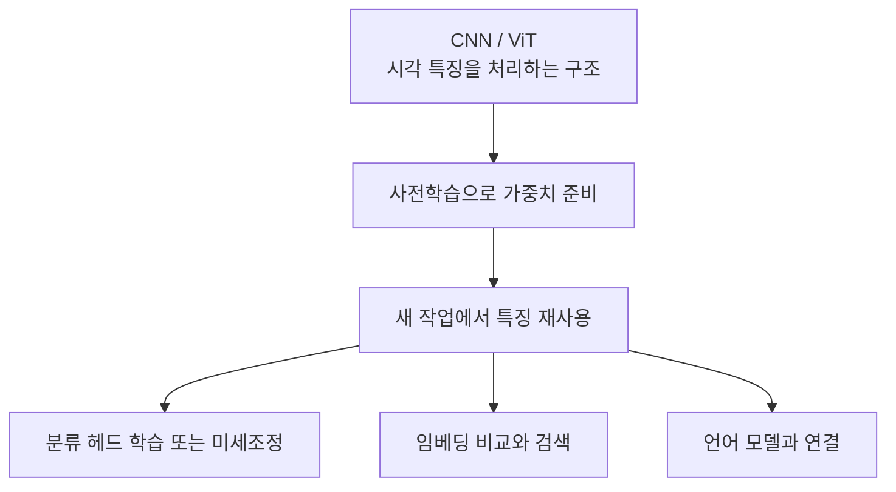
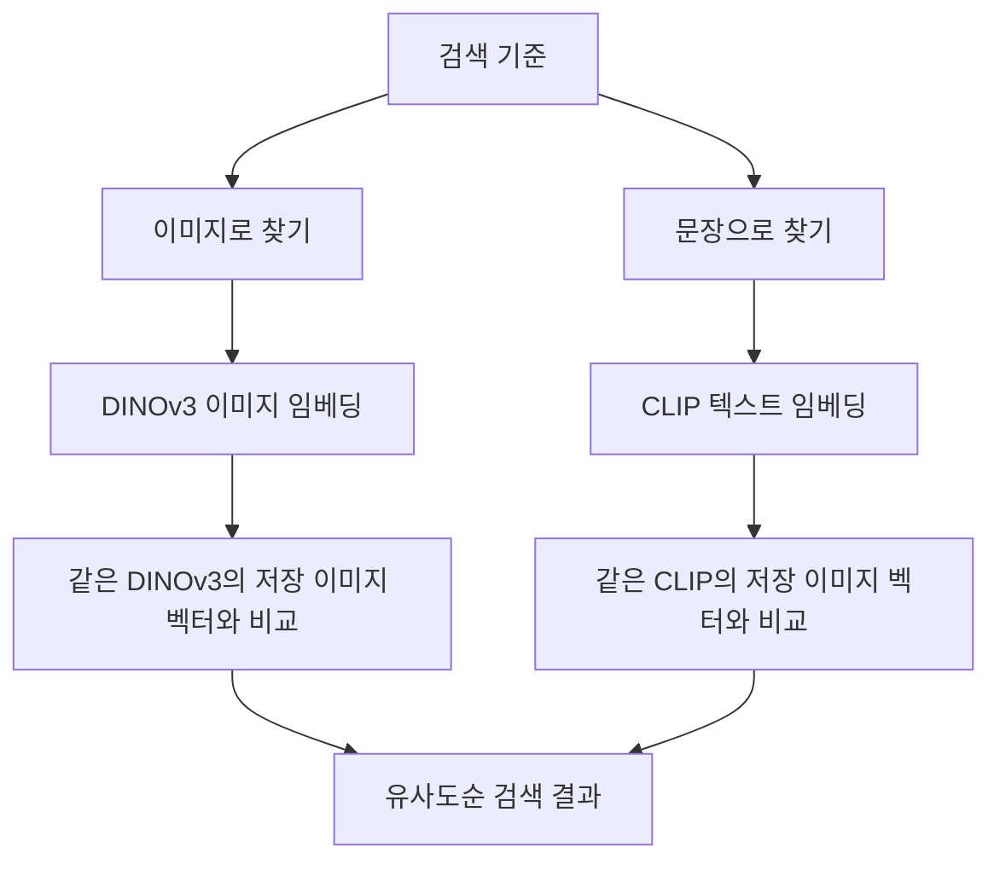
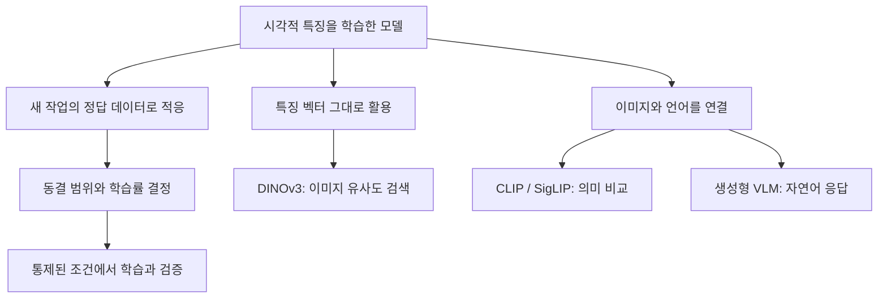

# Day 3. 사전학습부터 비전 언어 모델까지

> 학습된 특징의 재사용, 정답 없는 특징 학습, 이미지와 언어의 연결을 하나의 흐름으로 정리한다. 필요한 입력과 출력에 따라 모델의 활용 방식을 구분한다.

## 1. 모델 구조와 학습 방법 구분하기

합성곱 신경망(Convolutional Neural Network, CNN)과 비전 트랜스포머(Vision Transformer, ViT)는 이미지의 특징을 처리하는 모델 구조다.  
사전학습(Pre-training)은 이런 모델의 가중치를 미리 학습하는 과정이고, 전이학습(Transfer Learning)은 학습된 가중치를 다른 작업에 재사용하는 방법이다.  
구조가 같아도 어떤 목표로 학습하고 어떻게 활용하는지에 따라 역할이 달라진다.

ImageNet-1K로 사전학습된 ResNet18은 1,000개 클래스를 구분하는 과정에서 시각적 특징을 익힌다.  
이를 개미와 벌 분류에 활용하면 특징을 처음부터 배우는 부담을 줄일 수 있다.  
모델 구조만 가져오고 가중치를 모두 새로 초기화하는 것은 학습된 특징의 재사용과 다르다.

이 흐름은 기술의 역할을 연결한 것이며, 한 모델이 다음 모델로 교체되는 순서가 아니다.  
새로운 작업에서도 필요한 출력이 무엇인지 먼저 구분해야 한다.

## 2. 특징을 재사용할 때의 선택

백본(Backbone)은 이미지에서 특징을 추출하고, 분류 헤드(Classification Head)는 그 특징으로 클래스별 점수를 계산한다.  
ResNet18의 512차원 특징을 유지하면서 헤드의 출력을 1,000개에서 개미와 벌의 2개로 교체할 수 있다.  
기존 백본은 사전학습 값에서 시작하지만, 새 헤드는 새 초기값에서 분류 기준을 배운다.

특징 추출(Feature Extraction) 전략은 백본을 고정하고 새 헤드만 학습한다.  
미세조정(Fine-tuning)은 백본의 일부 또는 전체도 조정한다.  
앞부분을 고정하고 `layer4`와 헤드를 학습하는 ResNet18의 부분 미세조정은 일반적인 특징을 유지하면서 뒤쪽 표현을 바꾸는 예다.

도메인 이동(Domain Shift)은 기존 데이터와 새 데이터의 분포 차이다.  
자연 사진에서 공장 결함 이미지로 바뀌면 질감과 촬영 조건이 달라 기존 특징을 조정해야 할 수 있다.  
다만 차이가 크더라도 데이터가 적으면 전체 미세조정보다 일부 조정이나 다른 사전학습 모델이 적합할 수 있다.

| 판단 기준 | 확인할 내용 |
| --- | --- |
| 데이터의 특성 | 기존 특징이 새 이미지의 형태와 질감을 표현하는가 |
| 데이터의 양 | 선택한 범위의 가중치를 학습할 만큼 충분한가 |
| 학습 범위 | 헤드만, 백본 일부, 백본 전체 중 무엇을 바꾸는가 |
| 검증 성능 | 학습에 쓰지 않은 이미지에서도 개선되는가 |

## 3. 학습 설정과 비교 조건

동결(Freeze)은 해당 가중치를 바꾸지 않도록 설정하는 것이다.  
`requires_grad`로 기울기 계산을 제어하되, 실제 학습할 파라미터(Parameter)는 최적화 알고리즘(Optimizer)의 관리 대상에도 포함해야 한다.  
기울기 계산을 켜는 것과 업데이트 대상을 정하는 것은 별도 조건이다.

배치 정규화(Batch Normalization, BatchNorm)는 학습 파라미터 γ와 β 외에도 이동 평균과 이동 분산을 가진다.  
가중치를 동결해도 학습 모드의 순전파에서는 이동 통계가 갱신될 수 있다.  
통계를 유지하려면 BatchNorm의 평가 모드를 별도로 설정한다.

학습률(Learning Rate)은 가중치 변경 크기를 조절한다.  
기존 백본은 작은 폭으로 조정하고 새 헤드는 더 큰 학습률로 학습할 수 있다.  
스케줄러(Scheduler)는 시간에 따라 학습률을 바꾸며, 워밍업(Warm-up)은 초기의 작은 값을 목표 학습률까지 높인다.

| 설정 | 조절하는 대상 |
| --- | --- |
| 계층별 학습률 | 백본과 헤드 등 계층별 변경 크기 |
| StepLR | 일정 구간마다 감소하는 학습률 |
| 코사인 어닐링(Cosine Annealing) | 코사인 곡선에 따른 학습률 변화 |
| Warm-up | 학습 초기에 점진적으로 증가하는 학습률 |

데이터 증강(Data Augmentation)은 뒤집기, 자르기, 회전, 색 변형으로 입력의 다양성을 늘린다.  
믹스업(MixUp)은 픽셀과 정답을 같은 비율로 섞고, 컷믹스(CutMix)는 영역을 교체해 면적 비율을 정답에 반영한다.  
변환 후 정답 의미가 유지되는지 확인하며, 검증에서는 일관된 비교를 위해 고정 전처리를 사용한다.

동결 범위의 효과를 비교하려면 모델, 초기 가중치, 데이터 분할, 학습률, 에포크(Epoch), 전처리를 가능한 한 동일하게 유지한다.  
학습 가능한 파라미터 수, 훈련 손실(Training Loss), 검증 손실(Validation Loss), 검증 정확도(Validation Accuracy)를 함께 본다.  
훈련 손실만 낮아지고 검증 손실이 높아지면 과적합(Overfitting) 가능성을 검토한다.

## 4. 정답 없는 이미지에서 특징 배우기

지도학습(Supervised Learning)은 외부에서 제공한 정답을 사용한다.  
자기지도학습(Self-Supervised Learning)은 변환된 이미지의 관계나 가려진 영역처럼 데이터 자체에서 학습 목표를 만든다.  
정답 클래스가 없다는 것이 손실이나 학습 기준도 없다는 뜻은 아니다.

| 자기지도학습 접근 | 학습 목표 | 예 |
| --- | --- | --- |
| 대조학습(Contrastive Learning) | 관련된 표현과 구분할 표현의 관계 | 같은 원본의 변환 이미지들을 가깝게 표현 |
| 마스킹 이미지 모델링(Masked Image Modeling) | 가려진 영역의 정보 | MAE의 픽셀 복원, iBOT의 교사 특징 예측 |
| 자기증류(Self-Distillation) | 교사 출력과 일관된 학생 출력 | DINO의 교사-학생 학습 |

DINO의 학생 모델(Student)은 교사 모델(Teacher)과 출력을 비교한 손실로 역전파를 수행한다.  
교사는 직접 역전파로 학습하지 않고 학생 가중치를 지수이동평균(Exponential Moving Average, EMA)으로 반영한다.  
명시적인 음성 쌍(Negative Pair)을 직접 구성하는 방식과 구분해야 하며, 여러 자기지도학습 목표를 함께 활용할 수도 있다.

DINOv3의 전역 특징(Global Feature)은 전체 이미지를 요약하고 패치 특징(Patch Feature)은 위치별 정보를 담는다.  
ViT-S/16의 분류 토큰(CLS Token)에서는 384차원 이미지 임베딩(Image Embedding)을 얻을 수 있다.  
전체 유사도 검색에는 전역 특징이, 공간 정보가 필요한 분석에는 패치 특징이 적합하다.

## 5. 이미지 검색과 텍스트 검색의 차이

이미지 임베딩은 모델이 추출한 특징을 숫자 벡터로 나타낸 것이다.  
코사인 유사도(Cosine Similarity)는 벡터 방향의 유사성을 계산한다.  
DINOv3로 검색 대상과 기준 이미지의 임베딩을 만들고 높은 순서로 정렬하면 새 헤드 없이 상위 k개(Top-k) 검색이 가능하다.

텍스트로 이미지를 찾으려면 이미지와 문장 사이의 의미 관계도 학습되어야 한다.  
CLIP의 이중 인코더(Dual Encoder)는 이미지 인코더(Image Encoder)와 텍스트 인코더(Text Encoder)를 사용한다.  
두 임베딩이 같은 의미를 비교할 수 있게 정렬된 공동 임베딩 공간(Joint Embedding Space)을 학습한다.

CLIP은 이미지와 연결된 문장을 양성 쌍(Positive Pair)으로 사용한다.  
배치 내 다른 조합과 비교해 올바른 쌍의 점수를 높이며, 이미지에서 텍스트와 그 반대 방향에 소프트맥스(Softmax) 기반 손실을 적용한다.  
SigLIP은 비슷한 목적을 갖지만 쌍별 시그모이드 손실(Pairwise Sigmoid Loss)로 관계를 학습한다.

제로샷 분류(Zero-shot Classification)는 후보 클래스를 문장으로 표현하고 이미지와 가장 유사한 후보를 선택한다.  
새 작업의 정답 데이터로 추가 학습하지 않는다는 뜻이며, 사전학습 자체가 없다는 뜻은 아니다.  
프롬프트(Prompt)의 문장과 후보 클래스 구성이 바뀌면 결과도 달라질 수 있다.

**유사도와 소프트맥스 점수를 실제 정답 확률로 단정하지 않는다.**  
유사도 0.8은 정답 확률 80%가 아니며, 후보 집합이 바뀌면 소프트맥스 결과도 바뀐다.  
검색에서도 높은 유사도가 반드시 같은 클래스나 동일 객체를 뜻하지는 않는다.

## 6. 언어 생성이 필요한 경우

비전 언어 모델(Vision-Language Model, VLM)은 이미지와 텍스트를 함께 처리하는 모델이다.  
CLIP도 넓은 의미의 VLM에 포함되지만 기본 구조는 관련성을 비교하며, 자유로운 새 문장 생성과는 역할이 다르다.

생성형 VLM은 시각 인코더(Vision Encoder)의 특징을 연결 모듈로 변환하고 언어 모델(Language Model)에 전달하는 구조를 사용할 수 있다.  
사용자의 텍스트 요청과 이미지 정보를 함께 활용해 자연어 응답을 생성한다.  
이를 통해 이미지 설명(Image Captioning)이나 시각적 질의응답(Visual Question Answering)을 수행하며, 구체적 연결 구조는 모델마다 다르다.

## 핵심 개념 비교표

| 해결할 문제 | 활용 방식 | 필요한 출력 |
| --- | --- | --- |
| 정답이 일부 있는 개미와 벌 분류 | ResNet18 특징 추출 또는 미세조정 | 클래스별 점수 |
| 정답 없는 사진 중 비슷한 이미지 찾기 | DINOv3 임베딩의 유사도 비교 | 유사 이미지 순위 |
| 빨간 자동차라는 문장으로 사진 찾기 | CLIP 또는 SigLIP의 이미지-텍스트 비교 | 관련 이미지 순위 |
| 새 후보 클래스를 추가 학습 없이 분류 | CLIP의 후보 문장 비교 | 가장 관련 있는 클래스 |
| 사진 속 상황을 자연어로 설명 | 생성형 VLM | 새로운 설명 문장 |

## 전체 학습 흐름

## 핵심 정리

- 사전학습은 가중치를 준비하고, 전이학습은 그 가중치의 특징 추출 능력을 새 문제에 활용한다.
- 학습 범위는 데이터 분포 차이, 데이터 양과 검증 성능을 함께 보고 선택한다.
- 가중치 동결과 BatchNorm 통계 고정은 별도 설정이며, 학습 조건을 통제해야 차이를 해석할 수 있다.
- 자기지도학습은 데이터 자체에서 목표를 만들고, DINO의 교사와 학생은 서로 다른 방식으로 갱신된다.
- DINOv3의 전역 임베딩은 이미지 검색에, 패치 특징은 위치별 정보 활용에 적합하다.
- CLIP과 SigLIP은 이미지와 문장의 의미를 연결하지만 학습 손실의 구성 방식이 다르다.
- 모델 선택은 최신 여부보다 필요한 입력, 학습 데이터와 최종 출력에 맞춰야 한다.

---

[학습 목차로 이동](README.md)
