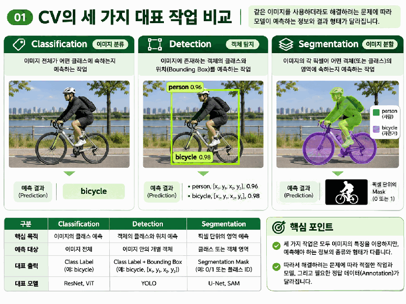
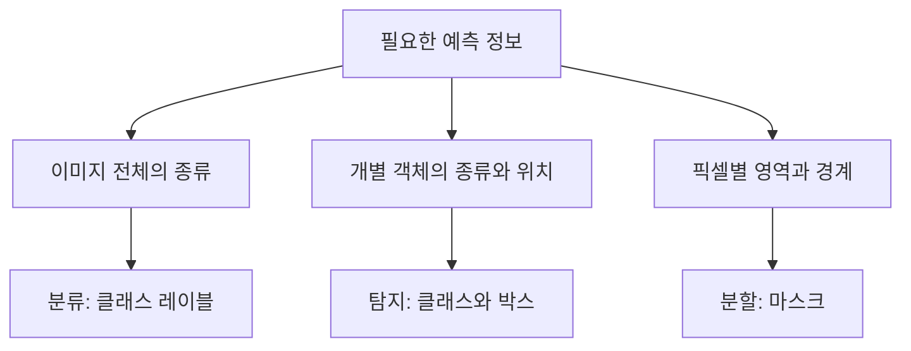
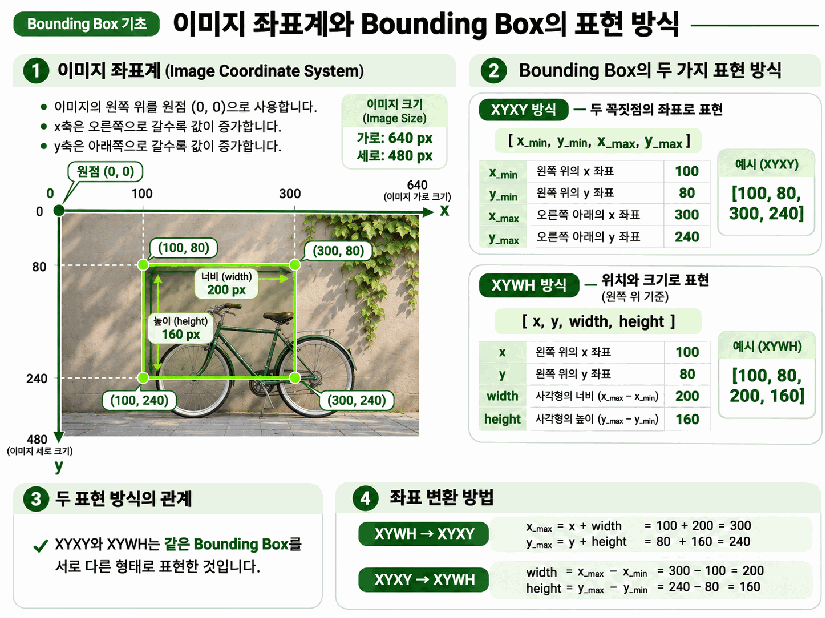
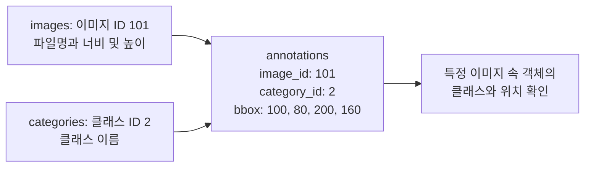
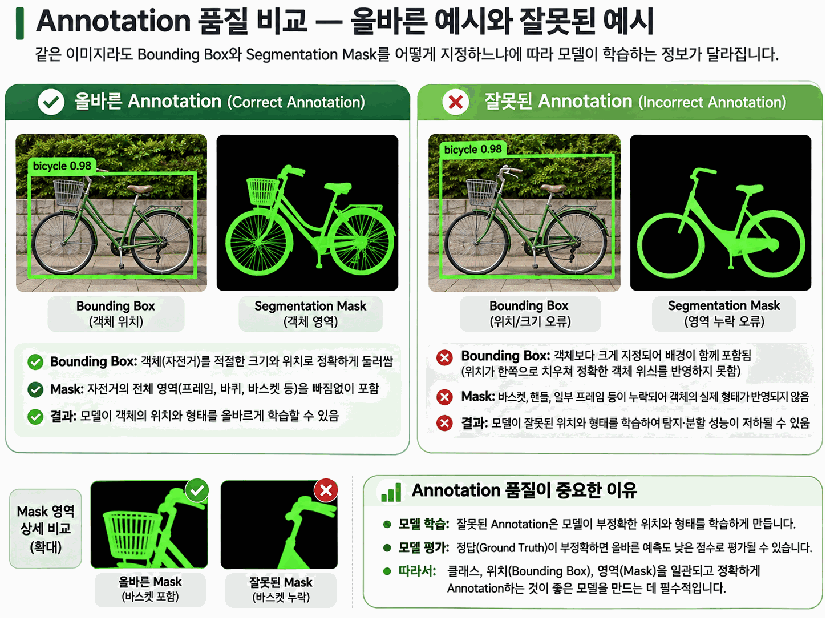

# Day 4. CV 작업과 학습 데이터의 이해

> 분류, 탐지, 분할은 예측하는 정보가 다르므로 필요한 정답 데이터도 다르다. 좌표와 마스크의 표현 방식을 이해하고 학습과 평가에 사용할 데이터의 품질을 확인한다.

## 1. 예측 목표에 따라 달라지는 CV 작업

**컴퓨터 비전(Computer Vision, CV)** 은 이미지에서 필요한 정보를 추출하는 분야다.  
이미지 분류(Image Classification)는 이미지 전체의 종류를, 객체 탐지(Object Detection)는 개별 객체의 종류와 위치를 예측한다.  
이미지 분할(Image Segmentation)은 사각형보다 세밀하게 픽셀별 영역을 구분한다.

같은 자전거 사진도 분류 결과는 자전거라는 이름이고, 탐지 결과는 자전거를 둘러싼 사각형이며, 분할 결과는 자전거의 실제 모양을 따라간 영역이다.  
여러 레이블을 출력하는 다중 레이블 분류(Multi-label Classification)도 가능하지만, 레이블이 여러 개라는 이유만으로 위치까지 알 수 있는 것은 아니다.

모델을 선택하기 전에 출력의 형태부터 정해야 한다.  
객체의 위치가 필요한데 이미지 전체의 클래스만 있다면, 위치 학습에 사용할 정답 정보를 추가로 준비해야 한다.

## 2. 주석과 정답 데이터

**주석(Annotation)** 은 데이터에 정보를 부여하는 작업이나 그 결과다.  
**정답 기준 데이터(Ground Truth)** 는 학습과 평가에서 예측 결과와 비교하는 기준이다.  
하나의 주석이 정답 기준으로 사용될 수 있으므로, 두 용어는 서로 배타적인 데이터 종류가 아니다.

클래스 레이블(Class Label)은 이미지나 객체의 종류를 나타낸다.  
클래스를 숫자 ID로 저장하더라도 그 숫자는 식별자이며, 큰 ID가 더 중요하거나 더 큰 객체라는 뜻은 아니다.

경계 상자(Bounding Box)는 객체를 둘러싼 사각형이다. 탐지에서는 이미지 한 장 안의 객체마다 클래스와 박스를 연결한다.  
분할 마스크(Segmentation Mask)는 픽셀에 값을 부여해 객체나 클래스가 차지하는 영역을 나타낸다. 어떤 값을 사용하는지는 이진 분할, 클래스별 분할, 개별 객체 분할에 따라 달라진다.

## 3. 이미지 좌표와 경계 상자

### 좌표의 방향과 두 가지 박스 형식

이미지의 원점은 일반적으로 왼쪽 위다. 가로 좌표 x는 오른쪽으로, 세로 좌표 y는 아래로 증가한다.  
같은 사각형도 끝점 두 개를 저장하거나, 시작점과 크기를 저장하는 방식으로 표현할 수 있다.

| 형식 | 저장하는 값 | 같은 사각형의 표현 |
| --- | --- | --- |
| XYXY | 왼쪽 위 x, y와 오른쪽 아래 x, y | `[100, 80, 300, 240]` |
| XYWH | 왼쪽 위 x, y와 너비, 높이 | `[100, 80, 200, 160]` |

XYXY에서 너비와 높이는 두 끝점의 차이다. 반대로 XYWH에서는 시작점에 크기를 더해 끝점을 구한다.

| 변환 | 계산 | 결과 |
| --- | --- | --- |
| 너비 w | 300 − 100 | 200 |
| 높이 h | 240 − 80 | 160 |
| 오른쪽 끝 x | 100 + 200 | 300 |
| 아래쪽 끝 y | 80 + 160 | 240 |

**좌표 네 개의 의미를 확인해야 박스를 올바르게 해석할 수 있다.**  
특히 YOLO에서 사용하는 형식은 중심 좌표를 기준으로 할 수 있다. XYWH라는 표현만 보고 항상 왼쪽 위 좌표라고 가정하면 안 된다.

### 픽셀 좌표와 정규화 좌표

픽셀 좌표(Pixel Coordinates)는 이미지 안의 실제 위치를 픽셀 단위로 나타낸다.  
정규화 좌표(Normalized Coordinates)는 가로 위치를 이미지 너비로, 세로 위치를 이미지 높이로 나누어 상대적인 위치로 표현한다.

너비 640, 높이 480인 이미지의 점 `(160, 120)`을 정규화하면 다음과 같다.

| 축 | 계산 | 의미 |
| --- | --- | --- |
| x | 160 ÷ 640 = 0.25 | 왼쪽에서 전체 너비의 25% 위치 |
| y | 120 ÷ 480 = 0.25 | 위에서 전체 높이의 25% 위치 |

두 값 모두 0.25지만 나누는 기준은 서로 다르다.  
모델의 입력과 출력에서 좌표가 픽셀 단위인지 정규화된 값인지 확인해야 위치를 정확하게 표시할 수 있다.

## 4. 마스크는 공간 구조를 가진 정답이다

이진 마스크(Binary Mask)는 대상 영역을 1, 그 밖을 0으로 구분한다.  
아래 배열은 5 × 5 이미지의 각 픽셀에 대응한다. 1의 개수뿐 아니라 1이 놓인 위치가 객체의 모양을 결정한다.

| 행 / 열 | 1 | 2 | 3 | 4 | 5 |
| --- | --- | --- | --- | --- | --- |
| 1 | 0 | 0 | 0 | 0 | 0 |
| 2 | 0 | 1 | 1 | 1 | 0 |
| 3 | 0 | 1 | 1 | 1 | 0 |
| 4 | 0 | 0 | 1 | 0 | 0 |
| 5 | 0 | 0 | 0 | 0 | 0 |

박스는 대상 주변의 사각형을 표현하므로 내부에 배경이 포함될 수 있다.  
마스크는 픽셀별로 대상 여부를 지정하므로 바퀴나 사람의 윤곽처럼 세밀한 형태를 표현할 수 있다. 모델은 이 공간적인 정답과 예측을 비교해 영역을 학습한다.

## 5. COCO 형식으로 이미지와 주석 연결하기

COCO(Common Objects in Context)는 객체 탐지와 분할 등에 활용되는 데이터셋이다.  
COCO 주석은 일반적으로 JSON 형식으로 관리하며, 이미지 정보와 객체별 정답을 ID로 연결한다.

`images`는 이미지 자체의 정보를, `categories`는 클래스 ID와 이름의 대응을 관리한다.  
`annotations`는 두 ID를 참조하면서 객체의 위치와 분할 정보 등을 기록한다. 객체별 주석 ID도 포함될 수 있다.

COCO의 `bbox`는 일반적으로 **왼쪽 위 좌표를 기준으로 한 XYWH** 다.  
따라서 `[100, 80, 200, 160]`에서 200과 160은 오른쪽 아래 좌표가 아니라 너비와 높이다. 분할 작업에서는 `segmentation` 정보도 확인해야 한다.

## 6. 데이터 품질은 학습과 평가에 모두 영향을 준다

지도학습(Supervised Learning)은 예측과 정답 사이의 손실(Loss)을 줄이도록 학습한다.  
자동차 사진에 자전거라는 잘못된 레이블을 붙였다면, 올바른 자동차 예측에도 손실이 생길 수 있다. 다만 오류의 영향은 비율, 데이터 규모, 학습 방식에 따라 달라진다.

| 주석의 문제 | 학습 또는 평가에 미치는 영향 |
| --- | --- |
| 잘못된 클래스 | 이미지 특징과 잘못된 종류를 연결할 수 있음 |
| 치우친 박스 | 실제 위치를 잘 예측해도 정답과 차이가 발생함 |
| 영역이 빠진 마스크 | 객체의 경계를 부정확하게 학습할 수 있음 |
| 객체 주석 누락 | 존재하는 객체의 학습과 평가에 혼란이 생김 |

평가용 정답이 틀리면 성능이 실제보다 낮거나 높게 측정될 수 있다.  
따라서 클래스의 정확성, 박스의 위치와 크기, 마스크의 경계, 객체 누락 여부와 데이터 전체의 주석 기준 일관성을 함께 확인한다.

## 7. 핵심 개념 비교

| 구분 | 나타내는 정보 | 확인할 사항 |
| --- | --- | --- |
| 클래스 레이블 | 이미지나 객체의 종류 | 클래스 ID와 이름의 대응 |
| 경계 상자 | 객체의 사각형 위치와 크기 | XYXY / XYWH, 기준점, 좌표 단위 |
| 분할 마스크 | 픽셀별 영역 | 픽셀값의 의미와 공간적 대응 |
| 주석 | 데이터에 부여한 정보 | 정확성, 누락, 일관성 |
| 정답 기준 데이터 | 학습과 평가의 비교 기준 | 기준 자체에 오류가 없는지 |

## 8. 핵심 정리

- 분류는 종류, 탐지는 종류와 위치, 분할은 픽셀별 영역을 예측한다.
- 필요한 출력에 맞는 정답 데이터를 먼저 준비해야 한다.
- 박스는 좌표 형식과 기준점, 픽셀 단위 여부에 따라 해석이 달라진다.
- 마스크는 각 픽셀의 값과 위치를 함께 사용해 객체의 형태를 표현한다.
- COCO는 이미지와 클래스 정보를 ID로 연결해 객체별 주석을 관리한다.
- 학습용 주석의 오류와 평가용 정답의 오류는 각각 학습 방향과 성능 측정을 왜곡할 수 있다.

[다음: 객체 탐지의 원리와 YOLO](15-객체-탐지와-YOLO.md)
