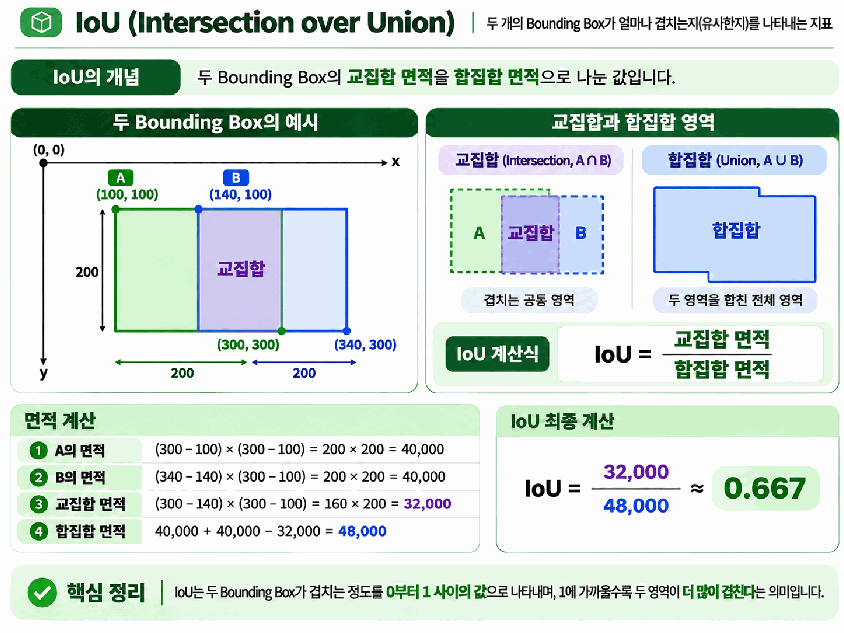
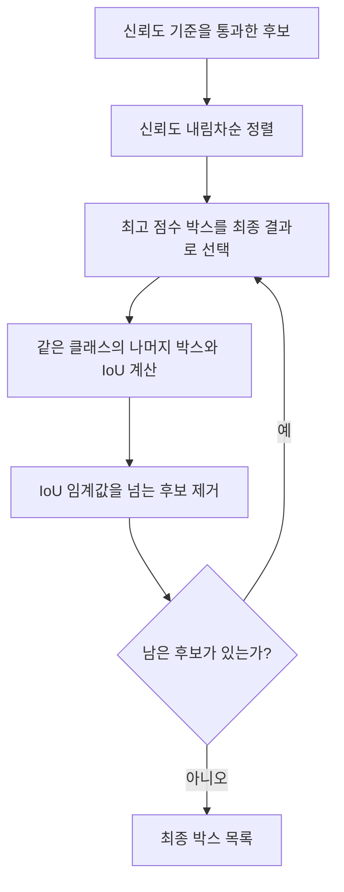
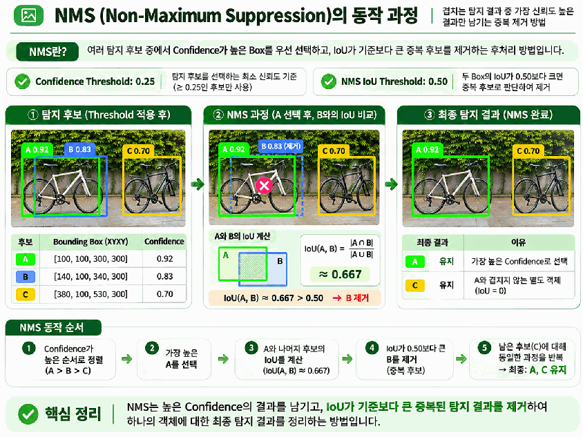
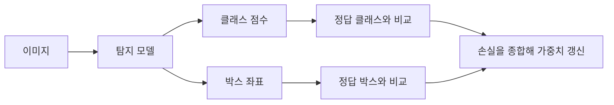
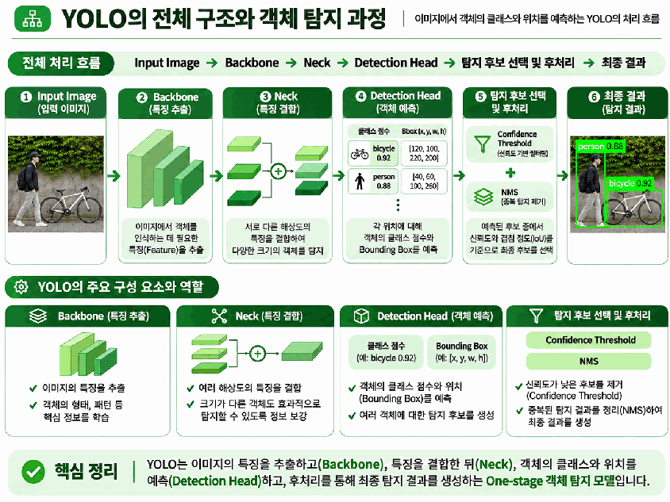

# Day 4. 객체 탐지의 원리와 YOLO

> 객체 탐지는 클래스와 위치를 함께 예측한다. 신뢰도로 후보를 고르고, 박스의 겹침으로 중복을 정리하는 과정과 YOLO의 특징 추출 구조를 연결한다.

## 1. 탐지 후보와 신뢰도

**객체 탐지(Object Detection)** 모델은 클래스, 경계 상자(Bounding Box), 신뢰도 점수(Confidence Score)를 가진 후보를 생성한다.  
같은 객체에 여러 박스가 생기거나 잘못된 위치의 후보가 섞일 수 있으므로 모든 후보를 최종 결과로 사용하지는 않는다.

신뢰도는 모델이 해당 예측에 부여한 점수다.  
0.92라는 값이 실제로 정확할 확률 92%를 반드시 뜻하지는 않으며, 계산 방식도 모델마다 다를 수 있다. 실제 정확성은 정답 기준 데이터(Ground Truth)와 비교해야 한다.

신뢰도 임계값(Confidence Threshold)은 후보를 선택하는 최소 점수다.  
자전거 후보 A, B, C의 점수가 각각 0.92, 0.83, 0.70이면 기준에 따라 다음과 같이 선택된다.

| 신뢰도 임계값 | 남는 후보 | 해석 |
| --- | --- | --- |
| 0.25 | A, B, C | 낮은 점수의 후보도 포함 |
| 0.75 | A, B | C 제외 |
| 0.90 | A | 가장 높은 점수의 후보만 포함 |

임계값을 낮추면 잘못된 탐지가 포함될 수 있고, 높이면 실제 객체도 놓칠 수 있다.  
**신뢰도 필터만으로는 같은 객체를 가리키는 중복 박스를 제거할 수 없다.**

## 2. IoU로 두 박스의 겹침 계산하기

**교집합 대 합집합 비율(Intersection over Union, IoU)** 은 두 영역이 얼마나 겹치는지 나타낸다.  
교집합은 공통 영역, 합집합은 두 영역이 차지하는 전체 영역이다. 겹치지 않으면 0, 완전히 같으면 1이며 값이 클수록 겹침이 크다.

$$
\operatorname{IoU}(A,B)=\frac{|A\cap B|}{|A|+|B|-|A\cap B|}
$$

A와 B는 비교할 박스이고, 세로 막대는 영역의 면적을 뜻한다.  
분모에서 교집합을 빼는 이유는 두 박스의 면적을 더할 때 공통 부분이 두 번 더해지기 때문이다.

XYXY 형식의 박스 A는 `[100, 100, 300, 300]`, B는 `[140, 100, 340, 300]`이다.  
두 박스 모두 너비와 높이가 200이며, 가로 방향으로 40만큼 어긋나 있다.

| 단계 | 계산 | 결과 |
| --- | --- | --- |
| A와 B의 개별 면적 | 200 × 200 | 각각 40,000 |
| 겹치는 너비 | 300 − 140 | 160 |
| 겹치는 높이 | 300 − 100 | 200 |
| 교집합 면적 | 160 × 200 | 32,000 |
| 합집합 면적 | 40,000 + 40,000 − 32,000 | 48,000 |
| IoU | 32,000 ÷ 48,000 | 약 0.667 |

이 결과는 합집합의 약 66.7%가 공통 영역이라는 뜻이다.  
IoU는 위치 평가에서는 예측 박스와 정답 박스를 비교하고, 중복 처리에서는 예측 박스끼리 비교한다. 겹침을 측정할 뿐 스스로 박스를 제거하지는 않는다.

## 3. NMS로 중복 후보 정리하기

**비최대 억제(Non-Maximum Suppression, NMS)** 는 높은 신뢰도의 박스를 우선 선택하고, 그 박스와 많이 겹치는 후보를 제거하는 후처리다.  
일반적인 클래스별 NMS는 같은 클래스로 예측된 박스끼리 비교한다. IoU가 높다는 이유만으로 반드시 같은 객체라고 확정할 수는 없다는 한계가 있다.

### 세 후보가 두 결과로 바뀌는 과정

앞의 A, B에 박스 C `[380, 100, 530, 300]`을 추가한다. 세 후보의 클래스는 모두 자전거다.  
A와 B는 첫 번째 자전거의 중복 후보이고, C는 별도의 두 번째 자전거 후보다.

신뢰도 임계값이 0.25이면 세 후보 모두 남는다. NMS IoU 임계값을 0.50으로 두면 다음 순서로 처리된다.

| 순서 | 판단 | 결과 |
| --- | --- | --- |
| 1 | A의 신뢰도 0.92가 가장 높음 | A 선택 |
| 2 | IoU(A, B) = 0.667 > 0.50 | B 제거 |
| 3 | IoU(A, C) = 0 | C 유지 |
| 4 | 남은 후보 C 선택 | 최종 결과 A, C |

NMS IoU 임계값을 0.75로 높이면 0.667인 B는 제거되지 않는다.  
즉, **NMS 임계값을 높이면 더 많이 겹치는 후보도 남을 수 있다.** 신뢰도 임계값을 높여 후보를 줄이는 것과 방향이 다르다.

평가에 사용하는 IoU 임계값도 별개의 기준이다.  
NMS는 예측끼리 비교해 중복을 정리하고, 평가는 예측과 정답의 위치 일치 정도를 판단한다.

## 4. 클래스와 위치를 함께 학습하기

탐지에서는 자전거라는 종류를 맞혀도 박스가 엉뚱한 곳에 있으면 올바른 결과가 아니다.  
반대로 박스가 정확해도 자동차라고 예측했다면 클래스 오류다. 따라서 분류(Classification)와 위치 추정(Localization)의 오류를 함께 줄여야 한다.

| 손실 | 비교하는 정보 | 줄이려는 오류 |
| --- | --- | --- |
| 분류 손실(Classification Loss) | 클래스 예측 점수와 정답 클래스 | 자전거를 자동차로 예측 |
| 박스 회귀 손실(Bounding Box Regression Loss) | 예측 박스와 정답 박스 | 위치와 크기가 실제 객체에서 벗어남 |

박스 회귀 손실은 좌표 차이나 IoU를 활용하는 등 여러 방식으로 구성할 수 있다.  
모델은 각 손실을 종합해 가중치를 갱신하며, 모델에 따라 객체 존재 여부를 위한 추가 손실도 사용한다. 모든 탐지 모델의 손실 구성이 동일한 것은 아니다.

## 5. YOLO의 특징 추출과 탐지 구조

**YOLO(You Only Look Once)** 는 빠른 객체 탐지를 목표로 발전한 모델 계열이다.  
대표적인 단일 단계 탐지(One-stage Detection) 방식으로, 별도의 후보 영역 제안 단계 없이 한 번의 모델 추론에서 클래스와 위치를 예측한다.

두 단계 탐지(Two-stage Detection)는 객체가 있을 법한 영역을 먼저 제안한 뒤 해당 영역을 분류하고 위치를 보정한다.  
단계 수만으로 성능을 단정할 수는 없으며, 속도와 정확도는 모델 크기, 구조, 입력 해상도와 실행 환경에 따라 달라진다.

### 백본에서 특징 추출

백본(Backbone)은 이미지에서 탐지에 필요한 특징을 추출하는 부분이다.  
CNN과 ResNet처럼 여러 계층을 거치며 특징 맵(Feature Map)을 만들고, 객체의 종류와 위치를 판단할 정보를 제공한다.

### 넥에서 여러 해상도의 특징 결합

넥(Neck)은 서로 다른 수준의 특징 맵을 결합한다.  
해상도가 높은 특징은 세밀한 위치와 작은 객체를 파악하는 데, 깊은 계층의 특징은 넓은 영역과 의미를 파악하는 데 도움이 된다.

가까운 큰 자동차와 멀리 있는 작은 자동차를 함께 탐지하려면 두 종류의 정보가 모두 필요하다.  
이처럼 여러 해상도를 함께 사용하는 것을 다중 스케일 특징(Multi-scale Features) 활용이라고 한다.

### 탐지 헤드와 후보 선택

탐지 헤드(Detection Head)는 결합된 특징으로 박스의 위치와 크기, 클래스 점수 등을 예측한다.  
이 예측에서 클래스 레이블과 박스, 신뢰도를 얻고, 신뢰도 기준과 필요한 후처리를 적용해 최종 결과를 선택한다.

여기서 설명한 흐름은 일반적인 NMS 기반 탐지 방식이다.  
YOLO 계열 전체가 항상 같은 후보 선택 방법을 사용하는 것은 아니다. 사전학습 가중치로 추론할 때도 신뢰도 기준을 바꾸면 출력 후보가 달라질 수 있다.

## 6. 핵심 개념 비교

| 개념 | 역할 | 혼동하지 않을 점 |
| --- | --- | --- |
| 신뢰도 임계값 | 낮은 점수의 후보 제외 | 높이면 후보가 줄어들 수 있음 |
| IoU | 두 영역의 겹침 측정 | 직접 후보를 제거하지 않음 |
| NMS IoU 임계값 | 겹치는 예측 후보 제거 기준 | 높이면 중복 후보가 더 남을 수 있음 |
| 분류 손실 | 종류 예측 학습 | 위치 오류와 별개 |
| 박스 회귀 손실 | 위치와 크기 학습 | 클래스 오류와 별개 |
| 백본 / 넥 / 헤드 | 특징 추출 / 결합 / 예측 | 후처리와 역할을 구분 |

## 7. 핵심 정리

- 신뢰도는 후보 선택을 위한 모델 점수이며 실제 정확성을 보장하지 않는다.
- IoU는 교집합 면적을 합집합 면적으로 나누어 위치의 겹침을 측정한다.
- NMS는 높은 점수의 박스를 선택하고 많이 겹치는 후보를 반복해서 제거한다.
- 신뢰도 임계값과 NMS 임계값은 비교 대상과 조절 효과가 다르다.
- 탐지 모델은 클래스 오류와 위치 오류를 함께 줄이도록 학습한다.
- YOLO는 특징 추출, 여러 해상도 특징의 결합, 클래스와 위치 예측을 연결한다.

[다음: 이미지 분할과 U-Net, SAM](16-이미지-분할과-U-Net-SAM.md)
