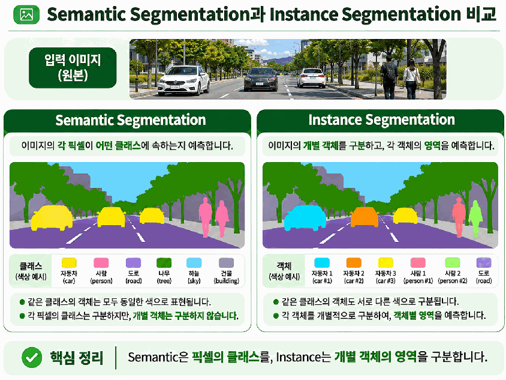
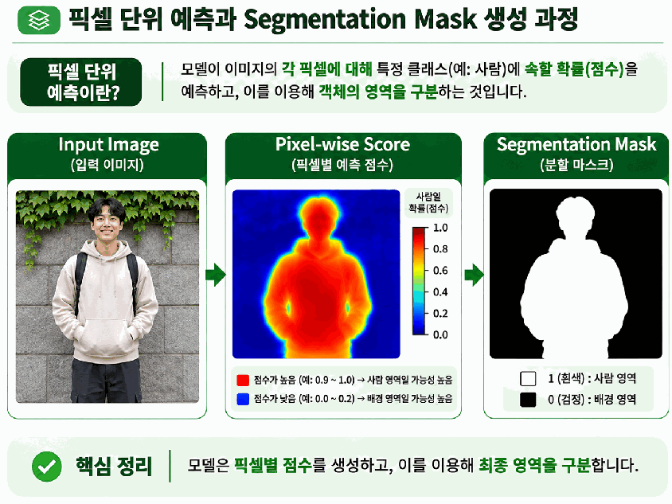
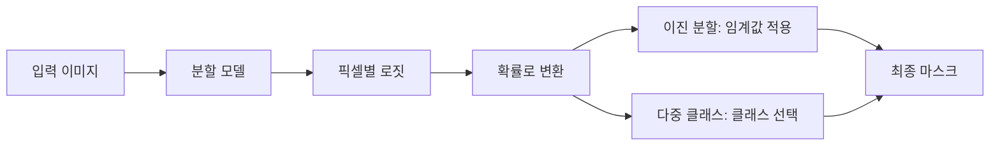
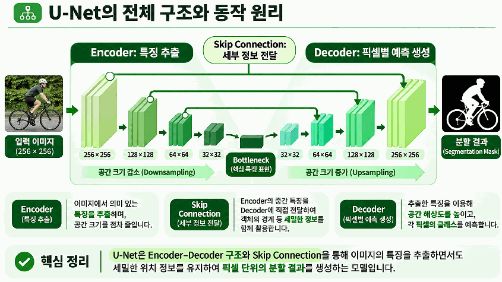
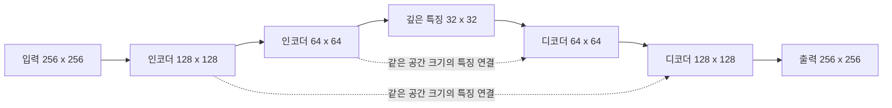
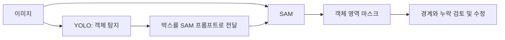

# Day 4. 이미지 분할과 U-Net, SAM

> 이미지 분할은 사각형으로 표현하기 어려운 객체의 형태를 픽셀 단위로 구분한다. 픽셀별 예측과 학습, U-Net의 공간 정보 복원, SAM의 프롬프트 기반 분할을 연결한다.

## 1. 클래스별 영역과 개별 객체의 영역

**이미지 분할(Image Segmentation)** 은 이미지의 픽셀을 클래스나 객체에 대응하는 영역으로 나누는 작업이다.  
객체 탐지의 박스는 대상 주변의 배경까지 포함할 수 있지만, 분할은 대상의 실제 윤곽을 표현한다. 무엇을 구분할지에 따라 출력의 의미가 달라진다.

### 의미 분할

의미 분할(Semantic Segmentation)은 각 픽셀이 어떤 클래스에 속하는지 예측한다.  
도로 이미지에 자동차 세 대가 있어도 모두 같은 자동차 클래스로 표시한다. 도로, 하늘, 건물처럼 장면의 영역별 종류를 파악할 때 사용한다.

따라서 클래스별 영역은 알 수 있지만, 일반적인 의미 분할 결과만으로 자동차 세 대를 각각 구분할 수는 없다.  
같은 클래스 안에서 개체의 경계와 정체성까지 분리하려면 다른 형태의 출력이 필요하다.

### 인스턴스 분할과 파놉틱 분할

인스턴스 분할(Instance Segmentation)은 개별 객체마다 별도의 마스크를 만든다.  
인스턴스는 장면 안의 개별 객체 하나를 뜻한다. 자동차 세 대는 클래스는 같아도 서로 다른 객체로 구분되므로 상품, 사람, 부품을 각각 분리하는 데 사용할 수 있다.

파놉틱 분할(Panoptic Segmentation)은 개별 객체와 배경 영역을 함께 표현한다.  
자동차와 사람은 각각 구분하면서 도로와 하늘 같은 영역도 함께 다룬다는 점에서 두 접근을 연결한다.

## 2. 픽셀별 점수에서 마스크까지

이미지 분류는 사진 전체에 대한 클래스 점수를 출력하지만, 분할은 각 픽셀 위치에 대한 예측을 생성한다.  
256 × 256 이미지라면 65,536개의 위치 각각에 대응하는 결과가 필요하다. 최종 분할 마스크(Segmentation Mask)는 이 예측으로 각 픽셀의 소속을 나타낸다.

로짓(Logit)은 확률로 바꾸기 전 모델의 점수다.  
이진 분할에서는 시그모이드(Sigmoid)로 대상에 속할 확률로 바꾸고, 임계값(Threshold)을 적용해 0 또는 1을 선택할 수 있다. 다중 클래스 분할은 각 위치에서 클래스별 점수를 비교해 소속 클래스를 정한다.

대상 확률이 아래와 같고 임계값이 0.5라면 다음 마스크 값이 만들어진다.

| 픽셀 | 대상 확률 | 임계값과 비교 | 마스크 값 |
| --- | --- | --- | --- |
| A | 0.95 | 0.5보다 큼 | 1 |
| B | 0.82 | 0.5보다 큼 | 1 |
| C | 0.18 | 0.5보다 작음 | 0 |
| D | 0.07 | 0.5보다 작음 | 0 |

**로짓, 확률, 최종 마스크는 서로 다른 단계의 값이다.**  
학습에서는 로짓이나 확률을 정답 마스크와 비교한다. 손실을 계산하기 전에 반드시 0과 1로 확정해야 하는 것은 아니다.

## 3. 분할 모델의 손실

분할 학습은 픽셀별 예측과 정답 마스크를 비교해 손실(Loss)을 계산하고, 그 손실을 줄이는 방향으로 가중치를 갱신한다.  
픽셀별 소속을 정확히 맞히는 관점과 전체 영역의 겹침을 높이는 관점을 구분하면 손실의 역할을 이해하기 쉽다.

| 손실 | 비교 관점 | 주로 사용하는 상황 |
| --- | --- | --- |
| 이진 교차 엔트로피(Binary Cross Entropy, BCE) | 대상 / 비대상에 대한 픽셀별 예측 오류 | 이진 분할 |
| 교차 엔트로피(Cross Entropy, CE) | 정답 클래스에 대한 픽셀별 예측 오류 | 다중 클래스 분할 |
| 다이스 손실(Dice Loss) | 예측 영역과 정답 영역의 겹침 | 영역의 일치 정도를 학습에 반영 |

교차 엔트로피는 정답 클래스에 낮은 확률을 부여한 예측에 큰 손실을 준다.  
다이스 손실은 영역이 얼마나 잘 겹치는지를 반영하며, 다른 손실과 함께 사용할 수도 있다. 결과를 출력하는 임계값과 학습 방향을 결정하는 손실 함수는 역할이 다르다.

## 4. U-Net의 인코더와 디코더

**U-Net** 은 이미지를 압축하며 특징을 추출하는 인코더(Encoder)와 공간 크기를 다시 늘리는 디코더(Decoder)를 연결한 구조다.  
장면의 의미를 이해하는 동시에 픽셀 위치와 경계도 보존해야 하는 분할 문제에 사용된다. 대표적으로 픽셀별 클래스를 예측하는 의미 분할 구조로 이해할 수 있다.

### 인코더: 공간을 줄이며 문맥 파악

인코더는 합성곱(Convolution)과 다운샘플링(Downsampling)으로 특징을 추출한다.  
특징 맵의 가로와 세로를 줄이면 더 넓은 영역의 정보를 모으면서 객체의 의미와 주변 문맥을 파악할 수 있다. 대신 세밀한 위치와 경계 정보가 줄어들 수 있다.

### 디코더: 공간 크기를 늘리며 예측 생성

디코더는 업샘플링(Upsampling)과 합성곱으로 공간 크기를 늘리고 픽셀별 예측을 만든다.  
하지만 작은 특징 맵의 크기를 늘리는 것만으로 압축 과정에서 잃은 경계가 저절로 복원되는 것은 아니다. 이때 인코더의 중간 특징을 다시 활용한다.

도식의 숫자는 공간 크기이며 채널 수와는 별개다.  
인코더의 압축과 디코더의 확대는 단순히 입력을 원래대로 복사하는 과정이 아니라, 의미 정보와 위치 정보를 결합해 픽셀별 결과를 만드는 과정이다.

### 스킵 연결과 ResNet의 차이

스킵 연결(Skip Connection)은 중간 계층을 건너뛰어 특징을 전달하는 연결이다.  
U-Net에서는 인코더의 같은 해상도 특징을 디코더로 전달하고, 일반적으로 채널 방향 연결(Concatenation)로 합친다. 디코더는 깊은 의미 정보와 앞단의 세부 위치 정보를 함께 사용할 수 있다.

| 구분 | U-Net의 스킵 연결 | ResNet의 잔차 연결 |
| --- | --- | --- |
| 대표적인 결합 방식 | 특징을 채널 방향으로 이어 붙임 | 입력과 변환 결과를 더함 |
| 주요 목적 | 픽셀 위치와 경계 정보 보완 | 깊은 네트워크의 학습과 신호 전달 지원 |
| 연결 관계 | 인코더와 대응하는 디코더 | 잔차 블록의 입력과 출력 |

연결을 건너뛴다는 공통점이 있어도 결합 연산과 목적이 같다거나, 모든 스킵 연결이 덧셈이라고 생각하면 안 된다.  
또한 기본 U-Net이 픽셀별 클래스를 예측한다고 해서 같은 클래스의 객체를 자동으로 각각 나누는 것은 아니다. 인스턴스 분할에는 추가 처리나 다른 구조가 필요하다.

## 5. SAM의 프롬프트 기반 분할

**SAM(Segment Anything Model)** 은 Meta의 사전학습 분할 모델로, 점이나 박스 같은 프롬프트(Prompt)를 이용해 원하는 영역을 지정한다.  
이처럼 입력 힌트를 받아 분할하는 방식을 프롬프트 기반 분할(Promptable Segmentation)이라고 한다. 출력의 핵심은 지정한 대상의 마스크이며, 그 대상의 클래스 이름까지 반드시 알려주는 것은 아니다.

| 프롬프트 | 의미 | 사용 방식 |
| --- | --- | --- |
| 양성 점(Positive Point) | 포함할 대상의 위치 | 원하는 객체 내부에 점 지정 |
| 음성 점(Negative Point) | 제외할 영역의 위치 | 함께 선택되면 안 되는 영역 지정 |
| 박스 프롬프트(Box Prompt) | 대상이 있는 범위 | 객체를 둘러싼 사각형 지정 |

같은 이미지라도 프롬프트 위치와 종류에 따라 결과가 달라질 수 있다.  
양성 점으로 대상을 지정하고 음성 점으로 주변 영역을 제외하거나, 탐지 모델이 만든 박스를 프롬프트로 전달할 수 있다.

### 활용과 검토 과정

SAM은 주석 작성의 초기 마스크 생성, 이미지 편집, 객체 영역 분리 등에 활용할 수 있다.  
초기 결과를 사람이 검토하고 수정하면 주석 작업을 보조할 수 있지만, 자동으로 생성한 마스크가 곧 정확한 정답이 되는 것은 아니다.

탐지와 SAM을 연결하면 종류와 대략적인 위치를 먼저 찾고, 해당 영역을 더 세밀하게 분리할 수 있다.  
단, 두 모델 사이의 좌표 체계와 입력 및 출력의 크기를 맞춰야 한다. 잘못 전달된 박스는 잘못된 대상을 분할하는 원인이 될 수 있다.

## 6. 핵심 개념 비교

| 개념 | 주된 역할 | 결과 또는 한계 |
| --- | --- | --- |
| 의미 분할 | 픽셀별 클래스 구분 | 같은 클래스의 개체는 별도 구분하지 않음 |
| 인스턴스 분할 | 개별 객체의 영역 구분 | 객체별 마스크 |
| 파놉틱 분할 | 개별 객체와 배경 영역을 함께 표현 | 객체 식별과 장면 영역 구분 |
| U-Net | 의미와 공간 정보를 결합해 픽셀별 예측 | 기본 구조만으로 인스턴스 구분이 보장되지 않음 |
| SAM | 프롬프트가 지정한 영역 분할 | 마스크가 클래스 이름을 뜻하지는 않음 |
| 손실 / 최종 마스크 | 학습 오류 계산 / 결과 표현 | 학습에서 먼저 이진화할 필요는 없음 |

## 7. 핵심 정리

- 의미 분할은 클래스별 영역을, 인스턴스 분할은 개별 객체의 영역을 구분한다.
- 분할 모델은 픽셀별 점수를 예측하고 이를 확률과 최종 마스크로 변환한다.
- 픽셀별 오류와 영역의 겹침은 분할 손실을 구성하는 서로 다른 관점이다.
- U-Net은 인코더에서 문맥을 추출하고 디코더에서 공간 크기를 늘려 픽셀별 결과를 만든다.
- U-Net의 스킵 연결은 앞단의 세밀한 정보를 전달하며 ResNet의 덧셈 연결과 구분해야 한다.
- SAM은 점이나 박스로 지정한 영역을 분할하며 출력 마스크의 품질을 검토해야 한다.
- 탐지 결과를 SAM에 전달할 때는 좌표와 크기의 대응을 맞춰야 한다.

[학습 목차로 이동](README.md)
