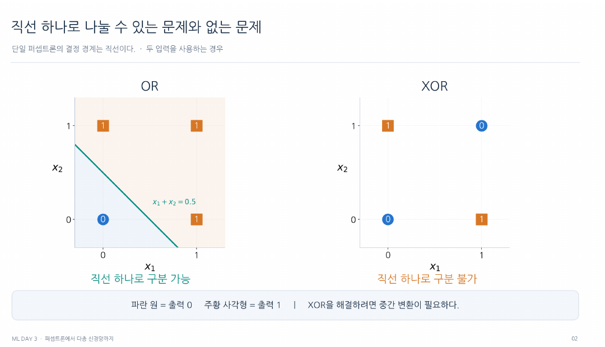
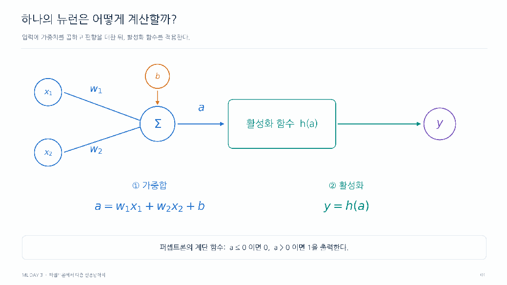
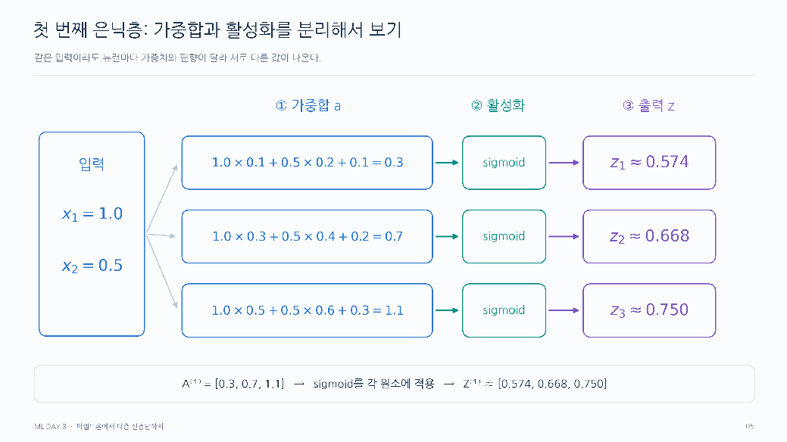

# Day 3. 퍼셉트론에서 다층 신경망까지

> 신경망은 입력에 가중치와 편향을 적용하고, 활성화 함수와 여러 층을 거쳐 문제에 맞는 예측값을 만든다.

## 1. 퍼셉트론과 선형 분류의 한계

퍼셉트론(Perceptron)은 여러 입력을 받아 하나의 출력을 만드는 기본 계산 단위다.  
가중치(Weight)는 각 입력에 곱해 영향력을 조절하고, 편향(Bias)은 가중합에 더해 기준을 조정한다.  
가중치와 편향은 학습 과정에서 조정되는 매개변수(Parameter)다.

$$
a = w_1x_1 + w_2x_2 + b
$$

$x_1$, $x_2$는 입력, $w_1$, $w_2$는 각 가중치, $b$는 편향, $a$는 활성화 전 계산값이다.  
이 퍼셉트론은 $a$가 0보다 크면 1, 그렇지 않으면 0을 출력한다.  
입력이 두 개라면 $a=0$인 경계는 직선이다.

| 입력 1 | 입력 2 | OR 출력 | XOR 출력 |
| --- | --- | --- | --- |
| 0 | 0 | 0 | 0 |
| 0 | 1 | 1 | 1 |
| 1 | 0 | 1 | 1 |
| 1 | 1 | 1 | 0 |

OR는 한 입력이라도 1이면 1이고, XOR는 두 입력이 다를 때만 1이다.  
OR의 두 그룹은 직선 하나로 구분할 수 있지만 XOR의 0과 1은 대각선으로 엇갈려 직선 하나로 나눌 수 없다.  
단층 퍼셉트론의 가중치를 바꿔도 이 표현의 한계는 남는다.

> OR는 직선 하나로 구분할 수 있지만 XOR의 두 클래스는 대각선으로 엇갈린다.

여러 뉴런을 연결하면 각자의 판단을 조합할 수 있다.  
예를 들어 OR의 결과가 1이고 AND의 결과가 0인지를 판단하면 XOR를 표현한다.  
다층 퍼셉트론(Multi-Layer Perceptron, MLP)은 이런 계산을 여러 층으로 연결한 신경망이다.

## 2. 활성화 함수와 비선형성

활성화 함수(Activation Function)는 가중합을 다음 층으로 전달할 값으로 변환한다.  
계단 함수(Step Function)는 0보다 크면 1, 나머지는 0을 출력하고, 시그모이드(Sigmoid)는 값을 0과 1 사이로 바꾼다.  
렐루(Rectified Linear Unit, ReLU)는 음수와 0은 0으로, 양수는 그대로 출력한다.

[추가 설명] 각 함수에 같은 입력값을 넣었을 때의 출력은 다음과 같다.

| 입력 | 계단 함수 | 시그모이드 약 | ReLU |
| --- | --- | --- | --- |
| -2 | 0 | 0.119 | 0 |
| 0 | 0 | 0.500 | 0 |
| 3 | 1 | 0.953 | 3 |

여러 층이 있어도 활성화 없이 가중합만 반복하면 하나의 선형 계산으로 합쳐진다.  
예를 들어 첫 층이 `h = 2x + 1`, 다음 층이 `y = 3h + 4`라면 전체는 `y = 6x + 7`이다.  
**비선형 활성화 함수**가 있어야 층을 쌓아 XOR 같은 더 복잡한 관계를 표현할 수 있다.

시그모이드의 은닉층 출력은 다음 층에 전달할 중간값이며 그 자체를 예측 확률이라고 해석하지 않는다.  
반면 이진 분류 출력층을 확률 예측용으로 설계하고 학습하면 양성 클래스의 확률로 사용할 수 있다.

> 입력마다 가중치를 곱해 더하고 편향을 더한 값이 가중합이다. 활성화 함수는 이 값을 변환해 다음 계층에 전달한다.

## 3. 순전파와 층별 계산

순전파(Forward Propagation)는 입력을 각 층에 차례로 통과시켜 출력을 계산하는 과정이다.  
입력층(Input Layer)은 입력을 전달하고, 은닉층(Hidden Layer)은 중간값을 변환하며, 출력층(Output Layer)은 최종 예측에 사용할 값을 만든다.

입력 `(1.0, 0.5)`를 세 뉴런에 넣는 실습에서 뉴런마다 가중치와 편향이 다르다.  
첫 뉴런의 가중합은 `1.0×0.1 + 0.5×0.2 + 0.1 = 0.3`이고 시그모이드를 적용하면 약 0.574다.

| 뉴런 | 가중합 | 시그모이드 출력 약 |
| --- | --- | --- |
| 1 | 0.3 | 0.574 |
| 2 | 0.7 | 0.668 |
| 3 | 1.1 | 0.750 |

앞 층의 출력 세 개는 다음 층의 입력이 된다.  
순전파는 현재 매개변수로 값을 계산하는 단계이며, 예측 오차를 바탕으로 매개변수를 바꾸는 학습과 구분한다.

> 같은 입력에도 뉴런별 가중치와 편향이 달라 가중합 0.3, 0.7, 1.1이 나온다. 시그모이드를 적용하면 약 0.574, 0.668, 0.750의 서로 다른 출력이 된다.

## 4. 행렬과 배치의 형상

여러 뉴런의 가중합은 행렬 곱(Matrix Multiplication)으로 묶을 수 있다.  
입력 2개와 뉴런 3개를 연결하면 가중치 행렬은 2행 3열이고 각 열은 한 뉴런에 연결되는 가중치다.  
여기에 뉴런별 편향을 더하면 세 뉴런의 가중합이 나온다.

$$
A = XW + B
$$

$X$는 입력, $W$는 가중치, $B$는 편향, $A$는 활성화 전 결과다.  
실습의 한 샘플은 `(1×2) × (2×3) = (1×3)`이며, 편향을 더하면 `[0.3, 0.7, 1.1]`이다.  
앞 행렬의 열 수와 뒤 행렬의 행 수가 같아야 곱할 수 있다.

배치(Batch)는 여러 샘플을 묶어 한 번에 처리하는 방식이다.  
샘플 100개를 처리하면 `(100×2) × (2×3) = (100×3)`이다.  
모든 샘플에 같은 가중치를 적용하므로 배치 크기가 바뀌어도 가중치의 형상은 바뀌지 않는다.  
편향도 각 샘플에 같은 기준으로 적용되지만 샘플별 출력은 입력에 따라 달라진다.

## 5. 문제에 맞는 출력층

| 문제 | 출력층 설정 | 결과 해석 |
| --- | --- | --- |
| 회귀 | 출력 하나와 항등 함수(Identity Function) | 계산값을 그대로 수치 예측에 사용 |
| 이진 분류 | 출력 하나와 시그모이드 | 양성 클래스 확률을 임계값과 비교 |
| 다중 분류 | 클래스 수만큼 출력과 소프트맥스(Softmax) | 합이 1인 클래스별 확률 중 최댓값 선택 |

이진 분류에서 양성 확률이 0.8이면 음성 확률은 0.2다.  
예를 들어 임계값을 0.5로 정하면 0.8은 양성으로 분류한다.  
다중 분류에서 확률이 A 0.2, B 0.7, C 0.1이면 B를 선택한다.

소프트맥스는 점수의 순서를 유지하므로 가장 큰 값의 위치를 찾는 아그맥스(Argmax)는 변환 전후 같은 클래스를 가리킨다.  
다만 변환 전 점수는 확률이 아니다.

손글씨 숫자 예제에서 28×28 이미지는 784개 입력값으로 펼쳐진다.  
은닉층 뉴런을 각각 50개와 100개, 출력층을 숫자 10개로 구성하면 형상은 다음과 같다.

행렬 형상은 첫 은닉층에서 `(1×784) × (784×50) = (1×50)`, 두 번째에서 `(1×50) × (50×100) = (1×100)`, 출력층에서 `(1×100) × (100×10) = (1×10)`이다.

## 핵심 개념 비교표

| 구분 | 역할 | 구별할 점 |
| --- | --- | --- |
| 가중치 | 입력에 곱해 영향 조절 | 학습으로 조정 |
| 편향 | 가중합에 더해 기준 조정 | 뉴런마다 적용 |
| 활성화 함수 | 계산값을 변환 | 비선형 함수가 복잡한 관계 표현에 필요 |
| 순전파 | 입력에서 출력까지 계산 | 매개변수 갱신 자체는 아님 |
| 출력층 | 문제에 맞는 최종 값 생성 | 회귀와 분류의 출력 의미가 다름 |

## 핵심 정리

- 퍼셉트론은 입력의 가중합과 편향을 계산한 뒤 출력을 결정한다.
- 단층 퍼셉트론의 직선 경계는 XOR를 완전히 구분하지 못한다.
- 여러 층에 비선형 활성화 함수를 적용하면 더 복잡한 관계를 표현할 수 있다.
- 순전파는 각 층의 출력을 다음 층의 입력으로 전달해 예측값을 만든다.
- 행렬 곱과 배치 처리는 여러 뉴런과 샘플의 계산을 함께 표현한다.
- 출력층의 함수와 출력 수는 회귀, 이진 분류, 다중 분류에 따라 달라진다.

---

다음 학습: [Day 3. 신경망 학습과 기울기 계산](04-손실과-기울기-계산.md)
