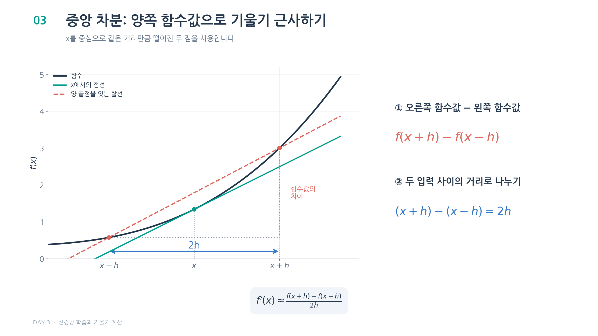
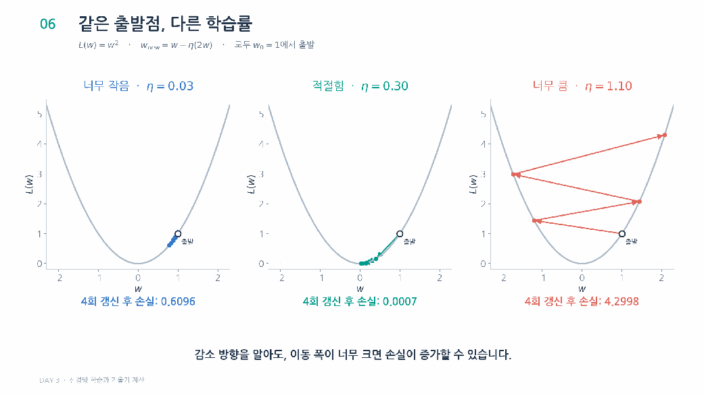
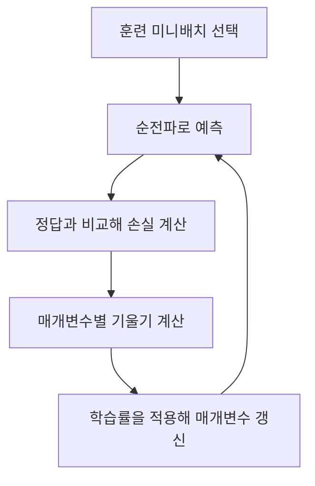

# Day 3. 신경망 학습과 기울기 계산

> 신경망은 예측과 정답의 차이를 손실로 나타내고, 손실의 기울기를 이용해 가중치와 편향을 조정한다.

## 1. 손실 함수와 모델 학습 (1-4쪽)

순전파(Forward Propagation)는 현재 매개변수로 예측값을 계산한다.  
학습에서는 예측값과 정답을 비교한 손실(Loss)을 줄이도록 가중치와 편향을 바꾼다.  
훈련 손실을 줄이는 것과 학습하지 않은 데이터에 잘 일반화하는 것은 다르므로, 설정 선택에는 검증 데이터, 최종 평가에는 테스트 데이터를 사용한다.

제곱오차 손실(Squared Error Loss)은 예측과 정답의 차이를 제곱한다.  
출력이 $K$개일 때 다음과 같이 각 오차의 제곱을 더하고 절반을 곱할 수 있다.

$$
E = \frac{1}{2}\sum_{k=1}^{K}(y_k-t_k)^2
$$

$y_k$는 $k$번째 예측, $t_k$는 대응하는 정답이다.  
예측이 3이고 정답이 5이면 손실은 `½ × (3 - 5)² = 2`다.  
앞의 ½은 미분 시 제곱에서 나오는 2와 상쇄되어 계산을 간단하게 한다.

평균 제곱 오차(Mean Squared Error, MSE)는 제곱오차의 합을 값의 개수로 나눈다. ½을 곱한 제곱오차 합과 MSE는 계수가 다르므로 손실값과 기울기의 크기도 다를 수 있다.

교차 엔트로피(Cross-entropy)는 분류에서 정답 클래스에 부여한 확률을 평가한다.  
정답이 B일 때 B의 확률이 0.6이면 손실은 `-ln(0.6) ≈ 0.511`, 확률이 0.9이면 `-ln(0.9) ≈ 0.105`다.  
둘 다 B를 예측해 정확도는 같아도 손실은 다르다.

원-핫 인코딩(One-hot Encoding)은 정답 클래스만 1, 나머지는 0으로 표시한다.  
이 경우 다중 분류의 교차 엔트로피는 정답에 해당하는 확률의 음의 자연로그만 남는다.  
여러 샘플로 이루어진 미니배치(Mini-batch)에서는 샘플별 손실의 평균을 사용할 수 있다.  
예를 들어 두 샘플의 손실이 0.4와 0.8이면 평균 손실은 0.6이다. [추가 설명]

정확도는 최종 클래스가 바뀌지 않는 구간에서 매개변수의 작은 변화에 반응하지 않는다.  
반면 손실은 예측 확률의 변화를 반영할 수 있어 경사 기반 학습에 필요한 변화율을 구하는 기준으로 쓰인다.

## 2. 미분과 수치 미분 (4-7쪽)

미분(Differentiation)은 한 지점에서 입력이 조금 변할 때 함수값이 변하는 비율을 구한다.  
미분값이 양수라면 입력을 조금 늘릴 때 함수값이 증가하는 방향이고, 음수라면 감소하는 방향이다.  
함수값의 크기와 그 지점의 변화율은 별개의 정보다.

수치 미분(Numerical Differentiation)은 실제 함수값의 차이로 미분값을 근사한다.  
중앙 차분(Central Difference)은 현재 위치 $x$의 양쪽에 있는 값의 차이를 사용한다.

$$
f'(x) \approx \frac{f(x+h)-f(x-h)}{2h}
$$

$h$는 위치를 조금 바꾸는 크기이고, 분모 $2h$는 두 위치 사이의 거리다.  
`f(x) = 0.01x² + 0.1x`에서 미분값은 x=5일 때 0.2, x=10일 때 0.3이다.  
같은 함수에서도 현재 위치에 따라 변화율이 달라진다.

$h$가 너무 크면 한 지점의 변화율을 세밀하게 나타내지 못하고, 지나치게 작으면 컴퓨터의 수 표현 오차가 커질 수 있다.  
실습에서는 0.0001을 예로 사용하며, 적절한 값은 함수와 계산 정밀도에 따라 달라진다.

> [추가 설명] x-h와 x+h의 함수값 차이를 두 위치 사이의 거리 2h로 나눈다. 그림의 곡선과 수치는 중앙 차분의 원리를 보여 주는 예시다.

## 3. 편미분과 그래디언트 (7-9쪽)

편미분(Partial Derivative)은 변수가 여러 개일 때 다른 값은 고정하고 특정 변수 하나의 변화율을 구하는 것이다.  
예를 들어 $f(x_0,x_1)=x_0^2+x_1^2$에서 현재 위치가 `(3, 4)`이면 함수값은 25다.

| 변화시키는 변수 | 고정하는 변수 | 편미분값 |
| --- | --- | --- |
| $x_0$ | $x_1=4$ | $2×3=6$ |
| $x_1$ | $x_0=3$ | $2×4=8$ |

각 편미분값을 모은 것이 그래디언트(Gradient) 또는 기울기 벡터다.  
이 지점의 기울기는 `(6, 8)`이다.  
기울기는 현재 주변에서 함수값이 가장 빠르게 증가하는 방향이며, 반대 방향은 가장 빠르게 감소하는 방향이다.  
기울기가 0이어도 그 지점이 반드시 최솟값인 것은 아니다.  
최댓값이나 어떤 방향으로는 증가하고 다른 방향으로는 감소하는 안장점(Saddle Point)일 수도 있다. [추가 설명]

## 4. 경사 하강법과 학습률 (9-11쪽)

경사 하강법(Gradient Descent)은 현재 위치에서 기울기의 반대 방향으로 이동한다.  
학습률(Learning Rate) $\eta$는 이동 크기를 조절하며, 갱신에 쓸 기울기는 모두 갱신 전 같은 위치에서 계산한다.

$$
x_{새값} = x_{현재값} - \eta\nabla f(x_{현재값})
$$

위 예에서 학습률이 0.1이면 `(3, 4) - 0.1×(6, 8) = (2.4, 3.2)`다.  
함수값은 25에서 16으로 줄어든다.  
다시 움직일 때는 새로운 위치의 기울기를 구해야 한다.

학습률이 너무 작으면 학습이 느리고, 너무 크면 낮은 지점을 지나쳐 손실이 커질 수 있다.  
기울기의 반대 방향을 택해도 모든 크기의 갱신에서 손실이 줄어드는 것은 아니다.

> 11쪽: 작은 학습률은 천천히 이동하고 적절한 크기는 손실을 빠르게 줄인다. 너무 큰 학습률은 최솟값을 반복해서 지나쳐 손실이 커질 수 있다.

## 5. 신경망의 기울기 계산과 갱신 (11-14쪽)

신경망에서는 각 가중치와 편향에 대한 손실의 편미분을 구한다.  
가중치 행렬이 2×3이면 기울기 행렬도 2×3이며 각 위치의 가중치를 어떻게 바꿀지 알려준다.  
선형 회귀에서 입력에 곱하는 계수와, 그 계수를 바꿀 때 손실이 얼마나 변하는지 나타내는 기울기는 구분한다.

수치 미분은 기울기를 **계산하는 방법**이고, 경사 하강법은 계산된 기울기로 매개변수를 **갱신하는 방법**이다.  
수치 미분은 매개변수마다 손실을 반복 계산하므로 신경망이 커지면 비용이 커진다.

## 핵심 개념 비교표

| 개념 | 의미 | 학습에서의 역할 |
| --- | --- | --- |
| 손실 | 현재 예측을 평가한 값 | 줄이려는 기준 |
| 미분 | 한 입력에 대한 순간 변화율 | 변화 방향과 민감도 확인 |
| 편미분 | 다른 변수 고정 후 한 변수의 변화율 | 매개변수별 영향 확인 |
| 그래디언트 | 편미분값을 모은 벡터 | 전체 매개변수의 변화 방향 표현 |
| 수치 미분 | 함수값 차이로 기울기를 근사 | 기울기 계산 |
| 경사 하강법 | 기울기 반대 방향으로 이동 | 매개변수 갱신 |

## 핵심 정리

- 손실은 현재 예측을 평가하고 기울기는 손실을 줄일 수정 방향을 알려준다.
- 제곱오차와 교차 엔트로피는 서로 다른 예측 결과를 평가한다.
- 수치 미분은 작은 변화에 따른 함수값의 차이로 미분을 근사한다.
- 편미분은 나머지 변수를 고정하고 하나의 영향을 살피며, 그래디언트는 이를 모은다.
- 경사 하강법은 현재 기울기에 학습률을 곱한 값을 매개변수에서 뺀다.
- 매개변수를 갱신한 후에는 새 위치에서 기울기를 다시 계산한다.
