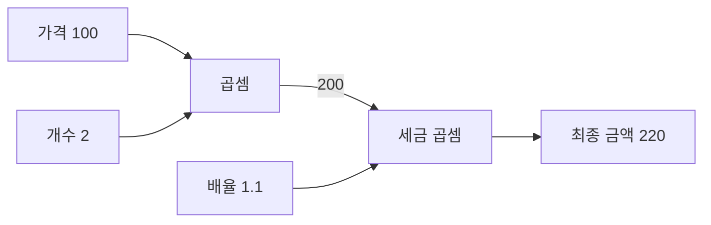
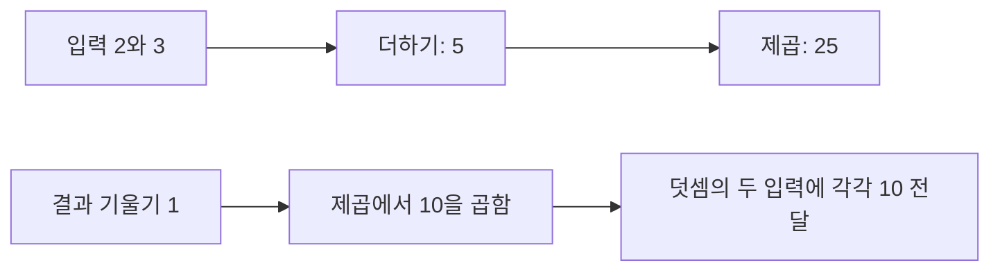

# Day 3. 계산 그래프와 오차역전파법

> 계산을 작은 연산으로 나누고, 연쇄법칙을 뒤에서부터 적용하면 손실에 대한 각 매개변수의 기울기를 구할 수 있다.

## 1. 계산 그래프와 순전파 (1-4쪽)

계산 그래프(Computational Graph)는 계산 과정을 연산 노드와 값의 흐름을 나타내는 화살표로 표현한다.
각 노드는 자신의 입력으로 맡은 연산을 수행하며, 전체 계산을 알지 않아도 된다.
입력부터 차례로 값을 계산하는 과정을 순전파(Forward Propagation)라고 한다.

사과 한 개가 100원이고 2개를 사며 세금이 10%이면, 세전 금액은 `100×2=200원`, 최종 금액은 `200×1.1=220원`이다.
첫 곱셈의 출력 200이 두 번째 곱셈의 입력으로 전달된다.

수치 미분은 매개변수를 하나씩 바꾸어 손실을 여러 번 계산한다.
매개변수가 많은 신경망에서는 계산이 늘어나므로, 이미 수행한 연산을 이용해 기울기를 효율적으로 구하는 오차역전파법(Backpropagation)을 사용한다.

## 2. 국소적 미분과 노드별 규칙 (4-7쪽)

국소적 미분(Local Derivative)은 한 노드의 입력이 조금 변할 때 그 노드의 출력이 얼마나 변하는지를 나타낸다.
역전파에서 각 입력으로 전달하는 기울기는 **뒤에서 받은 기울기 × 해당 입력의 국소적 미분**이다.

| 노드 | 순전파 예 | 뒤에서 받은 기울기 | 입력으로 전달되는 기울기 |
| --- | --- | --- | --- |
| 덧셈 | 10 + 5 = 15 | 1.3 | 양쪽 각각 1.3 |
| 곱셈 | 10 × 5 = 50 | 1.3 | 10 쪽은 1.3×5=6.5, 5 쪽은 1.3×10=13 |

덧셈은 각 입력의 국소적 미분이 1이므로 기울기를 양쪽에 그대로 전달한다.
곱셈은 한 입력의 기울기를 구할 때 다른 쪽 입력값을 곱한다.
따라서 곱셈의 역전파에는 순전파 때의 입력값이 필요하다.

## 3. 연쇄법칙으로 기울기 연결하기 (7-12쪽)

연쇄법칙(Chain Rule)은 연결된 연산의 변화율을 곱해 처음 입력이 최종 결과에 미치는 영향을 구하는 규칙이다. $s=x+y$, $z=s^2$이고 $x=2$, $y=3$이면 순전파 값은 $s=5$, $z=25$다.

$$
\frac{\partial z}{\partial x}=\frac{\partial z}{\partial s}\frac{\partial s}{\partial x}=10\times1=10
$$

제곱 노드의 입력 5에 대한 국소적 미분은 `2×5=10`이고, 덧셈 노드의 각 입력에 대한 국소적 미분은 1이다.
최종 결과를 자기 자신으로 미분한 1에서 시작하면 제곱 노드에서 10, 덧셈의 두 입력 각각에 10이 전달된다.
순전파 값 25와 역전파의 시작 기울기 1은 서로 다른 정보다.

같은 변수가 여러 경로로 사용되면 그 변수에 돌아오는 기울기는 더한다.
예를 들어 `x+x`의 두 경로로 각각 1이 돌아오면 x에 대한 전체 기울기는 2다.

## 4. 구매 금액의 역전파 (12-19쪽)

사과 예제에서 최종 금액의 기울기 1부터 시작한다.
세금 곱셈에서 사과 금액 쪽에는 `1×1.1=1.1`, 세금 배율 쪽에는 `1×200=200`이 전달된다.
이어서 사과 곱셈에서 가격 쪽은 `1.1×2=2.2`, 개수 쪽은 `1.1×100=110`이다.

가격의 기울기 2.2는 다른 조건을 고정했을 때 사과 가격이 1원 오르면 최종 금액이 2.2원 오른다는 뜻이다.
이 예에서는 가격과 금액이 선형 관계이므로 정확하지만, 일반적인 비선형 함수에서는 현재 위치 주변의 작은 변화율로 해석한다.
개수의 미분은 원리 설명을 위해 연속적인 값처럼 다룬다. [추가 설명]

사과 200원과 귤 `150×3=450원`을 함께 사면 세전 합계는 650원, 세후는 715원이다.
세금 노드에서 합계 쪽으로 전달된 1.1은 덧셈 노드에서 사과와 귤 금액 쪽으로 각각 전달된다.
귤 가격 쪽은 `1.1×3=3.3`, 귤 개수 쪽은 `1.1×150=165`다.
세금 배율 쪽에는 세전 합계 650이 전달된다.

> [추가 설명] 세후 금액에서 시작한 기울기에 각 노드의 국소적 미분을 곱한다. 사과 가격 쪽에는 개수 2와 세금 배율 1.1이 반영된 기울기 2.2가 전달된다.

## 5. 신경망의 각 연산에 적용하기 (19-25쪽)

아핀 계층(Affine Layer)은 입력과 가중치를 곱하고 편향을 더한다.
하나의 입력일 때 $z=xw+b$이며, 덧셈은 편향 쪽에 기울기를 그대로 보낸다.
곱셈에서는 가중치 쪽에 입력 $x$를, 입력 쪽에 가중치 $w$를 곱해 전달한다.

렐루(Rectified Linear Unit, ReLU)는 양수 입력에서 국소적 미분이 1, 음수 입력에서 0이다.
뒤에서 기울기 2가 왔다면 입력이 3일 때 2가 전달되고, 입력이 -3일 때 0이 전달된다.
정확히 0에서는 미분이 정의되지 않으며 여기서는 0으로 처리한다. [추가 설명]

시그모이드(Sigmoid)의 출력이 $y$라면 국소적 미분은 $y(1-y)$다.
출력 0.5에서 국소적 미분은 0.25이므로 기울기 2가 오면 0.5를 전달한다.
출력이 0이나 1에 가까우면 국소적 미분이 작아져 전달되는 기울기도 작아진다.

소프트맥스(Softmax)와 교차 엔트로피(Cross-entropy)를 결합한 분류에서는 한 샘플의 출력 점수에 대한 기울기가 `예측 확률 - 원-핫 정답`으로 정리된다.
이는 해당 조합에 대한 결과이며 모든 역전파에 공통으로 적용하는 식은 아니다.
배치 평균 손실에서는 배치 크기도 반영한다. [추가 설명]

## 6. 작은 신경망의 한 번의 학습 (25-34쪽)

입력 $x=2$, 가중치 $w=1$, 편향 $b=1$, 정답 $t=5$를 사용한다.
예측은 `ReLU(2×1+1)=3`, 손실은 `½×(3-5)²=2`다.

| 역전파 위치 | 전달 계산 | 결과 |
| --- | --- | --- |
| 손실에서 예측 | 1 × 0.5 × 2 × (-2) | -2 |
| ReLU | -2 × 1 | -2 |
| 편향 | 덧셈에서 -2 전달 | -2 |
| 가중치 | -2 × 입력 2 | -4 |

역전파는 기울기를 계산하며 매개변수를 아직 바꾸지 않는다.
학습률 0.1을 사용하는 경사 하강법(Gradient Descent)으로 가중치는 `1 - 0.1×(-4) = 1.4`, 편향은 `1 - 0.1×(-2) = 1.2`가 된다.
다시 계산하면 예측은 4, 손실은 0.5다.

같은 학습에서 새 가중치와 편향은 갱신 전의 기울기로 함께 계산한다.
학습률이 지나치게 크면 이 예와 달리 갱신 후 손실이 커질 수 있다.

수치 미분과 역전파의 결과를 비교하는 기울기 확인(Gradient Check)은 기울기 계산이 올바른지 살펴보는 데 도움이 된다.

## 핵심 개념 비교표

| 구분 | 순전파 | 역전파 | 매개변수 갱신 |
| --- | --- | --- | --- |
| 방향 또는 기준 | 입력에서 출력으로 | 손실에서 입력 방향으로 | 계산된 기울기 사용 |
| 결과 | 중간값, 예측, 손실 | 각 값에 대한 손실의 기울기 | 변경된 가중치와 편향 |
| 핵심 계산 | 노드의 원래 연산 | 전달받은 기울기와 국소적 미분의 곱 | 현재 값에서 학습률 × 기울기를 뺌 |

## 핵심 정리

- 계산 그래프는 전체 계산을 작은 연산과 값의 흐름으로 나눈다.
- 역전파는 최종 결과의 기울기 1에서 시작해 연쇄법칙을 거꾸로 적용한다.
- 덧셈은 기울기를 각 입력에 전달하고 곱셈은 다른 쪽 입력값을 곱한다.
- 같은 변수로 돌아오는 여러 경로의 기울기는 더한다.
- ReLU와 시그모이드는 각자의 국소적 미분을 사용해 기울기를 전달한다.
- 역전파는 기울기를 구하고 경사 하강법은 학습률을 적용해 매개변수를 바꾼다.
- 갱신 후 다시 순전파하면 바뀐 예측값과 손실을 확인할 수 있다.
