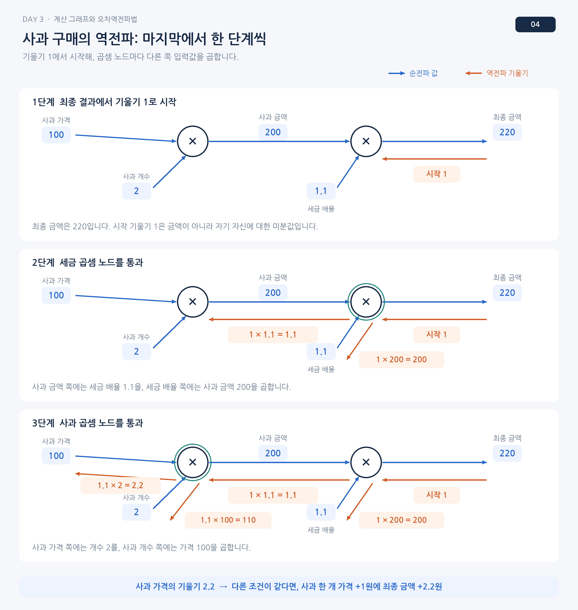

# 계산 그래프와 연쇄법칙

사과 가격과 개수를 곱한 뒤 세율을 곱하면 결제액이 나옴. 이 계산을 작은 연산으로 나누면 가격이 달라졌을 때 최종 금액이 얼마나 변하는지도 같은 경로를 거꾸로 따라가며 계산할 수 있음.

## 곱셈과 덧셈의 규칙

금액이 가격 × 개수 × 세금 배율이라면 가격에 대한 기울기는 개수 × 세금 배율임. 곱셈 노드는 뒤에서 받은 기울기에 반대쪽 입력을 곱함. 사과값과 귤값을 더하는 노드에서는 각 입력에 대한 미분이 1이므로 기울기를 양쪽에 그대로 보냄. 반씩 나누지 않음.

## 연쇄법칙

$a=f(x),\ L=g(a)$이면 $\partial L/\partial x=(\partial L/\partial a)(\partial a/\partial x)$. 각 노드는 순전파 때 사용한 값으로 자신의 변화율을 구하고 뒤에서 온 기울기에 곱함. 여러 경로로 같은 변수에 도달하면 그 기여는 더함.

## 신경망으로 연결하기

곱셈, 덧셈, 활성화, 손실 계산도 하나의 그래프임. 역전파의 시작값은 손실의 크기가 아니라 $\partial L/\partial L=1$임. 전체 손실을 각 매개변수마다 처음부터 다시 계산하지 않고 중간 결과를 재사용함.

## 사과값을 거꾸로 읽기

사과 한 개가 100원, 수량이 2개, 세금 배율이 1.1인 경우 합계는 220원임. 마지막 곱셈에서 세금 전 금액 쪽으로 가는 기울기는 1.1임. 앞쪽 곱셈까지 돌아오면 단가에 대한 기울기는 $1.1\times2=2.2$, 수량에 대한 기울기는 $1.1\times100=110$임. 단가를 1원 높이는 경우와 사과 한 개를 더 사는 경우의 합계 변화가 다른 이유가 여기에 있음.

| 순전파 연산 | 뒤에서 받은 기울기 g를 전달하는 방법 |
| --- | --- |
| $s=a+b$ | a와 b에 각각 g |
| $s=ab$ | a에는 gb, b에는 ga |
| $s=\max(0,a)$ | a가 양수이면 g, 음수이면 0 |

귤값을 더한 뒤 세금을 적용한다면 덧셈 노드에서 사과값과 귤값 쪽으로 각각 1.1이 전달됨. 두 경로가 나중에 같은 매개변수를 사용하면 그 매개변수의 기울기는 두 경로의 기여를 합한 값임. 순전파 때 값을 보관하는 이유도 곱셈의 반대쪽 입력이나 ReLU 입력의 부호를 역전파에서 다시 쓰기 때문임.

## 사과값 역전파

순전파의 중간 금액 200과 세금 배율 1.1을 다시 사용함. 가격 쪽에는 수량을, 수량 쪽에는 가격을 곱하기 때문에 같은 손실 방향에서도 전달값이 달라짐.

[이전](04-손실과-기울기-계산.md) | [다음](06-작은-신경망의-역전파.md) | [파트 목차](README.md)
