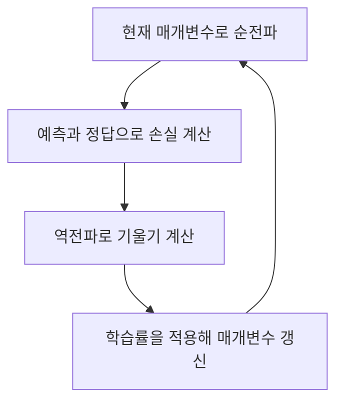

# Day 3. 신경망 학습과 역전파 한 번에 이해하기

> 작은 신경망 하나를 사용해 예측, 손실 계산, 기울기 계산, 매개변수 갱신이 어떻게 이어지는지 확인한다.

## 1. 순전파와 손실 (1-3쪽)

신경망 학습은 주어진 입력과 정답을 바꾸는 것이 아니라, 예측을 만드는 가중치와 편향을 조정하는 과정이다. 실습의 작은 신경망은 입력 $x=2$, 가중치 $w=1$, 편향 $b=1$, 정답 $t=5$를 사용한다.

순전파(Forward Propagation)에서 입력에 가중치를 곱하고 편향을 더하면 `2×1+1=3`이다. 렐루(Rectified Linear Unit, ReLU)는 양수 3을 그대로 내보내므로 예측값은 3이다.

손실 함수(Loss Function)는 예측과 정답의 차이를 학습에 사용할 숫자로 바꾼다. 이 예제에서는 예측값 $\hat y$와 정답 $t$의 차이를 제곱하고 ½을 곱한다.

$$
L = \frac{1}{2}(\hat y-t)^2 = \frac{1}{2}(3-5)^2 = 2
$$

손실 2는 현재 예측의 오류를 나타내지만, 가중치와 편향을 어느 방향으로 바꿀지는 직접 알려주지 않는다. 그 방향을 찾으려면 매개변수를 조금 바꿀 때 손실이 어떻게 변하는지 확인해야 한다.

## 2. 매개변수 하나씩 바꾸기 (4-8쪽)

다른 값을 고정하고 가중치나 편향 하나만 바꾸면 각각이 손실에 미치는 영향을 비교할 수 있다. 편미분(Partial Derivative)은 이런 조건에서 한 변수에 대한 변화율을 구한다.

| 설정 | 예측 | 손실 |
| --- | --- | --- |
| 가중치 1, 편향 1 | 3 | 2 |
| 가중치만 1.1로 변경 | 3.2 | 1.62 |
| 편향만 1.1로 변경 | 3.1 | 1.805 |

두 값을 각각 0.1 증가시키면 손실이 모두 줄지만 감소량은 다르다. 각 매개변수의 미분값은 현재 위치에서 손실의 변화 방향과 민감도를 나타낸다.

수치 미분(Numerical Differentiation)은 실제로 값을 조금 바꾼 양쪽의 손실 차이로 기울기를 근사한다. 중앙 차분(Central Difference)에서 기준보다 작은 값과 큰 값을 모두 사용한다.

| 변경 대상 | 작은 값에서 손실 | 큰 값에서 손실 | 중앙 차분 |
| --- | --- | --- | --- |
| 가중치 0.9와 1.1 | 2.42 | 1.62 | `(1.62-2.42)/0.2 = -4` |
| 편향 0.9와 1.1 | 2.205 | 1.805 | `(1.805-2.205)/0.2 = -2` |

가중치와 편향에 대한 편미분을 모으면 그래디언트(Gradient)는 `(-4, -2)`다. 각 값이 음수이므로 현재 위치에서 해당 매개변수를 조금 늘리면 손실은 감소하는 방향이다.

일반적으로 수치 미분은 근사지만, 이 예제는 ReLU가 양수 구간에 있고 손실이 이차식이므로 위 중앙 차분 결과가 실제 미분값과 일치한다. 여기서 사용한 변화량 0.1은 뒤에서 사용할 학습률 0.1과 역할이 다르다.

## 3. 계산 그래프와 역전파 (8-14쪽)

계산 그래프(Computational Graph)는 곱셈, 덧셈, 활성화, 손실 계산을 작은 연산으로 나누어 연결한다. 오차역전파법(Backpropagation)은 손실에서 시작해 그래프를 거꾸로 따라가며 각 매개변수의 기울기를 구한다. 매개변수를 하나씩 바꾸어 손실을 반복 계산하는 수치 미분보다 큰 신경망에서 효율적으로 기울기를 계산할 수 있다. 실제 신경망도 같은 원리로 여러 계층의 기울기를 연결하며, 파이토치(PyTorch)의 자동 미분(Automatic Differentiation) 기능이 이를 계산할 수 있다.

역전파는 각 연산에서 받은 기울기에 그 연산의 국소적 미분(Local Derivative)을 곱한다. 여러 단계의 변화율을 이어서 곱하는 규칙을 연쇄법칙(Chain Rule)이라고 한다.

| 뒤에서 앞으로의 단계 | 기울기 계산 | 의미 |
| --- | --- | --- |
| 손실에서 예측 | `1×0.5×2×(-2)=-2` | 예측값을 조금 늘리면 손실이 줄어드는 방향 |
| ReLU | `-2×1=-2` | 입력 3이 양수이므로 그대로 전달 |
| 덧셈에서 편향 | `-2×1=-2` | 편향에 대한 손실의 기울기 |
| 곱셈에서 가중치 | `-2×2=-4` | 다른 쪽 입력 2를 곱해 전달 |

덧셈 노드는 기울기를 두 입력에 각각 전달하고 절반으로 나누지 않는다. 곱셈 노드는 기울기를 구하려는 쪽의 반대편 입력값을 곱한다. 결과인 가중치 -4와 편향 -2는 앞에서 수치 미분으로 구한 값과 같다.

## 4. 경사 하강법으로 매개변수 갱신 (14-16쪽)

**역전파는 기울기를 계산하고, 경사 하강법은 매개변수를 실제로 바꾼다.** 경사 하강법(Gradient Descent)은 현재 값에서 `학습률 × 기울기`를 뺀다. 학습률(Learning Rate)은 한 번에 바꾸는 크기를 조절한다.

학습률이 0.1이면 가중치의 새 값은 `1 - 0.1×(-4) = 1.4`, 편향의 새 값은 `1 - 0.1×(-2) = 1.2`다. 음수 기울기를 빼므로 두 매개변수가 증가한다.

| 항목 | 갱신 전 | 갱신 후 |
| --- | --- | --- |
| 가중치 | 1 | 1.4 |
| 편향 | 1 | 1.2 |
| 예측 | 3 | `2×1.4+1.2=4` |
| 손실 | 2 | `½×(4-5)²=0.5` |

갱신 후 다시 순전파하면 예측이 정답 5에 가까워지고 손실이 2에서 0.5로 줄어든다. 이후에는 변경된 매개변수 위치에서 새로운 기울기를 계산해 과정을 반복한다.

## 핵심 개념 비교표

| 개념 | 하는 일 | 이 예제의 결과 |
| --- | --- | --- |
| 손실 | 현재 예측을 평가 | 2 |
| 수치 미분 | 값을 바꾼 손실의 차이로 변화율 근사 | 가중치 -4, 편향 -2 |
| 역전파 | 각 연산의 변화율을 연결해 기울기 계산 | 가중치 -4, 편향 -2 |
| 경사 하강법 | 기울기와 학습률로 매개변수 갱신 | 가중치 1.4, 편향 1.2 |
| 다시 순전파 | 갱신된 값으로 예측과 손실 계산 | 예측 4, 손실 0.5 |

## 핵심 정리

- 입력과 정답은 주어진 값이고 가중치와 편향은 학습으로 조정하는 값이다.
- 손실은 현재 예측을 평가하지만 매개변수의 수정 방향을 혼자 알려주지는 않는다.
- 편미분은 다른 값을 고정하고 한 매개변수가 손실에 미치는 영향을 나타낸다.
- 수치 미분은 값을 직접 바꾸어 기울기를 근사하고, 역전파는 연산의 변화율을 연결한다.
- 역전파로 얻은 기울기는 아직 갱신된 매개변수가 아니다.
- 경사 하강법은 학습률과 기울기를 적용해 매개변수를 바꾸며, 이후 새 위치에서 다시 계산한다.
