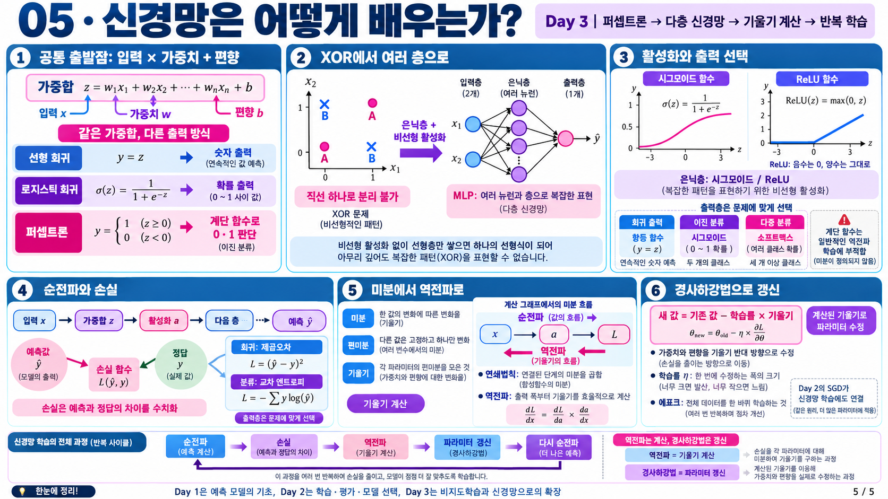

# 신경망 기초와 역전파

| 순서 | 학습 내용 |
| --- | --- |
| 1 | [퍼셉트론에서 다층 신경망까지](03-퍼셉트론과-순전파.md) |
| 2 | [신경망 학습과 기울기 계산](04-손실과-기울기-계산.md) |
| 3 | [계산 그래프와 오차역전파법](05-계산-그래프와-연쇄법칙.md) |
| 보충 | [신경망 학습과 역전파 한 번에 이해하기](06-작은-신경망의-역전파.md) |

## 전체 흐름

> 입력의 가중합과 활성화로 예측을 만든다. 손실을 계산한 뒤 역전파로 기울기를 구하고, 경사 하강법으로 가중치와 편향을 갱신한다.

[딥러닝 목차](../README.md) | [그림 살펴보기](그림-살펴보기.md)
