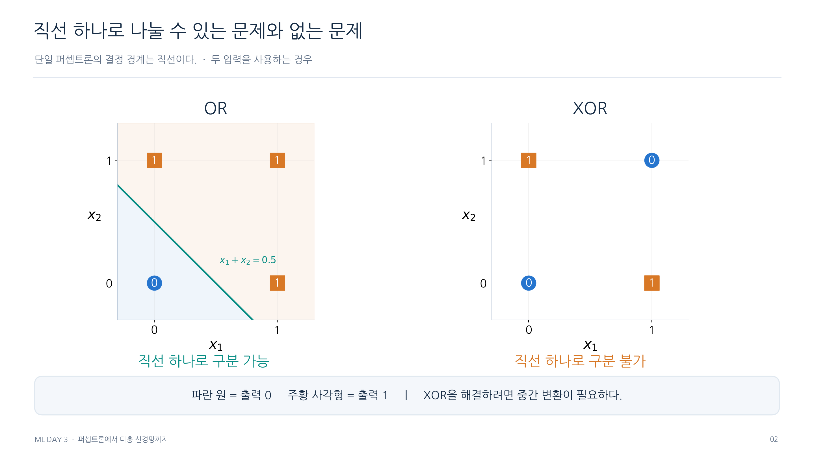
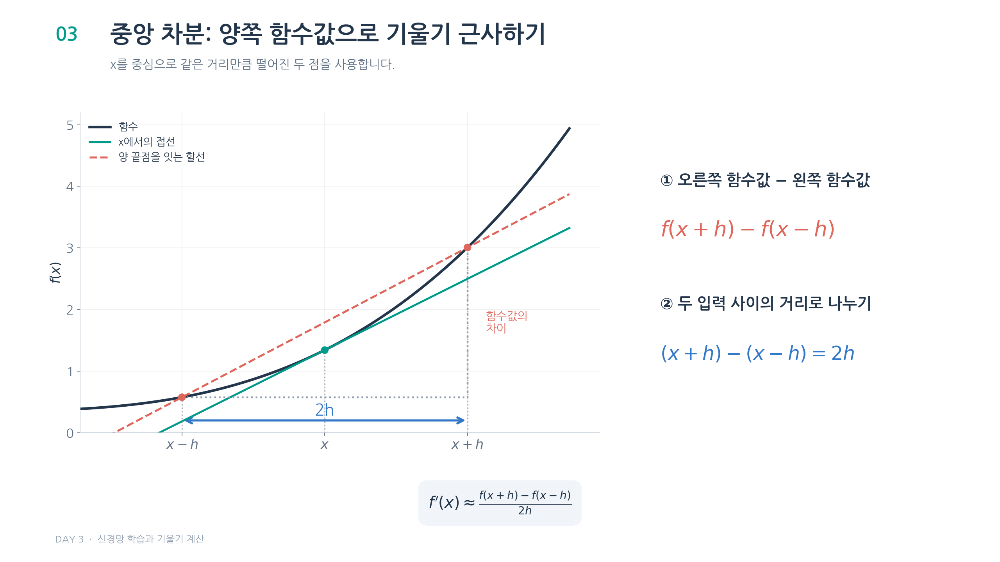
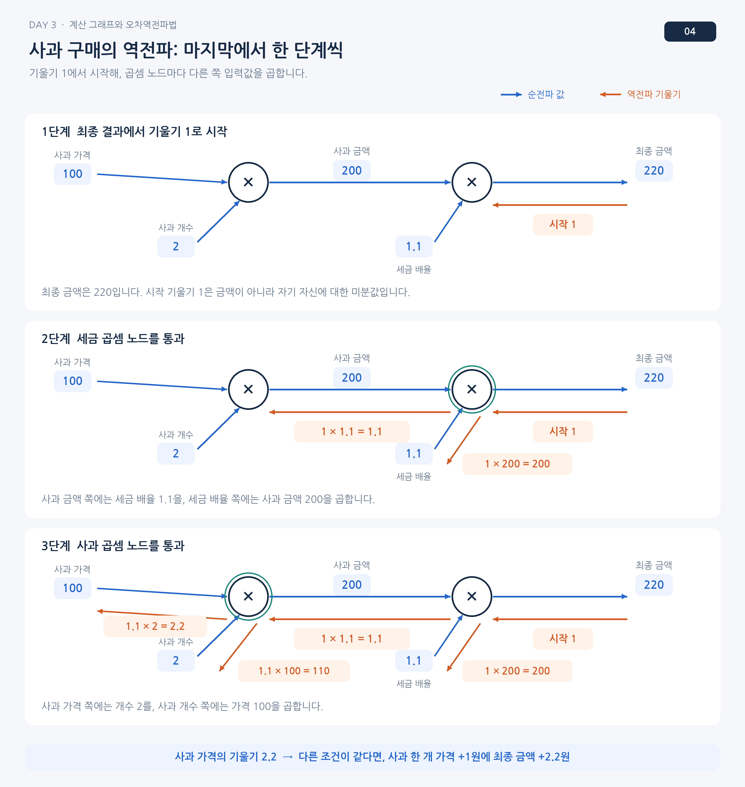

# 그림 살펴보기

## OR와 XOR

두 입력을 가로와 세로 좌표로 놓고 정답이 같은 점끼리 살펴봄.  
XOR의 같은 클래스 점들은 대각선으로 마주 보므로 한 직선으로 분리할 수 없음.

## 중앙 차분

곡선 위에서 현재 값의 양쪽을 고르고 두 점을 잇는 기울기를 구함.  
두 점 사이의 가로 간격은 h가 아니라 2h임.

## 사과값 역전파

순전파의 중간 금액 200과 세금 배율 1.1을 다시 사용함.  
가격 쪽에는 수량을, 수량 쪽에는 가격을 곱하기 때문에 같은 손실 방향에서도 전달값이 달라짐.

[파트 목차](README.md)
