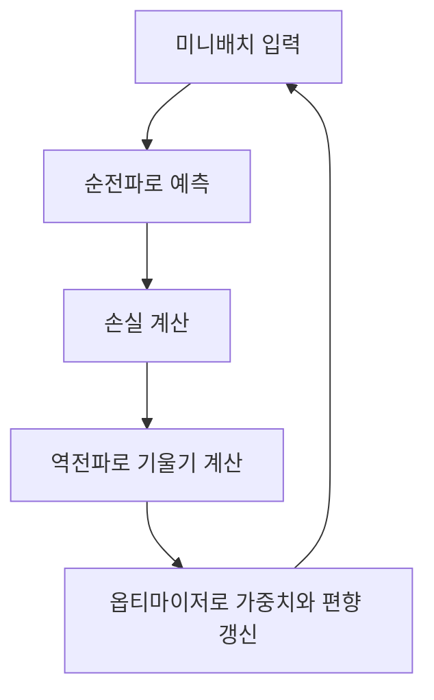
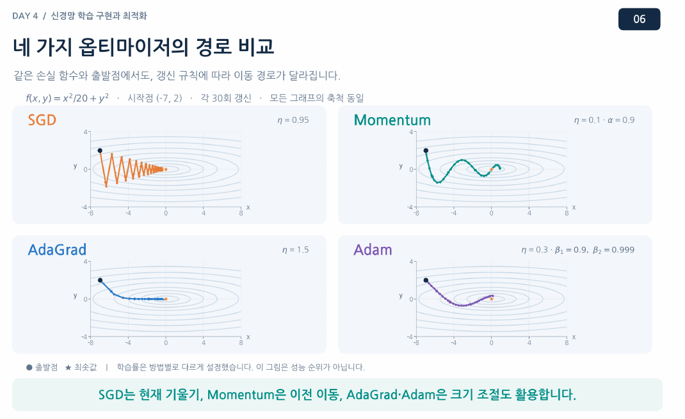
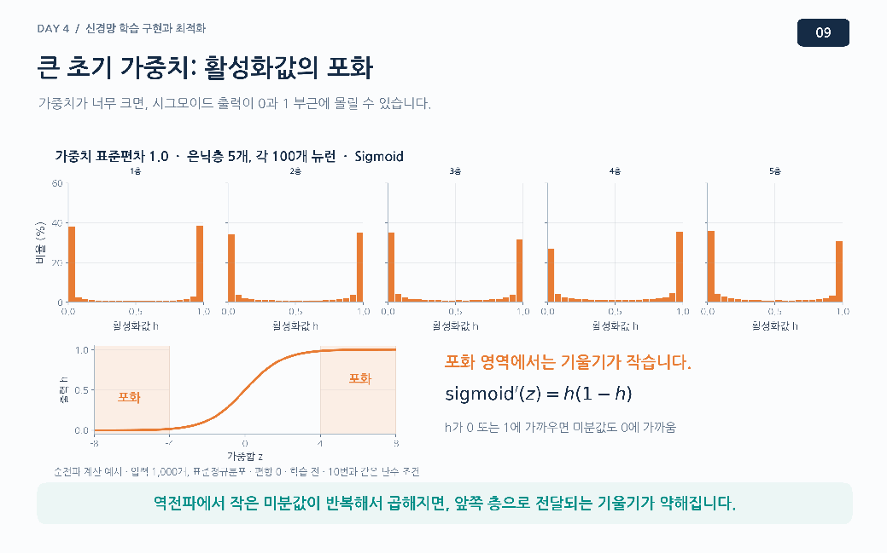
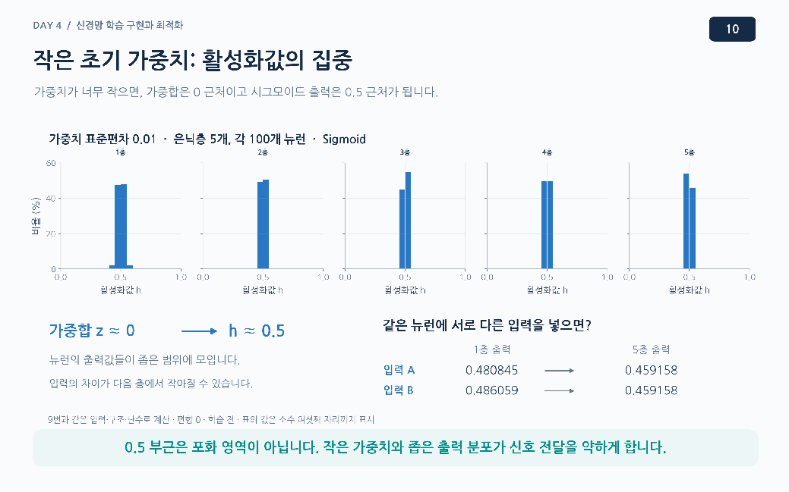
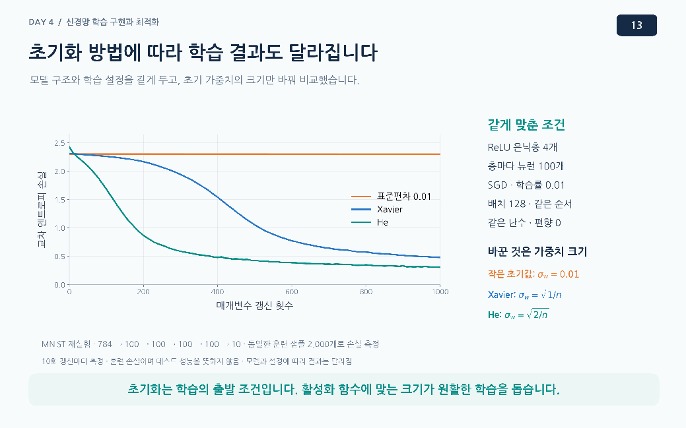

# Day 4. 신경망의 최적화와 가중치 초기화

> 옵티마이저는 계산된 기울기로 매개변수를 갱신한다. 가중치 초기화는 학습을 시작할 때 신호와 기울기가 여러 층을 통과할 수 있도록 출발점을 정한다.

## 1. 역전파와 매개변수 갱신

신경망은 순전파(Forward Propagation)로 예측을 만들고, 정답과 비교해 손실(Loss)을 구한다.  
오차역전파(Backpropagation)는 각 가중치와 편향을 바꾸었을 때 손실이 얼마나 달라지는지 계산한다.  
이후 옵티마이저(Optimizer)가 그 기울기를 사용해 매개변수를 실제로 수정한다.

확률적 경사 하강법(Stochastic Gradient Descent, SGD)의 기본 규칙은 현재 기울기의 반대 방향으로 이동하는 것이다.  
신경망에서는 보통 전체 훈련 데이터 중 미니배치의 기울기를 이용해 한 번 갱신한다.

$$
\theta_{t+1} = \theta_t - \eta g_t
$$

$\theta_t$는 현재 가중치 또는 편향, $g_t$는 현재 손실의 기울기, $\eta$는 학습률이다. [추가 설명] 현재 가중치가 1, 기울기가 -4, 학습률이 0.1이면 새 가중치는 `1 - 0.1×(-4) = 1.4`다.  
기울기를 계산하는 일과 새 값을 적용하는 일은 별개의 단계다.

## 2. 옵티마이저마다 이동 경로가 다른 이유

손실 곡면(Loss Surface)은 매개변수 조합에 따라 손실이 어떻게 달라지는지 나타낸다.  
길고 좁은 골짜기에서는 한 방향의 경사가 가파르고 다른 방향은 완만할 수 있다.  
SGD는 가파른 쪽에서 골짜기 양편을 오가며 지그재그로 움직이고, 완만한 쪽으로는 천천히 진행할 수 있다.

학습률을 줄이면 진동이 작아질 수 있지만 전체 이동도 느려진다.  
아래 방법들은 기울기의 이전 흐름이나 크기를 활용해 갱신을 조절한다.

| 옵티마이저 | 활용하는 정보 | 갱신의 특징 |
| --- | --- | --- |
| SGD | 현재 기울기 | 현재 기울기 반대 방향으로 이동 |
| 모멘텀(Momentum) | 현재 기울기와 이전 이동 흐름 | 같은 방향의 움직임을 이어 가고 진동을 완화 |
| 에이다그라드(AdaGrad) | 매개변수별 과거 기울기의 제곱 누적 | 누적값이 큰 매개변수의 갱신 크기를 줄임 |
| 아담(Adam) | 기울기와 기울기 제곱의 이동평균 | 최근 방향과 크기를 함께 반영 |

모멘텀은 움직이는 공이 이전 방향을 이어 가는 것에 비유할 수 있다.  
같은 방향의 영향은 누적되고, 번갈아 나타나는 방향은 일부 상쇄될 수 있다.

AdaGrad는 기울기 제곱을 계속 누적하므로 양수와 음수가 상쇄되지 않는다.  
다만 오랫동안 학습하면 누적값이 계속 커져 갱신 크기가 지나치게 작아질 수 있다.  
Adam은 오래된 정보의 비중이 점차 줄어드는 이동평균을 사용하며, 어떤 방법이 항상 가장 좋은지는 데이터와 설정에 따라 달라진다.

> 같은 손실 곡면과 출발점에서도 옵티마이저의 갱신 규칙에 따라 이동 경로가 달라질 수 있다. 각 그림의 설정이 다르므로 이 그림만으로 성능 순위를 단정하지 않는다.

## 3. 초기 가중치의 크기와 대칭성

가중치 초기화(Weight Initialization)는 학습 전에 가중치의 시작값을 정하는 일이다.  
같은 층의 뉴런이 동일한 가중치와 편향으로 시작하고 뒤쪽 연결도 대칭적이라면, 같은 계산과 갱신을 반복해 서로 다른 특징을 배우기 어려울 수 있다.  
이를 대칭성 문제(Symmetry Problem)라고 하며, 가중치를 서로 다른 무작위 값으로 시작해 완화한다.  
가중치가 다르면 편향은 0으로 시작해도 된다.

초기 가중치가 너무 크면 시그모이드(Sigmoid)의 입력이 큰 양수나 음수가 되어 출력이 각각 1이나 0에 가까워질 수 있다.  
이 포화(Saturation) 구간은 입력이 바뀌어도 출력이 거의 변하지 않아 미분값이 작다.  
역전파에서 작은 미분값이 여러 번 곱해지면 앞 계층의 기울기가 거의 사라지는 기울기 소실(Vanishing Gradient)이 생길 수 있다.

반대로 초기 가중치가 너무 작으면 가중합이 0 부근에 모여 시그모이드 출력이 0.5 근처에 집중된다.  
이 구간의 시그모이드 미분값은 오히려 크지만, 입력에 따른 출력 차이가 작고 역전파 과정에서 작은 가중치가 반복해서 곱해져 기울기가 약해질 수 있다.  
큰 가중치의 포화와 작은 가중치의 문제는 구분해야 한다.

> 0과 1 근처는 시그모이드의 미분값이 작다. 작은 미분값이 역전파에서 반복해서 곱해지면 앞 계층으로 전달되는 기울기가 약해질 수 있다.

> 0.5 부근은 시그모이드의 포화 구간이 아니다. 작은 가중치와 비슷한 출력값으로 신호 차이가 약해지는 문제를 큰 초기값의 포화와 구분한다.

## 4. 활성화 함수와 초기화 방법

한 뉴런은 여러 입력을 가중치와 곱해 더한다.  
입력 연결 수가 많아질 때 계산값의 규모가 지나치게 달라지지 않도록, 초기화 방법은 연결 수와 활성화 함수의 특성을 고려한다.

| 방법 | 고려하는 요소 | 주로 연결하는 활성화 함수 |
| --- | --- | --- |
| 자비에 초기화(Xavier Initialization) | 입력과 출력의 연결 수 | 시그모이드, 하이퍼볼릭 탄젠트(Hyperbolic Tangent, tanh) |
| 허 초기화(He Initialization) | 입력 연결 수와 ReLU의 특성 | 렐루(Rectified Linear Unit, ReLU) |

Xavier는 적절한 크기의 분포에서 가중치를 서로 다르게 뽑아 층 사이의 신호 규모를 조절한다.  
He는 ReLU가 음수 입력을 0으로 만드는 영향을 고려해 분포를 정한다.  
ReLU의 출력에 0이 많다는 사실 자체는 자연스러우며, 양수 활성화값까지 계속 작아지거나 반대로 지나치게 커지는지 살펴야 한다.

초기화는 학습의 **출발값**을 정하고, 옵티마이저는 학습 중 **갱신 규칙**을 정한다.  
공식 예제는 Adam을 사용하며, 옵티마이저나 초기화 방법을 직접 비교하는 실습은 포함하지 않는다.

> 같은 구조와 학습 설정에서도 초기 가중치의 크기에 따라 손실 감소가 달라진다. 그림은 해당 ReLU 실험의 결과이며 모든 조건의 성능 순위를 뜻하지 않는다.

## 5. Fashion-MNIST 학습 흐름

패션 엠니스트(Fashion-MNIST)는 28×28 흑백 옷 이미지와 10개 클래스의 정답으로 구성된다.  
실습은 픽셀값을 255로 나누어 0과 1 사이로 조정하고 훈련 데이터와 검증 데이터를 나눈다.  
배치 크기는 32이며, 텐서(Tensor)는 여러 차원의 숫자 데이터를 담는 자료 구조다.

| 단계 | 배치 32개의 형태 | 의미 |
| --- | --- | --- |
| 입력 이미지 | (32, 28, 28) | 이미지 32장 |
| 펼치기 | (32, 784) | 이미지마다 픽셀 784개 |
| 은닉층과 ReLU | (32, 100) | 이미지마다 은닉값 100개 |
| 출력층 | (32, 10) | 이미지마다 클래스 점수 10개 |

마지막 값은 확률 변환 전의 로짓(Logit)이다.  
교차 엔트로피 손실(Cross-entropy Loss)은 로짓을 직접 받아 필요한 확률 변환과 손실 계산을 결합하므로, 이 실습에서는 출력층 뒤에 소프트맥스를 별도로 붙이지 않는다.  
학습 가능한 가중치와 편향은 총 79,510개다.

자동 미분(Automatic Differentiation)은 역전파에 필요한 기울기를 계산한다.  
각 배치에서는 이전에 누적된 기울기를 비우고, 예측, 손실, 역전파, 갱신을 순서대로 수행한다.  
기울기를 비우는 것은 기존 가중치를 0으로 되돌리는 일이 아니다.

실습은 최대가 아닌 **5에포크를 정해** 학습하며, 저장된 결과에서 평균 훈련 손실은 첫 에포크 0.5428에서 다섯 번째 0.3119로 낮아졌다.  
검증 정확도는 약 0.8719였다.  
수치는 실행 환경과 학습의 무작위성에 따라 달라질 수 있다.

## 핵심 개념 비교표

| 구분 | 하는 일 | 확인할 점 |
| --- | --- | --- |
| 초기화 | 학습 전 가중치의 시작값 결정 | 활성화 함수와 연결 수 고려 |
| 역전파 | 손실에 대한 매개변수별 기울기 계산 | 아직 가중치를 갱신하지 않음 |
| 옵티마이저 | 계산된 기울기로 매개변수 갱신 | 방법마다 방향과 크기가 다를 수 있음 |
| 훈련 손실 | 훈련 데이터의 예측 오차 확인 | 학습 진행 추세를 살펴봄 |
| 검증 정확도 | 학습에 사용하지 않은 검증 데이터 평가 | 최종 테스트 성능과 구분 |

## 핵심 정리

- 역전파는 기울기를 계산하고 옵티마이저는 그 기울기로 매개변수를 갱신한다.
- SGD는 손실 곡면의 형태에 따라 지그재그로 이동할 수 있다.
- Momentum은 이전 이동 흐름을, AdaGrad는 기울기 제곱의 누적을 이용한다.
- Adam은 최근 기울기의 방향과 크기에 관한 이동평균을 함께 활용한다.
- 동일한 시작값과 대칭적인 연결은 뉴런이 서로 다른 특징을 배우는 데 방해가 될 수 있다.
- 초기 가중치가 너무 크거나 작으면 층 사이의 신호와 기울기 전달이 어려워질 수 있다.
- Xavier와 He는 연결 수와 활성화 함수의 특성을 고려해 시작값의 분포를 정한다.

---

다음 학습: [Day 4. 신경망의 학습 안정화와 일반화](02-학습-안정화와-일반화.md)
