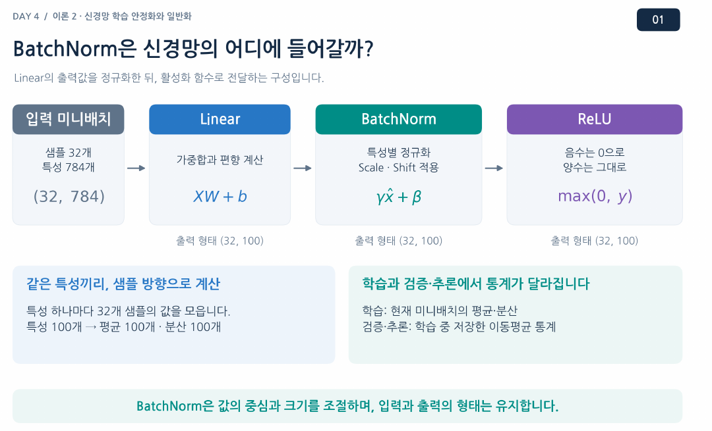
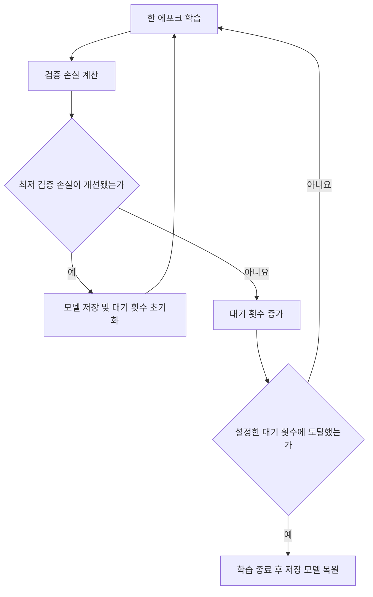

# Day 4. 신경망의 학습 안정화와 일반화

> 학습 중 값의 분포를 조절하고 과대적합을 완화한다. 검증 결과를 기준으로 학습을 멈추고 가장 좋은 모델을 선택한다.

## 1. 배치 정규화로 학습 안정화하기 (1-5쪽)

가중치 초기화는 학습을 시작할 때 한 번 수행하지만, 학습 중에는 가중치가 계속 바뀐다. 따라서 같은 입력이라도 계층의 출력과 다음 계층에 전달되는 값의 분포가 달라질 수 있다. 값의 크기가 지나치게 불안정하면 학습과 기울기 전달이 어려워질 수 있다.

배치 정규화(Batch Normalization, BatchNorm)는 학습 중 미니배치의 평균과 분산으로 중간 출력값을 정규화한다. 예를 들어 32개 샘플이 100개 뉴런을 통과해 `(32, 100)`을 만들면, 각 뉴런에 대해 샘플 32개의 값을 모아 평균과 분산을 구한다. 결과의 형태는 `(32, 100)`으로 유지된다.

> 3쪽: 완전연결 계층의 출력에 배치 정규화를 적용한 뒤 ReLU로 전달하는 예다. 각 특성에 대해 미니배치 방향으로 통계를 계산한다.

정규화에서는 각 값에서 미니배치의 평균을 빼고 분산의 제곱근으로 나눈다. $x_i$는 한 샘플의 특성값, $\mu_B$는 배치 평균, $\sigma_B^2$는 배치 분산, $\epsilon$은 0으로 나누는 문제를 피하는 작은 양수다.

$$
\hat{x}_i = \frac{x_i-\mu_B}{\sqrt{\sigma_B^2+\epsilon}}, \qquad y_i = \gamma\hat{x}_i+\beta
$$

예를 들어 한 뉴런의 출력이 1, 3, 5, 7이면 평균은 4, 분산은 5다. $\epsilon$을 무시하고 평균을 뺀 뒤 √5로 나누면 약 -1.34, -0.45, 0.45, 1.34가 된다. 이후 학습되는 크기 $\gamma$와 이동값 $\beta$로 모델에 필요한 분포를 다시 표현할 수 있다.

학습 시에는 현재 미니배치의 통계를 사용하고, 일반적인 평가 및 추론에서는 학습 중 저장한 이동평균 통계를 사용한다. $\gamma$와 $\beta$는 두 모드 모두에서 사용되는 학습된 매개변수다.

## 2. 훈련 성능과 일반화 (5-7쪽)

일반화(Generalization)는 학습에 사용하지 않은 데이터에서도 좋은 예측을 하는 능력이다. 훈련 데이터의 우연한 특징이나 잡음에 지나치게 맞추면 훈련 성능은 좋아도 새로운 데이터의 성능이 떨어질 수 있는데, 이를 과대적합(Overfitting)이라고 한다.

훈련 손실과 검증 손실이 함께 내려가면 학습이 검증 데이터에도 도움이 되는지 살펴볼 수 있다. 훈련 손실은 계속 감소하는데 검증 손실이 여러 에포크에 걸쳐 증가하면 과대적합을 의심한다. 작은 한 번의 변화보다 전체 추세와 검증 손실이 가장 낮은 시점을 함께 확인한다.

## 3. 가중치 감소와 드롭아웃 (7-10쪽)

가중치 감소(Weight Decay)는 학습 중 가중치가 지나치게 커지는 것을 억제하는 규제 방법이다. 기본적인 L2 규제는 예측 오차 외에 가중치 제곱합에 비례하는 비용을 고려한다. 규제가 너무 강하면 필요한 관계까지 배우지 못할 수 있다.

기본 SGD에서는 L2 규제와 가중치 감소가 같은 형태의 갱신으로 연결된다. 하지만 Adam처럼 매개변수별 갱신 크기를 조절하는 방식에서는 항상 같지 않으며, AdamW는 가중치 감소를 별도로 적용한다. 규제를 비교할 때는 훈련 결과뿐 아니라 검증 결과를 기준으로 판단한다.

드롭아웃(Dropout)은 학습 중 각 출력값을 정해진 확률로 0으로 만들어 일부 뉴런에 대한 지나친 의존을 완화한다. 제외 확률이 0.3이면 각 출력이 30% 확률로 0이 되지만, 매 배치에서 전체의 정확히 30%가 제거되는 것은 아니다. 값을 0으로 바꾸므로 텐서의 형태는 유지된다.

파이토치(PyTorch)의 역방향 드롭아웃(Inverted Dropout)은 학습 중 남긴 출력의 크기를 보정한다. 평가나 추론에서는 무작위 제외를 중단하고 값을 그대로 전달한다.

## 4. 검증 결과로 학습 종료와 모델 선택하기 (10-12쪽)

훈련 데이터는 가중치와 편향을 학습하는 데 사용한다. 검증 데이터는 학습률, 규제 강도, 드롭아웃 확률 같은 하이퍼파라미터(Hyperparameter)와 모델을 선택하는 데 사용하며, 테스트 데이터는 선택이 끝난 모델의 최종 평가에 남긴다.

조기 종료(Early Stopping)는 검증 성능이 일정 기간 개선되지 않으면 학습을 멈추는 방법이다. 인내 횟수(Patience)는 새 최저 검증 손실이 나오지 않아도 기다릴 에포크 수다. 직전 에포크가 아니라 **지금까지의 최저 검증 손실**과 비교한다.

| 에포크 | 훈련 손실 | 검증 손실 | 판단 |
| --- | --- | --- | --- |
| 8 | 0.3357 | 0.3315 | 최저 검증 손실, 모델 저장 |
| 9 | 0.3261 | 0.3335 | 개선 없음 1회 |
| 10 | 0.3201 | 0.3335 | 개선 없음 2회, 종료 |

최대 20에포크와 인내 횟수 2를 설정한 실습에서 학습은 10번째에 끝났지만, 선택해야 할 모델은 8번째에 저장한 상태다. 종료했다고 해서 메모리의 모델이 자동으로 그 시점으로 돌아가는 것은 아니므로 저장한 상태를 다시 불러온다.

## 5. Fashion-MNIST 실습과 평가 모드 (12-17쪽)

실습 모델은 28×28 이미지를 784개 값으로 펼친 뒤 은닉값 100개를 계산하고, ReLU와 제외 확률 0.3의 드롭아웃을 거쳐 클래스 점수 10개를 만든다. 배치가 32개라면 드롭아웃 전후의 형태는 모두 `(32, 100)`이다. 이 예제는 드롭아웃과 조기 종료를 다루며, 배치 정규화나 가중치 감소를 직접 비교하지는 않는다.

학습 모드는 드롭아웃을 켜고 배치 정규화가 있다면 현재 배치 통계를 사용하도록 설정한다. 평가 모드는 드롭아웃의 무작위 제외를 멈추고 배치 정규화의 저장된 통계를 사용하도록 설정한다. 기울기 기록 중단은 별개의 기능이므로, 기록만 중단해도 모델이 자동으로 평가 모드가 되는 것은 아니다.

검증 손실이 훈련 손실보다 낮게 나와도 반드시 오류는 아니다. 이 실습에서는 학습 중 드롭아웃이 적용되고 가중치가 갱신되는 동안 훈련 손실을 평균하지만, 검증은 드롭아웃을 끈 뒤 에포크가 끝난 모델로 계산하기 때문이다.

저장된 최적 모델을 복원한 뒤 계산한 참고 검증 정확도는 0.8798이다. 검증 데이터는 모델 선택에도 사용했으므로 이 수치를 별도의 최종 테스트 정확도로 해석하지 않는다. 실행 환경과 무작위성에 따라 결과는 달라진다.

## 핵심 개념 비교표

| 개념 | 대상과 작동 방식 | 주요 목적 |
| --- | --- | --- |
| 배치 정규화 | 미니배치의 중간 출력값을 정규화하고 크기와 위치를 조정 | 학습 안정화 |
| 가중치 감소 | 큰 가중치 사용을 억제 | 과대적합 완화 |
| 드롭아웃 | 학습 중 일부 출력값을 확률적으로 0으로 변환 | 특정 출력에 대한 의존 완화 |
| 조기 종료 | 검증 결과가 일정 기간 개선되지 않으면 중단 | 적절한 학습 시점 선택 |
| 최적 모델 복원 | 최저 검증 손실 시점의 저장 상태 적용 | 마지막 에포크와 최적 시점 구분 |

## 핵심 정리

- 배치 정규화는 특성별 미니배치 통계로 값을 조절하고 학습 가능한 크기와 위치를 적용한다.
- 학습과 평가에서 배치 정규화가 사용하는 통계와 드롭아웃의 동작은 다르다.
- 훈련 손실이 낮아도 검증 손실이 지속적으로 나빠지면 과대적합을 살펴봐야 한다.
- 가중치 감소는 가중치 크기를, 드롭아웃은 학습 중 출력 사용을 조절한다.
- 검증 데이터는 설정과 모델 선택에, 테스트 데이터는 최종 평가에 사용한다.
- 조기 종료 시점과 최저 검증 손실을 기록한 모델의 시점은 다를 수 있다.
- 평가 모드 전환과 기울기 기록 중단은 서로 다른 설정이다.
