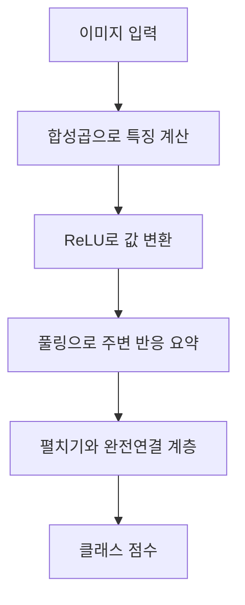
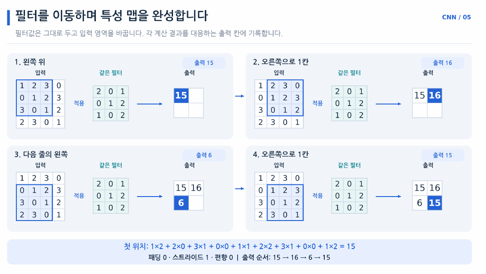
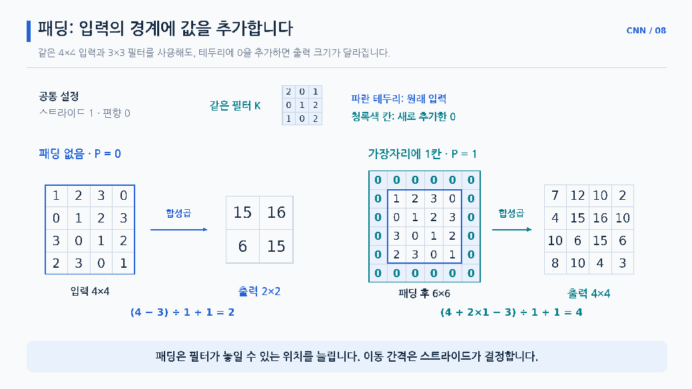
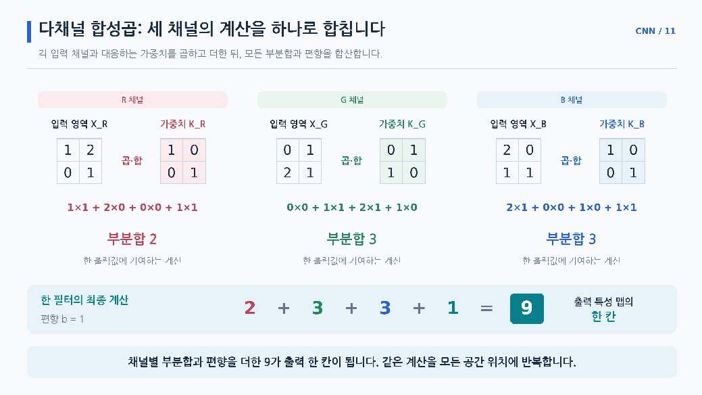
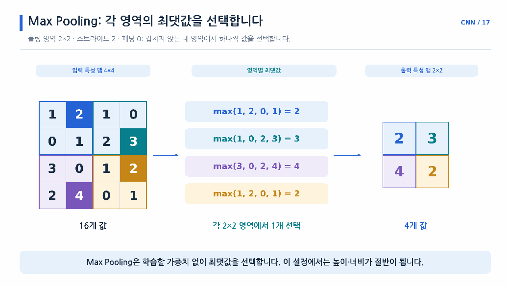

# Day 4. CNN의 구조와 합성곱 원리

> 합성곱 신경망은 이미지의 가까운 픽셀을 함께 계산하고, 같은 필터를 여러 위치에 적용해 특징을 추출한다.

## 1. 이미지와 CNN의 연결 방식 (1-5쪽)

이미지는 밝기나 색을 나타내는 픽셀(Pixel)의 배열이다. 흑백 이미지는 한 위치에 밝기값 하나를 사용하고, RGB 이미지는 빨강, 초록, 파랑의 세 성분을 사용한다. 이 성분을 구분하는 축을 채널(Channel)이라고 한다. 예를 들어 8×8 RGB 이미지는 `(3, 8, 8)`로 표현한다.

이미지를 일렬로 펼치는 플래튼(Flatten)은 픽셀값을 없애지 않는다. 다만 이어지는 완전연결 계층(Fully Connected Layer)은 가까운 픽셀을 함께 계산하거나 여러 위치에 같은 가중치를 사용하는 구조로 정해져 있지 않다.

합성곱 신경망(Convolutional Neural Network, CNN)은 작은 영역을 함께 계산하는 지역적 연결(Local Connectivity)과 같은 가중치를 여러 위치에 적용하는 가중치 공유(Weight Sharing)를 사용한다. 이를 통해 이미지의 공간적 관계를 활용하면서 반복되는 특징을 찾는다.

렐루(Rectified Linear Unit, ReLU)는 음수 입력을 0으로 바꾸는 활성화 함수다. 풀링은 근처의 특징 반응을 대표값으로 요약한다.



## 2. 필터와 특성 맵 (5-11쪽)

필터(Filter) 또는 커널(Kernel)은 입력의 작은 영역에 적용하는 가중치 묶음이다. 필터가 덮은 입력과 가중치를 같은 위치끼리 곱해 모두 더하고, 편향이 있으면 더해 출력값 하나를 만든다. CNN에서 일반적으로 사용하는 계산은 필터를 뒤집지 않고 같은 위치끼리 곱하는 방식이다.

4×4 입력에 3×3 필터를 적용하고 패딩 없이 한 칸씩 이동하는 예제다. 왼쪽 위 영역의 계산은 `1×2 + 2×0 + 3×1 + 0×0 + 1×1 + 2×2 + 3×1 + 0×0 + 1×2 = 15`다. 오른쪽 위는 16, 왼쪽 아래는 6, 오른쪽 아래는 15다.

```text
필터를 네 위치에 적용한 결과

  15  16
   6  15
```



> 9쪽: 같은 필터를 네 위치에 적용해 2×2 특성 맵을 만든다. 필터의 가중치는 그대로이고 계산에 사용하는 입력 영역이 달라진다.

이렇게 필터 하나의 출력값을 공간적으로 배열한 결과가 특성 맵(Feature Map)이다. 편향을 사용한다면 해당 필터가 만든 맵의 모든 위치에 같은 편향을 더한다.

필터의 가중치 배치에 따라 반응하는 패턴이 달라진다. 왼쪽 열은 1, 오른쪽 열은 -1인 2×2 필터는 왼쪽이 밝고 오른쪽이 어두운 영역에서 6, 양쪽 밝기가 같은 영역에서 0, 반대 방향의 경계에서는 -6을 출력한다. 실습에서 이 필터는 설명을 위해 정한 것이며, 실제 CNN의 필터는 분류 손실을 줄이는 방향으로 학습된다.

## 3. 패딩과 스트라이드 (12-14쪽)

패딩(Padding)은 입력의 가장자리 바깥에 값을 추가한다. 제로 패딩(Zero Padding)은 추가한 영역을 0으로 채우며, 원래 이미지 정보를 새로 만들어 내는 것은 아니다. 스트라이드(Stride)는 필터를 다음 계산 위치로 이동시키는 간격이다.

| 입력 | 필터 | 패딩 | 스트라이드 | 출력 |
| --- | --- | --- | --- | --- |
| 4×4 | 3×3 | 0 | 1 | 2×2 |
| 4×4 | 3×3 | 1 | 1 | 4×4 |
| 7×7 | 3×3 | 0 | 1 | 5×5 |
| 7×7 | 3×3 | 0 | 2 | 3×3 |
| 7×7 | 3×3 | 1 | 2 | 4×4 |

[추가 설명] 한 방향의 입력 길이 $N$, 필터 길이 $K$, 양쪽 패딩 $P$, 스트라이드 $S$일 때 출력 길이는 아래와 같다. 내림 기호는 필터가 완전히 들어가는 위치만 센다는 뜻이다.

$$
\text{출력 길이} = \left\lfloor\frac{N+2P-K}{S}\right\rfloor+1
$$

예를 들어 `N=7, K=3, P=1, S=2`이면 `⌊(7+2-3)/2⌋+1 = 4`다. 높이와 너비를 각각 같은 방식으로 계산하면 출력은 4×4다.



> 12쪽: 4×4 입력에 3×3 필터와 스트라이드 1을 사용하면 패딩 없이 2×2, 한 칸 패딩에서 4×4 출력이 된다.

## 4. 입력 채널과 출력 채널 (14-18쪽)

일반적인 2차원 합성곱에서 필터 하나는 **모든 입력 채널**을 함께 계산해 특성 맵 하나를 만든다. `(3, 8, 8)` RGB 입력에 3×3 필터를 적용하면 필터 하나의 형태는 `(3, 3, 3)`이며 가중치는 27개다.

한 위치에서 R, G, B 채널의 부분합이 각각 2, 3, 3이고 필터의 편향이 1이라면 최종 출력값은 `2+3+3+1=9`다. 2, 3, 3은 출력 채널 세 개가 아니라 하나의 출력값을 만들기 위한 중간 계산이다.

서로 다른 필터 4개는 특성 맵 4개를 만든다. 패딩 1과 스트라이드 1을 쓰면 입력 `(3, 8, 8)`은 출력 `(4, 8, 8)`로 변한다. 가중치 형태는 `(출력 채널 4, 입력 채널 3, 높이 3, 너비 3)`이고 가중치 108개와 편향 4개를 합쳐 매개변수는 112개다.

배치까지 포함한 일반적인 파이토치 이미지 텐서는 `(N, C, H, W)` 순서다. N은 이미지 수, C는 채널, H와 W는 높이와 너비다. 이미지 4장을 묶은 `(4, 3, 8, 8)`이 위 합성곱을 통과하면 `(4, 4, 8, 8)`이 되며, 첫 번째 4와 두 번째 4는 각각 배치 크기와 출력 채널 수다.



> 16쪽: 입력 채널별 계산 결과 2, 3, 3을 더하고 편향 1을 더해 출력값 9를 만든다. 입력 채널 세 개가 곧 출력 채널 세 개를 뜻하지 않는다.

## 5. 최대 풀링과 공간 축소 (19-21쪽)

풀링(Pooling)은 가까운 영역의 값을 대표값으로 요약한다. 최대 풀링(Max Pooling)은 각 영역의 최댓값을 선택하며 학습할 가중치는 없다. 4×4 입력에 2×2 영역과 스트라이드 2를 적용한 실습의 출력은 다음과 같다.

```text
각 영역의 최댓값
  2  3
  4  2
```

일반적인 최대 풀링은 채널마다 독립적으로 계산한다. `(4, 4, 8, 8)`에 위 설정을 적용하면 배치와 채널은 유지되고 높이와 너비만 줄어 `(4, 4, 4, 4)`가 된다. 가장 큰 반응은 남기지만 그 외 값과 정확한 위치 정보는 일부 사라진다.



> 20쪽: 4×4 배열을 겹치지 않는 2×2 영역으로 나누고 각각 2, 3, 4, 2를 골라 2×2 출력을 만든다. 값을 선택하며 학습 가중치는 사용하지 않는다.

## 6. CNN의 전체 형태 변화 (21-24쪽)

8×8 RGB 이미지 4장을 입력받고, 첫 합성곱은 4개 필터, 두 번째 합성곱은 8개 필터를 사용한다. 두 합성곱은 3×3 필터, 패딩 1, 스트라이드 1이고 각 풀링은 2×2와 스트라이드 2다.

```text
입력             (4, 3, 8, 8)
합성곱 1         (4, 4, 8, 8)
풀링 1           (4, 4, 4, 4)
합성곱 2         (4, 8, 4, 4)
풀링 2           (4, 8, 2, 2)
이미지별 펼치기  (4, 32)
클래스 점수      (4, 5)
```

ReLU는 값을 변환하지만 형태는 유지한다. 두 번째 풀링 후 이미지 하나에는 `8×2×2=32`개 값이 있으며, 펼칠 때 이미지 네 장을 하나로 합치지 않는다. 이후 완전연결 계층이 이미지마다 5개 클래스 점수를 계산한다.

CNN도 순전파, 손실 계산, 역전파, 매개변수 갱신으로 학습한다. 합성곱 필터와 완전연결 계층의 가중치가 학습 대상이며, ReLU와 최대 풀링, 펼치기는 학습할 가중치가 없어도 계산 경로에 참여한다.

## 핵심 개념 비교표

| 구분 | 합성곱 | 최대 풀링 |
| --- | --- | --- |
| 계산 | 학습 가능한 필터와 입력을 곱해 합산 | 정해진 영역의 최댓값 선택 |
| 채널 | 입력 채널을 함께 계산해 출력 채널 생성 | 각 채널을 독립적으로 처리 |
| 역할 | 새로운 특징 반응 계산 | 주변 반응을 요약하고 공간 크기 조절 |
| 학습할 가중치 | 있음 | 없음 |

## 핵심 정리

- CNN은 지역적 연결과 가중치 공유로 이미지의 공간적 관계를 활용한다.
- 필터 하나는 각 위치의 반응을 계산해 하나의 특성 맵을 만든다.
- 패딩은 경계의 계산 범위를, 스트라이드는 필터의 이동 간격을 조절한다.
- 일반적인 합성곱 필터는 모든 입력 채널을 함께 사용하고 필터 수가 출력 채널 수를 정한다.
- 최대 풀링은 채널별로 주변 값을 요약하며 일부 공간 정보를 버린다.
- Flatten은 배치를 유지하면서 이미지별 특성 맵을 벡터로 바꾼다.
- CNN의 필터도 최종 손실을 기준으로 역전파와 옵티마이저를 통해 학습된다.
