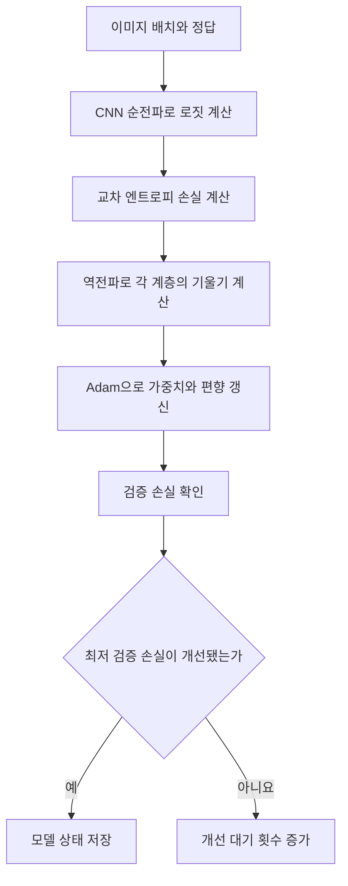

# Day 4. PyTorch를 이용한 CNN 구현과 학습

> 이미지 데이터의 형태를 준비하고 CNN의 계층별 출력을 따라간다. 검증 손실로 최적 모델을 선택한 뒤 별도 테스트 데이터로 평가한다.

## 1. 이미지와 배치 준비 (1-4쪽)

패션 엠니스트(Fashion-MNIST)는 28×28 흑백 의류 이미지와 10개 클래스의 정답으로 구성된다.
원본 훈련 데이터는 60,000장이고 별도의 테스트 데이터는 10,000장이다.
CNN은 높이와 너비 구조를 유지한 채 이미지를 합성곱층에 전달한다.

실습에서는 재현을 위한 `random_state=42`로 훈련 데이터의 20%를 검증용으로 분리해 훈련 48,000장과 검증 12,000장을 사용한다.
픽셀값을 255로 나누어 0과 1 사이로 조정하고, 흑백 채널 축을 추가해 `(이미지 수, 채널, 높이, 너비)`로 구성한다.

| 데이터 | 이미지 수 | 전처리 후 형태 | 용도 |
| --- | --- | --- | --- |
| 훈련 | 48,000 | (48000, 1, 28, 28) | 매개변수 학습 |
| 검증 | 12,000 | (12000, 1, 28, 28) | 모델 선택 |
| 테스트 | 10,000 | (10000, 1, 28, 28) | 최종 평가 |

데이터 로더(Data Loader)는 이미지와 정답의 대응을 유지하면서 데이터를 배치 단위로 전달한다.
실습의 배치 크기는 32이며 훈련 데이터는 섞고 검증 데이터는 섞지 않는다.
일반적인 입력 배치는 `(32, 1, 28, 28)`, 정답은 이미지별 클래스 번호를 담은 `(32,)`다.

## 2. 합성곱과 풀링 계층의 설정 (4-7쪽)

첫 합성곱 계층은 입력 채널 1개에 출력 채널 32개를 만든다.
3×3 필터, 공간 크기를 유지하는 패딩, 스트라이드 1을 사용하므로 `(32, 1, 28, 28)`은 `(32, 32, 28, 28)`이 된다.
첫 번째 32는 이미지 장수이고 두 번째 32는 필터가 만든 채널 수다.

두 번째 합성곱은 앞 계층의 32채널을 받아 64채널을 만든다.
필터 하나의 형태는 `(32, 3, 3)`이며 필터 전체 가중치는 `(64, 32, 3, 3)`이다.
두 번째 계층은 원본 픽셀이 아니라 앞에서 계산한 특징들을 입력으로 사용한다.

| 계층 | 입력 채널 | 출력 채널 | 필터 크기 | 공간 크기 |
| --- | --- | --- | --- | --- |
| 첫 합성곱 | 1 | 32 | 3×3 | 28×28 유지 |
| 두 번째 합성곱 | 32 | 64 | 3×3 | 14×14 유지 |

각 합성곱 뒤에는 렐루(Rectified Linear Unit, ReLU)와 최대 풀링(Max Pooling)이 이어진다.
ReLU는 음수를 0으로 만들되 형태는 바꾸지 않는다.
풀링은 2×2 영역의 최댓값을 선택하고 스트라이드 2로 이동하므로 공간 크기가 28×28에서 14×14로, 다시 7×7로 줄어든다.

## 3. 특징 추출에서 클래스 점수까지 (7-10쪽)

이미지 32장을 처리할 때 각 계층의 출력 형태는 다음과 같다.
합성곱은 출력 채널을 만들고 풀링은 공간 크기를 줄이며, 펼치기는 각 이미지의 특성 맵을 하나의 벡터로 바꾼다.

> 8쪽: 배치 축은 유지하고 합성곱은 채널을, 풀링은 공간 크기를 바꾼다. 이미지마다 64×7×7개 값을 펼쳐 분류층에 전달한다.

두 번째 풀링 뒤에는 이미지마다 7×7 특성 맵이 64개 있으므로 `64×7×7=3136`개 값이 있다.
펼치기는 이미지별로 계산하므로 배치 32를 곱해 하나의 벡터로 만들지 않는다.
실제 실습에서는 분류층을 추가하기 전 이미지 한 장의 출력이 `(1, 3136)`임을 확인한다.

이어서 완전연결 계층이 3136개 값을 100개로 조합하고, ReLU와 확률 0.3의 드롭아웃(Dropout)을 거쳐 10개 클래스 점수를 만든다.
드롭아웃은 학습 중 일부 값을 0으로 바꾸지만 `(32, 100)`의 형태는 유지한다.

마지막 출력은 확률이 아닌 <strong>로짓(Logit)</strong>이다.
교차 엔트로피 손실(Cross-entropy Loss)이 로짓을 직접 받아 필요한 확률 변환을 포함해 계산하므로, 이 모델에서는 마지막에 소프트맥스를 별도로 추가하지 않는다.
예측 클래스 번호만 필요하면 이미지마다 가장 큰 로짓의 위치를 선택한다.

## 4. CNN의 학습과 모델 선택 (11-17쪽)

CNN도 기존 신경망과 같은 순서로 학습한다.
합성곱 필터와 완전연결 계층의 가중치와 편향이 최종 분류 손실에 대한 기울기를 받아 함께 갱신된다.
ReLU, 풀링, 펼치기는 학습할 가중치는 없지만 순전파와 역전파의 계산 경로에 참여한다.

실행 장치는 CUDA를 사용할 수 있으면 GPU, 그렇지 않으면 CPU로 선택한다.
모델과 입력, 정답은 계산할 때 같은 장치에 있어야 한다.

학습 시에는 이전 배치의 기울기를 비운 뒤 순전파, 손실 계산, 역전파, 갱신을 수행한다.
검증 시에는 모델을 평가 모드로 바꾸고 기울기 기록을 중단한다.
두 설정은 서로 다른 역할이다.

실습은 Adam 옵티마이저(Optimizer), 최대 20에포크, 인내 횟수 2를 사용한다.
검증 손실이 지금까지의 최저값보다 낮아지면 모델 상태를 저장하고, 연속 두 번 개선되지 않으면 조기 종료(Early Stopping)한다.

| 에포크 | 훈련 손실 | 검증 손실 | 상태 |
| --- | --- | --- | --- |
| 1 | 0.5195 | 0.3513 | 초기 학습 |
| 6 | 0.2132 | 0.2339 | 손실 감소 |
| 8 | 0.1788 | 0.2154 | 최저 검증 손실 기록 |
| 9 | 0.1645 | 0.2173 | 개선 없음 1회 |
| 10 | 0.1488 | 0.2267 | 개선 없음 2회, 종료 |

참고 실행 결과에서는 10번째에 종료하지만 최적 모델은 8번째에 저장된 상태다.
학습 종료 뒤 저장된 상태를 다시 불러와야 최적 시점의 모델로 평가할 수 있다.
실행 환경과 무작위성에 따라 종료 시점과 값은 달라진다.

## 5. 검증과 테스트 평가 (17-18쪽)

복원한 모델은 이미지마다 가장 큰 로짓을 가진 클래스 번호를 예측한다.
전체 이미지에서 정답과 일치한 수를 나누면 정확도(Accuracy)가 된다.
검증 데이터와 테스트 데이터는 계산 방법이 비슷해도 사용 목적이 다르다.

실습에 저장된 참고 결과는 검증 정확도 0.9201, 테스트 정확도 0.9177이다.
검증 결과는 모델을 선택하는 데 사용했고, 테스트 결과는 선택이 끝난 모델의 최종 평가다.
이 수치는 해당 실행의 결과이며 다른 모델이나 실행의 성능을 보장하지 않는다.

## 핵심 개념 비교표

| 항목 | 특징 추출부 | 분류부 |
| --- | --- | --- |
| 주요 계층 | 합성곱, ReLU, 최대 풀링 | 펼치기, 완전연결, ReLU, 드롭아웃 |
| 입력과 출력 | 이미지에서 여러 특성 맵 계산 | 특성값을 조합해 클래스별 로짓 생성 |
| 형태 변화 | 채널 수와 공간 크기 변화 | 이미지별 벡터에서 클래스 점수로 변화 |
| 학습 대상 | 합성곱 필터와 편향 | 완전연결 계층의 가중치와 편향 |

## 핵심 정리

- 이미지를 채널, 높이, 너비를 갖는 텐서로 준비하고 픽셀값을 조정한다.
- 훈련 데이터로 학습하고 검증 데이터로 모델을 고른 뒤 테스트 데이터로 최종 평가한다.
- 합성곱은 새로운 특성 맵을 만들고 ReLU는 형태를 유지하며 값을 변환한다.
- 최대 풀링은 채널을 유지하면서 공간 크기를 줄인다.
- 이미지마다 `64×7×7=3136`개 특성값을 펼쳐 분류층에 전달한다.
- 최종 로짓은 교차 엔트로피 손실에 직접 전달하고, 역전파로 필터와 분류층을 함께 학습한다.
- 조기 종료 후에는 최저 검증 손실을 기록한 모델을 복원한다.
