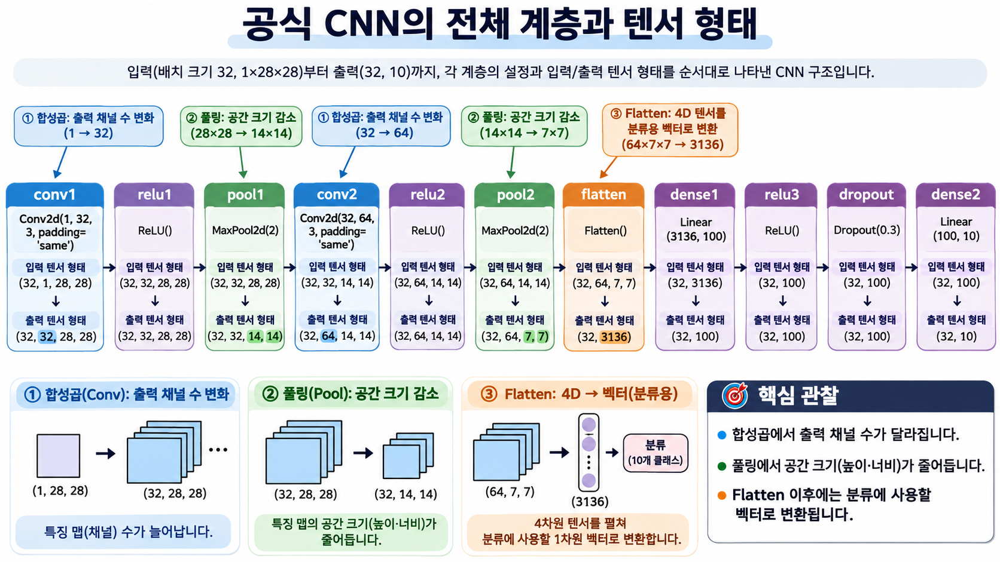

# CNN 구현과 학습


Fashion-MNIST의 옷 이미지는 흑백이므로 채널은 하나임. PyTorch의 Conv2d 입력은 배치, 채널, 높이, 너비 순서라 한 장도 채널 축을 유지해야 함.

## 특징 추출부

Conv2d는 학습할 필터를 정의하고 ReLU는 음수 반응을 0으로 바꿈. MaxPool2d는 공간 크기를 줄임. 다음 합성곱의 in_channels는 앞 계층의 out_channels와 일치해야 함.

## 분류층 연결

특성 맵이 (N,C,H,W)라면 Flatten은 배치 축을 남기고 (N,C×H×W)로 펼침. Linear의 입력 크기는 이 곱과 같아야 함. 마지막 출력은 옷 10종에 대한 로짓임. CrossEntropyLoss에는 소프트맥스 확률이 아닌 로짓과 정수 클래스 번호를 넣음.

## 학습과 평가

학습 모드에서 배치별로 순전파, 손실 계산, 역전파, 갱신을 수행함. 검증 모드에서는 기울기를 기록하지 않고 점수를 계산함. 검증 결과로 저장한 모델을 다시 불러와 테스트 정확도를 확인함.

```python
import torch
from torch import nn

x = torch.zeros(32, 1, 28, 28)
features = nn.Sequential(
    nn.Conv2d(1, 32, 3, padding=1), nn.ReLU(), nn.MaxPool2d(2),
    nn.Conv2d(32, 64, 3, padding=1), nn.ReLU(), nn.MaxPool2d(2)
)
h = features(x)
print(tuple(h.shape), tuple(nn.Flatten()(h).shape))
```

```text
(32, 64, 7, 7) (32, 3136)
```

| 단계 | 이미지 한 장의 형태 | 변화 |
| --- | --- | --- |
| 입력 | 1 × 28 × 28 | 흑백 채널 하나 |
| 첫 합성곱과 풀링 | 32 × 14 × 14 | 필터 32개, 가로와 세로 절반 |
| 둘째 합성곱과 풀링 | 64 × 7 × 7 | 앞층의 32채널을 결합해 64개 특징 계산 |
| Flatten | 3,136 | 64 × 7 × 7개 값을 한 줄로 펼침 |
| 분류층 | 100 → 10 | 마지막 10개 값이 옷 종류별 점수 |

배치의 첫 번째 32는 이미지 수, 첫 합성곱의 32는 필터 수임. 숫자가 같아도 의미는 다름.

## 학습 반복문에서 텐서가 쓰이는 위치

Fashion-MNIST 한 장은 28×28 회색조 이미지임. 32장을 묶은 입력의 형태는 (32, 1, 28, 28), 정답은 각 이미지의 클래스 번호를 담은 (32,)임. 마지막 층에서 (32, 10)이 나오면 행 하나가 이미지 한 장, 열 하나가 옷 종류 하나임.

```python
# model, optimizer, train_loader, device는 준비한 CNN과 학습 환경
model.train()
for images, labels in train_loader:
    images, labels = images.to(device), labels.to(device)
    optimizer.zero_grad()
    logits = model(images)
    loss = torch.nn.functional.cross_entropy(logits, labels)
    loss.backward()
    optimizer.step()
```

zero_grad는 직전 배치의 기울기를 지움. backward가 필터와 분류층 가중치 각각에 대한 기울기를 계산하면 step이 그 값을 이용해 가중치를 갱신함. 입력 이미지가 달라지는 것이 아니라 이미지에 적용하는 필터가 달라짐.

## 검증 정확도는 어떻게 집계할까?

각 행에서 가장 큰 로짓의 열 번호를 뽑으면 예측 클래스가 됨. 검증 세트 전체에서 맞힌 개수를 더한 뒤 전체 샘플 수로 나눔. 마지막 배치가 짧을 수 있으므로 배치별 정확도를 단순 평균하는 것과 결과가 다를 수 있음. 검증 시에는 model.eval()과 torch.no_grad()를 함께 사용함. 전자는 Dropout 등의 동작을 바꾸고 후자는 기울기 기록을 끔.

## CNN 계층별 형태



합성곱에서 바뀌는 것은 채널 수이고 풀링에서 줄어드는 것은 높이와 너비임. Flatten에서는 한 장의 64×7×7개 값을 펼치되 배치 축은 유지함.

## 검증 결과와 테스트 결과

| 평가 데이터 | 정확도 | 언제 쓰는가 |
| --- | ---: | --- |
| 검증 | 0.9201 | 에포크마다 결과를 관찰하고 저장할 모델을 선택 |
| 테스트 | 0.9177 | 저장된 최적 모델을 복원한 뒤 마지막에 평가 |

이 값은 Fashion-MNIST 실습의 기록임. 검증에서 약 92.01%를 맞힌 모델이 별도 테스트 이미지에서는 약 91.77%를 맞혔음. 검증 이미지의 정답이 모델 선택에 쓰였으므로 두 점수는 구분해서 기록함.

[이전](03-합성곱과-풀링.md) | [다음](05-필터와-특성-맵-해석.md) | [파트 목차](README.md)
