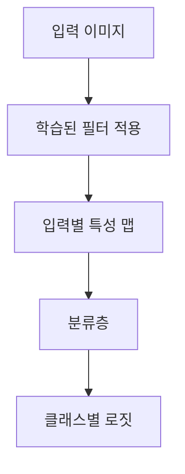
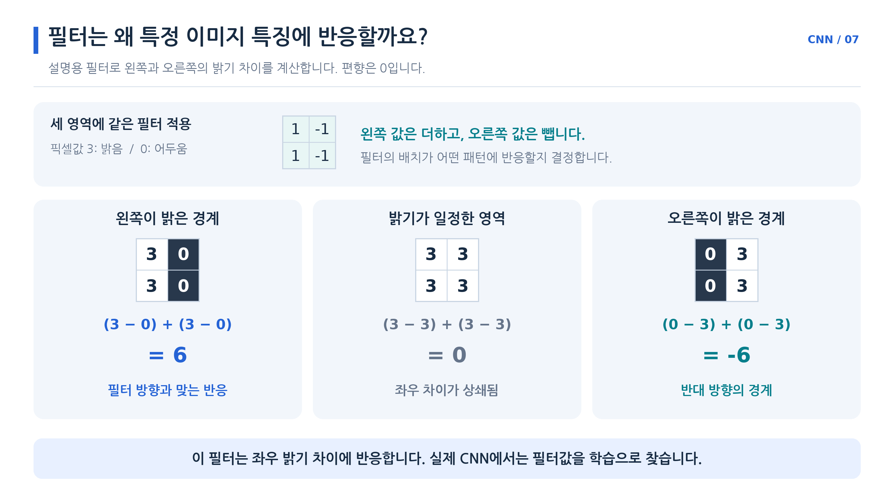
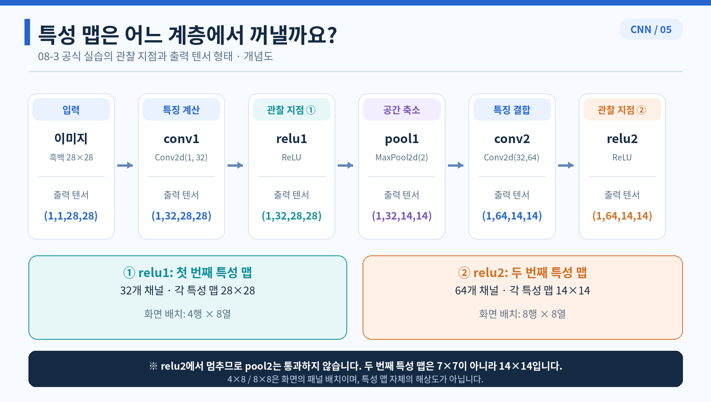
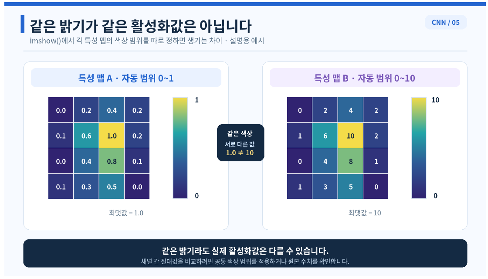

# Day 4. CNN의 특징 추출과 시각화 해석

> 학습된 필터와 입력별 특성 맵을 관찰해 CNN 내부의 반응을 살펴본다. 그림에서 확인한 사실과 최종 예측에 관한 해석은 구분한다.

## 1. 필터와 특성 맵의 차이 (1-3쪽)

분류 정확도는 모델이 얼마나 자주 정답을 맞히는지 보여 주지만, 중간 계층에서 어떤 반응이 계산됐는지는 직접 보여 주지 않는다.
CNN의 내부를 살피려면 학습된 필터(Filter)와 입력에 따라 만들어지는 특성 맵(Feature Map)을 구분해야 한다.

필터는 합성곱 계층에 저장된 학습 가능한 가중치다.
특성 맵은 특정 이미지를 그 필터에 적용해 계산한 중간 결과다.
학습된 모델을 고정하면 신발과 가방을 차례로 입력해도 필터는 그대로지만, 입력이 다르므로 특성 맵은 달라질 수 있다.

실습에서는 첫 합성곱층의 필터와 첫 번째, 두 번째 ReLU 출력 지점의 특성 맵을 살펴본다.
무엇을 시각화하는지에 따라 그림이 나타내는 의미가 달라진다.

## 2. 학습된 필터 관찰하기 (3-6쪽)

첫 합성곱층은 입력 채널 1개에 3×3 필터 32개를 적용한다.
가중치 형태 `(32, 1, 3, 3)`은 필터 수, 입력 채널, 필터 높이, 필터 너비를 뜻한다.
가중치는 `32×1×3×3=288`개이며 출력 채널별 편향 32개는 별도다.

학습 전 초기값은 순전파, 손실 계산, 역전파, 옵티마이저 갱신을 반복하면서 달라진다.
저장된 실습 모델의 첫 계층 가중치는 평균 약 -0.0550, 표준편차 약 0.3589였지만, 이 숫자만으로 필터의 공간적 배치를 알 수는 없다.

| 시각화 방식 | 볼 수 있는 것 | 알기 어려운 것 |
| --- | --- | --- |
| 가중치 히스토그램 | 값이 어느 범위에 얼마나 분포하는지 | 각 값이 필터 안의 어느 위치에 있었는지 |
| 필터 그림 | 3×3 가중치의 공간적 배치 | 특정 입력에서 실제로 어떤 반응이 나오는지 |

예를 들어 왼쪽에 양수, 오른쪽에 음수 가중치가 모인 필터는 두 영역의 밝기 차이에 반응할 가능성이 있다.
다만 가중치 그림만으로 특정 물체를 인식하는 필터라고 단정할 수 없다.
실제 특성 맵은 가중치와 입력을 함께 계산해 만들어진다.

두 번째 합성곱층의 가중치 형태는 `(64, 32, 3, 3)`이다.
필터 하나가 앞 계층의 32개 채널을 함께 사용하므로 한 채널의 3×3 그림 하나만 보고 전체 필터가 채널들을 어떻게 조합하는지 알기는 어렵다.

> [추가 설명] 왼쪽과 오른쪽의 밝기 차이에 반응하는 설명용 필터다. 필터의 방향과 맞는 경계는 양수, 반대 경계는 음수, 밝기가 같은 영역은 0이 되며 실제 CNN 필터는 학습으로 정해진다.

## 3. 계층별 특성 맵과 수용 영역 (6-9쪽)

실습에서 사용하는 입력은 Fashion-MNIST의 앵클부츠 이미지 한 장이며, 모델 입력 형태는 `(1, 1, 28, 28)`이다.
첫 합성곱과 ReLU를 통과하면 `(1, 32, 28, 28)`이 된다.
같은 이미지를 사용하더라도 필터별 가중치가 달라 각 채널의 반응 위치와 크기는 다를 수 있다.

첫 번째 풀링 뒤에는 공간 크기가 14×14로 줄어든다.
이후 두 번째 합성곱과 ReLU가 32개 입력 채널을 함께 계산해 `(1, 64, 14, 14)`를 만든다.
이 관찰 지점은 **두 번째 풀링 전**이므로 크기가 7×7이 아니다.

| 관찰 지점 | 입력으로 사용하는 정보 | 출력 형태 |
| --- | --- | --- |
| 첫 번째 ReLU | 원본 흑백 이미지 | (1, 32, 28, 28) |
| 두 번째 ReLU | 첫 풀링을 거친 32개 특성 맵 | (1, 64, 14, 14) |
| 두 번째 풀링 이후 | 두 번째 ReLU의 출력 | (1, 64, 7, 7) |

수용 영역(Receptive Field)은 출력의 한 위치에 영향을 줄 수 있는 입력 영역이다.
뒤쪽 계층은 앞 계층의 여러 반응을 다시 조합하므로 원본 이미지에서 더 넓은 영역의 영향을 받을 수 있다.
그 결과 특성 맵이 원본 이미지와 비슷하게 보이지 않아도 이상한 것은 아니다.

실습에서는 첫 특성 맵 32개를 화면에 4행 8열로, 두 번째 특성 맵 64개를 8행 8열로 배치한다.
이는 그림을 나열하는 방식이며 각 특성 맵 자체의 크기는 각각 28×28과 14×14다.

> 8쪽 관련 그림: 첫 ReLU에서는 32개의 28×28 맵을, 두 번째 ReLU에서는 64개의 14×14 맵을 관찰한다. 두 번째 풀링 전후를 혼동하지 않는다.

## 4. 색상과 실제 활성화값 (9-11쪽)

필터와 특성 맵은 숫자 배열이고, 컬러맵(Color Map)은 숫자를 화면의 색으로 표시하는 방식이다.
컬러맵을 바꾸더라도 배열의 숫자는 바뀌지 않는다.
표시 범위가 다르면 서로 다른 값이 같은 색으로 보일 수 있다.

> 10쪽: 각 그림의 색상 범위를 자동으로 맞추면 값 1과 값 10이 각 패널에서 같은 색으로 표시될 수 있다. 서로 다른 맵을 비교할 때는 범례와 표시 범위를 확인해야 한다.

이 실습의 필터 그림은 학습된 필터 32개를 화면에 2행 16열로 배치한 것이다.
각 그림은 서로 다른 필터의 가중치 배치를 나타낸다.

첫 번째 맵의 범위가 0부터 1, 두 번째가 0부터 10이라고 가정한다.
두 맵을 각각의 최솟값과 최댓값으로 표시하면 첫 맵의 1과 두 번째 맵의 10이 모두 가장 밝은 색이 될 수 있다.
같은 맵 안의 상대적 위치를 비교하는 것과 서로 다른 맵 사이의 절대값을 비교하는 것은 다르다.

실습에서는 필터 32개를 공통 표시 범위 -0.5부터 0.5로 보여 주지만, 특성 맵에는 공통 범위를 지정하지 않는다.
필터의 표시 범위가 -0.5부터 0.5라는 것은 모든 실제 가중치가 반드시 그 범위 안에 있다는 뜻도 아니다.

## 5. 관찰한 반응과 예측 근거 구분하기 (11-19쪽)

특성 맵의 특정 위치에 큰 값이 나타났다면 해당 계층이 그 위치의 입력에 크게 반응했다는 사실을 관찰할 수 있다.
그러나 그 반응 하나가 최종 클래스를 결정했다고 단정할 수는 없다.
중간 반응은 이후 계층에서 다른 채널과 결합해 최종 점수에 영향을 주기 때문이다.

예를 들어 부츠 밑창 근처가 밝게 나타났다면, 공통 범위를 확인한 뒤 해당 맵에서 그 부근의 반응이 상대적으로 크다고 설명할 수 있다.
그 모습만으로 모델이 밑창 때문에 앵클부츠를 선택했다고 주장하려면 추가 근거가 필요하다.

실습은 이미 학습한 모델 상태를 같은 구조의 CNN에 적용한 뒤 평가 모드에서 이미지를 통과시킨다.
이 과정의 목적은 관찰이며 매개변수를 다시 학습하지 않는다.
기울기 기록을 중단하는 설정도 함께 사용한다.

관찰한 특성 맵은 합성곱 직후가 아니라 **ReLU를 통과한 출력**이다.
따라서 원래 합성곱 결과의 음수는 0으로 바뀌어 있으며, 이 그림만으로 음수 반응의 원래 크기를 알 수 없다.
두 번째 특성 맵을 얻을 때도 입력부터 첫 합성곱, ReLU, 풀링, 두 번째 합성곱과 ReLU를 순서대로 거친다.

## 핵심 개념 비교표

| 구분 | 필터 | 특성 맵 | 최종 로짓 |
| --- | --- | --- | --- |
| 의미 | 합성곱에 사용하는 학습된 가중치 | 특정 입력에 대한 중간 반응 | 클래스별 최종 점수 |
| 입력을 바꾸면 | 고정된 모델에서는 그대로 | 일반적으로 달라질 수 있음 | 일반적으로 달라질 수 있음 |
| 확인할 내용 | 가중치의 크기와 배치 | 계층과 위치별 반응 | 클래스별 점수의 상대적 크기 |
| 해석의 한계 | 그림만으로 물체 인식을 단정하기 어려움 | 강한 반응만으로 최종 예측 기여를 단정하기 어려움 | 내부의 어느 중간 계산이 원인인지 직접 보여 주지 않음 |

## 핵심 정리

- 필터는 학습된 가중치이고 특성 맵은 특정 입력에 그 가중치를 적용한 결과다.
- 가중치 히스토그램은 값의 분포를, 필터 그림은 가중치의 공간적 배치를 보여 준다.
- 첫 번째 ReLU의 출력은 32개 28×28 특성 맵이다.
- 두 번째 ReLU의 출력은 두 번째 풀링 전이므로 64개 14×14 특성 맵이다.
- 뒤쪽 계층은 앞쪽 특징을 조합하며 원본의 더 넓은 수용 영역을 반영할 수 있다.
- 서로 다른 그림의 색상만으로 실제 활성화값의 크기를 비교하지 않는다.
- 중간 계층의 큰 반응과 최종 예측에 대한 결정적 기여는 구분한다.
