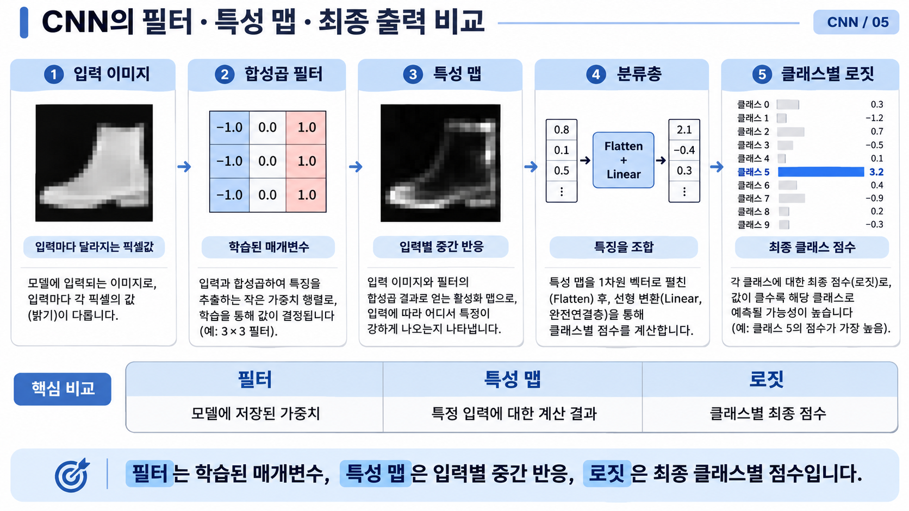
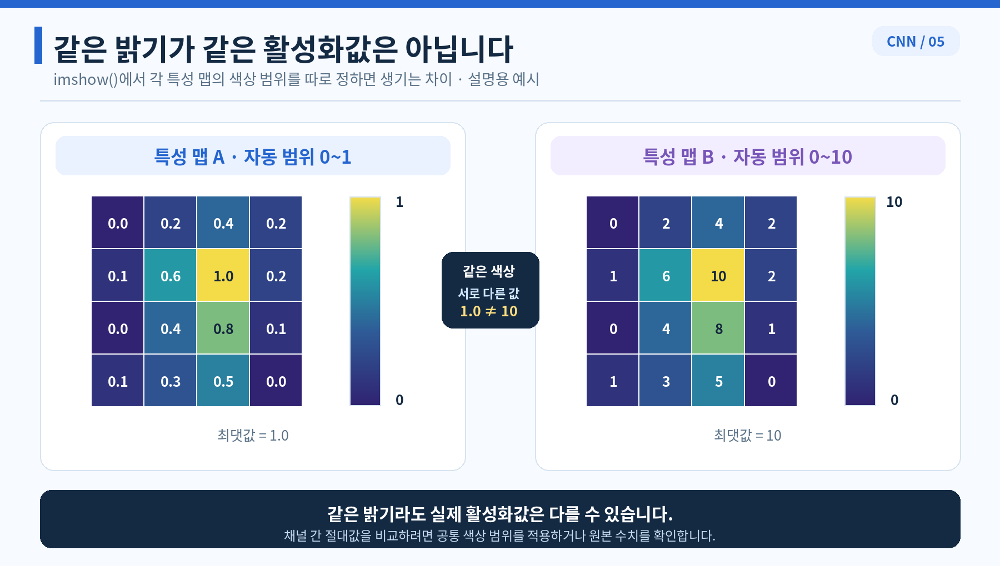
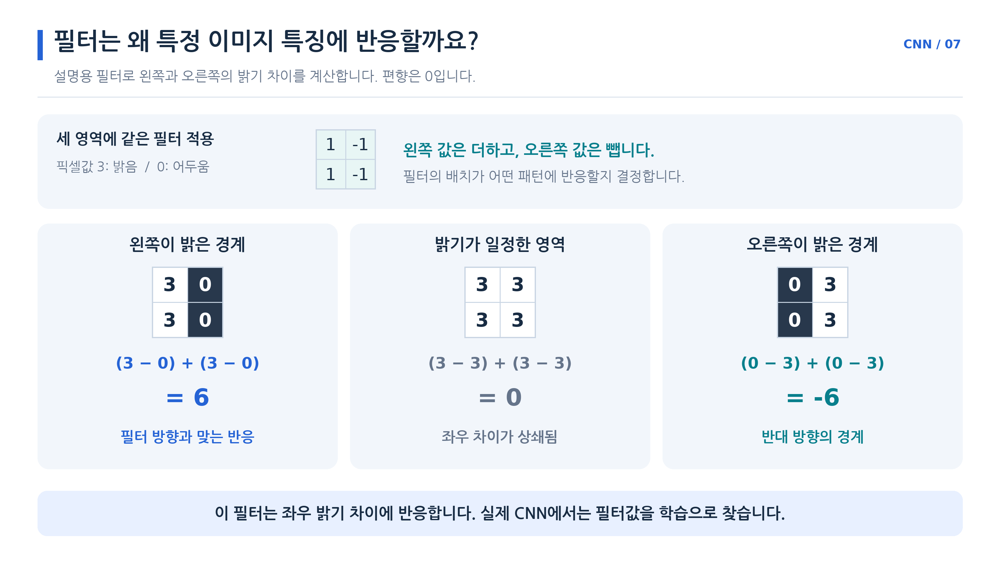
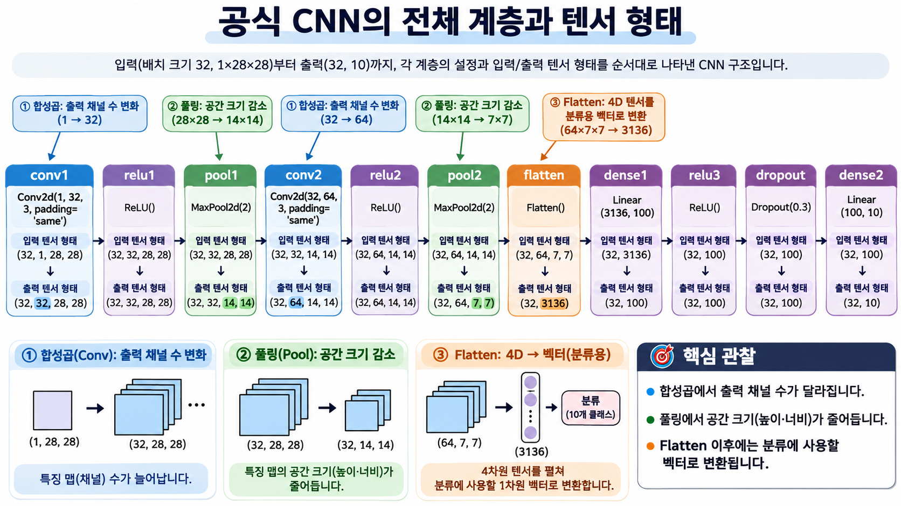
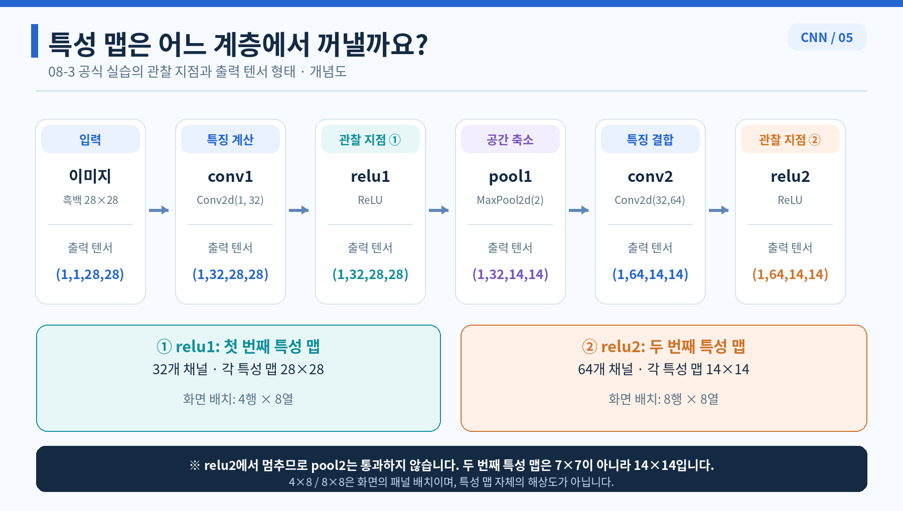

# 그림 살펴보기

## 필터와 특성 맵

왼쪽에서 오른쪽으로 입력, 학습한 필터, 입력별 반응, 클래스 점수를 구분해서 읽음.
필터와 달리 특성 맵은 이미지를 바꾸면 달라짐.

## 특성 맵 색상

각 그림이 자체 최댓값을 가장 밝은 색으로 표시하면 1과 10도 똑같이 밝아 보임.
반응 크기를 비교하려면 같은 색상 범위를 써야 함.

## 필터 반응

같은 필터를 서로 다른 밝기 배치에 적용하면 6, 0, −6이 나옴.
좌우 밝기 차이의 방향을 바꾸면 반응의 부호도 달라짐.

## CNN 계층별 형태

합성곱에서 바뀌는 것은 채널 수이고 풀링에서 줄어드는 것은 높이와 너비임.
Flatten에서는 한 장의 64×7×7개 값을 펼치되 배치 축은 유지함.

## 특성 맵 관찰 위치

둘째 ReLU는 둘째 풀링보다 앞에 있음.
그래서 관찰한 지도는 7×7이 아니라 14×14임.

[파트 목차](README.md)
