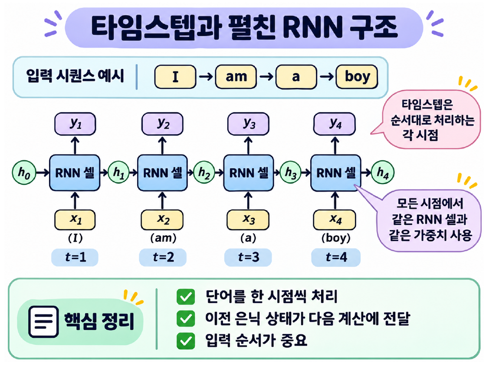
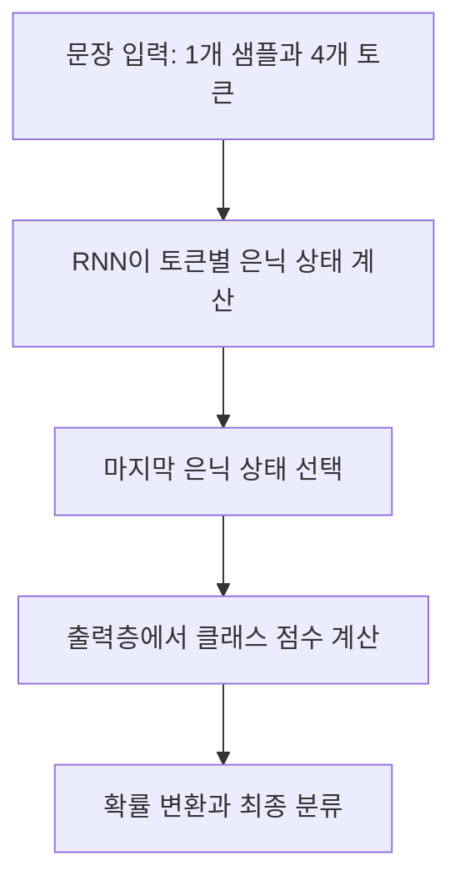

# Day 5. 순차 데이터와 순환 신경망

> 순환 신경망은 현재 입력과 이전 은닉 상태를 함께 계산한다. 같은 가중치를 각 시점에 반복 적용하면서 앞에서 처리한 정보가 이후 결과에 영향을 준다.

## 1. 순서가 의미를 만드는 데이터 (1-4쪽)

순차 데이터(Sequential Data)는 데이터가 나열된 순서 자체에 의미가 있는 데이터다. 텍스트는 단어 순서에 따라 의미가 달라지고, 음성과 시계열 데이터도 소리나 값이 나타나는 순서가 중요하다. 예를 들어 “별로지만 추천해요”와 “추천하지만 별로예요”는 비슷한 단어를 사용해도 표현하는 평가가 다르다.

피드포워드 신경망(Feedforward Neural Network)은 입력에서 출력 방향으로 정보를 전달한다. 이 구조 자체에는 앞서 처리한 입력의 상태를 다음 입력으로 되돌리는 연결이 없다. 순환 신경망(Recurrent Neural Network, RNN)은 같은 시퀀스 안에서 이전 단계의 계산 결과를 현재 단계에 전달한다.

## 2. 셀과 은닉 상태 (4-8쪽)

순환 신경망의 셀(Cell)은 현재 입력과 이전 은닉 상태를 받아 새로운 은닉 상태를 계산하는 단위다. 셀 하나에 여러 뉴런이 있을 수 있으며, 은닉 상태(Hidden State)는 이전 입력들을 처리하면서 계산한 정보를 다음 단계에 전달하는 벡터다. 이전 입력을 원문 그대로 모두 저장한다는 뜻은 아니다.

예를 들어 “I am a boy”를 단어 단위로 처리하면 I에서 만든 상태가 am을 계산할 때 사용된다. 이어서 am까지 처리한 상태가 a를 계산할 때, 다시 그 결과가 boy를 계산할 때 사용된다. 문장이 길어질수록 처음 정보의 영향을 충분히 유지하기 어려울 수 있다. 예를 들어 마지막 단어를 처리할 때 그 직전 단어뿐 아니라 이전 단계들을 거친 상태 전체가 계산에 사용된다.

시그모이드(Sigmoid)는 0과 1 사이의 값을, 렐루(Rectified Linear Unit, ReLU)는 0 이상의 값을 출력한다. tanh는 음수와 양수를 모두 표현할 수 있어 기본 RNN의 상태 계산에 자주 쓰인다.

기본 RNN은 현재 입력과 이전 상태에 각각 가중치를 적용하고 편향을 더한 뒤, 하이퍼볼릭 탄젠트(Hyperbolic Tangent, tanh)를 적용한다. tanh는 입력을 -1과 1 사이로 변환해 비선형성을 제공한다.

$$
h_t = \tanh(x_tW_x + h_{t-1}W_h + b)
$$

$x_t$는 현재 입력, $h_{t-1}$은 이전 은닉 상태, $h_t$는 새 은닉 상태다. $W_x$는 입력 가중치, $W_h$는 이전 상태의 가중치, $b$는 편향이다. 첫 단계에서는 보통 초기 은닉 상태를 0으로 설정한다. 이전 상태가 현재 계산에 들어가므로 현재 출력에는 이미 처리한 입력의 영향이 반영될 수 있다.

## 3. 타임스텝과 가중치 공유 (8-10쪽)

타임스텝(Timestep)은 시퀀스에서 입력 하나를 처리하는 단계다. “I am a boy”를 단어별로 나누면 타임스텝이 4개이며, 한 단계에서 만든 은닉 상태가 다음 단계로 전달된다.

> 9쪽: 단어를 순서대로 처리하며 이전 은닉 상태를 다음 셀로 전달한다. 모든 타임스텝은 같은 셀의 가중치를 공유한다.

타임스텝 수는 한 시퀀스에 포함된 처리 단계의 수이며, 샘플 수는 배치에 묶인 시퀀스의 수다. 두 숫자는 서로 다른 축이므로 문장 네 개와 단어 네 개를 혼동하지 않는다.

시간 방향으로 셀을 여러 개 그리더라도 각 단계에서 새로운 가중치를 만드는 것은 아니다. **같은 입력 가중치와 은닉 상태 가중치를 모든 타임스텝에서 공유**한다. 입력과 이전 상태가 매번 다르므로 같은 계산 규칙을 써도 은닉 상태는 달라진다.

## 4. 입력 순서와 은닉 상태 계산 (10-14쪽)

실습은 입력과 은닉 상태가 각각 숫자 하나인 작은 RNN으로 순전파만 수행한다. 입력 가중치 1.0, 은닉 상태 가중치 0.5, 편향 0, 초기 상태 0을 사용한다. 가중치를 학습하거나 갱신하는 실험은 아니다.

| 순서 | 현재 입력 | 계산 | 은닉 상태 약 |
| --- | --- | --- | --- |
| 1 | 1 | tanh(1×1 + 0×0.5) | 0.7616 |
| 2 | 0 | tanh(0×1 + 0.7616×0.5) | 0.3634 |

두 번째 입력이 0이어도 이전 상태의 영향이 남아 있으므로 결과가 0이 아니다. 같은 값을 `[0, 1]` 순서로 넣으면 최종 상태는 약 0.7616이다. 같은 입력값이라도 순서에 따라 중간 계산과 최종 결과가 달라질 수 있다.

입력 특성이 4개, 은닉 뉴런이 3개이고 편향 벡터 하나를 사용하는 기본 RNN 수식에서는 매개변수를 다음과 같이 센다.

| 구성 | 계산 | 개수 |
| --- | --- | --- |
| 입력 가중치 | 4×3 | 12 |
| 은닉 상태 가중치 | 3×3 | 9 |
| 편향 | 은닉 뉴런마다 1개 | 3 |
| 합계 | 12+9+3 | 24 |

이 예에서 타임스텝이 4개에서 10개로 늘어도 같은 가중치를 재사용하므로 매개변수는 24개다. [추가 설명] 이는 편향을 하나로 표현한 교재 수식의 계산이다. 파이토치(PyTorch)의 기본 RNN은 입력과 은닉 상태에 각각 편향을 두므로 같은 설정에서 편향 6개를 포함해 총 27개다. 타임스텝 수가 늘어도 가중치를 공유하는 원리는 같다.

## 5. 입력과 출력의 형태 (15-19쪽)

배치를 앞에 두는 입력 형태는 `(샘플 수, 타임스텝 수, 입력 특성 수)`다. 예를 들어 `(1, 4, 3)`은 문장 1개를 4단계로 처리하고, 단계마다 입력값 3개를 사용한다는 뜻이다. 단어는 숫자 하나가 아니라 여러 특성을 가진 벡터로 표현할 수 있다.

은닉 뉴런이 5개인 RNN에서는 각 단계가 5개 값의 은닉 상태를 만든다. 모든 타임스텝의 출력을 사용하면 `(1, 4, 5)`, 마지막 은닉 상태만 선택하면 `(1, 5)`다. 출력 특성 수는 입력 특성 3개가 아니라 은닉 상태 크기 5개에 따라 정해진다. 여러 순환층을 쌓으면 앞 층의 각 타임스텝 출력을 다음 층의 입력으로 전달할 수 있다.

문장 전체의 긍정 또는 부정을 예측하는 경우 마지막 은닉 상태를 분류층에 전달할 수 있다. 각 입력 위치의 정보가 필요한 작업에서는 모든 타임스텝의 출력을 사용할 수 있다. 마지막 상태는 이미 벡터이므로 CNN처럼 별도의 펼치기 단계가 필요하지 않다. 예를 들어 은닉 상태가 10개 값이고 클래스가 3개이면 출력층이 3개 점수를 만든 뒤 소프트맥스로 클래스별 확률을 계산한다. 각 단계의 상태를 출력으로 쓸지 마지막 상태만 쓸지는 해결할 문제에 따라 선택한다.

## 핵심 개념 비교표

| 개념 | 의미 | 역할 |
| --- | --- | --- |
| 피드포워드 | 입력에서 출력으로 계산 | 이전 입력의 상태를 자동으로 순환시키지 않음 |
| RNN | 현재 입력과 이전 상태로 계산 | 시퀀스의 앞선 정보를 다음 단계에 전달 |
| 타임스텝 | 입력 하나를 처리하는 단계 | 시퀀스의 처리 순서를 나타냄 |
| 은닉 상태 | 시점별 계산으로 만들어진 벡터 | 이전 계산의 영향을 다음 단계에 전달 |
| 가중치 공유 | 단계마다 같은 가중치 사용 | 시퀀스가 길어져도 가중치 개수 유지 |

## 핵심 정리

- 순차 데이터는 입력 순서에 따라 의미나 예측 결과가 달라질 수 있다.
- RNN 셀은 현재 입력과 이전 은닉 상태로 새로운 은닉 상태를 계산한다.
- 은닉 상태는 이전 입력을 처리한 정보를 전달하지만 원문 전체를 그대로 보관하지는 않는다.
- 모든 타임스텝에서 같은 가중치를 사용하므로 시퀀스 길이만으로 매개변수 수가 늘지 않는다.
- 같은 값이라도 입력 순서가 바뀌면 최종 은닉 상태가 달라질 수 있다.
- 모든 시점의 출력과 마지막 은닉 상태 중 필요한 결과를 선택해 사용한다.
