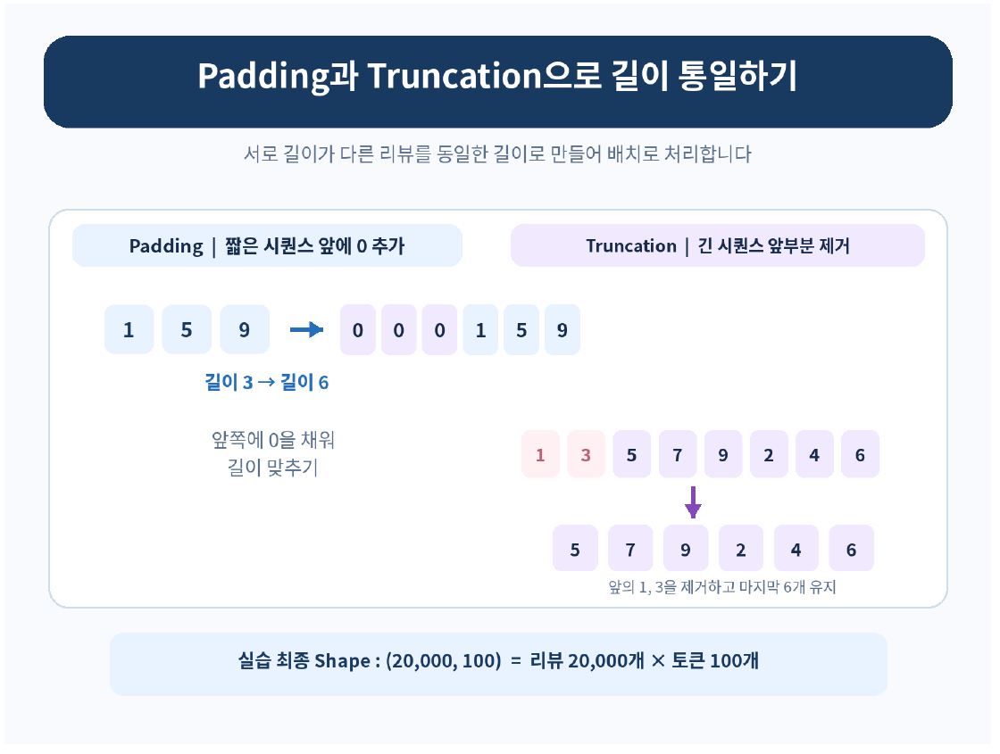
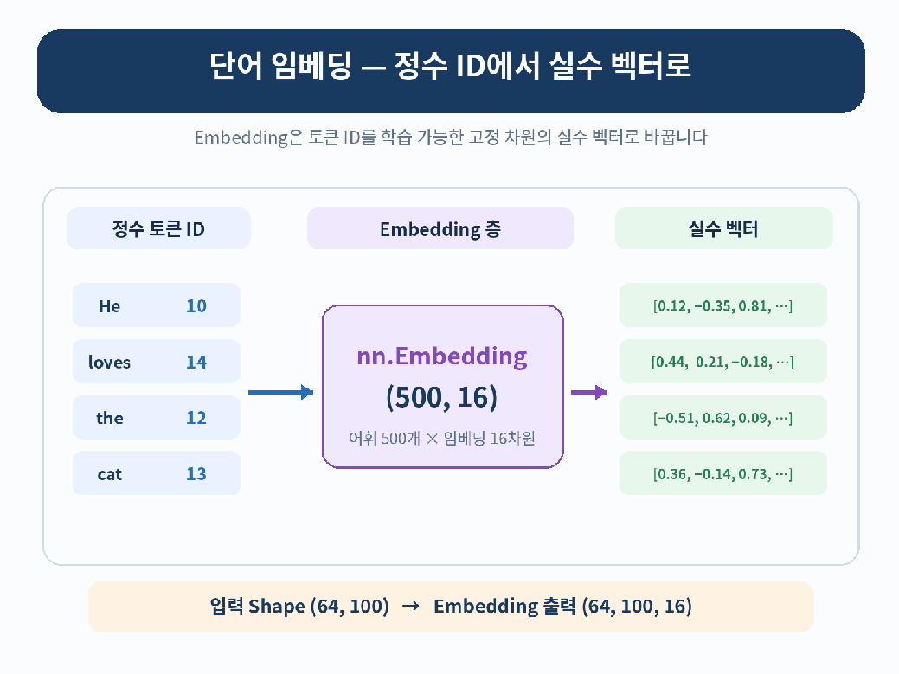
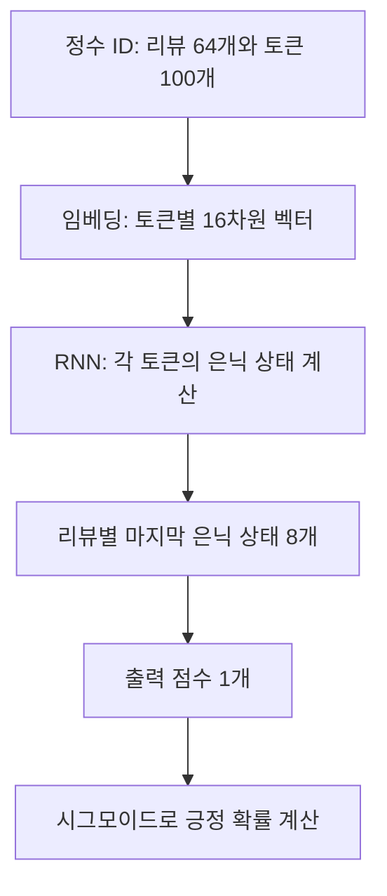
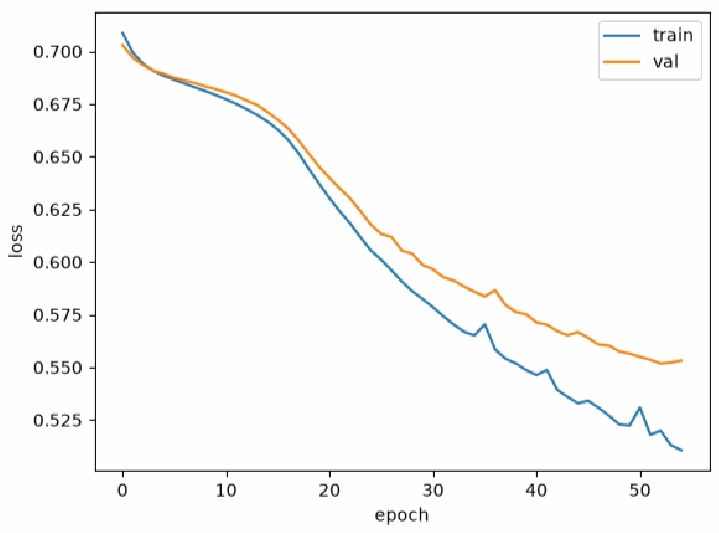

# Day 5. 순환 신경망으로 IMDB 리뷰 분류하기

> 영화 리뷰를 토큰과 숫자 벡터로 변환한 뒤 RNN의 마지막 은닉 상태로 긍정 또는 부정을 예측한다.

## 1. 리뷰 분류와 토큰 정수화 (1-7쪽)

IMDB 리뷰 데이터는 영화 리뷰와 긍정 또는 부정 정답으로 구성된 이진 분류(Binary Classification) 데이터다.
전체 50,000개 중 원본 훈련 데이터와 테스트 데이터가 각각 25,000개이며, 모델은 리뷰가 긍정일 확률을 계산한다.

신경망은 텍스트를 그대로 수치 연산할 수 없으므로 먼저 토큰(Token) 단위로 나누고 각 토큰을 정수 ID로 바꾼다.
예를 들어 `He loves the cat`을 네 토큰으로 나눈 뒤 `[10, 14, 12, 13]`처럼 표현한다.
**ID는 토큰을 구분하는 번호**이므로 숫자가 크다고 단어의 중요도나 의미가 더 큰 것은 아니다.

실습은 어휘 크기를 500개로 제한한다.
ID 0은 패딩, 1은 리뷰 시작, 2는 어휘 범위 밖의 토큰(Out-of-Vocabulary, OOV)에 사용하고, 나머지 ID로 어휘를 표현한다.
제한 범위를 벗어나는 단어는 OOV ID로 바뀌므로 어떤 원래 단어였는지 구별하기 어렵다.

## 2. 길이가 다른 리뷰를 배치로 묶기 (7-10쪽)

리뷰마다 토큰 개수가 달라 같은 크기의 텐서로 묶으려면 길이를 맞춰야 한다.
패딩(Padding)은 짧은 시퀀스의 부족한 위치를 채우고, 잘라내기(Truncation)는 긴 시퀀스의 일부를 제거한다.

> 10쪽: 짧은 시퀀스 앞에는 0을 추가하고, 긴 시퀀스는 앞부분을 제거해 정해진 길이를 맞춘다.

이 실습은 리뷰를 길이 100으로 맞춘다.
짧으면 앞에 0을 채우고, 길면 앞부분을 잘라 마지막 100개를 남긴다.
잘라낸 단어의 정보는 모델에 전달되지 않는다.

재현을 위한 분할 설정값 `random_state=42`를 사용해 원본 훈련 데이터의 20%를 검증용으로 분리해 학습 20,000개와 검증 5,000개를 사용한다.
변환 후 형태는 각각 `(20000, 100)`과 `(5000, 100)`이다.
25,000개의 테스트 데이터는 최종 평가용으로 보관한다.

[추가 설명] 패딩 ID가 0이라는 사실만으로 RNN이 그 위치를 자동으로 건너뛰는 것은 아니다. 이 실습의 임베딩과 RNN은 패딩을 포함한 고정 길이 입력을 처리하므로, 실제 패딩 처리 방식은 모델 설정과 함께 확인해야 한다. 임베딩에서 `padding_idx=0`을 지정하면 패딩 벡터의 역전파 갱신을 막을 수 있지만, 그것만으로 RNN이 해당 타임스텝을 건너뛰지는 않는다.

## 3. 원-핫 인코딩과 단어 임베딩 (10-13쪽)

원-핫 인코딩(One-Hot Encoding)은 어휘 수만큼 자리를 만들고 해당 토큰 위치만 1로 표시한다.
예를 들어 어휘가 다섯 개이면 첫 토큰은 `[1, 0, 0, 0, 0]`처럼 표현한다.
단어를 구별할 수 있지만 대부분이 0이며, 어휘가 커질수록 벡터도 길어진다.

단어 임베딩(Word Embedding)은 각 토큰 ID를 학습 가능한 실수 벡터로 바꾼다.
실습에서는 500개 어휘의 토큰을 각각 16차원으로 표현한다.
토큰을 구분하는 정수 ID와 모델이 계산에 사용하는 16개 실수값은 서로 다른 역할이다.
같은 500개 어휘를 원-핫으로 표현하면 토큰당 500개 값이 필요하지만 이번 임베딩은 토큰당 16개 값을 사용한다.

| 구분 | 원-핫 인코딩 | 단어 임베딩 |
| --- | --- | --- |
| 크기 | 어휘 수에 따라 정해짐 | 모델에서 지정 |
| 값 | 한 위치가 1, 나머지는 0 | 학습 가능한 실수 |
| 표현 | 토큰을 구별하는 고정 표현 | 학습을 통해 작업에 필요한 표현을 조정 |

배치의 정수 ID 형태가 `(64, 100)`이라면 임베딩을 거친 형태는 `(64, 100, 16)`이다.
리뷰 64개와 각 리뷰의 100단계는 그대로이고, 각 토큰이 16개 특성을 갖는 벡터가 된다.

> 12쪽: 토큰마다 임베딩 표의 해당 행을 선택한다. 토큰 ID 배열 (64, 100)은 각 위치에 16개 값을 가진 (64, 100, 16)으로 바뀐다.

## 4. RNN 분류 모델의 형태 (13-16쪽)

실습의 순환 신경망(Recurrent Neural Network, RNN)은 각 단계에 16차원 벡터를 받아 크기 8인 은닉 상태를 계산한다.
리뷰 전체를 하나의 정답으로 분류하므로 마지막 은닉 상태를 선택하고, 완전연결 출력층과 시그모이드를 거쳐 긍정 확률 하나를 얻는다.

| 단계 | 형태 | 의미 |
| --- | --- | --- |
| 입력 | (64, 100) | 리뷰 64개, 리뷰당 토큰 100개 |
| 임베딩 | (64, 100, 16) | 각 토큰에 16개 특성 |
| RNN 전체 출력 | (64, 100, 8) | 각 단계의 은닉 상태 |
| 마지막 은닉 상태 | (64, 8) | 리뷰마다 8개 값 |
| 분류 출력 | (64, 1) | 리뷰마다 긍정 확률 하나 |

배치를 앞에 두는 설정을 사용하므로 RNN 입력의 축 순서는 `(배치, 타임스텝, 특성)`이다.
학습 배치는 64개이고 훈련 데이터는 섞으며 검증 데이터는 섞지 않는다.
**테스트 데이터는 모델 선택에 사용하지 않는다.**

## 5. 손실 계산과 검증 (16-21쪽)

모델의 시그모이드(Sigmoid) 출력은 0과 1 사이의 긍정 확률이다.
이진 교차 엔트로피(Binary Cross-Entropy, BCE)는 이 확률과 실제 정답을 비교한다. [추가 설명] 정답이 긍정일 때 예측 확률이 0.8이면 손실은 `-ln(0.8)`로 약 0.223이고, 0.2이면 약 1.609다.
정답이 긍정인데 예측 확률이 낮으면 손실이 커지며, 이 손실의 기울기로 임베딩과 RNN, 출력층을 함께 학습한다.

실습은 Adam 옵티마이저(Optimizer)와 학습률 0.0002를 사용한다.
입력 토큰 ID는 정수로, 이진 정답은 손실 계산에 맞는 실수로 준비한다.
장치에 따라 GPU 또는 CPU를 사용할 수 있으며, 모델과 입력, 정답은 같은 장치에서 계산한다.
최대 100에포크를 설정하되 검증 손실이 최저 기록을 2에포크 연속 개선하지 못하면 조기 종료(Early Stopping)한다.
검증 손실이 가장 낮았던 상태를 저장하고 학습 후 다시 불러와 평가한다.

훈련 손실과 검증 손실이 함께 내려가면 학습이 검증 데이터에도 도움이 되는지 살펴볼 수 있다.
훈련 손실만 계속 내려가면 과대적합 가능성을, 두 손실이 충분히 줄지 않으면 학습 부족이나 과소적합 가능성을 확인한다.

[추가 설명] 시그모이드로 변환한 확률에는 BCE 손실을 사용한다. 로짓을 직접 받는 BCEWithLogitsLoss를 사용할 때는 별도의 시그모이드 출력을 다시 입력하지 않도록 두 계산 방식을 구분한다.

이 실습은 긍정 확률이 0.5보다 크면 긍정, 그 외에는 부정으로 분류한다.
자료에 제시된 참고 검증 정확도는 약 77%이며, 실행 환경과 학습 조건에 따라 달라진다.
이는 검증 데이터의 결과이며 최종 테스트 정확도와 구분한다.

> 19쪽: 두 손실은 초반에 함께 줄지만 이후 간격이 벌어진다. 마지막 훈련 손실만으로 성능을 판단하지 않고 검증 손실의 추세와 최저 시점을 살핀다.

## 핵심 개념 비교표

| 개념 | 하는 일 | 주의할 점 |
| --- | --- | --- |
| 정수 ID | 토큰을 번호로 구분 | 번호 차이가 의미 차이는 아님 |
| 패딩 | 짧은 시퀀스에 값을 추가 | 추가한 위치가 자동으로 무시되는 것은 아님 |
| 잘라내기 | 긴 시퀀스에서 일부를 제거 | 제거된 내용은 모델에 전달되지 않음 |
| 임베딩 | 토큰 ID를 학습 가능한 벡터로 변환 | 벡터 크기는 모델 설정에 따름 |
| 마지막 은닉 상태 | 리뷰를 순서대로 처리한 최종 상태 | 문장 전체 분류의 입력으로 사용 |

## 핵심 정리

- IMDB 리뷰 분류는 텍스트로 긍정 또는 부정을 예측하는 이진 분류다.
- 토큰 ID는 단어를 구별하는 번호이며 크기 자체에 의미나 중요도가 담겨 있지 않다.
- 패딩과 잘라내기로 리뷰 길이를 100개 토큰으로 맞춘다.
- 임베딩은 각 토큰을 16차원 학습 가능한 벡터로 변환한다.
- RNN은 토큰을 순차적으로 처리하고 마지막 은닉 상태를 분류층에 전달한다.
- 검증 손실로 학습을 멈출 시점과 저장할 모델을 선택한다.
- 자료의 약 77%는 참고 검증 정확도이며 테스트 성능과 다르다.
