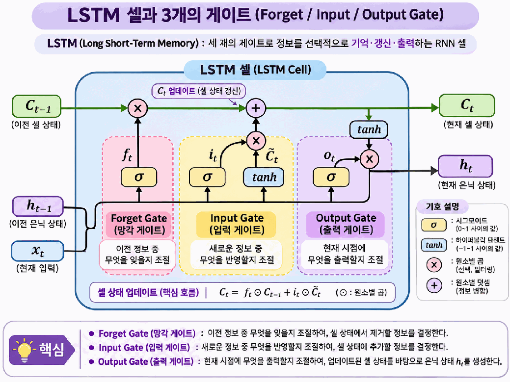
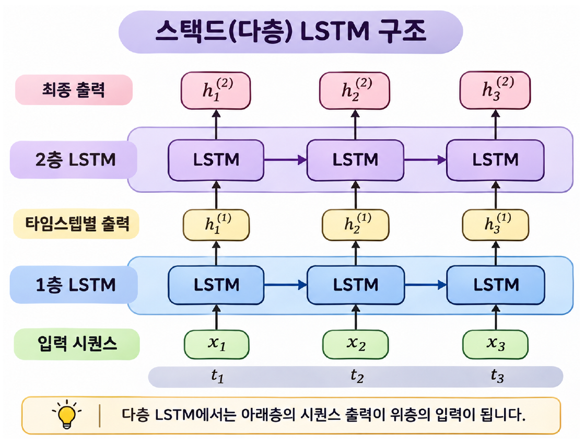
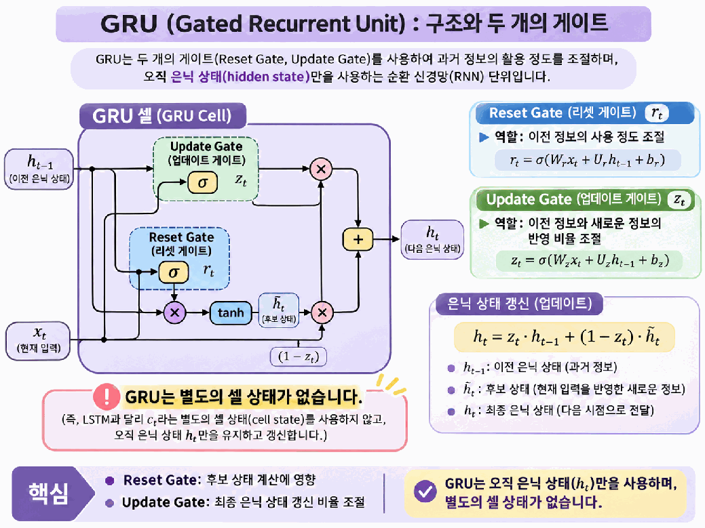

# Day 5. LSTM과 GRU 셀

> LSTM과 GRU는 게이트로 이전 정보와 새로운 정보의 반영 정도를 조절해, 기본 RNN이 긴 시퀀스를 학습할 때 겪는 어려움을 완화한다.

## 1. 긴 시퀀스와 장기 의존성 (1-3쪽)

기본 순환 신경망(Recurrent Neural Network, RNN)은 이전 은닉 상태를 현재 계산에 사용한다.  
그러나 입력이 길어지면 오래전의 정보가 마지막 예측에 충분히 반영되지 않을 수 있다.  
영화 리뷰의 앞부분과 끝부분처럼 멀리 떨어진 정보가 함께 필요한 관계를 장기 의존성(Long-term Dependency)이라고 한다.

RNN의 역전파는 여러 타임스텝을 거친다.  
이 과정에서 기울기가 지나치게 작아지는 기울기 소실(Vanishing Gradient)이 발생하면 앞부분의 입력과 관련된 가중치를 학습하기 어려워진다.  
LSTM과 GRU는 이 문제를 완화하도록 고안됐지만 모든 긴 문장을 완벽하게 기억한다는 뜻은 아니다.

## 2. LSTM의 두 상태와 세 게이트 (3-7쪽)

장단기 기억(Long Short-Term Memory, LSTM)은 은닉 상태(Hidden State) 외에 별도의 셀 상태(Cell State)를 사용한다.  
은닉 상태는 현재 시점의 출력과 다음 단계 계산에 사용하고, 셀 상태는 정보를 유지하며 갱신하는 별도 경로다.  
**셀 상태도 고정된 저장소가 아니라** 입력이 들어올 때마다 달라진다.

게이트(Gate)는 학습된 가중치로 계산한 조절값을 이용해 정보의 흐름을 조절한다.  
게이트에 주로 사용하는 시그모이드(Sigmoid)는 0과 1 사이의 값을 만들어, 각 요소를 얼마나 반영할지 정한다.  
하이퍼볼릭 탄젠트(Hyperbolic Tangent, tanh)는 새로운 후보 정보와 은닉 상태 계산에 사용한다.

| LSTM 게이트 | 역할 | 적용 대상 |
| --- | --- | --- |
| 망각 게이트(Forget Gate) | 이전 정보의 유지 정도 조절 | 이전 셀 상태 |
| 입력 게이트(Input Gate) | 새로운 후보 정보의 반영 정도 조절 | 현재 셀 상태에 추가할 정보 |
| 출력 게이트(Output Gate) | 갱신된 정보의 출력 정도 조절 | 현재 은닉 상태 |

[추가 설명] 한 요소에서 이전 셀 상태가 0.8, 망각 게이트 값이 0.5라면 이전 정보의 기여는 0.4다. 새 후보가 0.6이고 입력 게이트 값이 0.5라면 새 정보의 기여는 0.3이므로 갱신된 셀 상태는 0.7이다. 게이트는 요소별로 반영 비율을 조절하며, 이후 출력 게이트가 은닉 상태를 만드는 데 사용된다.

> 6쪽: 위쪽 셀 상태 경로에서 이전 정보를 유지하고 새 후보를 더한다. 망각 게이트와 입력 게이트가 셀 상태를 조절하고, 출력 게이트가 은닉 상태로 전달할 양을 조절한다.

각 게이트와 후보 상태는 현재 입력 및 이전 은닉 상태를 바탕으로 계산된다.  
그림의 ×는 같은 위치의 값끼리 곱하는 원소별 곱이다.

## 3. 다층 LSTM과 드롭아웃 (7-9쪽)

다층 순환 신경망(Stacked RNN)은 순환층을 여러 개 쌓은 구조다.  
첫 번째 LSTM이 각 타임스텝에서 만든 출력 시퀀스가 두 번째 LSTM의 입력이 된다.  
두 번째 층도 마지막 값 하나만 받는 것이 아니라 전달된 시퀀스를 순서대로 처리한다.

> 8쪽: 첫 번째 LSTM의 타임스텝별 출력이 두 번째 LSTM의 같은 시점 입력으로 전달된다. 가로 방향은 시간 흐름, 세로 방향은 층 사이의 전달을 나타낸다.

드롭아웃(Dropout)은 학습 중 일부 출력을 확률적으로 0으로 만들어 과대적합을 완화한다.  
실습의 파이토치(PyTorch) 설정은 입력 크기 16, 은닉 크기 8, 순환층 2개, 층 사이 드롭아웃 0.2다.  
이 설정의 드롭아웃은 첫 번째와 두 번째 순환층 사이에 적용되고 평가 시 비활성화된다.  
각 타임스텝 안에서 은닉 상태를 계산하는 게이트 자체가 드롭아웃으로 대체되는 것은 아니다.

## 4. GRU의 두 게이트 (9-11쪽)

게이트 순환 유닛(Gated Recurrent Unit, GRU)도 게이트를 통해 정보의 유지와 갱신을 조절한다.  
LSTM과 달리 **별도의 셀 상태를 사용하지 않고** 은닉 상태를 통해 정보를 전달한다.

리셋 게이트(Reset Gate)는 새 후보 상태를 계산할 때 이전 은닉 상태를 얼마나 사용할지 조절한다.  
업데이트 게이트(Update Gate)는 이전 은닉 상태와 새로운 후보 상태를 어느 정도씩 반영할지 조절해 현재 은닉 상태를 만든다.

두 모델은 같은 입력에서 장기 의존성을 다루기 위한 방식이지만 정보 전달 구조가 다르다.  
같은 크기 설정에서는 GRU가 일반적으로 더 적은 매개변수를 사용하지만, 구조가 단순하다는 것만으로 항상 정확도나 실행 속도가 더 좋다고 단정할 수 없다.

> 11쪽: 리셋 게이트는 새 후보를 만들 때 이전 상태를 얼마나 참고할지, 업데이트 게이트는 이전 상태와 새 후보를 얼마나 반영할지 조절한다.

## 5. IMDB 분류 실습과 평가 (12-24쪽)

LSTM과 GRU는 앞선 실습의 훈련 리뷰 20,000개와 검증 리뷰 5,000개를 재사용한다.  
리뷰 길이는 100, 어휘 크기는 500, 임베딩 차원은 16이며, 배치 크기 64의 임베딩 출력은 `(64, 100, 16)`이다.

두 모델은 은닉 크기 8, 순환층 2개, 층 사이 드롭아웃 0.2를 사용한다.  
마지막 층의 최종 은닉 상태 `(64, 8)`을 완전연결층과 시그모이드에 전달해 `(64, 1)` 형태의 긍정 확률을 얻는다.  
LSTM은 은닉 상태와 셀 상태를 모두 반환하지만 GRU는 별도의 셀 상태를 반환하지 않는다. [추가 설명] 단방향 2층 모델에서 층별 최종 은닉 상태의 형태는 `(2, 64, 8)`이고, 그중 마지막 층을 선택하면 `(64, 8)`이 된다.

| 학습 설정 | LSTM과 GRU의 실습 설정 |
| --- | --- |
| 손실과 옵티마이저 | 이진 교차 엔트로피, Adam |
| 학습률과 배치 | 0.001, 64개 |
| 최대 반복 | 100에포크 |
| 조기 종료 | 검증 손실이 2에포크 연속 개선되지 않으면 종료 |

검증 손실이 가장 낮았던 상태를 저장하고 복원해 정확도를 계산한다.  
LSTM의 참고 실행 결과는 검증 정확도 약 80.38%, 테스트 정확도 약 80.68%다.  
자료의 GRU 실습은 실행 후 검증 결과를 확인하도록 되어 있으므로, 여기서는 임의의 GRU 정확도를 정하지 않는다.  
두 모델의 결과를 비교할 때는 같은 데이터와 주요 설정에서 측정한 검증 점수를 사용하고, 한 번의 실행 결과를 모든 문제의 모델 우열로 일반화하지 않는다.

## 핵심 개념 비교표

| 구분 | 기본 RNN | LSTM | GRU |
| --- | --- | --- | --- |
| 주요 상태 | 은닉 상태 | 은닉 상태와 셀 상태 | 은닉 상태 |
| 정보 조절 | 반복되는 상태 계산 | 망각, 입력, 출력 게이트 | 리셋, 업데이트 게이트 |
| 긴 시퀀스 | 오래전 정보 학습에 어려움이 생길 수 있음 | 게이트와 셀 상태로 문제 완화 | 두 게이트로 문제 완화 |
| 출력 상태 | 최종 은닉 상태 | 최종 은닉 상태와 셀 상태 | 최종 은닉 상태 |

## 핵심 정리

- 장기 의존성은 멀리 떨어진 이전 정보가 현재 예측에 필요한 관계다.
- 기울기 소실은 여러 타임스텝을 거친 역전파에서 오래전 정보의 학습을 어렵게 만들 수 있다.
- LSTM은 은닉 상태와 별도의 셀 상태를 사용한다.
- LSTM의 세 게이트는 이전 정보 유지, 새 정보 반영, 은닉 상태 출력을 조절한다.
- GRU는 별도 셀 상태 없이 리셋 게이트와 업데이트 게이트로 은닉 상태를 갱신한다.
- 다층 LSTM에서는 앞 층의 타임스텝별 출력이 다음 층의 입력이 된다.
- 실습의 검증 결과로 모델을 선택하고 별도 테스트 데이터로 최종 성능을 평가한다.
