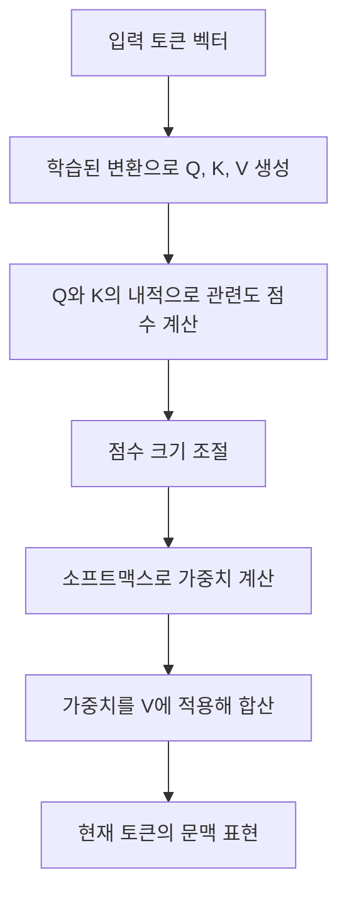
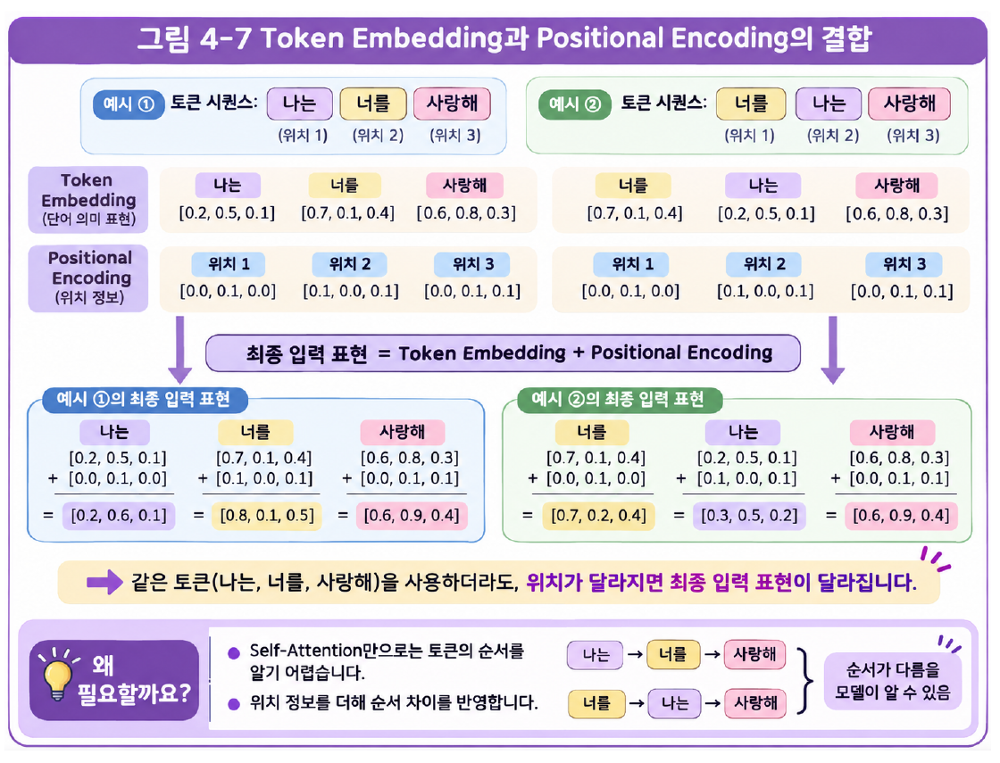
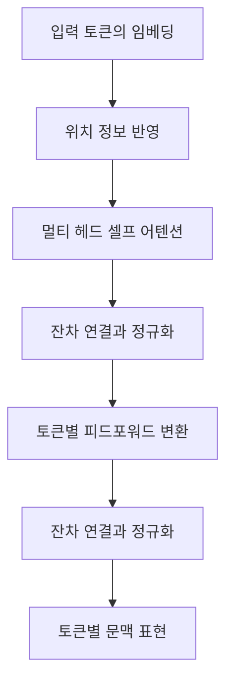
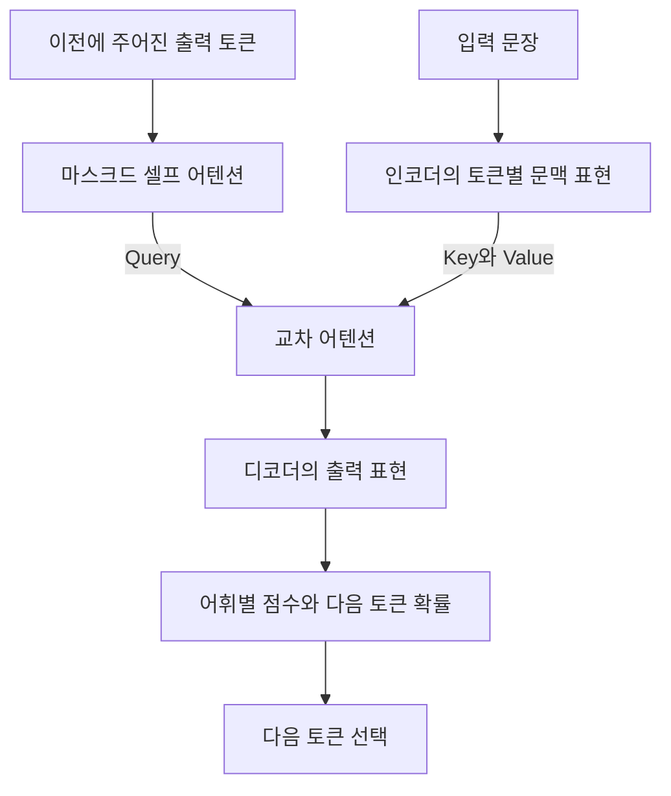

# Day 5. 어텐션 메커니즘과 트랜스포머

> 어텐션은 현재 계산에 필요한 정보를 가중합으로 결합한다. 트랜스포머는 순환 연결 없이 토큰 사이의 관계를 계산하고, 위치 정보와 마스크를 사용해 순서와 생성 조건을 표현한다.

## 1. 인코더와 디코더의 정보 전달 (1-6쪽)

기계 번역처럼 입력 문장을 받아 다른 문장을 만드는 작업에는 입력 정보를 처리하는 인코더(Encoder)와 출력을 생성하는 디코더(Decoder)를 연결할 수 있다. 초기 RNN 기반 인코더는 입력을 순서대로 처리하고 마지막 은닉 상태에 문장의 정보를 압축해 디코더에 전달했다.

입력이 길어지면 많은 정보를 하나의 제한된 크기의 벡터에 담는 과정에서 필요한 내용이 충분히 전달되지 않을 수 있다. 또한 출력 단어마다 참고해야 할 입력 부분이 다른데, 마지막 상태 하나만으로 이를 구분하기 어렵다.

어텐션(Attention)은 현재 계산과 입력 정보의 관련도를 구하고, 각 정보에 다른 가중치를 주어 결합한다. 번역 예에서 영어 `love`를 생성할 때 입력 `나는`, `너를`, `사랑해`에 각각 0.1, 0.2, 0.7의 가중치를 줄 수 있다. 가장 관련된 정보가 크게 반영되지만 나머지 정보가 반드시 제외되는 것은 아니다.

RNN에 어텐션을 추가하면 입력의 여러 시점 정보를 참고할 수 있지만, RNN 자체의 순환 계산은 남는다. 트랜스포머(Transformer)는 순환층 없이 어텐션을 사용해 토큰 관계를 계산하는 구조다.

## 2. 셀프 어텐션과 Q, K, V (6-12쪽)

셀프 어텐션(Self-Attention)은 하나의 시퀀스 안에서 각 토큰이 같은 시퀀스의 토큰들을 참고해 새로운 문맥 표현을 만드는 방법이다. 다른 토큰뿐 아니라 자기 자신도 참고할 수 있다. 같은 단어라도 함께 입력된 문맥에 따라 만들어지는 표현이 달라질 수 있다.

| 구성 | 역할 | 직관적인 의미 |
| --- | --- | --- |
| 쿼리(Query, Q) | 관련도를 계산할 때 기준이 되는 표현 | 현재 어떤 정보를 찾는가 |
| 키(Key, K) | 쿼리와 비교하는 각 토큰의 표현 | 어떤 정보가 있는가 |
| 값(Value, V) | 가중치를 적용해 실제 결합하는 정보 | 무엇을 전달하는가 |

셀프 어텐션에서는 같은 입력 토큰 벡터를 각각 다른 학습된 가중치로 변환해 Q, K, V를 만든다. 현재 토큰의 Q와 각 토큰의 K를 비교해 점수를 구하고, 그 점수로 계산한 가중치를 각 토큰의 V에 적용한다. **관련도 계산에는 Q와 K를, 정보 결합에는 V를 사용**한다.

스케일드 닷 프로덕트 어텐션(Scaled Dot-Product Attention)은 Q와 K의 내적값을 키 벡터 차원의 제곱근으로 나눈다. 키 차원이 64이면 점수를 √64, 즉 8로 나눈다. [추가 설명] 차원이 커질 때 내적값이 지나치게 커져 소프트맥스가 한쪽에 과도하게 집중되는 현상을 완화하려는 조절이다. 이어서 소프트맥스(Softmax)로 각 쿼리에 대한 가중치의 합을 1로 만든다.

[추가 설명] 여러 쿼리와 키를 행렬로 묶으면 다음 식으로 같은 과정을 나타낼 수 있다.

$$
\operatorname{Attention}(Q,K,V)=\operatorname{softmax}\left(\frac{QK^T}{\sqrt{d_k}}\right)V
$$

$QK^T$는 쿼리마다 키와 비교한 점수, $d_k$는 키 벡터의 차원이다. 소프트맥스로 얻은 가중치 행렬에 $V$를 곱하면 쿼리별 가중합을 얻는다.

| 쿼리 행과 키 열 | 나는 | 너를 | 사랑해 |
| --- | --- | --- | --- |
| 나는 | 0.5 | 0.2 | 0.3 |
| 너를 | 0.2 | 0.5 | 0.3 |
| 사랑해 | 0.2 | 0.5 | 0.3 |

이는 작동 원리를 설명하기 위한 가상 가중치다. 마지막 행에서 `사랑해`의 새 표현은 `0.2×V(나는) + 0.5×V(너를) + 0.3×V(사랑해)`로 계산한다. 각 행은 현재 표현을 만드는 쿼리, 각 열은 참고 대상 키에 해당한다. [추가 설명] 세 Value가 숫자 1, 2, 4라면 마지막 행의 가중합은 `0.2×1 + 0.5×2 + 0.3×4 = 2.4`다. 실제 모델에서는 이처럼 각 Value 벡터의 요소들을 함께 계산한다.

[추가 설명] 일반적인 전체 셀프 어텐션은 길이가 $T$인 시퀀스에서 토큰 쌍의 점수를 $T×T$개 계산한다. 길이가 두 배가 되면 점수의 수는 네 배가 되므로 병렬 계산이 가능해도 긴 입력의 계산 부담은 커질 수 있다.

## 3. 멀티 헤드와 위치 정보 (12-17쪽)

멀티 헤드 어텐션(Multi-Head Attention)은 여러 어텐션 계산을 병렬로 수행하고 결과를 결합한다. 각 헤드(Head)는 서로 다른 학습 가중치로 Q, K, V를 만들고, 헤드별 출력을 연결한 다음 선형 변환한다. 이를 통해 여러 표현 공간에서 서로 다른 관계를 반영할 수 있지만, 특정 헤드가 반드시 한 가지 문법 역할만 담당한다고 정해져 있지는 않다. [추가 설명]

셀프 어텐션 자체에는 토큰이 등장한 위치를 알려 주는 순환 구조가 없다. 위치 인코딩(Positional Encoding)은 각 토큰의 위치 정보를 표현에 더해 순서를 모델이 활용할 수 있게 한다. 원본 트랜스포머에서는 사인과 코사인으로 만든 위치 벡터를 토큰 임베딩에 더했다.

> 17쪽: 같은 토큰이라도 놓인 위치의 벡터가 달라지면 임베딩과 위치 정보를 더한 최종 입력 표현이 달라진다.

## 4. 트랜스포머 인코더 (14-19쪽)

트랜스포머 인코더는 입력 시퀀스의 토큰마다 다른 토큰의 문맥이 반영된 표현을 만든다. 토큰 임베딩과 위치 정보를 준비한 뒤, 멀티 헤드 셀프 어텐션과 피드포워드 신경망(Feedforward Network, FFN)을 포함한 블록을 통과시킨다.

셀프 어텐션은 토큰 사이의 정보를 결합하고, FFN은 각 토큰의 표현을 개별적으로 추가 변환한다. 잔차 연결(Residual Connection)은 연산의 입력을 변환 결과에 더해 정보와 기울기 전달을 돕는다. 층 정규화(Layer Normalization)는 각 토큰 표현의 특성값을 기준으로 정규화해 학습 안정화에 도움을 준다.

배치 정규화(Batch Normalization)가 여러 샘플의 통계를 활용하는 것과 달리, 층 정규화는 각 토큰 표현의 특성 차원에서 통계를 구한다. 인코더의 출력은 문장 전체를 하나로 압축한 벡터가 아니라 **각 입력 토큰에 대응하는 문맥 벡터들의 시퀀스**다.

## 5. 디코더와 다음 토큰 생성 (19-24쪽)

원본 트랜스포머의 디코더는 앞에서 주어진 출력 토큰과 인코더의 문맥 표현을 이용해 다음 토큰을 예측한다. 선택한 토큰을 다음 단계의 입력으로 다시 사용하는 방식을 자기회귀 생성(Autoregressive Generation)이라고 한다.

마스크드 셀프 어텐션(Masked Self-Attention)은 디코더의 현재 위치에서 미래 토큰을 참고하지 못하게 제한한다. 예를 들어 `I`를 생성할 때는 시작 토큰을, `love`를 생성할 때는 시작 토큰과 `I`를, `you`를 생성할 때는 시작 토큰과 `I love`를 참고한다. 훈련 중에도 아직 예측할 미래 정답을 미리 보지 않도록 이 제한이 필요하다.

교차 어텐션(Cross-Attention)은 디코더가 인코더의 출력 정보를 참고하는 연산이다. Q는 디코더의 현재 표현에서 만들고, K와 V는 인코더가 만든 입력 문장의 문맥 표현에서 만든다. 디코더는 자신의 이전 출력과 원본 입력 정보라는 서로 다른 두 경로를 활용한다.

출력층은 어휘의 각 토큰에 대한 점수를 계산하고 소프트맥스로 다음 토큰의 확률 분포를 만든다. 예를 들어 어휘가 30,000개면 각 후보에 대한 점수 30,000개를 계산한다. 선택된 토큰을 이용해 종료 토큰이나 지정한 길이에 도달할 때까지 생성한다.

입력 토큰의 셀프 어텐션은 병렬로 계산할 수 있다. 반면 자기회귀 방식의 추론에서는 다음 토큰이 이전에 생성한 토큰에 의존하므로 일반적으로 순차적으로 생성한다. 위 구조는 원본 인코더-디코더 트랜스포머이며, 이후 인코더만 또는 디코더만 사용하는 구조도 발전했다.

## 핵심 개념 비교표

| 구분 | 참고하는 정보 | 주요 역할 |
| --- | --- | --- |
| 셀프 어텐션 | 같은 시퀀스의 토큰 | 토큰 간 관계를 반영한 표현 생성 |
| 마스크드 셀프 어텐션 | 디코더의 현재 및 이전 위치 | 미래 토큰 참조 제한 |
| 교차 어텐션 | 디코더의 Q와 인코더의 K, V | 입력 문장의 문맥을 출력 생성에 반영 |
| FFN | 각 토큰의 현재 표현 | 토큰별 비선형 변환 |
| 위치 인코딩 | 토큰의 위치 정보 | 순서 차이를 모델에 제공 |

## 핵심 정리

- 초기 RNN 인코더-디코더는 입력을 하나의 은닉 상태에 압축해 긴 입력의 정보 전달에 한계가 있었다.
- 어텐션은 관련도에 따라 여러 정보에 다른 가중치를 적용해 결합한다.
- 셀프 어텐션은 Q와 K로 관련도를 구하고, 그 가중치로 V를 합쳐 문맥 표현을 만든다.
- 멀티 헤드는 여러 관계 표현을 병렬로 계산해 결합한다.
- 위치 정보는 순환 연결이 없는 트랜스포머가 토큰 순서를 활용하도록 돕는다.
- 인코더는 입력 토큰별 문맥 표현을 만들고, 원본 디코더는 이전 출력과 인코더 정보를 함께 사용한다.
- 마스크는 미래 출력 참조를 제한하며, 자기회귀 추론의 토큰 생성은 일반적으로 순차적이다.
