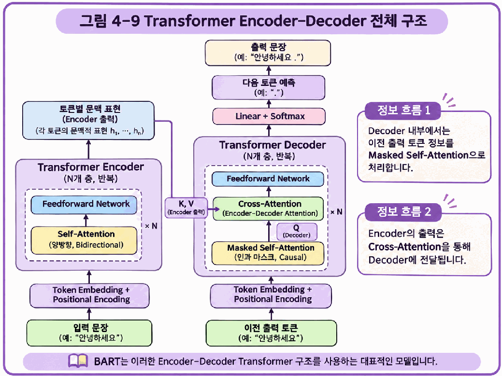
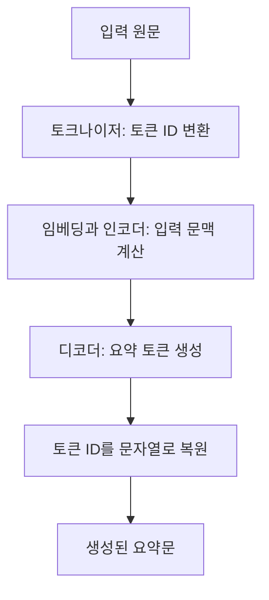

# Day 5. 순차 데이터에서 Transformer까지

> 순차 데이터의 상태 전달부터 어텐션 기반 문맥 계산까지의 흐름을 연결하고, 학습된 트랜스포머를 텍스트 요약에 사용하는 과정을 정리한다.

## 1. 순차 데이터와 RNN (1-3쪽)

순차 데이터(Sequential Data)는 나열된 순서에 의미가 있는 데이터다.  
텍스트에서는 같은 단어라도 순서가 달라지면 문장의 의미가 바뀔 수 있고, 음성과 시계열 데이터에서도 값이 나타난 순서가 중요하다.

순환 신경망(Recurrent Neural Network, RNN)은 현재 입력과 이전 은닉 상태(Hidden State)로 새로운 상태를 계산한다.  
모든 타임스텝에서 같은 가중치를 사용하지만 입력과 이전 상태는 매번 다르다.  
숫자 실습에서 `[1, 0]`의 최종 상태는 약 0.3634, `[0, 1]`은 약 0.7616으로 순서에 따른 차이를 확인했다.

## 2. 리뷰 분류의 데이터 흐름 (3-5쪽)

텍스트는 토큰(Token)으로 나누고 각 토큰을 정수 ID로 표현한다.  
숫자는 토큰을 구분하는 번호이며 크기가 의미나 중요도를 나타내지는 않는다.  
패딩(Padding)은 짧은 리뷰의 길이를 채우고 잘라내기(Truncation)는 긴 리뷰의 일부를 제거해 같은 크기의 배치로 만든다.

단어 임베딩(Word Embedding)은 토큰 ID를 학습 가능한 실수 벡터로 바꾼다.  
IMDB 실습에서는 리뷰 길이 100과 임베딩 차원 16을 사용했다.  
배치 64개는 `(64, 100)`에서 `(64, 100, 16)`으로 변하고, RNN의 마지막 은닉 상태 `(64, 8)`이 분류층으로 전달된다.

마지막 상태를 점수 하나로 바꾼 뒤 시그모이드(Sigmoid)를 적용하면 긍정 확률을 얻는다.  
이진 교차 엔트로피(Binary Cross-Entropy)는 이 확률과 정답을 비교하며, 검증 손실은 학습 중 모델을 선택하는 기준이 된다.  
테스트 데이터는 선택된 모델을 최종 평가할 때 사용한다.

## 3. LSTM과 GRU의 정보 조절 (5-6쪽)

장기 의존성(Long-term Dependency)은 멀리 떨어진 이전 정보가 현재 예측에 필요한 관계다.  
기본 RNN은 여러 타임스텝을 거친 역전파에서 기울기가 지나치게 작아져 오래전 정보를 학습하기 어려울 수 있다.  
이를 기울기 소실(Vanishing Gradient)이라고 한다.

장단기 기억(Long Short-Term Memory, LSTM)은 은닉 상태와 별도의 셀 상태(Cell State)를 사용한다.  
망각 게이트는 이전 정보의 유지 정도를, 입력 게이트는 새 정보의 반영 정도를, 출력 게이트는 은닉 상태로 내보낼 정보를 조절한다.

게이트 순환 유닛(Gated Recurrent Unit, GRU)은 별도 셀 상태 없이 은닉 상태를 사용한다.  
리셋 게이트는 새 후보를 만들 때 이전 정보를 얼마나 참고할지 정하고, 업데이트 게이트는 이전 상태와 새 후보의 반영 비율을 조절한다.  
두 모델 모두 장기 의존성 학습의 어려움을 완화하도록 설계됐다.

## 4. 어텐션과 트랜스포머 (6-9쪽)

초기 RNN 인코더-디코더(Encoder-Decoder)는 입력 문장의 정보를 하나의 마지막 은닉 상태로 전달했다.  
어텐션(Attention)은 현재 출력에 필요한 입력 정보를 서로 다른 가중치로 결합해 이 한계를 완화한다.  
RNN에 어텐션을 더해도 RNN의 순차 계산은 그대로 남는다.

트랜스포머(Transformer)의 셀프 어텐션(Self-Attention)은 순환층 없이 같은 시퀀스의 토큰 사이 관계를 계산한다.  
쿼리(Query, Q)와 키(Key, K)로 관련도를 구하고, 그 가중치를 값(Value, V)에 적용해 새로운 문맥 표현을 만든다.  
멀티 헤드 어텐션(Multi-Head Attention)은 여러 관계를 병렬로 계산한 뒤 결과를 결합한다.

인코더는 각 입력 토큰의 문맥 표현을 만들고 위치 인코딩(Positional Encoding)으로 순서 정보를 제공한다.  
원본 트랜스포머의 디코더는 마스크드 셀프 어텐션으로 미래 출력 참조를 제한하고, 교차 어텐션(Cross-Attention)으로 인코더의 입력 정보를 참고해 다음 토큰을 생성한다.

> [추가 설명] 어텐션 이론 25쪽의 전체 구조도다. 입력 토큰의 문맥 표현이 디코더의 교차 어텐션에 전달되고, 디코더는 이전 출력 토큰과 함께 다음 토큰의 확률을 계산한다.

## 5. 사전학습 모델로 텍스트 요약하기 (9-11쪽)

트랜스포머는 사용하는 구성에 따라 인코더 전용, 디코더 전용, 인코더-디코더 구조로 나눌 수 있다.  
BERT는 입력 표현과 분류, GPT는 생성, BART와 T5는 인코더-디코더 방식의 번역이나 요약에 활용되는 예다.  
각 모델의 실제 사용 목적은 학습 방식과 추가 설정에 따라 달라진다. [추가 설명]

사전학습(Pretraining)은 대규모 데이터에서 일반적인 언어 패턴을 학습하는 단계다.  
미세 조정(Fine-tuning)은 특정 작업에 맞게 추가 학습하는 단계이며, 추론(Inference)은 학습된 모델로 새 입력의 결과를 만드는 단계다.  
이 자료의 요약 실습은 **요약용으로 미세 조정된** 영어 DistilBART와 한국어 KoBART를 불러와 추론하며, **별도의 역전파나 가중치 갱신은 수행하지 않는다.**

토크나이저(Tokenizer)는 텍스트를 토큰으로 나누고 정수 ID로 바꾼다.  
단어보다 작은 조각을 사용하는 서브워드 토큰화(Subword Tokenization)도 가능하다.  
모델이 생성한 토큰 ID는 다시 디코딩(Decoding)해 읽을 수 있는 문자열로 바꾼다. [추가 설명] 모델과 맞는 토크나이저를 사용해야 입력과 출력의 ID가 모델이 학습한 어휘 체계에 대응한다.

요약은 원문에서 필요한 내용을 바탕으로 새 문장을 만드는 작업이다.  
결과가 짧고 자연스러워도 중요한 정보가 빠지거나 원문에 없는 사실이 추가될 수 있으므로 핵심 정보 유지, 사실 일치, 간결성, 자연스러움을 함께 확인한다.

## 핵심 개념 비교표

| 구분 | IMDB 리뷰 분류 | BART와 KoBART 요약 |
| --- | --- | --- |
| 입력 | 영화 리뷰 | 요약할 원문 |
| 모델 활용 | RNN, LSTM, GRU 학습 | 요약용으로 학습된 인코더-디코더 모델 추론 |
| 출력 | 긍정 또는 부정 확률 | 새로 생성한 요약문 |
| 결과 확인 | 검증 손실, 정확도, 테스트 성능 | 핵심 정보와 사실 일치, 간결성, 자연스러움 |

## 핵심 정리

- RNN은 은닉 상태를 순서대로 전달하고 같은 가중치를 모든 타임스텝에서 사용한다.
- 리뷰 분류에서는 토큰화와 길이 조정 후 임베딩 벡터를 순환 신경망에 입력한다.
- LSTM과 GRU는 게이트를 통해 이전 정보와 새로운 정보의 반영을 조절한다.
- 어텐션은 현재 계산과 관련된 정보를 가중합으로 결합한다.
- 트랜스포머 인코더는 문맥 표현을 만들고 디코더는 이전 출력과 입력 문맥을 이용해 생성한다.
- 사전학습, 미세 조정, 추론은 각각 일반 학습, 작업별 추가 학습, 결과 생성 단계다.
- 생성된 요약문은 자연스러움뿐 아니라 원문의 핵심 정보와 사실이 유지됐는지도 확인한다.
