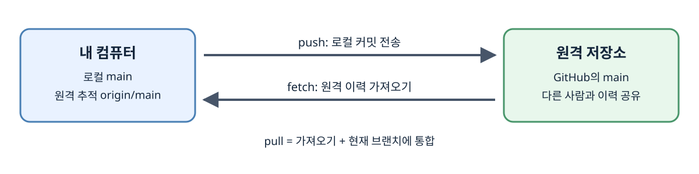

# 원격 저장소와 Push

로컬에서 커밋을 만들면 변경 이력은 내 컴퓨터의 저장소에 기록됨. 다른 컴퓨터나 협업자와 이력을 공유하려면 GitHub 같은 원격 저장소를 연결하고 커밋을 보내야 함. 로컬 커밋과 원격 전송은 서로 다른 단계임.

## 로컬 브랜치와 원격의 위치

| 이름 | 의미 |
| --- | --- |
| `origin` | 원격 저장소 주소에 붙인 로컬 별명 |
| `main` | 내 컴퓨터의 로컬 브랜치 |
| `origin/main` | 마지막으로 원격과 통신해 확인한 원격 main 위치를 나타내는 로컬 참조 |

`origin`은 GitHub 서비스 전체가 아니라 특정 저장소 주소의 별명임. GitHub에서 다른 사람이 새 커밋을 만들었다고 내 `origin/main`이 실시간으로 바뀌지는 않음. fetch나 push 등으로 원격과 통신했을 때 갱신됨.



그림의 `origin/main`은 내 컴퓨터에 저장된 원격 추적 참조임. fetch는 원격 정보를 가져와 이 참조를 갱신하고, pull은 가져온 이력을 현재 브랜치에 통합하는 단계까지 진행함. 원격 파일을 편집하는 것과 내 컴퓨터의 파일을 편집하는 것도 별개임.

## 원격 주소 연결하기

새 로컬 저장소에서 아직 `origin`을 등록하지 않은 경우의 명령임. 주소는 자신의 원격 저장소 주소로 바꿈.

```powershell
git remote -v
git remote add origin https://github.com/사용자이름/저장소이름.git
git remote -v
```

첫 `remote -v`는 이미 연결된 주소가 있는지 확인함. `remote add`는 원격 저장소를 생성하는 명령이 아니라 존재하는 주소를 별명과 연결하는 명령임. 이미 `origin`이 있으면 다시 `add`하지 않고 현재 주소를 확인함. 의도적으로 주소를 바꿔야 할 때는 `git remote set-url origin <새주소>`를 사용함.

GitHub에서 빈 저장소를 새로 만드는 단계와 내 컴퓨터의 `git init`은 별개. GitHub 저장소를 README 등으로 미리 초기화했다면 원격에도 별도의 커밋이 생길 수 있어 처음 push하기 전에 양쪽 이력을 확인해야 함.

## 로컬 커밋을 원격으로 보내기

```powershell
git status
git push -u origin main
git branch -vv
```

`push`는 로컬 `main`의 커밋을 원격 `origin`의 브랜치에 전송함. `-u`는 앞으로 기본적으로 연결해 사용할 업스트림을 설정함. 이후 적절한 업스트림이 설정된 상태에서는 `git push`로 보낼 수 있음. `branch -vv`는 각 로컬 브랜치와 연결된 업스트림을 확인함.

파일을 저장하거나 `add`만 한 내용은 아직 커밋이 아니므로 push할 커밋 이력에 들어 있지 않음. 먼저 `git status`로 남은 변경을 보고 원하는 내용을 커밋해야 함. 또한 주소 등록과 원격에 쓸 권한은 별개임. HTTPS로 GitHub에 접근할 때는 Credential Manager나 토큰 등의 인증이 필요하며 Git 작업에 GitHub 계정 비밀번호를 직접 사용하는 방식은 지원되지 않음.

## Push가 거절되는 이유

원격 브랜치에 로컬에 없는 커밋이 있어 단순히 앞으로 이동시키는 방식으로 반영할 수 없으면 non-fast-forward 거절이 발생할 수 있음. 다른 사람의 변경을 덮어쓰지 않도록 Git이 막은 것임. 이때 반복해서 push하기보다 `git fetch origin`으로 원격 상태를 가져와 양쪽 이력을 비교함.

원격 변경과 로컬 변경을 어떻게 통합할지 확인한 뒤 merge 또는 rebase를 진행함. 통합 중 충돌이 발생하면 해결과 커밋 등 해당 작업의 완료 절차가 필요함. 다음에는 `clone`, `fetch`, `pull`이 원격과 로컬의 어느 상태를 바꾸는지 구분함.

참고: [git remote](https://git-scm.com/docs/git-remote), [git push](https://git-scm.com/docs/git-push), [GitHub 인증](https://docs.github.com/en/authentication/keeping-your-account-and-data-secure/about-authentication-to-github)

[이전](../git/10-ignore-and-files.md) | [다음](02-clone-fetch-pull.md) | [목차로](../README.md)
