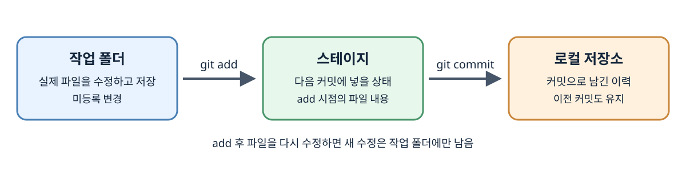
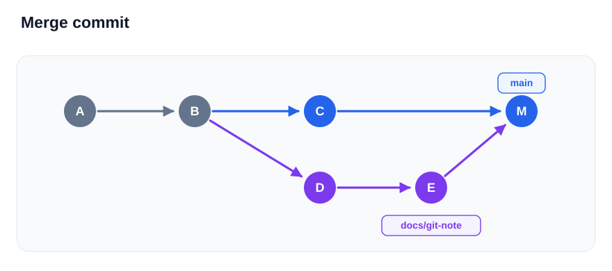
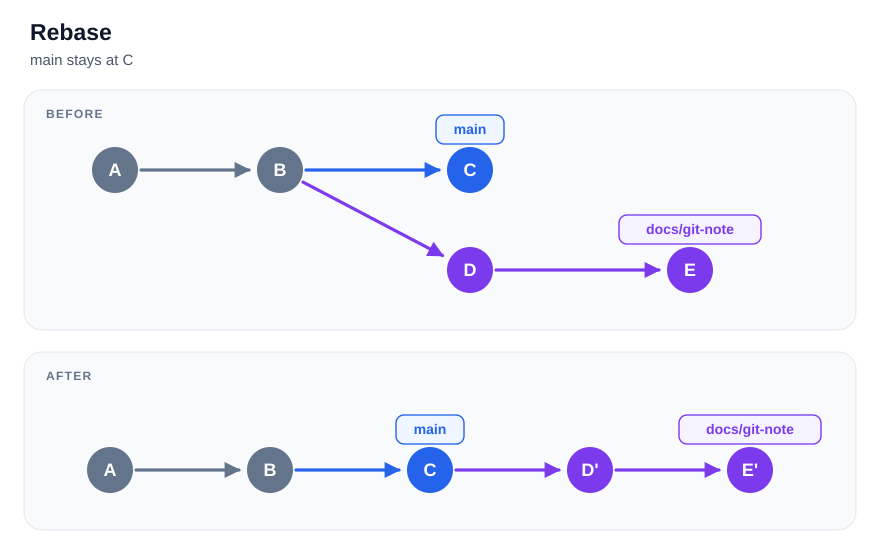

# Git과 GitHub 그림 살펴보기

## 작업 폴더, 스테이지, 커밋

왼쪽은 실제 파일을 편집하는 작업 폴더, 가운데는 다음 커밋에 넣을 상태를 준비하는 스테이지, 오른쪽은 만들어진 커밋을 보관하는 로컬 저장소임. `git add`는 실행한 시점의 파일 상태를 스테이지에 반영하고 `git commit`은 그 상태를 기록함.

화살표는 파일을 다른 폴더로 옮긴다는 뜻이 아님. `add` 후 파일을 다시 저장하면 새 수정은 작업 폴더에만 있으므로 다시 `add`해야 다음 커밋에 포함됨. [Stage와 Commit](git/03-stage-and-commit.md)에서 상태와 명령을 확인함.

## 브랜치로 나뉜 작업

B까지는 두 브랜치가 공유한 이력이고 이후 각각 다른 작업이 기록됨. `main`이 C를, 작업 브랜치가 E를 가리키는 그림. 브랜치는 커밋을 가리키는 이름이며 별도의 프로젝트 폴더를 만드는 것은 아님. [브랜치](git/07-branch.md)에서 생성과 전환을 확인함.

## Fast-forward 병합

기준 브랜치가 작업 브랜치의 이전 이력에 있다면 앞으로 이동해 그 커밋을 가리킬 수 있음. 이 그림에서는 `main`이 B에서 D로 이동하며 새 병합 커밋을 만들지 않음. 작업 브랜치의 이름이 자동 삭제되는 것은 아님.

## 병합 커밋이 만들어지는 경우

분기 이후 양쪽에 각각 새 커밋이 있으면 이름 하나를 앞으로 옮기는 방식만으로 두 흐름을 합칠 수 없음. 그림의 M은 두 부모를 가진 병합 커밋이며 `main`이 M을 가리킴. 두 브랜치가 갈라졌다고 반드시 충돌하는 것은 아니며 서로 다른 부분의 변경은 자동으로 합쳐질 수 있음. [Merge와 충돌 해결](git/08-merge-and-conflict.md)에서 충돌 표시를 읽는 방법을 다룸.

## Rebase 전후의 커밋

기존 D와 E의 변경을 새 기준 C 뒤에 적용해 D'와 E'를 만듦. 재적용한 커밋은 부모가 달라지므로 해시도 바뀜. 작업 브랜치는 E'로 이동하지만 `main`은 자동으로 이동하지 않음. [Rebase](git/09-rebase.md)에서 충돌 해결과 이후 병합을 확인함.

## 로컬과 원격 이력

로컬에서 커밋한 뒤 push하면 원격에 이력을 보냄. fetch는 원격 정보를 가져와 내 컴퓨터의 `origin/main`을 갱신하지만 로컬 `main`이나 작업 파일을 자동으로 바꾸지 않음. pull은 가져온 이력을 현재 브랜치에 통합하는 단계까지 진행함.

그림의 `origin/main`은 GitHub 서버 자체가 아니라 내 컴퓨터에 저장된 원격 추적 참조임. [Clone, Fetch, Pull](github/02-clone-fetch-pull.md)에서 실제 명령과 충돌 시의 흐름을 확인함.

[목차로](README.md)
