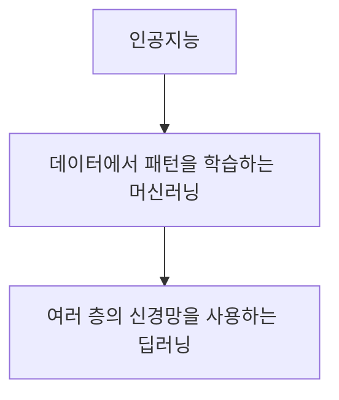
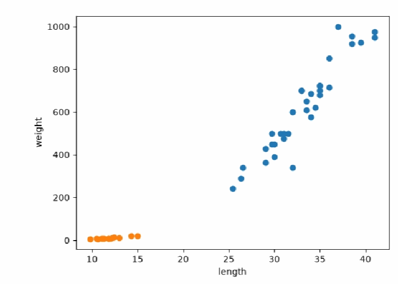
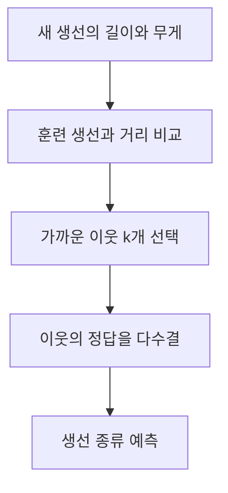
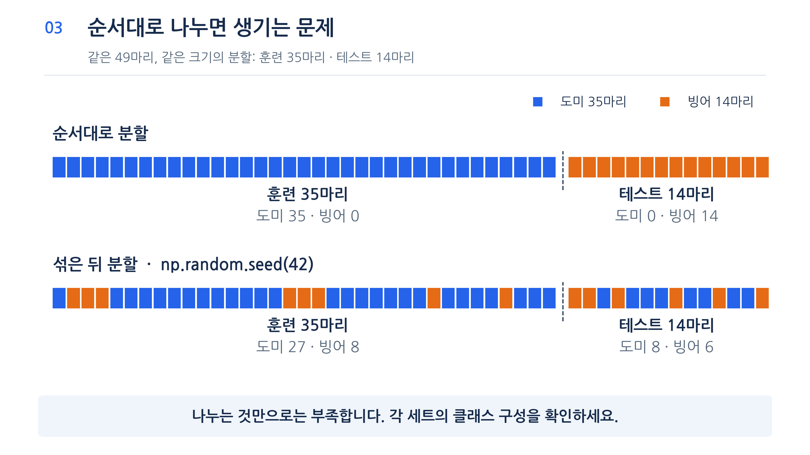
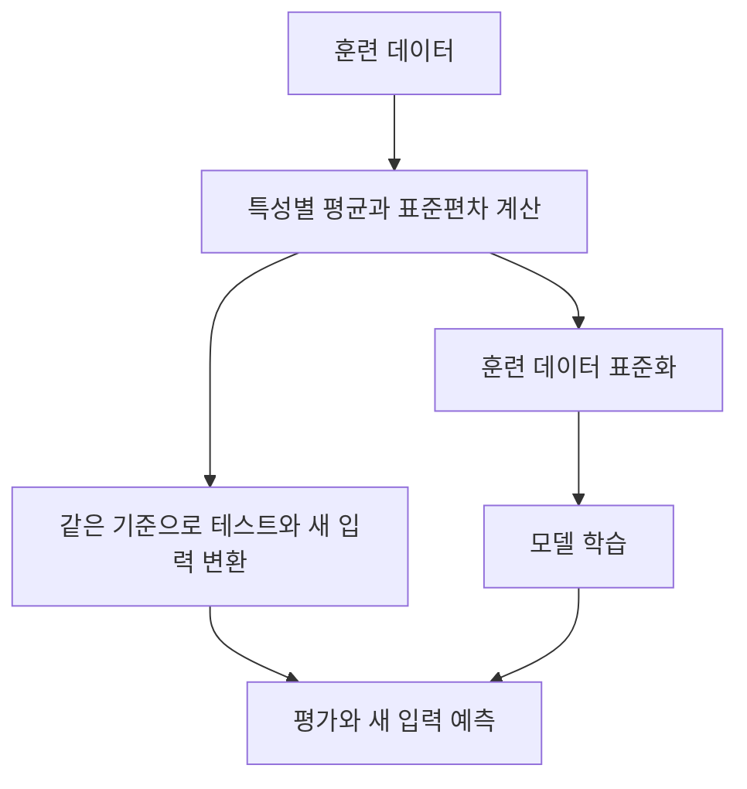
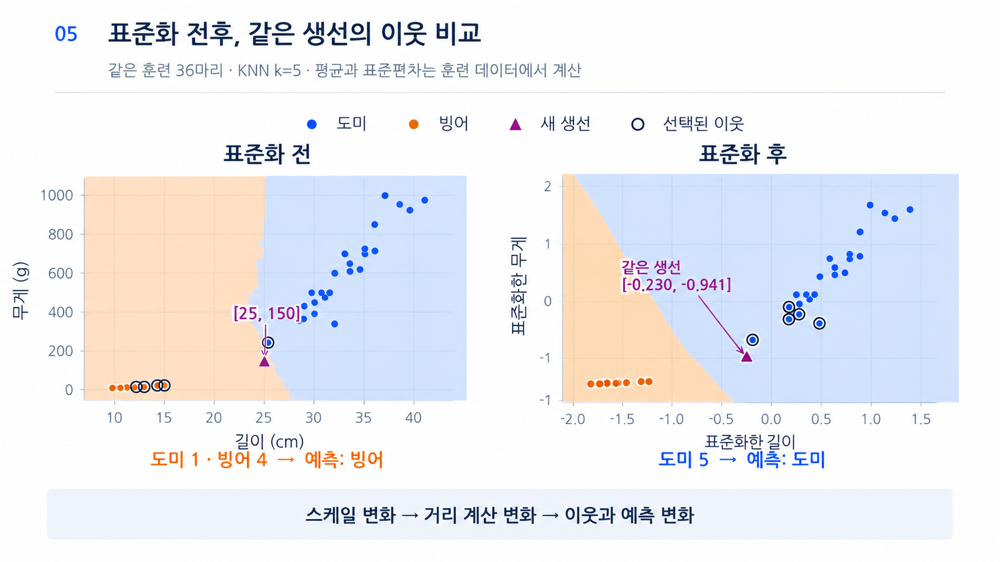

# Day 1. 머신러닝의 기본 흐름과 데이터 준비

> 생선의 길이와 무게로 종류를 예측하면서 머신러닝의 학습, 평가, 전처리 과정을 이해한다.

## 1. 인공지능과 머신러닝

<strong>인공지능(Artificial Intelligence, AI)</strong>은 인식과 판단 등 사람의 지능이 필요한 작업을 컴퓨터가 수행하도록 만드는 기술이다.  
<strong>머신러닝(Machine Learning)</strong>은 데이터에서 예측에 필요한 패턴을 학습하는 방법이고, <strong>딥러닝(Deep Learning)</strong>은 여러 층의 신경망을 사용하는 머신러닝의 한 분야다.

<strong>지도학습(Supervised Learning)</strong>은 입력과 정답을 함께 사용한다.  
비지도학습(Unsupervised Learning)은 정답 없이 데이터의 구조를 찾고, 강화학습(Reinforcement Learning)은 행동에 따른 보상을 통해 학습한다.

무엇을 예측할지, 어떤 데이터를 모을지, 어떤 지표로 결과를 평가할지는 사람이 정한다.  
데이터가 모델이 실제로 만날 사례를 잘 나타내는지도 확인해야 한다.

## 2. 생선 데이터와 KNN 분류

<strong>샘플(Sample)</strong>은 데이터 한 건, <strong>특성(Feature)</strong>은 예측에 사용할 입력 정보, <strong>타깃(Target)</strong>은 예측하려는 정답이다.  
생선 한 마리가 샘플이고 길이와 무게가 특성이며 도미나 빙어가 타깃이다.  
도미 35마리와 빙어 14마리를 사용할 때 입력은 49행 2열, 정답은 49개다.

해당 산점도에서 점 하나는 생선 한 마리다.  
이 예시에서는 길고 무거운 도미와 짧고 가벼운 빙어가 서로 다른 위치에 모인다.

<strong>k-최근접 이웃(k-Nearest Neighbors, KNN)</strong> 분류는 새 입력과 가장 가까운 훈련 샘플 k개의 정답을 다수결로 선택한다.  
예를 들어 이웃 5개 중 도미가 4개면 도미로 예측한다.  
KNN은 학습한 관계식 대신 훈련 사례를 보관하고 예측 시 거리를 계산하므로 데이터가 많아지면 저장과 탐색 부담이 커질 수 있다.

<strong>정확도(Accuracy)</strong>는 올바르게 분류한 샘플 수를 전체 평가 샘플 수로 나눈 비율이다.  
훈련에 사용한 49마리를 다시 평가해 정확도가 1.0이어도, 새로운 생선에서 같은 성능을 보장하지는 않는다.

이웃 수를 49로 늘리면 모든 생선이 투표한다.  
35마리인 도미가 항상 다수이므로 정확도는 `35÷49≈0.714`다.  
k는 사용자가 정하는 <strong>하이퍼파라미터(Hyperparameter)</strong>이며, 이웃을 많이 본다고 항상 정확도가 높아지지는 않는다.

길이 30cm, 무게 600g인 생선은 가까운 도미를 참고해 도미로 예측한다.  
입력 한 건도 `[30, 600]`이라는 한 행을 가진 2차원 구조로 전달한다.  
첫 차원은 샘플, 두 번째 차원은 길이와 무게 두 특성에 대응한다.

실험에서는 k를 5부터 늘릴 때 18에서 훈련 정확도가 처음 1보다 작아져 49마리 중 48마리를 맞혔다.  
이 값은 훈련 데이터에 대한 관찰이므로 최적의 이웃 수를 증명하지 않는다.  
k를 선택할 때는 별도 검증 데이터의 성능을 비교한다.

## 3. 훈련과 테스트 데이터

<strong>훈련 세트(Training Set)</strong>는 모델 학습에 사용하고, <strong>테스트 세트(Test Set)</strong>는 학습에 쓰지 않은 데이터의 예측 성능을 평가한다.  
입력과 정답은 같은 생선을 가리키도록 순서를 맞춰 나누어야 한다.

데이터가 도미 35마리 다음 빙어 14마리 순서일 때 앞 35개만 훈련에 쓰면 도미만 학습하게 된다.  
이처럼 데이터의 일부만 대표하는 <strong>샘플링 편향(Sampling Bias)</strong>이 생기면 평가 결과를 제대로 해석하기 어렵다.

무작위 분할은 데이터를 섞어 나누고, <strong>층화 분할(Stratified Split)</strong>은 각 클래스의 비율이 가능한 한 유지되도록 나눈다.  
강의 예제에서 전체 도미와 빙어는 35:14이며, 테스트 13마리는 일반 분할에서 10:3, 층화 분할에서 9:4였다.  
무작위 분할의 결과는 설정에 따라 달라진다.

49마리를 테스트 비율 25%로 나누면 훈련은 36마리, 테스트는 13마리다.  
같은 무작위 상태를 지정하면 같은 분할을 재현할 수 있다.  
층화 분할은 비율을 최대한 유지하지만 샘플 수가 작으면 정수 개수로 나누어야 하므로 전체 비율과 정확히 같지는 않을 수 있다.

> 같은 생선 49마리도 나누는 방법에 따라 훈련 세트에 포함되는 클래스가 달라진다. 입력과 정답은 같은 인덱스로 함께 섞는다.

## 4. 특성 스케일과 표준화

길이와 무게의 숫자 범위가 다르면 거리 기반 모델에서 숫자가 큰 특성이 결과에 더 큰 영향을 줄 수 있다.  
테스트 정확도가 1.0인 모델도 새 생선 `[25, 150]`을 빙어로 예측한 이유를 이웃의 거리와 데이터 스케일에서 확인한다.

<strong>표준화(Standardization)</strong>는 각 특성의 값에서 평균을 빼고 표준편차로 나누는 방법이다.

$$z=\frac{x-\mu}{\sigma}$$

x는 원래 값, μ는 훈련 데이터의 평균, σ는 훈련 데이터의 표준편차, z는 표준화한 값이다. 평균보다 한 표준편차 큰 값은 1, 작은 값은 -1이다. 표준화 결과는 반드시 0에서 1 사이가 아니다.

평균과 표준편차를 테스트 데이터까지 포함해 구하면 평가 정보가 학습 준비에 섞이는 <strong>데이터 누수(Data Leakage)</strong>가 생긴다. 훈련 데이터의 기준을 테스트와 새 입력에 그대로 적용한다. 예시에서는 표준화 후 같은 새 생선의 예측이 빙어에서 도미로 바뀌었다.

이 예시의 표준화된 새 입력은 약 `[-0.23, -0.94]`다. 길이는 훈련 평균보다 약 0.23 표준편차, 무게는 약 0.94 표준편차 낮다는 뜻이다. 표준화 전후 테스트 13마리의 정확도는 모두 1.0이었지만 새 생선의 가까운 이웃은 달라졌다. 한 테스트 점수만으로 모든 새 입력의 결과를 알 수는 없다.

> 같은 생선과 같은 이웃 수를 사용해도 길이와 무게의 비교 기준을 맞추면 선택되는 이웃이 달라진다.

## 핵심 개념 비교표

| 구분 | 핵심 차이 |
| --- | --- |
| 샘플과 특성 | 데이터 한 건과 예측에 사용하는 입력 항목 |
| 훈련과 테스트 | 모델을 배우게 하는 데이터와 학습하지 않은 평가 데이터 |
| 무작위와 층화 분할 | 무작위로 나누기와 클래스 비율을 고려한 분할 |
| 모델 파라미터와 하이퍼파라미터 | 학습을 통해 정하는 값과 사용자가 설정하는 값 |

## 최종 정리

- 머신러닝은 데이터를 이용해 예측에 필요한 패턴을 학습한다.
- KNN 분류는 가까운 이웃의 정답을 다수결로 선택한다.
- 이웃 수가 너무 크면 가까운 데이터의 특성이 묻힐 수 있다.
- 훈련 데이터와 테스트 데이터를 분리해 새로운 데이터의 성능을 평가한다.
- 클래스 비율을 고려한 분할은 한쪽 종류만 포함되는 문제를 줄이는 데 도움이 된다.
- 거리 기반 모델에서는 훈련 데이터로 계산한 기준을 사용해 특성의 스케일을 맞춘다.

---

다음 학습: [Day 1. k-최근접 이웃 회귀](../02-knn-regression/02-k-최근접-이웃-회귀.md)
