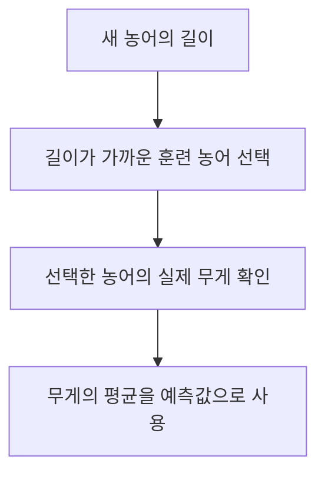
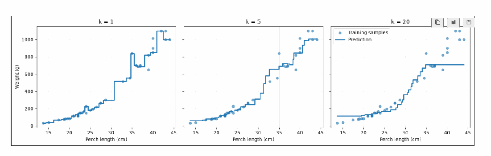

# Day 1. k-최근접 이웃 회귀

> 농어의 길이로 무게를 예측하면서 KNN 회귀의 평균 계산, 회귀 평가 지표, 이웃 수와 모델 복잡도의 관계를 정리한다.

## 1. 분류와 회귀 (1-2쪽)

<strong>분류(Classification)</strong>는 도미나 빙어처럼 범주를 예측하고, <strong>회귀(Regression)</strong>는 농어의 무게처럼 연속적인 숫자를 예측한다.
분류의 0과 1은 종류를 구분하는 이름표이며, 회귀의 무게는 크기 자체에 의미가 있다.

집의 면적으로 가격을, 이동 거리로 시간을 예측하는 것도 회귀의 예다.
두 작업 모두 입력과 정답을 함께 사용하는 지도학습이지만, 분류는 범주가 맞는지 확인하고 회귀는 숫자가 실제값에서 얼마나 벗어났는지 평가한다.

<strong>KNN 회귀(k-Nearest Neighbors Regression)</strong>는 새 입력과 가까운 훈련 샘플을 찾고 이웃의 타깃값을 평균 내어 예측한다.
예를 들어 가까운 이웃의 무게가 100g, 80g, 60g이면 예측은 `(100+80+60)÷3=80g`이다.

새 농어의 무게는 아직 모르므로 이웃을 찾을 때 사용하지 않는다.
길이로 이웃을 선택한 뒤, 이미 알고 있는 이웃의 무게를 평균 낸다.

## 2. 데이터와 예측 계산 (3-9쪽)

농어 56마리를 훈련 42마리와 테스트 14마리로 나눈다.
입력은 길이 하나이지만 모델 입력의 형태(Shape)는 행이 샘플, 열이 특성인 `(42, 1)`이다.
정답 무게는 `(42,)`인 1차원 배열로 표현한다.

| 새 입력 | 이웃 길이 | 이웃의 실제 무게 |
| --- | --- | --- |
| 30cm | 28.7, 27.5, 27.5, 32.8, 26.5cm | 300, 260, 265, 514, 218g |

기본 이웃 5개의 예측 무게는 `(300+260+265+514+218)÷5=311.4g`이다.
입력 특성 하나를 2차원 배열로 표현하더라도 특성 수가 두 개가 되는 것은 아니다.

## 3. 결정계수와 평균 절댓값 오차 (10-14쪽)

<strong>결정계수(Coefficient of Determination, R²)</strong>는 평가 데이터의 실제값 평균으로만 예측할 때와 비교해 모델의 제곱오차가 얼마나 줄었는지 나타낸다.

$$R^2=1-\frac{\sum(y_i-\hat{y}_i)^2}{\sum(y_i-\bar{y})^2}$$

실제값은 yi, 예측값은 ŷi, 평가 데이터의 실제값 평균은 ȳ다. 분자는 모델의 제곱오차 합, 분모는 평균 예측의 제곱오차 합이다. R²=1은 완벽한 예측, 0은 평균 예측과 같은 제곱오차, 음수는 평균 예측보다 큰 제곱오차를 뜻한다.

실제 무게가 100, 200, 300g이고 예측이 110, 190, 290g이면 평균 예측의 제곱오차 합은 20,000, 모델의 제곱오차 합은 300이다. 따라서 `R²=1-300÷20,000=0.985`다. 이는 분류 정확도가 98.5%라는 의미가 아니다.

<strong>평균 절댓값 오차(Mean Absolute Error, MAE)</strong>는 실제값과 예측값의 차이를 절댓값으로 만든 뒤 평균 낸다. 위 예시의 오차는 각각 10g이므로 MAE는 10g이다. 방향이 다른 오차가 서로 상쇄되지 않으며, 예측값과 같은 단위로 평균 차이를 읽을 수 있다.

| 지표 | 무엇을 보여주는가 | 좋은 방향 |
| --- | --- | --- |
| R² | 평균 예측 대비 제곱오차의 상대적 감소 | 1에 가까움 |
| MAE | 실제값과 예측값의 평균 차이 | 0에 가까움 |

강의의 k=5 실험에서 테스트 R²는 약 0.9928, MAE는 약 19.16g이다. 이는 평균 차이이므로 모든 농어의 오차가 19.16g 이내라는 뜻은 아니다.

R²의 분모에 들어가는 평균은 점수를 계산하는 데이터의 실제 타깃 평균이다. 따라서 테스트 R²는 테스트 농어의 평균을 기준으로 비교한다. 모델이 훈련 데이터의 평균을 예측했다고 해서 테스트 R²까지 반드시 0이 되는 것은 아니다.

## 4. 이웃 수와 모델 복잡도 (15-26쪽)

<strong>과대적합(Overfitting)</strong>은 훈련 데이터의 세부 차이까지 지나치게 반영해 새로운 데이터에서 성능이 떨어지는 상태다. <strong>과소적합(Underfitting)</strong>은 모델이 너무 단순해 훈련 데이터의 중요한 관계도 충분히 반영하지 못하는 상태다.

KNN에서 k를 줄이면 소수 이웃의 영향을 많이 받아 예측이 민감해진다. k를 늘리면 더 넓은 이웃을 평균 내므로 예측이 완만해지지만 중요한 변화도 묻힐 수 있다.

원본 PDF 25쪽의 그림은 k=1, 5, 20의 예측선을 비교한다. 입력이 달라져도 선택한 이웃이 같으면 평균도 같고, 이웃이 바뀌는 시점에 값이 바뀌므로 예측선은 계단형이다.

| 이웃 수 | 훈련 R² | 테스트 R² | 테스트 MAE |
| --- | ---: | ---: | ---: |
| 1 | 0.9853 | 0.9913 | 22.69g |
| 3 | 0.9805 | 0.9746 | 35.42g |
| 5 | 0.9699 | 0.9928 | 19.16g |
| 10 | 0.9616 | 0.9738 | 39.24g |
| 20 | 0.8613 | 0.8785 | 76.44g |
| 42 | 0.0000 | -0.0551 | 291.16g |

k=42는 훈련 샘플 전체의 평균을 모든 입력에 예측한다. 테스트 평균은 훈련 평균과 다를 수 있어 테스트 R²는 0이 아니라 음수가 될 수 있다. 훈련 점수가 높아졌다는 사실만으로 새 데이터의 성능이 좋아졌다고 판단하지 않는다.

이 데이터에서 k=1의 훈련 R²는 약 0.9853이다. 같은 길이를 가진 농어의 실제 무게가 서로 다르기 때문에 길이 하나만으로 모든 농어를 완전히 구분할 수 없다. 가까운 이웃이 하나여도 훈련 점수가 반드시 1이 되는 것은 아니다.

이 실험에서 k=5의 테스트 R²가 비교한 값 중 가장 높고 MAE가 가장 낮다. 이는 이번 분할과 데이터에서 관찰한 결과이며 다른 데이터에서도 k=5가 최적이라는 뜻은 아니다.

일반적으로 k가 작을수록 개별 데이터에 더 민감하고, k가 클수록 많은 이웃을 평균 내어 복잡도가 낮아진다. 과대적합이 의심되면 k를 늘려 보고, 중요한 관계를 반영하지 못하는 과소적합이라면 k를 줄이는 방향을 시도할 수 있다. 실제 성능 향상 여부는 평가로 확인해야 한다.

이 표는 설정에 따른 변화를 관찰한 실험이다. 실제 모델 선택에는 검증 데이터나 교차 검증을 사용하고, 테스트 세트는 최종 성능 확인에 사용한다.

## 핵심 개념 비교표

| 구분 | 차이 |
| --- | --- |
| KNN 분류와 회귀 | 이웃 클래스의 다수결과 이웃 숫자값의 평균 |
| R²와 MAE | 평균 예측 대비 상대적 제곱오차와 원래 단위의 평균 오차 |
| 작은 k와 큰 k | 개별 샘플에 민감한 예측과 더 넓은 범위를 평균 낸 예측 |
| 과대적합과 과소적합 | 훈련 데이터의 세부까지 지나치게 반영하는 상태와 중요한 관계를 충분히 반영하지 못하는 상태 |

## 최종 정리

- 회귀는 범주가 아니라 무게 같은 연속적인 수치를 예측한다.
- KNN 회귀는 입력이 가까운 이웃의 타깃을 평균 내어 예측한다.
- 특성이 하나여도 모델 입력은 샘플과 특성으로 나뉜 2차원 형태다.
- R²는 평균 예측과 비교하고 MAE는 원래 단위의 평균 오차를 보여준다.
- k가 작으면 예측이 민감하고, 크면 예측이 더 완만해진다.
- 모델과 설정은 검증 데이터로 비교하고 테스트 데이터로 최종 평가한다.
