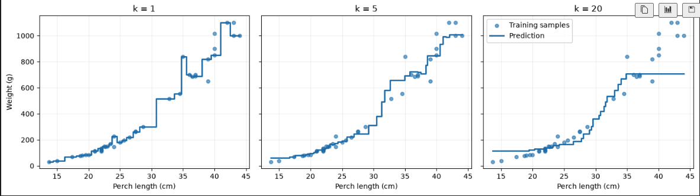
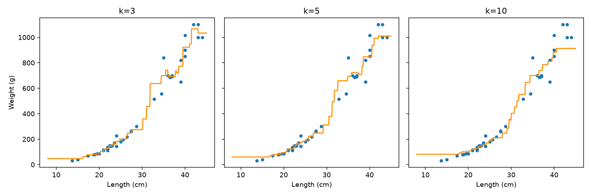

# 7. 예측선과 이웃 수 해석

학습 범위: 24에서 28쪽

## 촘촘한 길이에서 예측값 그리기

```python
x_grid = np.linspace(train_input.min(), train_input.max(), 500).reshape(-1, 1)
fig, axes = plt.subplots(1, 3, figsize=(14, 4), sharex=True, sharey=True)
for ax, k in zip(axes, [1, 5, 20]):
    model = KNeighborsRegressor(n_neighbors=k)
    model.fit(train_input, train_target)
    ax.scatter(train_input[:, 0], train_target, alpha=0.6)
    ax.step(x_grid[:, 0], model.predict(x_grid), where='mid')
    ax.set_title(f'k={k}')
    ax.set_xlabel('Length (cm)')
axes[0].set_ylabel('Weight (g)')
plt.tight_layout()
plt.show()
```

`linspace()`는 훈련 길이 범위를 500개 지점으로 나눔. 이 지점은 새로 측정한 농어가 아니라 예측선을 그리기 위한 입력. `zip()`으로 각 그래프와 k를 대응시키고 `step()`으로 계단형 선을 그림.



k=1은 한 농어의 무게를 그대로 사용해 변동이 크고, k=5는 주변 평균을 사용. k=20은 더 넓은 범위를 평균해 특히 큰 농어의 무게를 충분히 따라가지 못하는 모습.

선이 계단형인 이유는 길이를 조금 바꿔도 이웃 집합이 같으면 평균도 그대로이기 때문. 이웃이 바뀌는 지점에서만 예측값이 바뀜.



반복문의 후보를 `[3, 5, 10]`으로 바꾸면 같은 방식으로 비교할 수 있음. 선이 완만하다는 것만으로 좋은 모델이라고 판단하지 말고 R²와 MAE, 주요 관계를 반영하는지 함께 확인.

분류는 가까운 이웃의 다수결, 회귀는 이웃 타깃의 평균을 사용. 다음에는 훈련 범위보다 큰 농어에서도 이웃 평균이 계속 적절한지 확인하고 관계식으로 예측하는 모델을 배움.

[이전](06-이웃-수별-평가-비교.md) | [전체 목차](../README.md)
