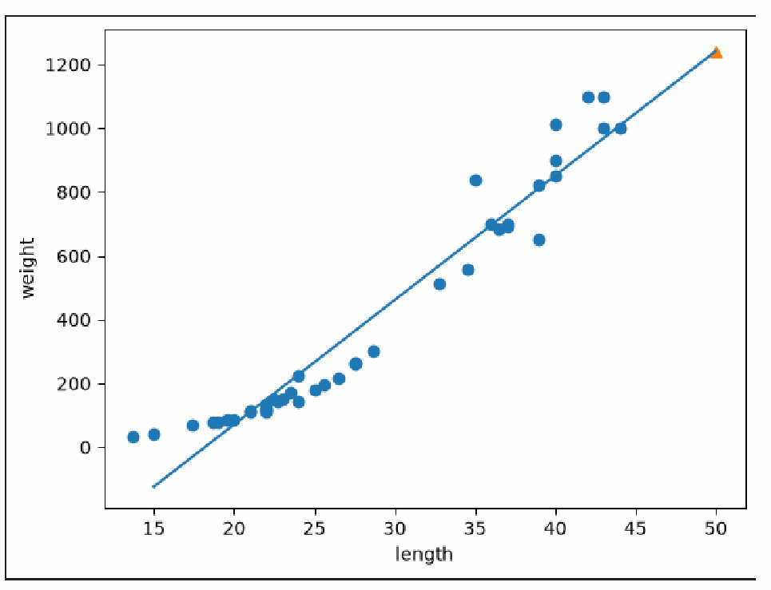
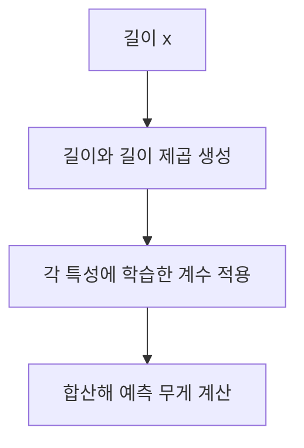

# Day 1. 선형 회귀와 다항 회귀

> KNN 회귀가 훈련 범위 밖에서 보이는 한계를 살펴보고, 직선과 곡선으로 길이와 무게의 관계를 표현한다.

## 1. KNN 회귀의 범위 한계 (1-6쪽)

KNN 회귀는 가까운 훈련 샘플의 타깃을 평균 내어 예측한다. 훈련 길이의 최댓값이 44cm인 데이터에서 50cm와 100cm 농어는 모두 가장 긴 이웃 3마리를 참고하므로 같은 약 1,033g을 예측한다.

길이가 더 커져도 이웃이 같으면 평균도 같다. KNN은 훈련 사례의 평균을 사용하기 때문에 훈련 범위 밖의 증가 관계를 계속 연장하지 못한다.

## 2. 직선으로 예측하는 선형 회귀 (6-11쪽)

<strong>선형 회귀(Linear Regression)</strong>는 입력과 타깃의 관계를 직선으로 표현하는 모델이다. 길이 x에 대한 예측 무게 ŷ는 기울기 a와 절편 b로 계산한다.

$$\hat{y}=ax+b$$

기울기는 길이가 1cm 증가할 때 예측 무게가 얼마나 변하는지, 절편은 길이 0에서 직선의 예측값을 나타낸다. 이 값들은 훈련 데이터에서 학습한 <strong>모델 파라미터(Model Parameter)</strong>다.

강의 예제에서 기울기는 약 39.017, 절편은 약 -709.019다. 50cm를 입력하면 `39.017×50-709.019≈1,241.8g`이다. 반올림한 계수를 쓰면 실제 모델 결과와 끝자리가 조금 다를 수 있다.

기울기 39.017은 이 직선 모델에서 길이가 1cm 증가하면 예측 무게가 약 39g 증가한다는 뜻이다. 절편은 직선의 위치를 결정하지만, 길이 0cm의 물고기에 대한 믿을 만한 실제 측정값으로 해석해서는 안 된다.

선형 회귀에서는 훈련 데이터로 계산한 계수와 절편을 바탕으로 새 값을 예측한다. 가까운 사례를 보관하고 새 입력마다 이웃을 찾는 KNN과 예측에 사용하는 정보가 다르다. 사용자가 정한 이웃 수 k는 KNN의 하이퍼파라미터이고, 데이터로부터 학습한 기울기와 절편은 선형 회귀의 모델 파라미터다.

원본 PDF 10쪽의 직선은 학습한 관계를, 삼각형은 50cm의 예측값을 나타낸다. 직선을 연장하면 훈련 범위 밖도 계산할 수 있지만 정확성이 보장되지는 않는다.

## 3. 곡선을 표현하는 다항 회귀 (11-17쪽)

농어는 길이가 커질수록 무게가 증가하는 폭도 커져 직선 하나로 표현하기 어려울 수 있다. <strong>다항 회귀(Polynomial Regression)</strong>는 기존 길이를 가공한 길이² 같은 특성을 추가해 곡선 관계를 표현한다.

$$\hat{y}=a x^2+bx+c$$

x는 길이, x²는 길이의 제곱, a와 b는 학습한 계수, c는 절편이다. 길이를 제곱하지만 계수들은 서로 곱해지거나 제곱되지 않으므로 계수에 대해서는 선형 회귀다.

50cm를 예측할 때도 훈련과 같은 순서인 `[길이², 길이]`가 필요하다. 예제의 다항 회귀 예측은 약 1,574g이며, 입력 특성을 확장하면 표현력이 늘지만 모든 데이터에서 예측 성능이 반드시 좋아지는 것은 아니다.

예를 들어 길이 40cm의 두 특성은 `[1600, 40]`이다. 학습한 계수 약 1.0143, -21.5579와 절편 116.0502를 넣으면 `1.0143×1600-21.5579×40+116.0502≈876.61g`이다. 모델의 반올림 전 계수를 사용한 예측은 약 876.66g이다.

두 계수는 각각 길이²과 길이에 대응한다. 입력 순서를 바꾸면 같은 숫자라도 다른 계수가 곱해지므로 다른 예측이 나온다. 데이터를 가공할 때와 새 샘플을 예측할 때 동일한 변환 순서를 유지한다.

## 4. 세 모델의 예측 비교 (18-24쪽)

| 농어 길이 | KNN k=3 | 직선 회귀 | 2차 다항 회귀 | 훈련 범위 |
| --- | ---: | ---: | ---: | --- |
| 30cm | 275.00g | 461.50g | 382.21g | 안 |
| 40cm | 921.67g | 851.67g | 876.66g | 안 |
| 50cm | 1,033.33g | 1,241.84g | 1,573.98g | 밖 |
| 60cm | 1,033.33g | 1,632.01g | 2,474.17g | 밖 |

훈련 범위의 끝에서 멀어질수록 직선과 곡선의 예측은 더 크게 벌어진다. KNN은 같은 큰 이웃을 반복해서 참고하고, 직선 회귀는 일정한 증가량, 다항 회귀는 곡선 형태를 이어 간다.

같은 분할에서 직선 회귀의 훈련 R²는 0.9398, 테스트 R²는 0.8248이다. 다항 회귀는 각각 0.9707, 0.9776이다. 이 실험에서는 두 점수가 모두 높아졌지만, 테스트 점수가 훈련 점수보다 조금 높다는 사실만으로 과소적합을 단정할 수는 없다.

세 모델은 서로 다른 방식으로 예측하므로 훈련 범위 밖에서 차이가 커진다. 50cm와 60cm 예시의 타깃이 없으면 이 표만으로 어느 모델이 더 정확한지는 판단할 수 없다.

## 5. 잔차로 예측 확인하기 (25-29쪽)

<strong>잔차(Residual)</strong>는 실제값에서 예측값을 뺀 값이다. 잔차가 양수면 실제보다 가볍게, 음수면 실제보다 무겁게 예측한 것이다. 잔차 그래프에서 길이에 따라 오차가 특정 방향으로 반복되면 모델이 관계를 충분히 반영하지 못했을 가능성을 살펴볼 수 있다.

| 같은 테스트 데이터 | 직선 회귀 | 다항 회귀 |
| --- | ---: | ---: |
| R² | 0.8248 | 0.9776 |
| MAE | 94.46g | 37.77g |

예를 들어 실제 무게가 5.9g인 8.4cm 농어에 직선 회귀가 -381.27g을 예측하면 잔차는 `5.9-(-381.27)=387.17g`이다. 다항 회귀 예측이 6.53g이면 잔차는 -0.63g이다. 이번 데이터에서는 다항 회귀가 더 잘 맞지만, 테스트 샘플이 14개이므로 모든 길이에서 성능이 보장되지는 않는다.

직선은 길이가 작아지는 쪽으로도 그대로 연장되므로 실제로 불가능한 음수 무게를 예측할 수 있다. 점수가 높아도 개별 예측과 잔차를 함께 살펴야 하는 이유다. 반대로 다항 회귀 역시 관찰하지 않은 범위에서 곡선이 빠르게 커질 수 있으므로 입력 범위를 확인해야 한다.

## 핵심 개념 비교표

| 구분 | KNN 회귀 | 선형 회귀 | 다항 회귀 |
| --- | --- | --- | --- |
| 예측 기준 | 가까운 이웃의 평균 | 직선 관계식 | 가공한 특성을 사용하는 관계식 |
| 범위 밖 입력 | 같은 이웃이면 같은 예측 | 직선을 연장해 계산 | 곡선 관계식으로 계산 |
| 주의점 | 훈련 타깃 범위를 넘기 어려움 | 곡선 관계를 충분히 반영하지 못할 수 있음 | 범위 밖의 곡선 예측도 검증이 필요함 |

## 최종 정리

- KNN은 이웃이 바뀌지 않으면 입력이 달라져도 같은 평균을 예측한다.
- 선형 회귀는 학습한 기울기와 절편을 이용해 값을 계산한다.
- 길이의 제곱을 특성으로 추가하면 곡선 형태의 관계를 표현할 수 있다.
- 예측할 때는 훈련할 때와 같은 특성의 개수와 순서를 사용한다.
- R²와 MAE, 잔차를 함께 보면 전체 성능과 개별 예측의 차이를 살펴볼 수 있다.
- 훈련 범위 밖에서 계산이 가능하더라도 그 정확성은 별도로 검증해야 한다.
