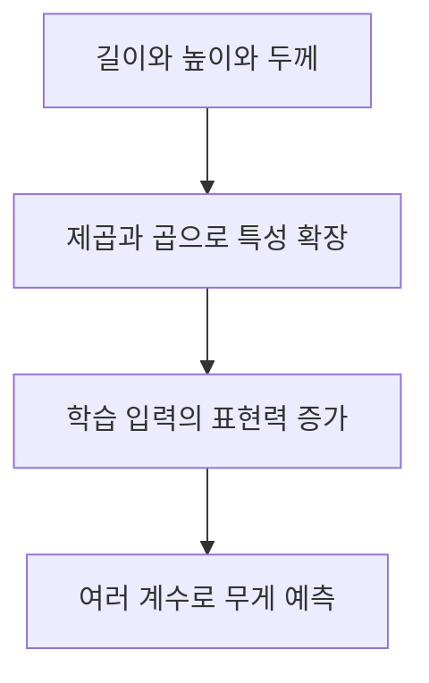
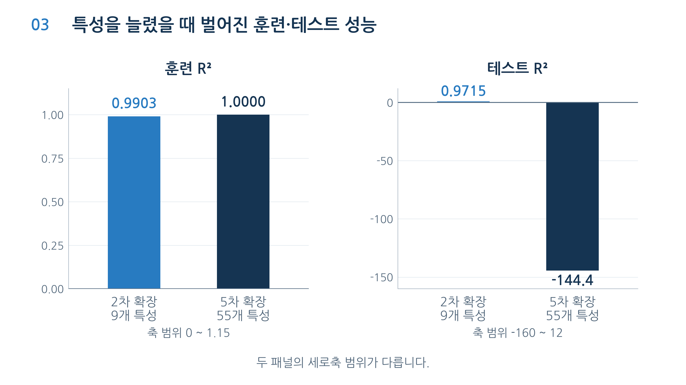
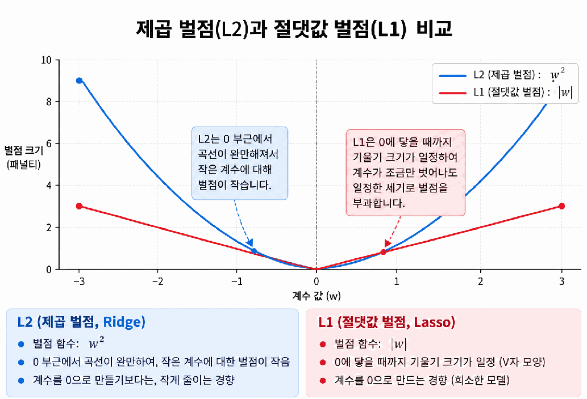
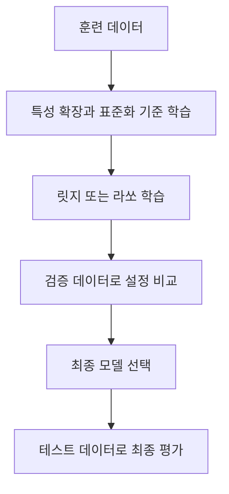
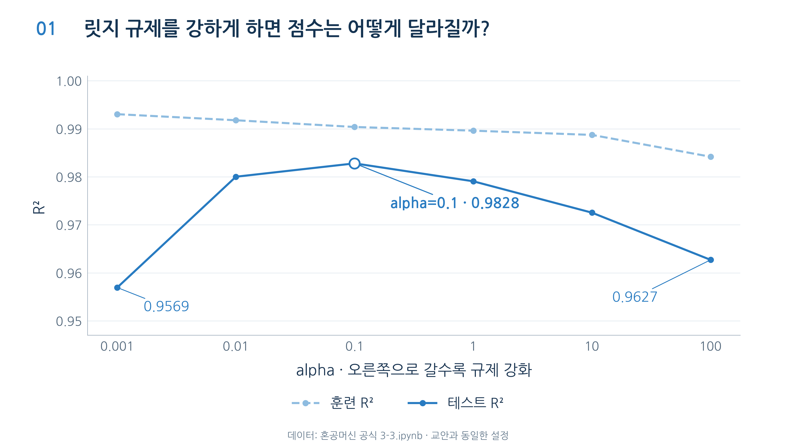

# Day 1. 특성 공학과 규제

> 여러 특성을 조합해 모델의 표현력을 높이고, 규제로 과대적합을 억제하는 원리를 살펴본다.

## 1. 다중 회귀와 특성 확장 (1-8쪽)

<strong>다중 회귀(Multiple Regression)</strong>는 여러 입력 특성을 사용해 하나의 숫자를 예측하는 선형 회귀다. 농어의 길이, 높이, 두께 각각에 계수를 곱하고 더해 무게를 예측할 수 있다.

<strong>특성 공학(Feature Engineering)</strong>은 기존 특성을 가공하거나 조합해 새로운 입력을 만드는 작업이다. 길이²이나 길이×높이 같은 특성은 새로 측정한 값이 아니라 기존 값을 변환한 결과다.

예를 들어 입력이 `[2, 3]`이면 2차 특성 확장으로 `2, 3, 4, 6, 9`를 만들 수 있다. 각각 원래 값 두 개, 2², 2×3, 3²이다. 농어의 특성 3개를 2차까지 확장하면 9개, 5차까지 확장하면 55개가 된다.

상수항 1을 특성 목록에서 제외하더라도 회귀 모델이 학습하는 절편이 사라지는 것은 아니다. 훈련과 테스트에 같은 특성 확장 규칙과 같은 열 순서를 적용해야 계수가 의도한 특성에 곱해진다.

## 2. 특성 확장과 과대적합 (8-12쪽)

특성이 늘면 복잡한 관계를 표현할 수 있지만 훈련 데이터의 우연한 차이까지 지나치게 반영할 수 있다. <strong>과대적합(Overfitting)</strong>은 훈련 데이터에는 잘 맞지만 새로운 데이터에 대한 성능이 떨어지는 상태다.

| 설정 | 훈련 샘플 | 특성 수 | 훈련 R² | 테스트 R² |
| --- | ---: | ---: | ---: | ---: |
| 2차 특성 | 42 | 9 | 0.9903 | 0.9715 |
| 5차 특성 | 42 | 55 | 약 1.0000 | 약 -144.4 |

55개 특성에서는 훈련 점수가 거의 1이지만 테스트 R²가 큰 음수다. 이는 테스트 실제값의 평균으로만 예측하는 기준보다 제곱오차가 컸다는 뜻이다. 특성을 늘리는 것만으로 일반화 성능이 좋아지는 것은 아니다.

훈련 샘플은 42개인데 학습할 특성은 55개이므로, 훈련 사례의 세부 차이까지 모델이 맞추기 쉬워진다. 특성 간 관계와 계산 환경에 따라 규제 없는 모델의 정확한 점수는 달라질 수 있다. 핵심은 특정 음수의 크기보다 훈련 성능과 테스트 성능의 큰 차이다.

> 9-11쪽 관련 그림: 특성 55개로 훈련 점수가 거의 1이 되어도 테스트 점수는 크게 떨어진다. 두 패널의 세로축 범위가 다르므로 막대 높이와 수치를 함께 읽는다.

## 3. 규제와 표준화 (12-19쪽)

<strong>규제(Regularization)</strong>는 모델이 훈련 데이터에 지나치게 맞춰지지 않도록 학습 기준에 계수 크기의 벌점을 더하는 방법이다. 모델은 예측 오차와 벌점을 함께 줄이도록 계수를 조정한다.

$$\text{학습 기준}=\text{예측 오차}+\alpha \times \text{계수 벌점}$$

α는 규제 강도다. 예를 들어 α를 적용한 벌점까지 계산했을 때 모델 A의 예측 오차가 10, 벌점이 10이면 합계는 20이고, 모델 B가 각각 15와 0.9이면 합계는 15.9다. 이 예시에서는 B의 예측 오차가 더 크더라도 전체 학습 기준은 더 작다.

규제 전에는 특성별 수치 범위를 맞추기 위해 <strong>표준화(Standardization)</strong>를 적용한다. 평균과 표준편차는 훈련 데이터에서만 구하고 테스트 데이터에도 같은 기준을 적용해야 평가 정보가 학습에 섞이는 데이터 누수(Data Leakage)를 피할 수 있다.

서로 단위가 다른 특성은 계수 크기도 다른 기준으로 표현된다. 표준화는 각 특성의 평균과 퍼짐을 기준으로 스케일을 맞춰, 단위 차이가 벌점에 영향을 주는 문제를 줄인다. 표준화 자체는 타깃인 농어의 무게를 바꾸는 작업이 아니다.

## 4. 릿지와 라쏘 (19-30쪽)

<strong>릿지 회귀(Ridge Regression)</strong>는 계수의 제곱합에 벌점을 주는 L2 규제를 사용한다. <strong>라쏘 회귀(Lasso Regression)</strong>는 계수의 절댓값 합에 벌점을 주는 L1 규제를 사용한다.

원본 PDF 25쪽의 그래프에서 파란 곡선은 제곱 벌점, 빨간 선은 절댓값 벌점이다. 릿지는 계수를 전반적으로 줄이는 경향이 있고 라쏘는 일부 계수를 정확히 0으로 만들 수 있다.

| 설정 예시 | 훈련 R² | 테스트 R² | 해석 |
| --- | ---: | ---: | --- |
| 릿지, α=0.1 | 0.9904 | 0.9828 | 계수를 제한하며 높은 테스트 점수 |
| 라쏘, α=10 | 0.9888 | 0.9830 | 55개 계수 중 48개가 0 |

라쏘 실험의 최대 반복 횟수는 10,000이다. 계산이 충분히 진행되지 않으면 계수와 점수가 달라질 수 있으므로 모델을 비교할 때 같은 설정을 유지하고 학습 경고를 확인한다.

라쏘에서 0이 된 특성은 현재 모델의 예측에 직접 기여하지 않는다는 뜻이다. 입력 열이 삭제되거나 해당 특성이 모든 문제에서 불필요하다는 뜻은 아니다. 릿지와 라쏘는 벌점 방식이 달라 α 숫자만으로 규제 강도를 서로 직접 비교할 수 없다.

## 5. 규제 강도와 평가 (20-37쪽)

α가 작으면 벌점이 약해 과대적합 위험이 커지고, 너무 크면 필요한 관계까지 억제해 과소적합(Underfitting)이 생길 수 있다. 라쏘 실험에서 α=100일 때 0인 계수는 52개였지만 테스트 R²는 0.9091로 낮아졌다.

| 라쏘 α | 0인 계수 수 | 테스트 R² |
| --- | ---: | ---: |
| 0.1 | 42 | 0.9824 |
| 1 | 47 | 0.9802 |
| 10 | 48 | 0.9830 |
| 100 | 52 | 0.9091 |

이 결과는 같은 데이터와 최대 반복 횟수 10,000이라는 실험 조건에서 얻었다. 0인 계수의 수가 많다고 성능이 반드시 좋아지는 것은 아니며, 데이터와 설정이 달라지면 선택되는 계수도 달라질 수 있다.

동일한 입력에서 비교한 릿지와 라쏘의 계수 크기는 각각 약 146.03과 175.88이었다. 계수 크기는 특성 간 관계와 모델 설정에도 영향을 받으므로 숫자 하나만으로 예측 성능의 우열을 정하지 않는다.

강의의 비교는 테스트 점수 변화를 관찰하는 실습이다. 실제로는 **훈련 데이터**로 전처리 기준과 계수를 학습하고, **검증 데이터**로 모델과 α를 선택한 뒤, **테스트 데이터**로 최종 성능을 평가한다.

> 21-23쪽 관련 그림: 가로축은 로그 눈금의 alpha다. 규제가 너무 약하거나 강할 때보다 중간 설정에서 테스트 점수가 높게 나타난다. 이 그래프는 강도에 따른 변화를 보여 주며 실제 설정 선택에는 검증 데이터를 사용한다.

## 핵심 개념 비교표

| 구분 | 핵심 차이 |
| --- | --- |
| 다중 회귀와 특성 공학 | 여러 입력을 사용하는 모델과 입력을 가공하는 작업 |
| 특성 확장과 규제 | 표현력을 높이는 작업과 계수에 벌점을 주는 작업 |
| 릿지와 라쏘 | 계수 제곱합에 벌점을 주는 L2와 절댓값 합에 벌점을 주는 L1 |
| 검증과 테스트 | 모델 설정을 고르는 데이터와 최종 성능을 확인하는 데이터 |

## 최종 정리

- 다중 회귀는 여러 특성을 이용해 하나의 수치를 예측한다.
- 특성 공학은 기존 입력을 조합해 다양한 관계를 표현하게 한다.
- 특성이 지나치게 많으면 훈련 데이터에 과대적합할 수 있다.
- 규제는 예측 오차와 계수의 벌점을 함께 고려한다.
- 표준화 기준은 훈련 데이터에서만 구하고 평가 데이터에도 적용한다.
- 릿지는 계수를 줄이고 라쏘는 일부 계수를 0으로 만들 수 있다.
- 규제 강도는 검증 데이터로 선택하고 테스트 데이터는 최종 평가에 사용한다.
