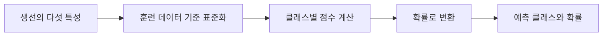
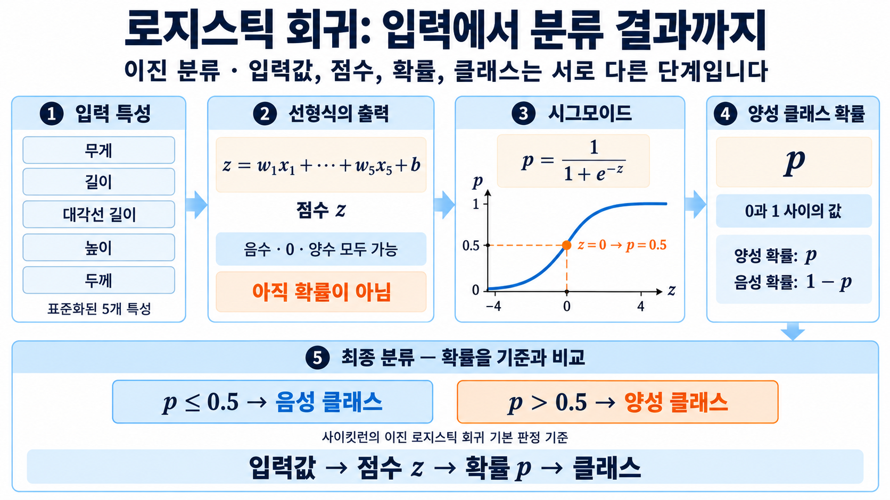
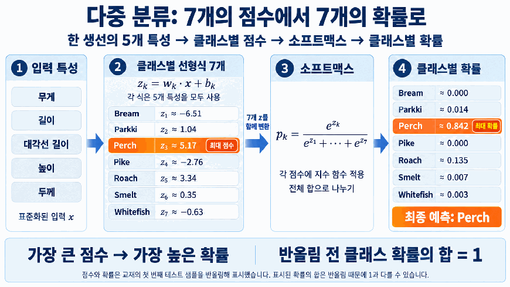

# Day 2. 로지스틱 회귀

> 로지스틱 회귀는 입력 특성으로 분류 점수를 구하고, 이를 클래스에 속할 확률로 바꾸는 모델이다.

## 1. 분류 결과와 확률 (1-5쪽)

**분류(Classification)** 는 데이터가 어떤 종류에 속하는지 예측하는 작업이다.  
생선의 무게, 길이, 높이와 너비를 이용해 생선의 종류를 맞히는 문제가 여기에 해당한다.  
정답인 생선 종류를 클래스(Class)라고 한다.

최근접 이웃 분류에서는 가까운 이웃이 어떤 클래스인지 살펴 예측한다.  
예를 들어 가장 가까운 생선 3마리 중 2마리가 농어이고 1마리가 바퀴라면, 농어의 비율은 2/3이다.  
다만 이웃이 3개이면 가능한 비율이 0, 1/3, 2/3, 1로 제한된다.

로지스틱 회귀(Logistic Regression)는 이름에 회귀가 들어가지만 **분류 모델**이다.  
각 클래스에 대한 점수를 계산한 뒤 확률로 변환하므로 클래스와 함께 확률을 확인할 수 있다.

## 2. 데이터 준비와 표준화 (2-4쪽)

생선 데이터에는 무게, 길이, 대각선 길이, 높이, 너비의 다섯 특성과 일곱 생선 종류가 있다.  
특성마다 단위와 크기 범위가 다르므로 훈련 데이터에서 평균과 표준편차를 구해 표준화(Standardization)한다.

테스트 데이터에도 훈련 데이터에서 구한 같은 기준을 적용한다.  
테스트 데이터로 표준화 기준을 새로 학습하면 평가 과정에 테스트 정보가 섞일 수 있다.

## 3. 이진 분류와 시그모이드 (6-15쪽)

**이진 분류(Binary Classification)** 는 두 클래스 중 하나를 선택하는 문제다.  
도미와 빙어만 골라 학습하는 경우, 특성에 가중치를 곱해 더하고 절편을 더한 값이 분류 점수 `z`가 된다.

$$
z = w_1x_1 + w_2x_2 + \cdots + w_5x_5 + b
$$

여기서 $x$는 각 입력 특성, $w$는 특성에 곱하는 계수, $b$는 절편이다.  
점수 `z`는 음수부터 양수까지 제한 없이 나올 수 있어 그대로는 확률로 읽을 수 없다.

시그모이드 함수(Sigmoid Function)는 `z`를 0과 1 사이의 값으로 바꾼다.  
이진 분류에서는 한 클래스의 확률을 구하면 나머지 클래스의 확률은 1에서 그 값을 뺀 것이다.

$$
p = \frac{1}{1+e^{-z}}
$$

| 점수 z | 약 -4 | 약 -2 | 0 | 약 2 | 약 4 |
| --- | --- | --- | --- | --- | --- |
| 양성 클래스 확률 p | 0.018 | 0.119 | 0.500 | 0.881 | 0.982 |

`z`가 커질수록 양성 클래스의 확률이 커진다.  
확률이 0.5보다 크면 양성 클래스를 예측하고, 이 실습에서는 0.5일 때 음성 클래스로 판단한다.  
어떤 클래스가 양성인지와 출력 열의 순서는 클래스 목록을 확인해야 한다.

### 계수 해석 (13-15쪽)

계수는 다른 특성이 일정할 때 해당 특성이 점수에 미치는 방향과 크기를 나타낸다.  
예를 들어 표준화된 무게의 계수가 약 -0.4045라면, 다른 값이 같을 때 무게 특성이 1 증가하면 `z`는 약 0.4045 감소한다.  
이는 **확률이 0.4045만큼 감소한다는 뜻은 아니다**. 확률의 변화량은 시그모이드 곡선에서 현재 점수의 위치에 따라 달라진다.

실습에서 표준화된 무게만 -1, 0, +1만큼 바꾸었을 때 빙어 확률은 각각 0.982, 0.973, 0.960이었다.  
세 확률이 모두 0.5보다 커서 예측 클래스는 빙어로 같았다.  
무게를 +2만큼 바꾸면 점수는 약 0.809 감소하지만 확률은 같은 비율로 변하지 않는다.

> 8쪽 관련 그림: 입력의 가중합으로 점수 z를 구하고 시그모이드로 양성 확률을 계산한다. 점수의 크기와 확률의 크기는 같은 척도가 아니다.

## 4. 다중 분류와 소프트맥스 (21-27쪽)

**다중 분류(Multiclass Classification)** 는 세 개 이상의 클래스 중 하나를 고른다.  
일곱 종류의 생선을 구분하는 모델은 클래스마다 점수를 하나씩 계산한다.  
특성이 다섯 개이므로 계수는 7행 5열이며 절편은 클래스별로 하나씩 7개다.

소프트맥스 함수(Softmax Function)는 클래스별 점수를 합이 1인 확률로 바꾼다.  
각 점수에 지수 함수를 적용해 양수로 만든 뒤, 전체 지수값의 합으로 나눈다.

$$
p_j = \frac{e^{z_j}}{\sum_k e^{z_k}}
$$

$z_j$는 클래스 $j$의 점수이고 $p_j$는 그 클래스의 확률이다.  
가장 높은 확률의 클래스를 최종 예측으로 사용한다.

> 27쪽: 모든 클래스의 점수에 지수 함수를 적용하고 그 합으로 나눈다. 가장 높은 점수를 가진 농어가 가장 높은 확률을 얻으며, 반올림 전 확률의 합은 1이다.

실습에서는 규제의 강도를 조절하는 `C`를 20으로, 최대 반복 횟수를 1000으로 설정했다.  
훈련 정확도는 약 0.933, 테스트 정확도는 약 0.925였다.  
`C`가 클수록 규제가 약해지며, 반복 횟수는 최적화가 충분히 진행될 기회를 조절한다.

## 5. 확률의 크기와 예측의 차이 (28-31쪽)

확률이 높다는 것은 모델이 해당 예측에 더 큰 확률을 부여했다는 뜻이다.  
반드시 그 비율만큼 실제로 정답이라는 보장은 아니므로, 확률과 정확도를 같은 개념으로 취급하지 않는다.

[추가 설명] 모든 클래스 점수에 같은 양의 값을 곱하면 순서는 유지되지만 점수 사이의 간격은 달라진다. 실습에서 점수의 배율을 낮추자 가장 높은 농어 확률이 약 0.842에서 0.225까지 낮아졌지만, 가장 높은 클래스는 바뀌지 않았다. 확률값이 달라져도 예측 클래스가 그대로일 수 있다.

## 핵심 개념 비교표

| 구분 | 최근접 이웃 분류 | 로지스틱 회귀 |
| --- | --- | --- |
| 기준 | 가까운 샘플의 클래스 비율 | 입력 특성으로 계산한 점수 |
| 확률 | 이웃 수에 따라 가능한 값이 제한됨 | 점수를 함수로 변환 |
| 이진과 다중 분류 | 이웃의 클래스별 비율 | 시그모이드 또는 소프트맥스 |

## 핵심 정리

- 분류는 입력 데이터가 속할 클래스를 예측하며, 확률은 각 클래스에 부여한 정도를 보여준다.
- 로지스틱 회귀는 특성과 계수의 선형 결합으로 분류 점수를 만든다.
- 표준화 기준은 훈련 데이터에서 구하고 테스트 데이터에도 동일하게 적용한다.
- 이진 분류의 시그모이드는 점수를 0과 1 사이의 확률로 변환한다.
- 다중 분류의 소프트맥스는 클래스별 점수를 합이 1인 확률로 변환한다.
- 계수는 점수의 변화 방향을 나타내며 확률 변화량과는 다르다.
- 모델이 낸 높은 확률과 실제 정답률은 구분해서 해석한다.
