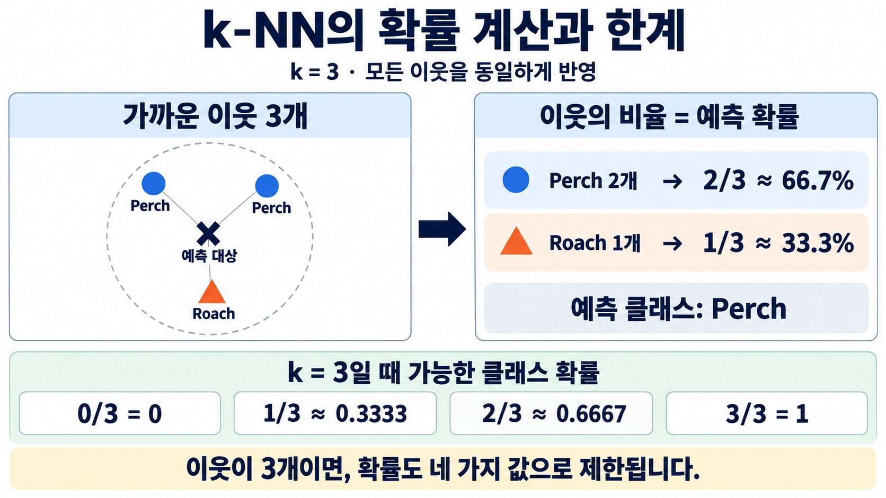

# 1. 생선 데이터와 최근접 이웃 확률

학습 범위: 1에서 6쪽

생선의 측정값으로 종류를 분류하고, 가까운 이웃을 이용해 클래스별 확률을 계산

## 1. 생선 데이터 준비

```python
import numpy as np
import pandas as pd

fish = pd.read_csv('https://bit.ly/fish_csv_data')
print(fish.head())
print(np.asarray(pd.unique(fish['Species'])))
```

```text
  Species  Weight  Length  Diagonal   Height   Width
0   Bream   242.0    25.4      30.0  11.5200  4.0200
1   Bream   290.0    26.3      31.2  12.4800  4.3056
2   Bream   340.0    26.5      31.1  12.3778  4.6961
3   Bream   363.0    29.0      33.5  12.7300  4.4555
4   Bream   430.0    29.0      34.0  12.4440  5.1340
['Bream' 'Roach' 'Whitefish' 'Parkki' 'Perch' 'Pike' 'Smelt']
```

한 행은 생선 한 마리. `Species`는 종류이고 나머지 열은 측정값

입력은 5개 열을 선택하고, 정답은 생선 종류를 사용

```python
fish_input = fish[['Weight', 'Length', 'Diagonal', 'Height', 'Width']]
fish_target = fish['Species']

print(fish_input.shape, fish_target.shape)
```

```text
(159, 5) (159,)
```

`fish_input`은 행과 열이 있는 DataFrame, `fish_target`은 종류가 들어 있는 1차원 Series. 입력과 정답의 같은 행은 같은 생선을 가리킴

`fish[['Weight', ...]]`는 여러 열 이름을 목록으로 선택해 2차원 표를 만듦. `fish['Species']`는 한 열을 선택하므로 1차원 Series가 됨. `shape`의 `(159, 5)`는 생선 159마리와 특성 5개, `(159,)`는 생선 종류 159개라는 뜻.

## 2. 데이터 분리와 표준화

```python
from sklearn.model_selection import train_test_split
from sklearn.preprocessing import StandardScaler

train_input, test_input, train_target, test_target = train_test_split(
    fish_input, fish_target, random_state=42
)

ss = StandardScaler()
ss.fit(train_input)
train_scaled = ss.transform(train_input)
test_scaled = ss.transform(test_input)
print(train_scaled.shape, test_scaled.shape)
```

```text
(119, 5) (40, 5)
```

`fit(train_input)`은 훈련 데이터에서 각 특성의 평균과 표준편차를 계산. 테스트 데이터에는 별도로 `fit()`하지 않고 같은 기준으로 `transform()`함

테스트 데이터의 정보를 표준화 기준에 미리 반영하지 않아야 학습하지 않은 데이터로 평가할 수 있음

`train_test_split()`의 기본 설정에서는 데이터의 약 25%를 테스트로 나눔. `random_state=42`는 같은 데이터와 설정에서 분할을 다시 재현하기 위한 값. 표준화 후에도 훈련 119행, 테스트 40행이며 특성의 개수는 5개로 유지됨.

## 3. 최근접 이웃 3마리로 분류

```python
from sklearn.neighbors import KNeighborsClassifier

kn = KNeighborsClassifier(n_neighbors=3)
kn.fit(train_scaled, train_target)
print(kn.score(train_scaled, train_target))
print(kn.score(test_scaled, test_target))
print(kn.predict(test_scaled[:5]))
```

```text
0.8907563025210085
0.85
['Perch' 'Smelt' 'Pike' 'Perch' 'Perch']
```

`score()`는 분류에서 실제 정답과 예측이 일치한 비율. 훈련 정확도는 약 89.1%, 테스트 정확도는 85%

## 4. 클래스별 예측 확률

```python
print(kn.classes_)
print(np.round(kn.predict_proba(test_scaled[:5]), 4))
```

```text
['Bream' 'Parkki' 'Perch' 'Pike' 'Roach' 'Smelt' 'Whitefish']
[[0.     0.     1.     0.     0.     0.     0.    ]
 [0.     0.     0.     0.     0.     1.     0.    ]
 [0.     0.     0.     1.     0.     0.     0.    ]
 [0.     0.     0.6667 0.     0.3333 0.     0.    ]
 [0.     0.     0.6667 0.     0.3333 0.     0.    ]]
```

5행은 테스트 샘플 5마리, 7열은 `classes_` 순서대로 생선 7종의 확률

네 번째 샘플의 농어 확률은 약 66.67%, Roach 확률은 약 33.33%. 농어의 확률이 가장 높아 농어로 예측함

`test_scaled[:5]`는 처음 다섯 행을 선택하고, `np.round(..., 4)`는 숫자를 소수점 넷째 자리까지 반올림해 보여줌. 이 확률은 한 마리의 분류 결과를 설명하는 값이고, 위의 정확도 0.85는 테스트 생선 40마리 전체의 정답 비율임.

## 5. 이웃과 확률 연결하기

```python
distances, indexes = kn.kneighbors(test_scaled[3:4])
print(train_target.iloc[indexes[0]].to_numpy())
```

```text
['Roach' 'Perch' 'Perch']
```

`test_scaled[3:4]`는 네 번째 샘플 한 개를 2차원 형태로 선택. `kneighbors()`는 이웃의 거리와 훈련 데이터에서의 위치를 반환함



그림의 이웃은 농어 2마리와 Roach 1마리. 기본 설정인 `weights='uniform'`에서는 세 이웃을 동일하게 반영하므로 농어 확률은 $2/3$, Roach 확률은 $1/3$

이 설정에서는 가장 가까운 3마리를 고를 때 거리를 사용하지만, 일단 선택한 이웃은 같은 비중으로 셈. `weights='distance'`처럼 거리 가중치를 쓰면 단순 비율과 달라질 수 있음

이웃 3마리로 표현할 수 있는 한 클래스의 확률은 0, 1/3, 2/3, 1뿐. 확률을 세밀하게 표현하는 것과 실제 정답을 잘 맞히는 것은 다른 문제임

## 6. 로지스틱 회귀로 이어지는 이유

최근접 이웃은 선택한 이웃의 비율로 확률을 계산함. 그래서 이웃 3개를 똑같은 비중으로 사용하면 농어가 2개인 상황에서 66.67% 외의 값을 줄 수 없음.

로지스틱 회귀는 이웃의 개수를 세는 대신 다섯 특성과 학습한 계수로 점수 $z$를 계산하고, 점수를 확률로 바꿈. 이때 확률이 더 다양한 값을 가질 수 있지만, 이것만으로 정확도가 더 높다고 보장할 수는 없음.

확률을 예측한다고 해서 정답이 연속적인 숫자가 되는 것은 아님. 여기서 맞히려는 것은 생선의 종류이므로 여전히 분류 문제.

[다음: 시그모이드와 확률 변환](02-로지스틱-회귀와-시그모이드.md) | [전체 목차](../README.md)
